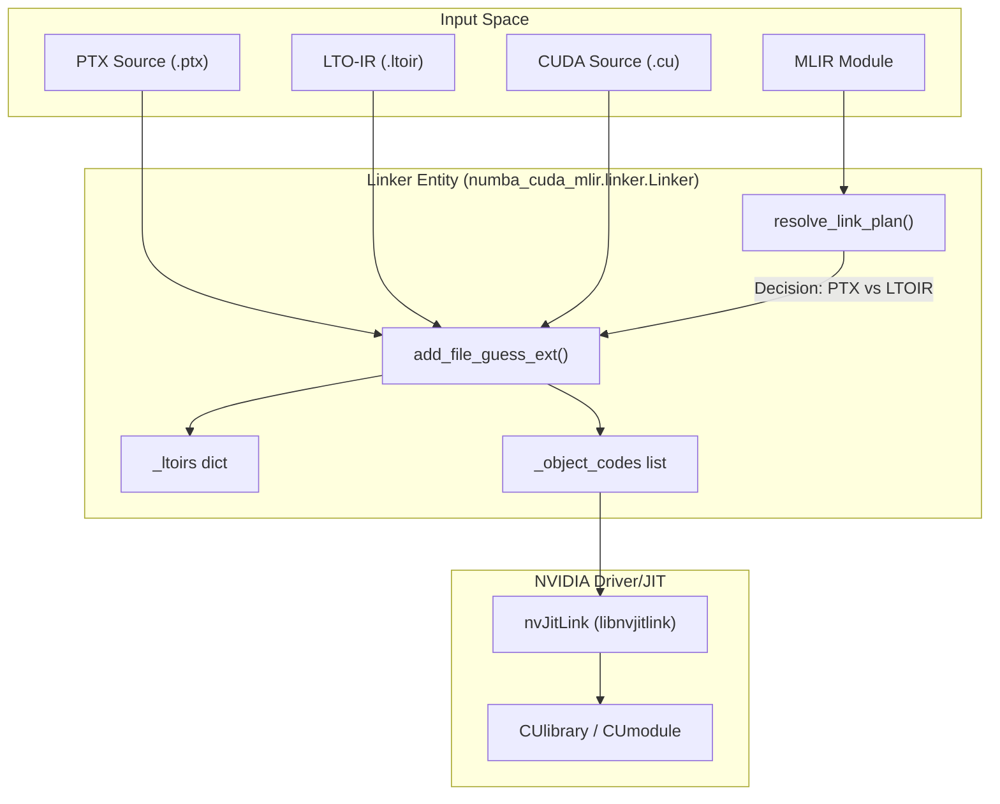
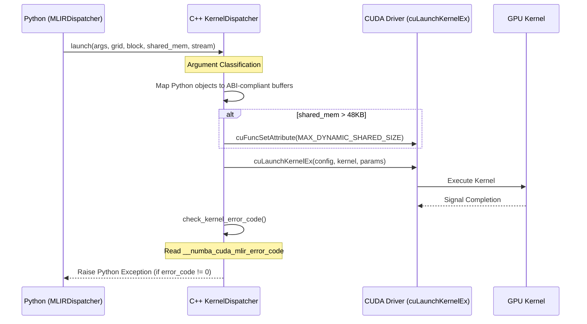

<!-- source: DeepWiki mcp.deepwiki.com · repo NVIDIA/numba-cuda-mlir · page 2.5 Linking and Kernel Launch · fetched 2026-10-26 -->

# Linking and Kernel Launch

Relevant source files

The following files were used as context for generating this wiki page:

- [cext/launcher/cuda_shim.h](cext/launcher/cuda_shim.h)
- [cext/launcher/kernel.cpp](cext/launcher/kernel.cpp)
- [src/numba_cuda_mlir/caching.py](src/numba_cuda_mlir/caching.py)
- [src/numba_cuda_mlir/decorators.py](src/numba_cuda_mlir/decorators.py)
- [src/numba_cuda_mlir/linker.py](src/numba_cuda_mlir/linker.py)
- [src/numba_cuda_mlir/mlir_compiler.py](src/numba_cuda_mlir/mlir_compiler.py)
- [src/numba_cuda_mlir/mlir_optimization.py](src/numba_cuda_mlir/mlir_optimization.py)
- [src/numba_cuda_mlir/numba_cuda/cudadrv/driver.py](src/numba_cuda_mlir/numba_cuda/cudadrv/driver.py)
- [src/numba_cuda_mlir/tools.py](src/numba_cuda_mlir/tools.py)
- [tests/numba_cuda_tests/cudadrv/test_linker.py](tests/numba_cuda_tests/cudadrv/test_linker.py)
- [tests/numba_cuda_tests/cudadrv/test_module_callbacks.py](tests/numba_cuda_tests/cudadrv/test_module_callbacks.py)
- [tests/test_large_smem.py](tests/test_large_smem.py)

This page describes the final stages of the compilation and execution pipeline: resolving the link plan, performing Just-In-Time (JIT) linking using `nvJitLink`, and launching kernels through the C++ `KernelDispatcher`.

## Linker Infrastructure

The linking process is managed by the `Linker` and `_Linker` classes, which provide a Pythonic interface to the `nvJitLink` library.

### The Linker and _Linker Classes
The `_Linker` class [src/numba_cuda_mlir/numba_cuda/cudadrv/driver.py:236-241]() is the base implementation for managing CUDA object codes (PTX, LTO-IR, and CUBIN). It abstracts the underlying `cuda.core.Linker` from the NVIDIA bindings. 

The subclass `Linker` [src/numba_cuda_mlir/linker.py:94-113]() extends this with MLIR-specific functionality, such as tracking temporary PTX files and managing LTO-IR buffers.

### LTO-Aware Linking
The pipeline supports Link Time Optimization (LTO) through the `LTOIR` object code type. The `resolve_link_plan` function [src/numba_cuda_mlir/linker.py:45-91]() determines whether to compile new inputs as LTO-IR based on:
1.  The `lto` target option.
2.  The presence of existing `.ltoir` or `.cu` source items in the link list [src/numba_cuda_mlir/linker.py:52-64]().
3.  Debug mode requirements (which often disable LTO for better line info) [src/numba_cuda_mlir/linker.py:78-79]().

### Linker Data Flow
The following diagram illustrates how different source types are aggregated into the `Linker` before being finalized into a `CUlibrary` or `CUmodule`.

**Title: Linker Input Aggregation and Finalization**

Sources: [src/numba_cuda_mlir/linker.py:45-138](), [src/numba_cuda_mlir/numba_cuda/cudadrv/driver.py:236-241]()

## C++ KernelDispatcher

The `KernelDispatcher` is a C++ extension responsible for the high-performance path of argument marshalling and kernel invocation.

### Argument Classification and Marshalling
Before launch, Python arguments must be converted to a layout compatible with the CUDA ABI. The dispatcher handles:
-   **Scalars**: Mapped to standard C types (int64, float64, etc.) [cext/launcher/kernel.cpp:230-243]().
-   **Arrays**: Supports `__cuda_array_interface__` and `__array_interface__`. It extracts the data pointer, shape, and strides to build a `MemRef` descriptor [cext/launcher/kernel.cpp:33-40]().
-   **DLPack**: Support for interoperability with frameworks like PyTorch and CuPy via `__dlpack__` [cext/launcher/kernel.cpp:39-44]().

### Shared Memory Opt-In
CUDA kernels have a default dynamic shared memory limit (typically 48KB). If a kernel requires more, the dispatcher must explicitly "opt-in" using `cuFuncSetAttribute` with the `CU_FUNC_ATTRIBUTE_MAX_DYNAMIC_SHARED_SIZE_BYTES` flag [cext/launcher/kernel.cpp:161-163](). 

The launcher accounts for both static shared memory (reported by the compiler) and the requested dynamic shared memory to ensure the total does not exceed the device's hardware limit [tests/test_large_smem.py:171-180]().

### Kernel Launch Paths
The dispatcher primarily uses `cuLaunchKernelEx` [cext/launcher/cuda_shim.h:143-144](), which allows passing `CUlaunchConfig` structures containing attributes like cooperative launch flags or cluster dimensions.

**Title: Kernel Launch Execution Path**

Sources: [cext/launcher/kernel.cpp:117-155](), [cext/launcher/kernel.cpp:168-228](), [cext/launcher/cuda_shim.h:108-120]()

## Module Callbacks and Runtime Integration

The linking process supports `setup_callback` and `teardown_callback` functions [src/numba_cuda_mlir/linker.py:9-12](). These are used to initialize device-side globals immediately after a module is loaded into a context.

### NRT MemSys Setup
A critical use case for callbacks is the Numba Runtime (NRT). The `_nrt_memsys_setup_callback` [src/numba_cuda_mlir/mlir_optimization.py:29-38]() ensures that the kernel's `TheMSys` device global is initialized with the pointer to the host-managed memory system. This allows the GPU to perform reference counting and dynamic allocation that is tracked by the host [src/numba_cuda_mlir/mlir_optimization.py:36-38]().

### Exception Propagation
Kernels compiled via the MLIR pipeline include a global variable named `__numba_cuda_mlir_error_code` [cext/launcher/kernel.cpp:58](). 
1.  **Lowering**: The `MLIRLower` engine inserts checks that write to this global when an exception (e.g., out-of-bounds access) occurs.
2.  **Post-Launch**: After `cuLaunchKernelEx` returns, the C++ dispatcher calls `check_kernel_error_code` [cext/launcher/kernel.cpp:168-170]().
3.  **Synchronization**: The dispatcher synchronizes the context, copies the error code back to the host, and raises the corresponding Python exception (e.g., `IndexError` or `AssertionError`) [cext/launcher/kernel.cpp:198-225]().

Sources: [src/numba_cuda_mlir/mlir_optimization.py:29-38](), [cext/launcher/kernel.cpp:157-166](), [tests/numba_cuda_tests/cudadrv/test_module_callbacks.py:38-66]()

---

