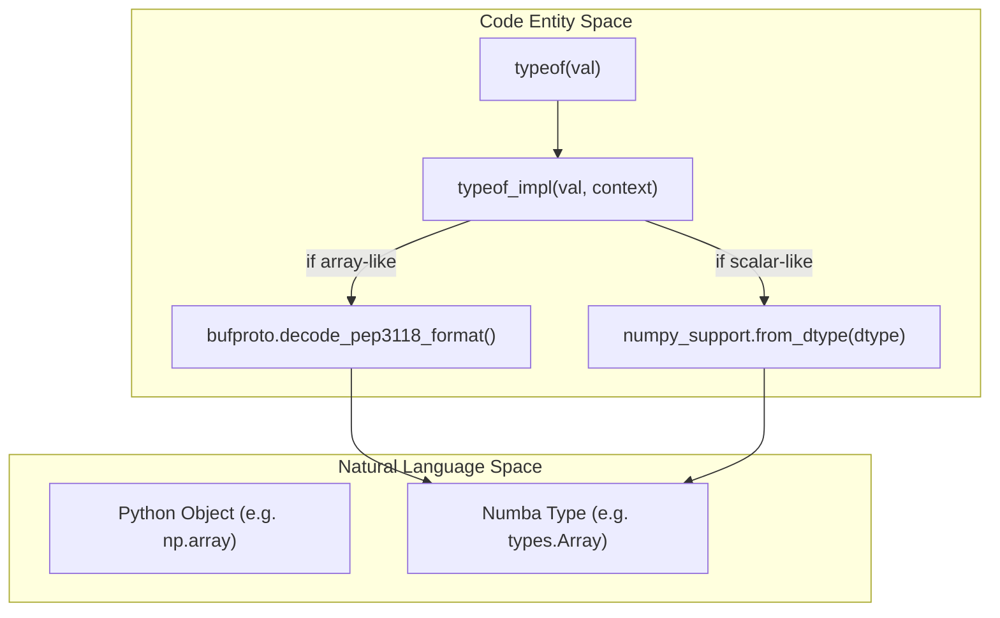
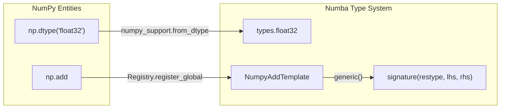

<!-- source: DeepWiki mcp.deepwiki.com · repo NVIDIA/numba-cuda-mlir · page 3.1 Core Types and NumPy Support · fetched 2026-10-26 -->

# Core Types and NumPy Support

Relevant source files

The following files were used as context for generating this wiki page:

- [src/numba_cuda_mlir/lowering_utilities/type_conversions.py](src/numba_cuda_mlir/lowering_utilities/type_conversions.py)
- [src/numba_cuda_mlir/models.py](src/numba_cuda_mlir/models.py)
- [src/numba_cuda_mlir/numba_cuda/np/numpy_support.py](src/numba_cuda_mlir/numba_cuda/np/numpy_support.py)
- [src/numba_cuda_mlir/numba_cuda/typeconv/rules.py](src/numba_cuda_mlir/numba_cuda/typeconv/rules.py)
- [src/numba_cuda_mlir/numba_cuda/types/__init__.py](src/numba_cuda_mlir/numba_cuda/types/__init__.py)
- [src/numba_cuda_mlir/numba_cuda/types/abstract.py](src/numba_cuda_mlir/numba_cuda/types/abstract.py)
- [src/numba_cuda_mlir/numba_cuda/typing/npydecl.py](src/numba_cuda_mlir/numba_cuda/typing/npydecl.py)
- [src/numba_cuda_mlir/numba_cuda/typing/typeof.py](src/numba_cuda_mlir/numba_cuda/typing/typeof.py)
- [src/numba_cuda_mlir/types.py](src/numba_cuda_mlir/types.py)
- [src/numba_cuda_mlir/typing/numpy.py](src/numba_cuda_mlir/typing/numpy.py)
- [tests/numba_cuda_tests/cudapy/test_array_methods.py](tests/numba_cuda_tests/cudapy/test_array_methods.py)
- [tests/test_array_methods.py](tests/test_array_methods.py)
- [tests/test_array_view.py](tests/test_array_view.py)
- [tests/test_custom_dtype.py](tests/test_custom_dtype.py)
- [tests/test_type_conversions.py](tests/test_type_conversions.py)

This page describes the core type system of `numba-cuda-mlir`, including the hierarchy of Numba types, how Python and NumPy values are mapped to these types, and the infrastructure for type interning and promotion.

## Type Hierarchy and Interning

The foundation of the type system is the `Type` class. All types used within the compiler are subclasses of this base. To ensure performance and consistency, types are interned using a metaclass.

### The Type Hierarchy
The hierarchy includes standard scalars, aggregate types, and pointers:
*   **Type**: Base class for all types [src/numba_cuda_mlir/numba_cuda/types/abstract.py:87-89]().
*   **Number**: Base for all numeric types, including `Integer`, `Float`, and `Complex` [src/numba_cuda_mlir/types.py:31-33]().
*   **Array**: Represents NumPy-like buffers with `dtype`, `ndim`, and `layout` [src/numba_cuda_mlir/types.py:83]().
*   **Record**: Represents NumPy structured dtypes (structs) [src/numba_cuda_mlir/types.py:89]().
*   **CPointer / RawPointer**: Low-level pointer types [src/numba_cuda_mlir/types.py:81-82]().

### Type Interning via `_TypeMetaclass`
Types are interned to ensure that only one instance of a specific type exists at runtime. This allows for fast identity checks and stable type codes.

*   **Mechanism**: The `_TypeMetaclass` hooks the `__call__` method of type classes. When a type is instantiated, it is checked against a global `_typecache` [src/numba_cuda_mlir/numba_cuda/types/abstract.py:38-74]().
*   **Weak References**: To prevent memory leaks, the cache uses `weakref.ref` [src/numba_cuda_mlir/numba_cuda/types/abstract.py:31-35]().
*   **Type Codes**: Each unique type instance is assigned a unique integer `_code` [src/numba_cuda_mlir/numba_cuda/types/abstract.py:63-65]().

Sources: [src/numba_cuda_mlir/numba_cuda/types/abstract.py:1-100](), [src/numba_cuda_mlir/types.py:1-93]()

## Type Mapping and Inference

The compiler must map Python objects, NumPy dtypes, and MLIR types into the Numba type system.

### Python to Numba Mapping (`typeof`)
The `typeof` function is the entry point for determining the Numba type of a Python value [src/numba_cuda_mlir/numba_cuda/typing/typeof.py:38-49](). It uses `singledispatch` on `typeof_impl`.

| Python Type | Numba Type | Logic / File |
| :--- | :--- | :--- |
| `bool` | `boolean` | `_typeof_bool` [src/numba_cuda_mlir/numba_cuda/typing/typeof.py:141-143]() |
| `int` | `intp` or `int64` | `_typeof_int` (bit-width dependent) [src/numba_cuda_mlir/numba_cuda/typing/typeof.py:156-169]() |
| `float` | `float64` | `_typeof_float` [src/numba_cuda_mlir/numba_cuda/typing/typeof.py:146-148]() |
| `complex` | `complex128` | `_typeof_complex` [src/numba_cuda_mlir/numba_cuda/typing/typeof.py:151-153]() |
| `np.ndarray` | `Array` | `_typeof_buffer` [src/numba_cuda_mlir/numba_cuda/typing/typeof.py:99-113]() |

### MLIR to Numba Mapping (`to_numba_type`)
During lowering or when processing MLIR-defined kernels, the compiler converts MLIR `ir.Type` objects back to Numba types using `to_numba_type` [src/numba_cuda_mlir/lowering_utilities/type_conversions.py:18-56]().

*   **Integers**: `ir.IntegerType` maps to `int8`, `int16`, etc., based on width [src/numba_cuda_mlir/lowering_utilities/type_conversions.py:68-81]().
*   **MemRefs**: `ir.MemRefType` maps to `Array` [src/numba_cuda_mlir/lowering_utilities/type_conversions.py:60-62]().
*   **LLVM Structs**: `llvm.struct` maps to `AggregateType` via name lookup [src/numba_cuda_mlir/lowering_utilities/type_conversions.py:141-147]().

### Data Flow: Python Value to Numba Type
The following diagram shows how a value passed to a JIT kernel is typed.

Sources: [src/numba_cuda_mlir/numba_cuda/typing/typeof.py:38-113](), [src/numba_cuda_mlir/lowering_utilities/type_conversions.py:54-150]()

## NumPy Support and ufunc Matching

The compiler provides deep integration with NumPy, mapping dtypes and resolving ufunc loops.

### DType Mapping
The `numpy_support` module maintains the `FROM_DTYPE` map for standard NumPy types [src/numba_cuda_mlir/numba_cuda/np/numpy_support.py:53-69]().
*   Special handling is provided for `bfloat16` via `ml_dtypes` [src/numba_cuda_mlir/numba_cuda/np/numpy_support.py:72-78]().
*   Structured dtypes are handled via `from_struct_dtype` [src/numba_cuda_mlir/numba_cuda/np/numpy_support.py:152-153]().

### ufunc Loop Matching
When a NumPy ufunc (e.g., `np.add`) is called, the compiler must find a loop signature that matches the input types.

1.  **Template Registration**: ufuncs are registered in the typing registry via `Numpy_rules_ufunc` [src/numba_cuda_mlir/numba_cuda/typing/npydecl.py:30-92]().
2.  **Input Handling**: `_handle_inputs` extracts dtypes and determines the dimensionality of the resulting array [src/numba_cuda_mlir/numba_cuda/typing/npydecl.py:32-87]().
3.  **Loop Selection**: `ufunc_find_matching_loop` (from `numpy_support`) is called to find the best-fitting implementation loop based on NumPy's casting rules [src/numba_cuda_mlir/numba_cuda/typing/npydecl.py:99-101]().

### NumPy to Numba Entity Mapping

Sources: [src/numba_cuda_mlir/numba_cuda/np/numpy_support.py:143-180](), [src/numba_cuda_mlir/typing/numpy.py:161-202](), [src/numba_cuda_mlir/numba_cuda/typing/npydecl.py:93-163]()

## Type Promotion and Unification

Type promotion determines the "common" type when two different types interact (e.g., `int32 + float64`).

### Casting Rules
The `TypeCastingRules` class manages the relationships between types [src/numba_cuda_mlir/numba_cuda/typeconv/rules.py:18-62](). Rules are categorized as:
*   **Promote**: Safe conversion where no precision is lost (e.g., `int16` -> `int32`) [src/numba_cuda_mlir/numba_cuda/typeconv/rules.py:23-30]().
*   **Safe**: Conversion that is generally acceptable but might not be a simple promotion (e.g., `float32` -> `complex64`) [src/numba_cuda_mlir/numba_cuda/typeconv/rules.py:53]().
*   **Unsafe**: Conversion that may lose information (e.g., `int64` -> `float64`) [src/numba_cuda_mlir/numba_cuda/typeconv/rules.py:46]().

### Unification
Unification is the process of finding a single type that can represent two different types. This is implemented via the `unify` method on `Type` subclasses [src/numba_cuda_mlir/numba_cuda/types/abstract.py:140-147](). For numeric types, this typically delegates to the `TypeManager` which uses the rules defined in `rules.py`.

Sources: [src/numba_cuda_mlir/numba_cuda/typeconv/rules.py:1-66](), [src/numba_cuda_mlir/numba_cuda/types/abstract.py:140-162]()

## Data Models and MLIR Representation

While Numba types represent the frontend view, `DataModel` objects define how these types are represented in MLIR/LLVM.

### Data Model Manager
The `mlir_data_manager` (a `ContextAwareDataModelManager`) maps Numba types to their backend representation [src/numba_cuda_mlir/models.py:69-71]().

*   **Context Sensitivity**: Because MLIR types are tied to a specific `ir.Context`, the `mlir_data_manager` invalidates its cache if the active context changes [src/numba_cuda_mlir/models.py:34-66]().
*   **Storage Mapping**: Some types have different value types and storage types. For example, floating-point types like `bf16` may be stored as integers in memory [src/numba_cuda_mlir/models.py:77-131]().

### Struct Models
The `StructModel` handles Numba `Record` and `Tuple` types by mapping them to `llvm.StructType` [src/numba_cuda_mlir/models.py:134-164](). It provides methods to extract and insert values into the struct using `llvm.extractvalue` and `llvm.insertvalue` [src/numba_cuda_mlir/models.py:172-186]().

Sources: [src/numba_cuda_mlir/models.py:1-210]()

---

