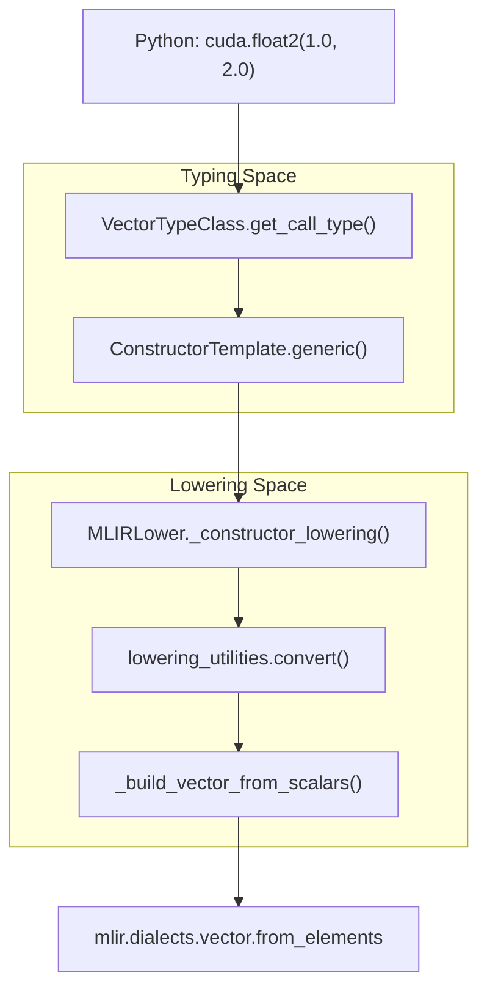
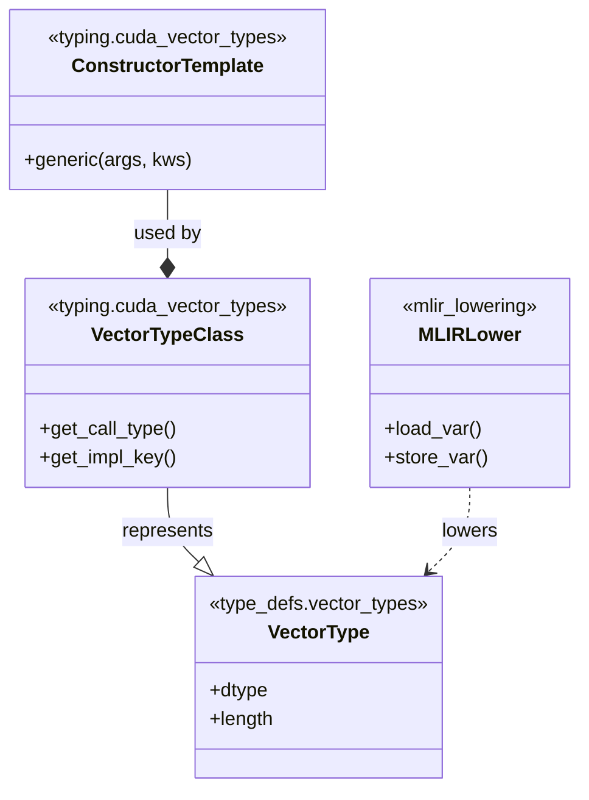

<!-- source: DeepWiki mcp.deepwiki.com · repo NVIDIA/numba-cuda-mlir · page 3.2 CUDA-Specific Types · fetched 2026-10-26 -->

# CUDA-Specific Types

Relevant source files

The following files were used as context for generating this wiki page:

- [.gitignore](.gitignore)
- [src/numba_cuda_mlir/cuda/__init__.py](src/numba_cuda_mlir/cuda/__init__.py)
- [src/numba_cuda_mlir/cuda/vector_types.py](src/numba_cuda_mlir/cuda/vector_types.py)
- [src/numba_cuda_mlir/lowering/cuda_vector_types.py](src/numba_cuda_mlir/lowering/cuda_vector_types.py)
- [src/numba_cuda_mlir/numba_cuda/np/numpy_support.py](src/numba_cuda_mlir/numba_cuda/np/numpy_support.py)
- [src/numba_cuda_mlir/numba_cuda/stubs.py](src/numba_cuda_mlir/numba_cuda/stubs.py)
- [src/numba_cuda_mlir/numba_cuda/typeconv/rules.py](src/numba_cuda_mlir/numba_cuda/typeconv/rules.py)
- [src/numba_cuda_mlir/numba_cuda/types/__init__.py](src/numba_cuda_mlir/numba_cuda/types/__init__.py)
- [src/numba_cuda_mlir/numba_cuda/types/abstract.py](src/numba_cuda_mlir/numba_cuda/types/abstract.py)
- [src/numba_cuda_mlir/numba_cuda/typing/npydecl.py](src/numba_cuda_mlir/numba_cuda/typing/npydecl.py)
- [src/numba_cuda_mlir/type_defs/vector_types.py](src/numba_cuda_mlir/type_defs/vector_types.py)
- [src/numba_cuda_mlir/types.py](src/numba_cuda_mlir/types.py)
- [src/numba_cuda_mlir/typing/cuda.py](src/numba_cuda_mlir/typing/cuda.py)
- [src/numba_cuda_mlir/typing/cuda_vector_types.py](src/numba_cuda_mlir/typing/cuda_vector_types.py)
- [tests/numba_cuda_tests/cudapy/test_array.py](tests/numba_cuda_tests/cudapy/test_array.py)
- [tests/numba_cuda_tests/cudapy/test_vector_type.py](tests/numba_cuda_tests/cudapy/test_vector_type.py)
- [tests/test_vector_type_complex_cast.py](tests/test_vector_type_complex_cast.py)
- [tests/test_vector_types.py](tests/test_vector_types.py)
- [tests/test_vector_types_ops.py](tests/test_vector_types_ops.py)

This page details the implementation and integration of CUDA-specific data types within the `numba-cuda-mlir` compiler. These types include hardware-accelerated vector types, reduced-precision floating-point formats, and specialized descriptors like `CUTensorMap`, along with type modifiers for memory alignment and visibility.

## CUDA Vector Types

CUDA vector types (e.g., `float2`, `int4`, `double2`) are represented as first-class objects that map directly to MLIR's `vector` dialect. They provide high-performance SIMD-like operations and vectorized memory access.

### Type Representation and Registration
Vector types are defined in `numba_cuda_mlir.type_defs.vector_types.VectorType` [src/numba_cuda_mlir/type_defs/vector_types.py]() and registered in the typing system via `VectorTypeClass` [src/numba_cuda_mlir/typing/cuda_vector_types.py:27-31]().

The compiler supports:
- **Component Access**: Attributes `.x`, `.y`, `.z`, and `.w` map to vector indices 0, 1, 2, and 3 [src/numba_cuda_mlir/typing/cuda_vector_types.py:56-56]().
- **Flexible Construction**: Constructors support scalar broadcasting, component-wise initialization, and "fancy" mixed-mode construction (e.g., `float4(float2, float, float)`) [src/numba_cuda_mlir/typing/cuda_vector_types.py:62-115]().

### Lowering and Vectorization
Vector operations are lowered using the `vector` and `arith` MLIR dialects.

| Operation | MLIR Implementation | File Reference |
| :--- | :--- | :--- |
| **Construction** | `vector.from_elements` | [src/numba_cuda_mlir/lowering/cuda_vector_types.py:36-51]() |
| **Attribute Access** | `vector.extract` | [src/numba_cuda_mlir/lowering/cuda_vector_types.py:102-112]() |
| **Binary Ops** | `vector.broadcast` + `arith` ops | [src/numba_cuda_mlir/lowering/cuda_vector_types.py:121-156]() |
| **Memory Load** | `vector.transfer_read` | [tests/test_vector_types.py:22-22]() |
| **Memory Store** | `vector.transfer_write` | [tests/test_vector_types.py:23-23]() |

Sources: [src/numba_cuda_mlir/typing/cuda_vector_types.py:1-123](), [src/numba_cuda_mlir/lowering/cuda_vector_types.py:1-176](), [tests/test_vector_types.py:9-24]().

## Reduced-Precision Floats

The compiler supports a wide array of reduced-precision and specialized floating-point types used in deep learning and HPC, mapping them to the `numba_cuda_mlir.type_defs.float_types` hierarchy.

### Supported Formats
- **BFloat16**: `bf16` [src/numba_cuda_mlir/types.py:152-152]().
- **TensorFloat-32**: `tf32` [src/numba_cuda_mlir/types.py:166-166]().
- **FP8 Variants**: Multiple E4M3 and E5M2 variants (including NUZ and B11 versions) [src/numba_cuda_mlir/types.py:158-165]().
- **Experimental**: `nvfp4` [src/numba_cuda_mlir/types.py:153-153]().

### Complex Interoperability
Specialized logic exists to cast between 2-element vector types and complex numbers. For example, `float2` can be cast to `complex64`, and `double2` to `complex128` [tests/test_vector_type_complex_cast.py:16-35](). This is handled during typing by checking if the vector length is 2 [src/numba_cuda_mlir/typing/cuda_vector_types.py:87-88]().

Sources: [src/numba_cuda_mlir/types.py:98-113](), [src/numba_cuda_mlir/types.py:152-166](), [tests/test_vector_type_complex_cast.py:1-106]().

## Specialized Types and Modifiers

### CUTensorMap
`CUTensorMap` is a specialized type for NVIDIA's Tensor Memory Accelerator (TMA). It is implemented as a `byval` pointer to a `CUTensorMapStorage` type, with a mandatory 128-byte alignment [src/numba_cuda_mlir/types.py:172-176]().

### Type Modifiers
Modifiers allow users to attach metadata to types that influence the final NVVM/PTX generation:
- **`grid_constant`**: Marks a kernel parameter with the `nvvm.grid_constant` attribute, indicating the value is constant across the entire grid [src/numba_cuda_mlir/types.py:125-130]().
- **`alignas`**: Sets the `llvm.align` attribute on a type to enforce specific memory alignment [src/numba_cuda_mlir/types.py:132-136]().

Sources: [src/numba_cuda_mlir/types.py:116-136](), [src/numba_cuda_mlir/types.py:172-176]().

## Data Flow: Python to MLIR Vector

The following diagram illustrates how a Python call to a vector constructor is transformed into MLIR operations.

### Vector Construction Data Flow

Sources: [src/numba_cuda_mlir/typing/cuda_vector_types.py:43-44](), [src/numba_cuda_mlir/lowering/cuda_vector_types.py:64-92]().

## System Entity Map

This diagram maps the high-level CUDA type concepts to the specific classes and files that implement them.

### Type System Entity Mapping

Sources: [src/numba_cuda_mlir/type_defs/vector_types.py](), [src/numba_cuda_mlir/typing/cuda_vector_types.py:27-31](), [src/numba_cuda_mlir/lowering/cuda_vector_types.py:64-64]().

## Summary of Lowering Registrations

The `lowering.cuda_vector_types` module registers handlers for vector operations in the `LoweringRegistry`.

| Entity | Lowering Function | Implementation Detail |
| :--- | :--- | :--- |
| `VectorType` Constructor | `_constructor_lowering` | Extracts scalars from inputs and packs via `vector.from_elements`. |
| `VectorType` Attributes | `_make_attr_lowering` | Uses `vector.extract` with static indices from `ATTR_INDEX`. |
| Binary Operators | `_make_vector_binop_lowering` | Broadcasts scalars to vectors before applying `arith` ops. |
| Unary Operators | `_make_vector_unary_lowering` | Handles negation and absolute value via `arith` and `math` dialects. |

Sources: [src/numba_cuda_mlir/lowering/cuda_vector_types.py:64-156](), [src/numba_cuda_mlir/lowering/cuda_vector_types.py:178-200]().

---

