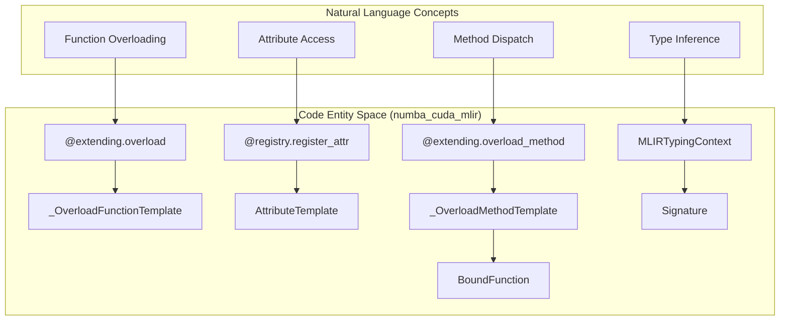
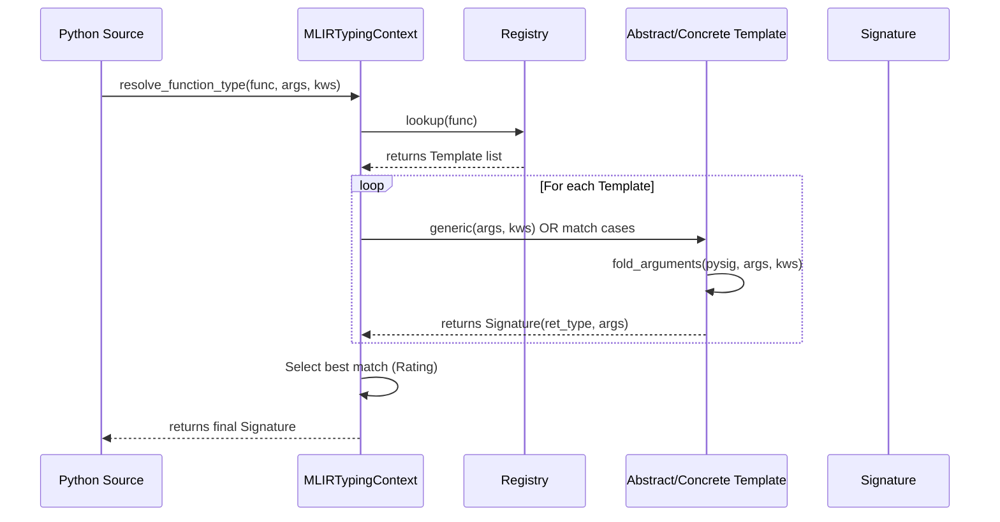

<!-- source: DeepWiki mcp.deepwiki.com · repo NVIDIA/numba-cuda-mlir · page 3.3 Typing Infrastructure · fetched 2026-10-26 -->

# Typing Infrastructure

Relevant source files

The following files were used as context for generating this wiki page:

- [src/numba_cuda_mlir/compiler.py](src/numba_cuda_mlir/compiler.py)
- [src/numba_cuda_mlir/extending/__init__.py](src/numba_cuda_mlir/extending/__init__.py)
- [src/numba_cuda_mlir/lowering/cmath.py](src/numba_cuda_mlir/lowering/cmath.py)
- [src/numba_cuda_mlir/numba_cuda/typing/builtins.py](src/numba_cuda_mlir/numba_cuda/typing/builtins.py)
- [src/numba_cuda_mlir/numba_cuda/typing/collections.py](src/numba_cuda_mlir/numba_cuda/typing/collections.py)
- [src/numba_cuda_mlir/numba_cuda/typing/context.py](src/numba_cuda_mlir/numba_cuda/typing/context.py)
- [src/numba_cuda_mlir/numba_cuda/typing/templates.py](src/numba_cuda_mlir/numba_cuda/typing/templates.py)
- [tests/numba_cuda_tests/cudapy/test_extending.py](tests/numba_cuda_tests/cudapy/test_extending.py)
- [tests/test_complex.py](tests/test_complex.py)
- [tests/test_numba_cuda_mlir_extending.py](tests/test_numba_cuda_mlir_extending.py)

The typing infrastructure in `numba-cuda-mlir` provides the mechanism for resolving the types of Python expressions, function calls, and attribute accesses within the MLIR-based compilation pipeline. It builds upon the Numba typing concepts—registries, templates, and signatures—while integrating with the `MLIRTypingContext` to support CUDA-specific types and MLIR lowering requirements.

## Core Components

The infrastructure is centered around a registry-based system where Python entities (functions, operators, types) are associated with "Templates" that define how to infer the return type based on input argument types.

### Registry and Templates

The `Registry` class manages the collection of typing declarations. Templates are categorized into three main hierarchies:

*   **`AbstractTemplate`**: Used when the return type must be computed dynamically based on input types (via the `generic` method). [src/numba_cuda_mlir/numba_cuda/typing/templates.py:246-261]()
*   **`ConcreteTemplate`**: Used for functions with a fixed set of supported type signatures (the `cases` attribute). [src/numba_cuda_mlir/numba_cuda/typing/templates.py:231-243]()
*   **`AttributeTemplate`**: Used to resolve type information for attribute access (e.g., `obj.attr`) or method calls. [src/numba_cuda_mlir/numba_cuda/typing/templates.py:644-660]()

### Type Resolution Flow

When the compiler encounters a function call, it uses the `MLIRTypingContext` to find a matching template.

| Step | Action | Description |
| :--- | :--- | :--- |
| 1 | **Lookup** | The context looks up the function key (the Python function object or a string) in the `Registry`. [src/numba_cuda_mlir/numba_cuda/typing/context.py:203-207]() |
| 2 | **Binding** | Arguments are bound to the function's Python signature to handle defaults and keyword arguments. [src/numba_cuda_mlir/numba_cuda/typing/templates.py:196-231]() |
| 3 | **Resolution** | The template's `generic` method or `cases` list is evaluated to find a matching `Signature`. [src/numba_cuda_mlir/numba_cuda/typing/context.py:228-245]() |
| 4 | **Refinement** | If multiple overloads match, the system selects the most specific one using Numba's rating system (preferring promotion over safe conversion). [src/numba_cuda_mlir/numba_cuda/typing/context.py:21-43]() |

**Sources:** `[src/numba_cuda_mlir/numba_cuda/typing/templates.py:1-300]()`, `[src/numba_cuda_mlir/numba_cuda/typing/context.py:134-250]()`

## MLIRTypingContext

The `MLIRTypingContext` is a specialized version of the Numba typing context. It holds the global state of known types and function signatures available to the MLIR pipeline.

### Key Responsibilities
*   **Global Registration**: Maps Python globals to Numba types (e.g., mapping `abs` to a `Function` type containing the `Abs` template). [src/numba_cuda_mlir/numba_cuda/typing/builtins.py:58-64]()
*   **Attribute Resolution**: Uses `AttributeTemplate` to determine the type of fields in structured types like `Complex` or `Array`. [src/numba_cuda_mlir/lowering/cmath.py:103-130]()
*   **Re-entrance Guarding**: Maintains a `CallStack` to prevent infinite recursion during type inference of recursive functions. [src/numba_cuda_mlir/numba_cuda/typing/context.py:45-76]()

**Sources:** `[src/numba_cuda_mlir/numba_cuda/typing/context.py:134-200]()`, `[src/numba_cuda_mlir/descriptor.py:1-50]()`

## Overload Resolution and BoundFunctions

The `@overload` and `@overload_method` decorators allow users and the core library to extend the typing system.

### BoundFunction Dispatch
When a method is accessed (e.g., `ndarray.sum()`), the system creates a `BoundFunction`. This wraps the underlying function template but treats the instance (`self`) as the first argument.

*   **`_OverloadMethodTemplate`**: Specifically handles methods by providing a `generic` implementation that resolves the implementation function based on the type of the instance. [src/numba_cuda_mlir/extending/__init__.py:113-132]()
*   **Resolution**: The `BoundFunction` type contains logic to resolve the call signature by including the `recvr` (receiver) type. [src/numba_cuda_mlir/numba_cuda/typing/templates.py:480-510]()

### System Mapping: Natural Language to Code Entities

The following diagram maps high-level typing concepts to their implementation classes and registry hooks.

**Typing Infrastructure Mapping**

**Sources:** `[src/numba_cuda_mlir/extending/__init__.py:133-187]()`, `[src/numba_cuda_mlir/numba_cuda/typing/templates.py:32-168]()`

## Data Flow: From Python to Signature

The following diagram illustrates how the `MLIRTypingContext` processes a function call to produce a concrete `Signature`.

**Type Resolution Data Flow**

**Sources:** `[src/numba_cuda_mlir/numba_cuda/typing/context.py:203-240]()`, `[src/numba_cuda_mlir/numba_cuda/typing/templates.py:196-230]()`

## Built-in Typing Registrations

The system includes pre-registered templates for Python built-ins and operators in `numba_cuda_mlir.numba_cuda.typing.builtins`.

| Category | Implementation Class | Supported Types |
| :--- | :--- | :--- |
| **Arithmetic** | `BinOpAdd`, `BinOpSub`, etc. | Integers, Reals, Complex [src/numba_cuda_mlir/numba_cuda/typing/builtins.py:210-225]() |
| **Math** | `Abs`, `Round` | Numeric types [src/numba_cuda_mlir/numba_cuda/typing/builtins.py:58-64]() |
| **Control** | `Range`, `Slice` | `int32`, `int64`, `uint64` [src/numba_cuda_mlir/numba_cuda/typing/builtins.py:87-104]() |
| **Iteration** | `GetIter`, `IterNext` | `IterableType`, `IteratorType` [src/numba_cuda_mlir/numba_cuda/typing/builtins.py:107-127]() |

**Sources:** `[src/numba_cuda_mlir/numba_cuda/typing/builtins.py:1-230]()`

## Extension Mechanism

The `numba_cuda_mlir.extending` module provides the public API for adding new types and functions to the typing infrastructure.

*   **`type_callable(func)`**: Registers a typer function for a specific callable. [src/numba_cuda_mlir/extending/__init__.py:81-110]()
*   **`typeof_impl.register(cls)`**: Defines how a Python class is mapped to a Numba `Type` object. [src/numba_cuda_mlir/numba_cuda/typing/typeof.py:25-35]()
*   **`refresh_registries()`**: Synchronizes the `MLIRTypingContext` with any newly registered templates. This is critical when adding extensions dynamically. [src/numba_cuda_mlir/extending/__init__.py:67-79]()

**Sources:** `[src/numba_cuda_mlir/extending/__init__.py:1-110]()`, `[tests/test_numba_cuda_mlir_extending.py:13-35]()`

---

