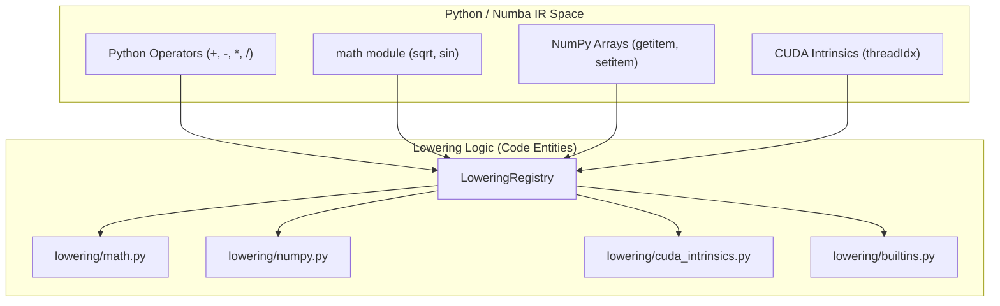
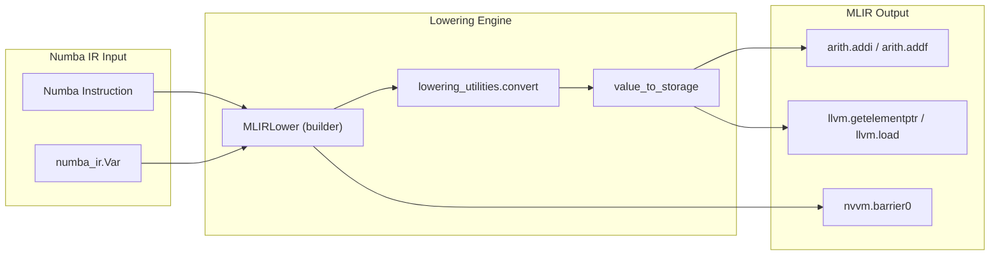

<!-- source: DeepWiki mcp.deepwiki.com · repo NVIDIA/numba-cuda-mlir · page 4 Lowering Subsystems · fetched 2026-10-26 -->

# Lowering Subsystems

Relevant source files

The following files were used as context for generating this wiki page:

- [src/numba_cuda_mlir/lowering/__init__.py](src/numba_cuda_mlir/lowering/__init__.py)
- [src/numba_cuda_mlir/lowering/builtins.py](src/numba_cuda_mlir/lowering/builtins.py)
- [src/numba_cuda_mlir/lowering/ctypes.py](src/numba_cuda_mlir/lowering/ctypes.py)
- [src/numba_cuda_mlir/lowering/math.py](src/numba_cuda_mlir/lowering/math.py)
- [src/numba_cuda_mlir/lowering/record.py](src/numba_cuda_mlir/lowering/record.py)
- [src/numba_cuda_mlir/lowering/vector.py](src/numba_cuda_mlir/lowering/vector.py)
- [src/numba_cuda_mlir/lowering_utilities/__init__.py](src/numba_cuda_mlir/lowering_utilities/__init__.py)
- [tests/numba_cuda_tests/cudapy/test_compiler.py](tests/numba_cuda_tests/cudapy/test_compiler.py)
- [tests/numba_cuda_tests/cudapy/test_cooperative_groups.py](tests/numba_cuda_tests/cudapy/test_cooperative_groups.py)
- [tests/numba_cuda_tests/cudapy/test_operator.py](tests/numba_cuda_tests/cudapy/test_operator.py)
- [tests/test_builtin_broadcasted_binops.py](tests/test_builtin_broadcasted_binops.py)
- [tests/test_lowering_utilities.py](tests/test_lowering_utilities.py)
- [tests/test_ptr_ops.py](tests/test_ptr_ops.py)
- [tests/test_record_dtype.py](tests/test_record_dtype.py)

The Lowering Subsystems comprise a modular collection of registries and utility functions responsible for translating Numba IR and Python-level constructs into MLIR operations. This stage bridges the gap between the high-level type system and the hardware-specific dialects (such as `nvvm` and `gpu`) or mid-level dialects (such as `arith`, `math`, and `linalg`).

The primary entry point for these subsystems is the `LoweringRegistry`, which allows specialized modules to register handlers for specific Python operators, builtins, and types.

## Lowering Registry and Infrastructure

The lowering process is driven by the `LoweringRegistry` [src/numba_cuda_mlir/lowering_registry.py](), which maintains mappings between Numba types/functions and their corresponding MLIR emission logic. Specialized modules for Math, NumPy, and CUDA intrinsics populate this registry during compiler initialization.

### Lowering Mapping Overview
The following diagram illustrates how Python-space entities are mapped to specific lowering implementations within the codebase.

**Entity Mapping Diagram**

Sources: [src/numba_cuda_mlir/lowering/math.py:16-17](), [src/numba_cuda_mlir/lowering/builtins.py:35-39](), [src/numba_cuda_mlir/lowering/record.py:33-34]().

## Subsystem Modules

The lowering infrastructure is partitioned into several specialized domains:

### 4.1 Lowering Utilities and Type Conversions
The `lowering_utilities` package provides the fundamental building blocks for MLIR emission. It includes `convert()` for type casting, address space management for CUDA memory tiers (Global, Shared, Local), and `memref_to_llvm_ptr` for raw memory access.
*   **Key Entities:** `convert()`, `memref_llvm_address_space`, `GEP_DYNAMIC_INDEX`.
*   **Details:** For details, see [Lowering Utilities and Type Conversions](#4.1).
*   **Sources:** [src/numba_cuda_mlir/lowering_utilities/__init__.py:40-124]().

### 4.2 Math, Operators, and Builtins Lowering
This module handles standard Python operators (e.g., `+`, `-`, `//`) and `math` module functions. It dispatches to `arith`, `math`, or `complex` MLIR dialects based on operand types. For operations not natively supported by MLIR dialects, it generates fallback calls to the CUDA `libdevice` library.
*   **Key Entities:** `OpForType`, `_call_libdevice_unary`, `_operator_mapping`.
*   **Details:** For details, see [Math, Operators, and Builtins Lowering](#4.2).
*   **Sources:** [src/numba_cuda_mlir/lowering/math.py:38-144](), [src/numba_cuda_mlir/lowering/builtins.py:133-166]().

### 4.3 NumPy Array Lowering
Handles the lifecycle and manipulation of NumPy arrays on the device. This includes array creation (`np.empty`, `np.zeros`), indexing (getitem/setitem), and high-level operations like broadcasting and reductions via the `linalg` dialect.
*   **Key Entities:** `linalg.GenericOp`, `linalg.ReduceOp`, `memref_to_tensor`.
*   **Details:** For details, see [NumPy Array Lowering](#4.3).
*   **Sources:** [src/numba_cuda_mlir/lowering_utilities/__init__.py:146-188](), [src/numba_cuda_mlir/lowering/builtins.py:169-195]().

### 4.4 Record, CPointer, and Vector Lowering
Manages complex data layouts including structured dtypes (`Record`), raw pointers (`CPointer`), and fixed-size nested arrays. Structured fields are accessed by calculating byte offsets and using `llvm.getelementptr`. It also handles CUDA vector types (e.g., `float4`).
*   **Key Entities:** `get_record_field_ptr`, `lower_pointer_getitem`, `NestedArray`.
*   **Details:** For details, see [Record, CPointer, and Vector Lowering](#4.4).
*   **Sources:** [src/numba_cuda_mlir/lowering/record.py:46-76](), [src/numba_cuda_mlir/lowering/ctypes.py:122-148]().

### 4.5 CUDA Intrinsics and libdevice Lowering
Provides access to hardware-specific features such as thread/block indices, synchronization primitives (cooperative groups), and atomic operations. It also maps specialized math intrinsics (like half-precision operations) to `nvvm` or `libdevice` calls.
*   **Key Entities:** `cuda.cg.this_grid()`, `nvvm` dialect, `gpu` dialect.
*   **Details:** For details, see [CUDA Intrinsics and libdevice Lowering](#4.5).
*   **Sources:** [src/numba_cuda_mlir/lowering/builtins.py:29-33](), [tests/numba_cuda_tests/cudapy/test_cooperative_groups.py:21-32]().

## Lowering Data Flow

The following diagram shows the data flow from a Python operation through the `MLIRLower` builder to the final MLIR Dialect operations.

**Lowering Data Flow Diagram**

Sources: [src/numba_cuda_mlir/lowering/record.py:80-125](), [src/numba_cuda_mlir/lowering/ctypes.py:96-120](), [src/numba_cuda_mlir/lowering/math.py:145-180]().

---

