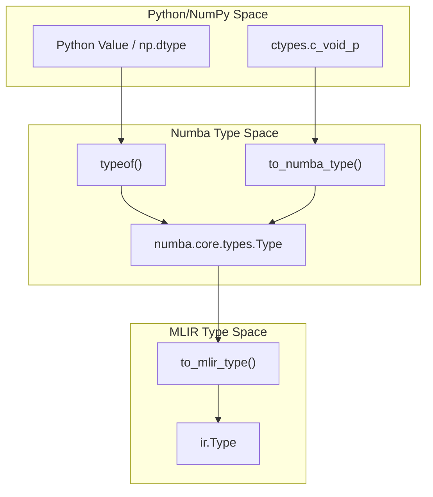
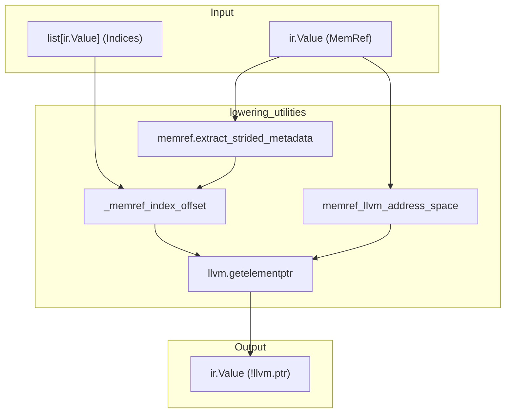

<!-- source: DeepWiki mcp.deepwiki.com · repo NVIDIA/numba-cuda-mlir · page 4.1 Lowering Utilities and Type Conversions · fetched 2026-10-26 -->

# Lowering Utilities and Type Conversions

Relevant source files

The following files were used as context for generating this wiki page:

- [cext/mlir-llvm70/lib/CAPI.cpp](cext/mlir-llvm70/lib/CAPI.cpp)
- [cext/mlir-modern/ModernBridge.cpp](cext/mlir-modern/ModernBridge.cpp)
- [cext/mlir-modern/ModernBridgeSmoke.cpp](cext/mlir-modern/ModernBridgeSmoke.cpp)
- [cext/mlir-modern/include/ModernBridge.h](cext/mlir-modern/include/ModernBridge.h)
- [ci/windows-llvm-container-build.ps1](ci/windows-llvm-container-build.ps1)
- [src/numba_cuda_mlir/lowering/ctypes.py](src/numba_cuda_mlir/lowering/ctypes.py)
- [src/numba_cuda_mlir/lowering/record.py](src/numba_cuda_mlir/lowering/record.py)
- [src/numba_cuda_mlir/lowering/vector.py](src/numba_cuda_mlir/lowering/vector.py)
- [src/numba_cuda_mlir/lowering_utilities/__init__.py](src/numba_cuda_mlir/lowering_utilities/__init__.py)
- [src/numba_cuda_mlir/lowering_utilities/llvm_utils.py](src/numba_cuda_mlir/lowering_utilities/llvm_utils.py)
- [src/numba_cuda_mlir/lowering_utilities/type_conversions.py](src/numba_cuda_mlir/lowering_utilities/type_conversions.py)
- [src/numba_cuda_mlir/numba_cuda/typing/typeof.py](src/numba_cuda_mlir/numba_cuda/typing/typeof.py)
- [tests/test_builtin_broadcasted_binops.py](tests/test_builtin_broadcasted_binops.py)
- [tests/test_ptr_ops.py](tests/test_ptr_ops.py)
- [tests/test_record_dtype.py](tests/test_record_dtype.py)
- [tests/test_type_conversions.py](tests/test_type_conversions.py)

The `lowering_utilities` package provides the foundational infrastructure for translating Numba IR and Python types into MLIR and LLVM representations. It handles address space mapping, memory reference (memref) to pointer conversions, and the bidirectional mapping between Numba types and MLIR/LLVM types.

## Type Conversion System

The system relies on a single-dispatch mechanism to convert between various type representations, primarily centered around the `to_numba_type` and `to_mlir_type` functions.

### Numba and MLIR Type Mapping
The `to_numba_type` function, defined in `src/numba_cuda_mlir/lowering_utilities/type_conversions.py`, converts MLIR values, attributes, and types back into Numba's type system.

| MLIR Type | Numba Type | Source |
| :--- | :--- | :--- |
| `ir.IntegerType(width=1)` | `types.bool` | [src/numba_cuda_mlir/lowering_utilities/type_conversions.py:70-71]() |
| `ir.IntegerType(width=64)` | `types.int64` | [src/numba_cuda_mlir/lowering_utilities/type_conversions.py:78-79]() |
| `ir.FloatType(width=32)` | `types.float32` | [src/numba_cuda_mlir/lowering_utilities/type_conversions.py:116-117]() |
| `ir.MemRefType` | `types.Array` | [src/numba_cuda_mlir/lowering_utilities/type_conversions.py:60-62]() |
| `!llvm.ptr` | `types.CPointer(types.void)` | [src/numba_cuda_mlir/lowering_utilities/type_conversions.py:58-59]() |

### NumPy and CTypes Integration
Utilities also bridge external type systems into the compiler:
*   **NumPy:** `np_dtype_to_numba_dtype` maps NumPy dtypes to Numba types [src/numba_cuda_mlir/lowering_utilities/type_conversions.py:157]().
*   **CTypes:** `ctypes_type_to_numba_type` maps `ctypes.c_int32`, `ctypes.c_float`, etc., to their Numba equivalents [src/numba_cuda_mlir/lowering_utilities/type_conversions.py:161-188]().

### Conversion Logic Flow
The following diagram illustrates how a Python/NumPy entity is resolved into a Numba type and eventually an MLIR type during lowering.

**Diagram: Type Entity Resolution**

*Sources: [src/numba_cuda_mlir/numba_cuda/typing/typeof.py:38-48](), [src/numba_cuda_mlir/lowering_utilities/type_conversions.py:17-25]()*

## Memory and Pointer Utilities

The compiler frequently needs to convert high-level MLIR `memref` types (representing arrays) into low-level LLVM pointers for raw memory access or interoperability with `ctypes`.

### Address Space Mapping
CUDA kernels utilize specific address spaces for different memory tiers. `memref_llvm_address_space` maps MLIR memory space attributes to NVVM integers:
*   **Global Memory:** 1 [src/numba_cuda_mlir/lowering_utilities/__init__.py:51]()
*   **Shared/Workgroup Memory:** 3 [src/numba_cuda_mlir/lowering_utilities/__init__.py:56]()
*   **Local/Private Memory:** 5 [src/numba_cuda_mlir/lowering_utilities/__init__.py:58]()

### Memref to LLVM Pointer Conversion
The `memref_to_llvm_ptr` function performs the heavy lifting of converting a potentially strided MLIR memref into a raw LLVM pointer (`!llvm.ptr`).

1.  **Metadata Extraction:** It uses `memref.extract_strided_metadata` to obtain the base pointer and strides [src/numba_cuda_mlir/lowering_utilities/__init__.py:67]().
2.  **Offset Calculation:** `_memref_index_offset` computes the linear element offset based on indices and strides [src/numba_cuda_mlir/lowering_utilities/__init__.py:77-93]().
3.  **GEP Generation:** It emits an `llvm.getelementptr` (GEP) using the constant `GEP_DYNAMIC_INDEX` (-2147483648) to mark dynamic indexing [src/numba_cuda_mlir/lowering_utilities/__init__.py:40, 117-124]().

### Storage Conversions
Certain types require different representations when stored in memory versus when used in registers.
*   **Complex Types:** MLIR `complex` types are lowered to LLVM structures containing two floats [src/numba_cuda_mlir/lowering_utilities/__init__.py:128-130]().
*   **Functions:** `value_to_storage` and `storage_to_value` (via `builder.as_storage` and `builder.from_storage`) ensure types like `bool` (i1) are correctly handled in memory (typically i8) [src/numba_cuda_mlir/lowering/record.py:122, 192]().

## Record and CPointer Lowering

Lowering for structured data (NumPy Records) and raw pointers (`CPointer`) relies on the utilities described above.

### Record Field Access
For NumPy structured dtypes, `get_record_field_ptr` calculates the byte offset of a field using the Numba `Record` type's `offset(field_name)` method [src/numba_cuda_mlir/lowering/record.py:59](). It then emits an `llvm.getelementptr` on an `i8` pointer to reach the field [src/numba_cuda_mlir/lowering/record.py:67-74]().

### Pointer Arithmetic
`CPointer` operations are lowered to LLVM integer arithmetic. `lower_pointer_add` and `lower_pointer_sub` convert the pointer to an `i64`, calculate the byte offset using `storage_itemsize_bytes(ele_ty)`, and cast back to a pointer [src/numba_cuda_mlir/lowering/ctypes.py:150-186]().

**Diagram: Memref to Pointer Lowering Flow**

*Sources: [src/numba_cuda_mlir/lowering_utilities/__init__.py:96-124]()*

## Key Constants and Helpers

*   **`GEP_DYNAMIC_INDEX`**: Set to `-2147483648` (INT32_MIN). Used in `llvm.getelementptr` to indicate that an index is provided as a value rather than a static attribute [src/numba_cuda_mlir/lowering_utilities/__init__.py:40]().
*   **`convert(value, to_type)`**: A robust utility that handles various MLIR type conversions (e.g., `arith.extsi`, `arith.trunc`, `llvm.ptrtoint`) to reach the target type [src/numba_cuda_mlir/lowering_utilities/__init__.py:223]().
*   **`RangeObject`**: A dataclass used during lowering to represent Python range metadata (start, stop, step) in a format suitable for `scf.for` loop generation [src/numba_cuda_mlir/lowering_utilities/__init__.py:530]().

*Sources: [src/numba_cuda_mlir/lowering_utilities/__init__.py](), [src/numba_cuda_mlir/lowering_utilities/type_conversions.py](), [src/numba_cuda_mlir/lowering/record.py](), [src/numba_cuda_mlir/lowering/ctypes.py]()*

---

