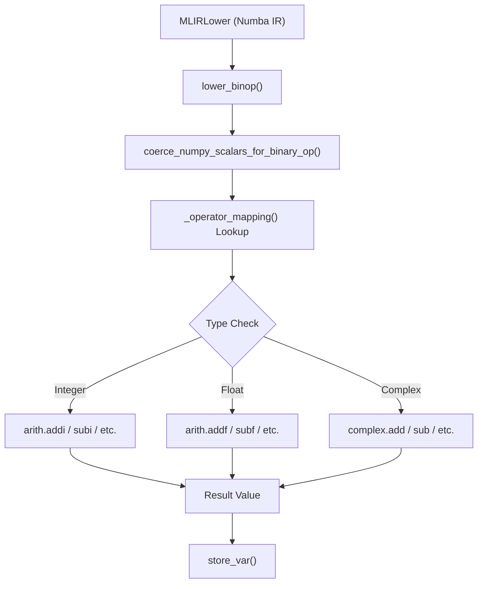

<!-- source: DeepWiki mcp.deepwiki.com · repo NVIDIA/numba-cuda-mlir · page 4.2 Math, Operators, and Builtins Lowering · fetched 2026-10-26 -->

# Math, Operators, and Builtins Lowering

<details>
<summary>Relevant source files</summary>

The following files were used as context for generating this wiki page:

- [src/numba_cuda_mlir/lowering/__init__.py](src/numba_cuda_mlir/lowering/__init__.py)
- [src/numba_cuda_mlir/lowering/builtins.py](src/numba_cuda_mlir/lowering/builtins.py)
- [src/numba_cuda_mlir/lowering/cmath.py](src/numba_cuda_mlir/lowering/cmath.py)
- [src/numba_cuda_mlir/lowering/math.py](src/numba_cuda_mlir/lowering/math.py)
- [src/numba_cuda_mlir/numba_cuda/typing/builtins.py](src/numba_cuda_mlir/numba_cuda/typing/builtins.py)
- [tests/numba_cuda_tests/cudapy/test_compiler.py](tests/numba_cuda_tests/cudapy/test_compiler.py)
- [tests/numba_cuda_tests/cudapy/test_cooperative_groups.py](tests/numba_cuda_tests/cudapy/test_cooperative_groups.py)
- [tests/numba_cuda_tests/cudapy/test_operator.py](tests/numba_cuda_tests/cudapy/test_operator.py)
- [tests/test_complex.py](tests/test_complex.py)
- [tests/test_lowering_utilities.py](tests/test_lowering_utilities.py)

</details>


This section describes the lowering process for standard Python operators, the `math` and `cmath` modules, and core built-in functions. The system translates high-level Python semantics into MLIR operations, primarily targeting the `arith`, `math`, and `complex` dialects, while falling back to `libdevice` calls for specialized GPU math functions.

## Operator Lowering

Python operators are lowered using a dispatch mechanism defined in `numba_cuda_mlir/lowering/math.py`. The `OpForType` dataclass defines how an operator should be handled based on whether the operand is a float, signed integer, unsigned integer, or complex number.

### Dispatch and Type Handling
The `_operator_mapping` function provides a central registry for mapping Python operators (from the `operator` module) to MLIR dialect operations.

| Python Operator | MLIR Dialect / Operation | Target Types |
| :--- | :--- | :--- |
| `+`, `-`, `*` | `arith.addf`, `arith.addi`, `complex.add`, etc. | Float, Int, Complex |
| `/` (truediv) | `arith.divf` (with float casting), `complex.div` | All (casted to float) |
| `%` (mod) | `arith.remf`, `arith.remsi`, `arith.remui` | Float, Signed, Unsigned |
| `==`, `!=`, `<`, `>` | `arith.cmpf`, `arith.cmpi` | Float, Int |
| `&`, `\|`, `^` | `arith.andi`, `arith.ori`, `arith.xori` | Integer |
| `**` (pow) | `math.ipowi` (ext), `math.powf`, `complex.pow` | Int, Float, Complex |

Sources: `[src/numba_cuda_mlir/lowering/math.py:38-50]()`, `[src/numba_cuda_mlir/lowering/math.py:144-245]()`.

### Data Flow: Operator Lowering
The following diagram illustrates how a binary operator is resolved and lowered to MLIR.

**Binary Operator Lowering Flow**

Sources: `[src/numba_cuda_mlir/lowering/math.py:248-290]()`, `[src/numba_cuda_mlir/lowering_utilities/__init__.py:1-50]()`.

## Math and Libdevice Fallback

Functions from the Python `math` module are lowered to the `math` MLIR dialect where possible (e.g., `math.sqrt`, `math.exp`). For functions not natively supported by standard MLIR dialects or requiring high-precision GPU implementations, the compiler generates calls to NVIDIA `libdevice`.

### Libdevice Unary and Binary Calls
The functions `_call_libdevice_unary` and `_call_libdevice_binary` manage the insertion of external function declarations into the MLIR module and generate the corresponding `func.call` operations.

*   **Type Management**: The utility ensures that operands are promoted to at least `f32` or `f64` before calling libdevice, as libdevice typically provides `__nv_` prefixed functions for these widths (e.g., `__nv_sin` for `f64` and `__nv_sinf` for `f32`).
*   **Registration**: Standard math functions like `math.sin`, `math.cos`, and `math.tan` are registered to these libdevice calls.

Sources: `[src/numba_cuda_mlir/lowering/math.py:92-123]()`, `[src/numba_cuda_mlir/lowering/math.py:386-410]()`.

## Complex Number Lowering

Complex numbers are handled via the MLIR `complex` dialect. This includes the `complex()` constructor, attribute access (`.real`, `.imag`), and the `cmath` module.

### Complex Attributes and Methods
*   **`.real` / `.imag`**: Lowered to `complex.re` and `complex.im`.
*   **`.conjugate()`**: Lowered to `complex.conj`.
*   **Constructor**: `complex(r, i)` uses `complex.create`.

### cmath Support
The `cmath` module functions are implemented in `numba_cuda_mlir/lowering/cmath.py`. Some are mapped directly to MLIR (e.g., `cmath.exp` to `complex.exp`), while others are synthesized from real-valued math operations. For example, `cmath.phase(x)` is lowered as `math.atan2(complex.im(x), complex.re(x))`.

Sources: `[src/numba_cuda_mlir/lowering/cmath.py:103-140]()`, `[src/numba_cuda_mlir/lowering/cmath.py:156-167]()`.

## Builtins and Range Lowering

### Range and Iteration
The `range()` builtin is lowered to a `RangeObject` in MLIR.
1.  **Arguments**: The `_get_range_object` utility extracts `start`, `stop`, and `step` values, defaulting `start` to 0 and `step` to 1 if necessary.
2.  **Lowering**: The `lower_range` function creates a `RangeObject` which is later used by the `MLIRLower` engine to generate `scf.for` loops during Numba IR `iternext` processing.

Sources: `[src/numba_cuda_mlir/lowering/builtins.py:50-79]()`, `[src/numba_cuda_mlir/lowering/builtins.py:130-137]()`.

### Tuple Operations
Tuples are often handled as compile-time constants or lowered to MLIR `tensor` or `memref` types if they contain non-constant values.
*   **Concatenation**: `operator.add` for tuples is handled by `lower_tuple_concat`.
*   **Containment**: `operator.contains` (the `in` operator) for tuples is lowered by `tuple_contains_cg`. If values are non-constant, it generates a reduction loop or a series of `arith.cmpi` and `arith.ori` operations to check for the item at runtime.

Sources: `[src/numba_cuda_mlir/lowering/builtins.py:115-128]()`, `[src/numba_cuda_mlir/lowering/builtins.py:139-167]()`.

## Cooperative Groups

Lowering for Cooperative Groups (CG) allows synchronization across the entire grid.
*   **`this_grid()`**: Lowered to a call that retrieves the grid group handle.
*   **`sync()`**: Lowered to a call to `cudaCGGridSync` (or equivalent `libdevice`/`nvvm` intrinsic).
*   **Cooperative Dispatch**: When CG synchronization is detected in a kernel, the `MLIRDispatcher` marks the kernel as `cooperative`. This changes the launch path to use `cuLaunchCooperativeKernel` (or `cuLaunchKernelEx` with cooperative attributes) and ensures the kernel is linked against `cudadevrt`.

Sources: `[tests/numba_cuda_tests/cudapy/test_cooperative_groups.py:21-37]()`, `[src/numba_cuda_mlir/numba_cuda/typing/builtins.py:38-56]()`.

## Code Entity Map

The following diagram bridges the Python-level math/builtin concepts to the specific classes and functions in the lowering subsystem.

**Math and Builtin Entity Mapping**
```mermaid
classDiagram
    class LoweringRegistry {
        lower(key, *types)
        lower_getattr(type, attr)
    }
    class MathLowering {
        _operator_mapping()
        _call_libdevice_unary()
        lower_binop()
    }
    class BuiltinLowering {
        lower_range()
        _get_range_object()
        tuple_contains_cg()
    }
    class CMathLowering {
        complex_real_getattr()
        cmath_phase_cg()
    }

    LoweringRegistry <|-- MathLowering : uses
    LoweringRegistry <|-- BuiltinLowering : uses
    LoweringRegistry <|-- CMathLowering : uses

    MathLowering ..> "arith/math dialects" : emits
    CMathLowering ..> "complex dialect" : emits
    BuiltinLowering ..> RangeObject : creates
```
Sources: `[src/numba_cuda_mlir/lowering/math.py:16-17]()`, `[src/numba_cuda_mlir/lowering/builtins.py:37-41]()`, `[src/numba_cuda_mlir/lowering/cmath.py:25-26]()`.

---

