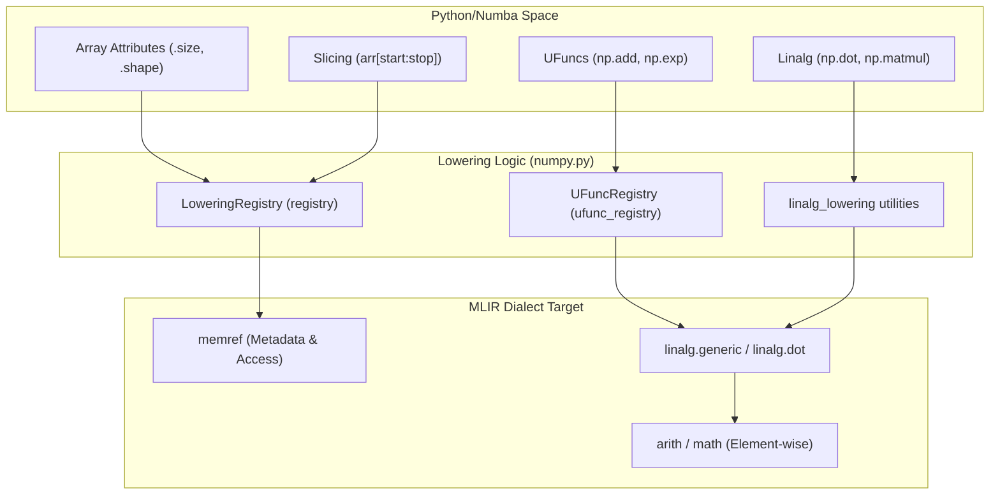
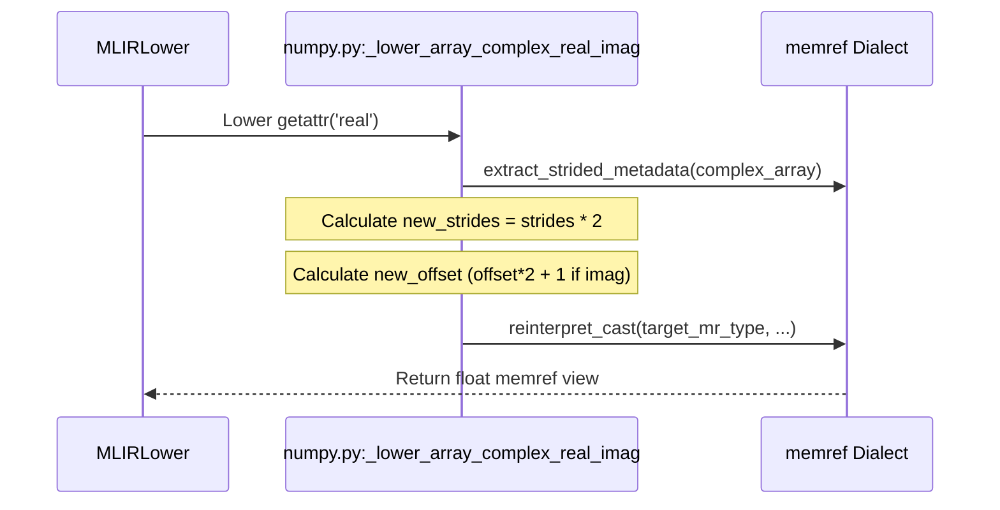

<!-- source: DeepWiki mcp.deepwiki.com · repo NVIDIA/numba-cuda-mlir · page 4.3 NumPy Array Lowering · fetched 2026-10-26 -->

# NumPy Array Lowering

Relevant source files

The following files were used as context for generating this wiki page:

- [ci/tools/run-cudf-source-tests](ci/tools/run-cudf-source-tests)
- [src/numba_cuda_mlir/device_declarations.py](src/numba_cuda_mlir/device_declarations.py)
- [src/numba_cuda_mlir/lowering/numpy.py](src/numba_cuda_mlir/lowering/numpy.py)
- [src/numba_cuda_mlir/memory_management/nrt_mlir.py](src/numba_cuda_mlir/memory_management/nrt_mlir.py)
- [src/numba_cuda_mlir/numba_cuda/api.py](src/numba_cuda_mlir/numba_cuda/api.py)
- [src/numba_cuda_mlir/numba_cuda/api_util.py](src/numba_cuda_mlir/numba_cuda/api_util.py)
- [src/numba_cuda_mlir/numba_cuda/cpython/builtins.py](src/numba_cuda_mlir/numba_cuda/cpython/builtins.py)
- [src/numba_cuda_mlir/numba_cuda/np/arrayobj.py](src/numba_cuda_mlir/numba_cuda/np/arrayobj.py)
- [tests/numba_cuda_tests/cudapy/test_analysis.py](tests/numba_cuda_tests/cudapy/test_analysis.py)
- [tests/numba_cuda_tests/cudapy/test_array_args.py](tests/numba_cuda_tests/cudapy/test_array_args.py)
- [tests/numba_cuda_tests/cudapy/test_sm.py](tests/numba_cuda_tests/cudapy/test_sm.py)
- [tests/test_slicing.py](tests/test_slicing.py)

This section describes the lowering of NumPy array operations to MLIR. The implementation primarily resides in `src/numba_cuda_mlir/lowering/numpy.py`, which utilizes a specialized `LoweringRegistry` to translate Numba IR array operations into a combination of `memref`, `linalg`, `arith`, and `math` MLIR dialects.

## Overview and Data Flow

The array lowering subsystem handles the lifecycle of an array on the device: from allocation (using the Numba Runtime) to element access, slicing, and complex linear algebra operations. In `numba-cuda-mlir`, arrays are represented as MLIR `memref` types.

### Data Layout Mapping
When a Numba `types.Array` is encountered, the `MLIRLower` engine maps it to a `memref` with a strided layout. This allows the compiler to represent C-contiguous, Fortran-contiguous, and arbitrary slices within the same type system [src/numba_cuda_mlir/lowering/numpy.py:140-151]().

### Lowering Architecture
The following diagram illustrates the relationship between the high-level NumPy calls and the internal MLIR lowering entities.

**Diagram: NumPy Lowering Entity Map**

Sources: [src/numba_cuda_mlir/lowering/numpy.py:28-65](), [src/numba_cuda_mlir/lowering/numpy.py:115-127]()

## Array Creation and Initialization

Array creation on the device (e.g., `np.empty`, `np.zeros`) is managed through the Numba Runtime (NRT).

### Zero Initialization
The `_zero_fill_array_method` is lowered to an `llvm.memset` operation. It extracts the raw pointer from the `memref` using `extract_aligned_pointer_as_index` and calculates the total byte size by multiplying the storage item size by all dimensions [src/numba_cuda_mlir/lowering/numpy.py:97-113]().

### Metadata Access
Array attributes like `.size` are computed dynamically by reducing the dimensions of the `memref` using `arith.muli` [src/numba_cuda_mlir/lowering/numpy.py:115-127]().

## Slicing and Views

Slicing is implemented by creating a new `memref` view over the existing data using `memref.reinterpret_cast` or `memref.subview`.

### Complex Array Views (`.real` / `.imag`)
For complex arrays, `.real` and `.imag` attributes return views. Because complex numbers are stored as interleaved pairs `[real, imag, real, imag, ...]`, the lowering logic:
1. Doubles the strides of the original array.
2. For `.imag`, adds an offset of 1 (the size of one float) to the base pointer.
3. Uses `memref.reinterpret_cast` to define the new view [src/numba_cuda_mlir/lowering/numpy.py:129-177]().

**Diagram: Complex Array View Lowering**

Sources: [src/numba_cuda_mlir/lowering/numpy.py:129-177]()

## Element-wise Operations (UFuncs)

Element-wise ufuncs (like `np.add` or `np.exp`) are lowered into `linalg.generic` operations.

### The UFunc Registry
The `UFuncRegistry` maps NumPy functions to MLIR operations [src/numba_cuda_mlir/lowering/numpy.py:40-65](). When a ufunc is called:
1. **Broadcasting**: The shapes of inputs are analyzed to determine the iteration space.
2. **Linalg Emission**: A `linalg.generic` op is created with an indexing map for each operand.
3. **Scalar Body**: The actual math (e.g., `arith.addf`) is emitted inside the region of the `linalg.generic` [src/numba_cuda_mlir/lowering/numpy.py:58-63]().

## Reductions and Linear Algebra

High-level linear algebra functions are delegated to `lowering_utilities.linalg_lowering`.

| Function | MLIR Implementation | Source |
| :--- | :--- | :--- |
| `np.dot` | `linalg.dot` | [src/numba_cuda_mlir/lowering/numpy.py:61]() |
| `np.matmul` | `linalg.matmul` | [src/numba_cuda_mlir/lowering/numpy.py:60]() |
| `np.transpose` | `memref.transpose` (metadata view) | [src/numba_cuda_mlir/lowering/numpy.py:62]() |
| `ReduceOp` | `linalg.reduce` | [src/numba_cuda_mlir/lowering/numpy.py:20]() |

## Indexing (Getitem/Setitem)

Indexing is handled by converting Numba IR indices into MLIR values and using `memref.load` and `memref.store`.

### Integer and Slice Indexing
- **Integer Indexing**: If all indices are integers, a single `memref.load` is emitted.
- **Slicing**: If any index is a slice, a `memref.subview` is created to represent the slice, which is then returned as a new array variable [src/numba_cuda_mlir/numba_cuda/np/arrayobj.py:185-208]().

### Error Handling
For out-of-bounds access, the lowering logic uses `set_error_code_if_zero` to trigger kernel exceptions if the index exceeds the dimension size [src/numba_cuda_mlir/lowering/numpy.py:50-57]().

Sources:
- `src/numba_cuda_mlir/lowering/numpy.py` (Primary lowering implementation)
- `src/numba_cuda_mlir/numba_cuda/np/arrayobj.py` (Typing and structural helpers)
- `src/numba_cuda_mlir/lowering_utilities/linalg_lowering.py` (Linalg backend)
- `src/numba_cuda_mlir/mlir_lowering.py` (Kernel error codes)

---

