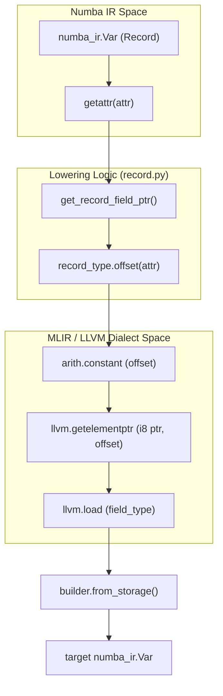
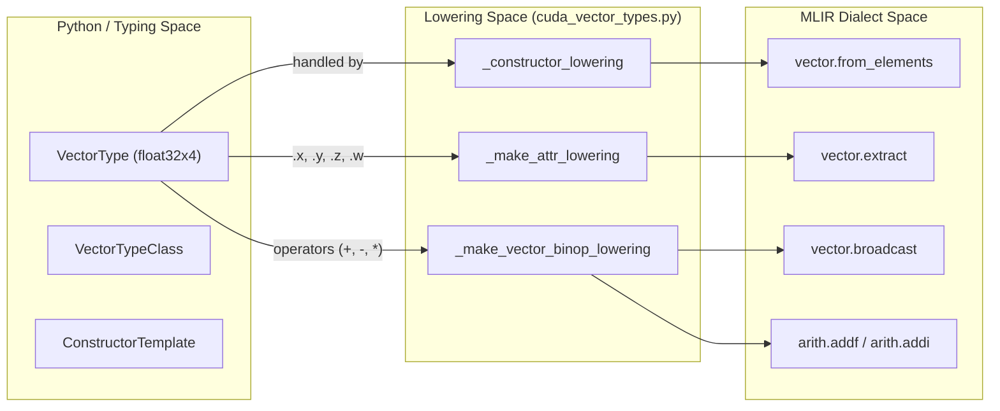

<!-- source: DeepWiki mcp.deepwiki.com · repo NVIDIA/numba-cuda-mlir · page 4.4 Record, CPointer, and Vector Lowering · fetched 2026-10-26 -->

# Record, CPointer, and Vector Lowering

Relevant source files

The following files were used as context for generating this wiki page:

- [.gitignore](.gitignore)
- [src/numba_cuda_mlir/lowering/ctypes.py](src/numba_cuda_mlir/lowering/ctypes.py)
- [src/numba_cuda_mlir/lowering/cuda_vector_types.py](src/numba_cuda_mlir/lowering/cuda_vector_types.py)
- [src/numba_cuda_mlir/lowering/record.py](src/numba_cuda_mlir/lowering/record.py)
- [src/numba_cuda_mlir/lowering/vector.py](src/numba_cuda_mlir/lowering/vector.py)
- [src/numba_cuda_mlir/lowering_utilities/__init__.py](src/numba_cuda_mlir/lowering_utilities/__init__.py)
- [src/numba_cuda_mlir/typing/cuda_vector_types.py](src/numba_cuda_mlir/typing/cuda_vector_types.py)
- [tests/test_builtin_broadcasted_binops.py](tests/test_builtin_broadcasted_binops.py)
- [tests/test_ptr_ops.py](tests/test_ptr_ops.py)
- [tests/test_record_dtype.py](tests/test_record_dtype.py)
- [tests/test_vector_type_complex_cast.py](tests/test_vector_type_complex_cast.py)
- [tests/test_vector_types_ops.py](tests/test_vector_types_ops.py)

This section describes the lowering mechanisms for NumPy structured dtypes (`Record`), C-style pointers (`CPointer`), and CUDA vector types. These subsystems bridge the gap between high-level Python/NumPy abstractions and low-level MLIR/LLVM operations, specifically handling byte-level memory offsets, nested array data movement, and SIMD vector construction.

## Record (Structured DType) Lowering

NumPy `Record` types represent structured data with named fields of potentially different types. In the MLIR lowering engine, a `Record` is represented as an LLVM pointer to a byte array. Field access is implemented by calculating byte offsets based on the NumPy dtype layout and using LLVM's `getelementptr` (GEP) to resolve the field address.

### Field Access and Pointer Calculation
The core function `get_record_field_ptr` computes the address of a specific field within a record [src/numba_cuda_mlir/lowering/record.py:46-76](). It retrieves the field's byte offset from the Numba `Record` type and emits an `llvm.getelementptr` instruction using an `i8` (byte) base type [src/numba_cuda_mlir/lowering/record.py:59-74]().

### Attribute Lowering
- **`getattr`**: When a field is accessed (e.g., `record.a`), the compiler resolves the field pointer and loads the value. For scalar fields, it uses `llvm.load` followed by a conversion from storage type [src/numba_cuda_mlir/lowering/record.py:112-123](). For complex types, it loads an LLVM struct and converts it to an MLIR complex type [src/numba_cuda_mlir/lowering/record.py:115-119]().
- **`setattr`**: Assigning to a field (e.g., `record.a = value`) triggers a store operation. The value is converted to the field's MLIR type and then to its storage representation before emitting `llvm.store` [src/numba_cuda_mlir/lowering/record.py:181-194]().

### NestedArray Handling
If a record field is a `NestedArray`, the behavior differs:
1. **Loading**: `getattr` returns the raw LLVM pointer to the start of the nested array data within the record [src/numba_cuda_mlir/lowering/record.py:128-144]().
2. **Storing**: Assigning to a nested array field performs a deep copy. The function `_store_nested_array_field` generates an `scf.for` loop to iterate through the source array and copy elements one-by-one into the record's storage [src/numba_cuda_mlir/lowering/record.py:199-206]().

**Record Data Flow**
The following diagram illustrates how a Python record attribute access is translated into MLIR operations.

| Component | Entity in Code |
| :--- | :--- |
| **Lowering Entry** | `lower_record_getattr` [src/numba_cuda_mlir/lowering/record.py:79-125]() |
| **Offset Logic** | `record_type.offset(field_name)` [src/numba_cuda_mlir/lowering/record.py:59]() |
| **Address Calculation** | `llvm.getelementptr` [src/numba_cuda_mlir/lowering/record.py:67-74]() |
| **Data Retrieval** | `llvm.load` [src/numba_cuda_mlir/lowering/record.py:121]() |

Sources: [src/numba_cuda_mlir/lowering/record.py:46-125](), [src/numba_cuda_mlir/lowering/record.py:147-195]()

## CPointer and CTypes Lowering

The `CPointer` type represents raw memory addresses, typically used for interoperability with C-style APIs or `ctypes`.

### Pointer Arithmetic and Casting
- **Casting**: Pointers can be cast to/from integers using `llvm.ptrtoint` and `llvm.inttoptr` [src/numba_cuda_mlir/lowering/ctypes.py:54-73](). Generic `ctypes.cast` is supported for converting between pointer types [src/numba_cuda_mlir/lowering/ctypes.py:75-83]().
- **Arithmetic**: Adding or subtracting an integer from a `CPointer` (e.g., `ptr + 5`) is lowered by converting the pointer to an integer, adding the product of the index and the element's storage size (via `storage_itemsize_bytes`), and converting back to a pointer [src/numba_cuda_mlir/lowering/ctypes.py:150-186]().

### Dereferencing (Getitem/Setitem)
Dereferencing a pointer (e.g., `ptr[i]`) is implemented via `llvm.getelementptr` with a dynamic index [src/numba_cuda_mlir/lowering/ctypes.py:122-148](). The compiler uses `GEP_DYNAMIC_INDEX` (defined as `int32` minimum) to signal to the LLVM dialect that the offset is provided as a runtime value [src/numba_cuda_mlir/lowering_utilities/__init__.py:39-40](), [src/numba_cuda_mlir/lowering/ctypes.py:30-32]().

Sources: [src/numba_cuda_mlir/lowering/ctypes.py:54-186](), [src/numba_cuda_mlir/lowering_utilities/__init__.py:39-40]()

## CUDA Vector Type Lowering

CUDA vector types (e.g., `float4`, `int2`) are mapped to the MLIR `vector` dialect. These types are treated as value types rather than pointers.

### Vector Construction
The vector constructor (e.g., `cuda.float4(x, y, z, w)`) is handled by `_constructor_lowering` [src/numba_cuda_mlir/lowering/cuda_vector_types.py:64-93](). It supports:
- **Broadcasting**: A single scalar argument is replicated to fill all vector lanes [src/numba_cuda_mlir/lowering/cuda_vector_types.py:88-89]().
- **Concatenation**: Mixed scalars and smaller vectors are flattened into a single list of elements [src/numba_cuda_mlir/lowering/cuda_vector_types.py:75-86]().
- **Conversion**: Vectors of the same length but different element types are converted using `vector.from_elements` [src/numba_cuda_mlir/lowering/cuda_vector_types.py:91]().

### Component Extraction
Accessing vector components (attributes `.x`, `.y`, `.z`, `.w`) is lowered to `vector.extract` [src/numba_cuda_mlir/lowering/cuda_vector_types.py:102-118](). The `ATTR_INDEX` map associates component names with integer indices [src/numba_cuda_mlir/lowering/cuda_vector_types.py:26]().

### Vector Operators
Binary operations (e.g., `v1 + v2`) and scalar-vector operations (e.g., `v1 * 2.0`) are supported for standard arithmetic operators [src/numba_cuda_mlir/lowering/cuda_vector_types.py:159-176]().
- **Broadcasting**: If one operand is a scalar, it is broadcast to the vector shape using `vector.broadcast` before the operation [src/numba_cuda_mlir/lowering/cuda_vector_types.py:136-147]().
- **Dispatch**: The lowering dispatches to integer (`arith.addi`, etc.) or floating-point (`arith.addf`, etc.) MLIR operations based on the element type [src/numba_cuda_mlir/lowering/cuda_vector_types.py:149-152]().

**Vector Type Entity Mapping**
This diagram bridges the Python `cuda.vector_types` definitions to the lowering implementations.

Sources: [src/numba_cuda_mlir/typing/cuda_vector_types.py:27-115](), [src/numba_cuda_mlir/lowering/cuda_vector_types.py:64-156]()

## Summary of Lowering Utilities
The following utilities are frequently used across these subsystems to manage memory and type conversions:

| Function | Purpose |
| :--- | :--- |
| `memref_to_llvm_ptr` | Converts a strided MLIR memref and indices into a single LLVM pointer via GEP [src/numba_cuda_mlir/lowering_utilities/__init__.py:96-124](). |
| `to_llvm_storable_type` | Returns the LLVM type used for storage (e.g., complex types become structs) [src/numba_cuda_mlir/lowering_utilities/__init__.py:127-130](). |
| `storage_itemsize_bytes` | Computes the byte size of a Numba type for pointer arithmetic [src/numba_cuda_mlir/lowering/ctypes.py:161](). |
| `convert` | Handles implicit type promotion and casting between MLIR types [src/numba_cuda_mlir/lowering/cuda_vector_types.py:17](). |

Sources: [src/numba_cuda_mlir/lowering_utilities/__init__.py:96-130](), [src/numba_cuda_mlir/lowering/ctypes.py:161]()

---

