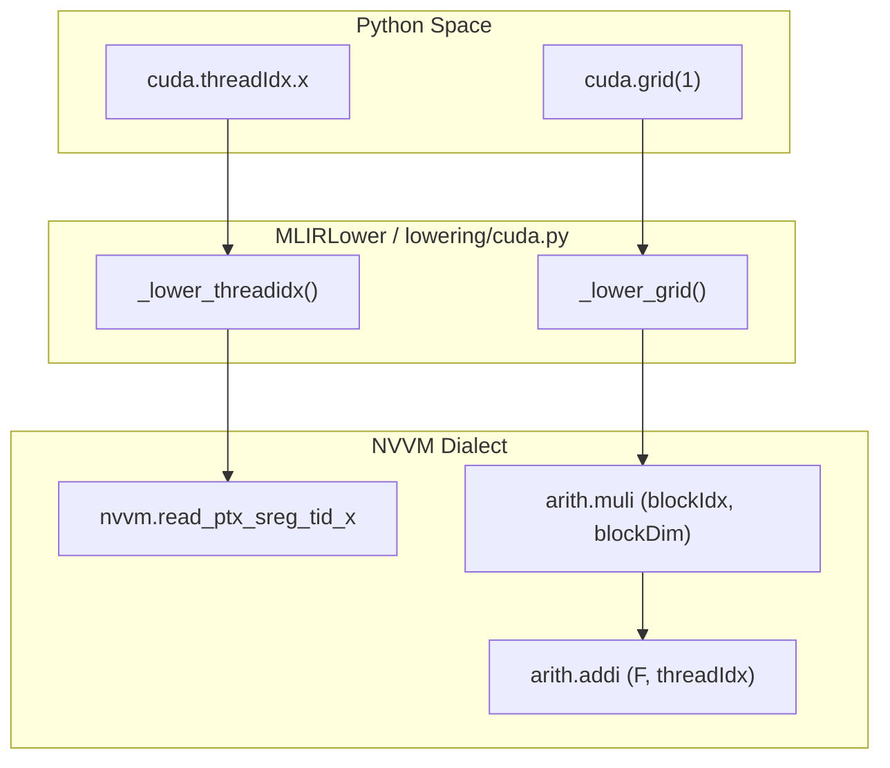
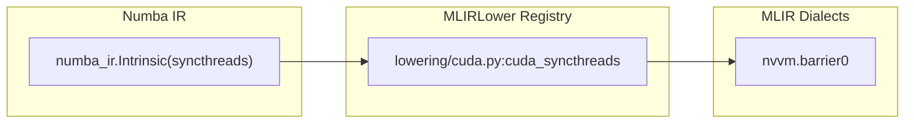

<!-- source: DeepWiki mcp.deepwiki.com · repo NVIDIA/numba-cuda-mlir · page 4.5 CUDA Intrinsics and libdevice Lowering · fetched 2026-10-26 -->

# CUDA Intrinsics and libdevice Lowering

Relevant source files

The following files were used as context for generating this wiki page:

- [docs/source/reference/kernel.rst](docs/source/reference/kernel.rst)
- [docs/source/reference/libdevice.rst](docs/source/reference/libdevice.rst)
- [docs/source/reference/memory.rst](docs/source/reference/memory.rst)
- [docs/source/reference/types.rst](docs/source/reference/types.rst)
- [docs/source/user/index.rst](docs/source/user/index.rst)
- [src/numba_cuda_mlir/cuda/libdevice.py](src/numba_cuda_mlir/cuda/libdevice.py)
- [src/numba_cuda_mlir/lowering/cuda.py](src/numba_cuda_mlir/lowering/cuda.py)
- [src/numba_cuda_mlir/numba_cuda/intrinsics.py](src/numba_cuda_mlir/numba_cuda/intrinsics.py)
- [tests/numba_cuda_tests/cudapy/test_dispatcher.py](tests/numba_cuda_tests/cudapy/test_dispatcher.py)

This page details the implementation and lowering of CUDA-specific operations within the `numba-cuda-mlir` pipeline. It covers how high-level Python calls to CUDA intrinsics, indexing, shared memory, and math functions are translated into MLIR operations using the `nvvm`, `gpu`, and `arith` dialects.

## Thread, Block, and Grid Indexing

CUDA indexing intrinsics (e.g., `cuda.threadIdx`, `cuda.blockIdx`) are lowered by mapping Python-level attribute access to PTX special register reads via the `nvvm` dialect.

### Implementation Details
The lowering is registered in `src/numba_cuda_mlir/lowering/cuda.py`. For basic indexing, the compiler uses functions like `_lower_threadidx` which emit `nvvm.read_ptx_sreg_tid_*` operations [src/numba_cuda_mlir/lowering/cuda.py:192-201]().

| Python Attribute | MLIR / NVVM Op |
| :--- | :--- |
| `cuda.threadIdx.x/y/z` | `nvvm.read_ptx_sreg_tid_x/y/z` |
| `cuda.blockIdx.x/y/z` | `nvvm.read_ptx_sreg_ctaid_x/y/z` |
| `cuda.blockDim.x/y/z` | `nvvm.read_ptx_sreg_ntid_x/y/z` |
| `cuda.gridDim.x/y/z` | `nvvm.read_ptx_sreg_nctaid_x/y/z` |
| `cuda.laneid` | `nvvm.read_ptx_sreg_laneid` |
| `cuda.warpsize` | `nvvm.read_ptx_sreg_warpsize` |

### High-Level Grid Intrinsics
Functions like `cuda.grid(ndim)` and `cuda.gridsize(ndim)` are composite intrinsics. Their typing is handled in `src/numba_cuda_mlir/numba_cuda/intrinsics.py` [src/numba_cuda_mlir/numba_cuda/intrinsics.py:34-94](), but the actual MLIR emission occurs in `MLIRLower`. For example, `grid(1)` is lowered as `(blockIdx.x * blockDim.x) + threadIdx.x` [docs/source/reference/kernel.rst:141-152]().

**Indexing Data Flow**

Sources: [src/numba_cuda_mlir/lowering/cuda.py:192-225](), [src/numba_cuda_mlir/numba_cuda/intrinsics.py:34-94](), [docs/source/reference/kernel.rst:104-168]().

## Memory Management: Shared and Local

CUDA shared and local memory arrays are managed via the `gpu` and `memref` dialects.

### Shared Memory
`cuda.shared.array(shape, dtype)` creates an allocation in address space 3. The compiler handles this by creating a `memref` with a global memory space attribute [docs/source/reference/kernel.rst:172-180]().
- **Static Shared Memory**: The size must be known at compile time.
- **Dynamic Shared Memory**: Supported via the launch configuration, though the MLIR lowering typically handles the pointer retrieval via `nvvm` intrinsics for dynamic shared memory offsets.

### Local Memory
`cuda.local.array(shape, dtype)` allocates memory in the thread-local scope (address space 5). Each thread sees a unique instance [docs/source/reference/kernel.rst:182-189]().

Sources: [docs/source/reference/kernel.rst:169-198](), [src/numba_cuda_mlir/lowering/cuda.py:75-145]().

## Atomic Operations

Atomic operations are lowered to `nvvm.atomic.rmw` or `arith.atomic_rmw` depending on the operand types.

- **`cuda.atomic.add(array, idx, val)`**: Lowered to an atomic read-modify-write operation.
- **Scope**: By default, these are GPU-wide or block-wide depending on the underlying PTX instruction generated during the `convert-to-nvvm` pass.

Sources: [docs/source/reference/kernel.rst:201-203]().

## libdevice Math Intrinsics

Numba-CUDA-MLIR provides exhaustive coverage of the CUDA `libdevice` library. These functions are exposed via the `numba_cuda_mlir.cuda.libdevice` module [src/numba_cuda_mlir/cuda/libdevice.py:1-15]().

### Lowering Path
1. **Python Call**: User calls `cuda.libdevice.sin(x)`.
2. **Type Inference**: The `MLIRTypingContext` identifies the function as a libdevice intrinsic.
3. **MLIR Emission**: The `MLIRLower` engine emits a call to an external function prefixed with `__nv_` (e.g., `__nv_sin`) [docs/source/reference/libdevice.rst:5-14]().
4. **Linking**: During the translation to LLVM IR, these calls are linked against the `libdevice.10.bc` bitcode file provided by the CUDA Toolkit.

| Python Function | CAPI / PTX Mapping |
| :--- | :--- |
| `libdevice.abs(x)` | `__nv_abs` |
| `libdevice.cos(x)` | `__nv_cos` |
| `libdevice.fast_sinf(x)` | `__nv_fast_sinf` |

Sources: [src/numba_cuda_mlir/cuda/libdevice.py:15-300](), [docs/source/reference/libdevice.rst:5-21]().

## Half and Bfloat16 Precision

The compiler supports `float16` and `bfloat16` (Compute Capability 8.0+) via specialized types and intrinsics.

### Bfloat16 Support
Bfloat16 is implemented as a first-class type in the `numba_cuda_mlir.cuda.types` module [docs/source/reference/types.rst:68-82]().
- **Casts**: Handled via `bfloat16(val)` constructors which lower to `arith.truncf` or `arith.extf` [docs/source/reference/types.rst:86-104]().
- **Math**: Specialized intrinsics like `cuda.bf16.hsqrt(b)` map to `nvvm` bfloat16 instructions [docs/source/reference/types.rst:119-145]().

### Arithmetic
Arithmetic operations (`+`, `-`, `*`, `/`) on `bfloat16` are lowered to `arith` dialect operations using the `bf16` type, which are later lowered to `nvvm` instructions like `fadd.bf16` [docs/source/reference/types.rst:106-115]().

Sources: [docs/source/reference/types.rst:65-214]().

## Cooperative Groups and Synchronization

### Barriers
- `cuda.syncthreads()`: Lowered to `nvvm.barrier0` [src/numba_cuda_mlir/numba_cuda/intrinsics.py:121-131]().
- **Predicated Barriers**: `syncthreads_count`, `syncthreads_and`, and `syncthreads_or` are supported and map to `llvm.nvvm.barrier0.popc` and similar intrinsics [src/numba_cuda_mlir/numba_cuda/intrinsics.py:143-175]().

### Warp Shuffles
Warp shuffle intrinsics (`shfl_sync`, `shfl_up_sync`, etc.) are lowered to `nvvm.shfl.sync` operations. The `MLIRLower` handles the bitmasking and mode selection (idx, up, down, bfly) [src/numba_cuda_mlir/numba_cuda/intrinsics.py:193-235]().

**Intrinsic Lowering Pipeline**

Sources: [src/numba_cuda_mlir/numba_cuda/intrinsics.py:117-235](), [src/numba_cuda_mlir/lowering/cuda.py:148-180]().

---

