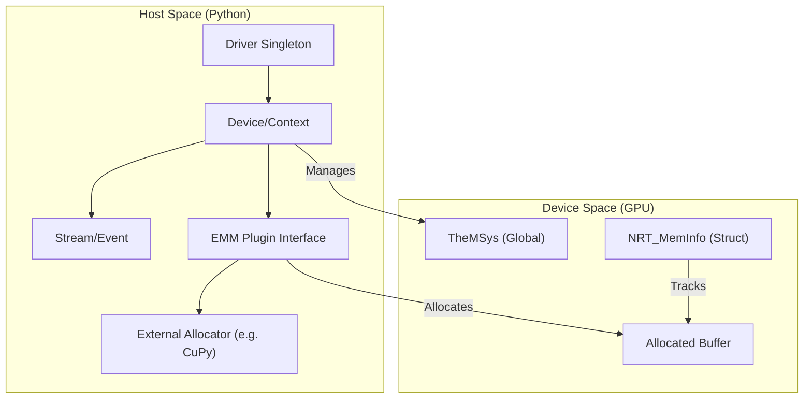

<!-- source: DeepWiki mcp.deepwiki.com · repo NVIDIA/numba-cuda-mlir · page 5 Memory Management and Runtime · fetched 2026-10-26 -->

# Memory Management and Runtime

Relevant source files

The following files were used as context for generating this wiki page:

- [ci/tools/run-cudf-source-tests](ci/tools/run-cudf-source-tests)
- [src/numba_cuda_mlir/device_declarations.py](src/numba_cuda_mlir/device_declarations.py)
- [src/numba_cuda_mlir/memory_management/__init__.py](src/numba_cuda_mlir/memory_management/__init__.py)
- [src/numba_cuda_mlir/memory_management/nrt.py](src/numba_cuda_mlir/memory_management/nrt.py)
- [src/numba_cuda_mlir/memory_management/nrt_mlir.py](src/numba_cuda_mlir/memory_management/nrt_mlir.py)
- [src/numba_cuda_mlir/numba_cuda/codegen.py](src/numba_cuda_mlir/numba_cuda/codegen.py)
- [src/numba_cuda_mlir/numba_cuda/cpython/builtins.py](src/numba_cuda_mlir/numba_cuda/cpython/builtins.py)
- [src/numba_cuda_mlir/numba_cuda/dispatcher.py](src/numba_cuda_mlir/numba_cuda/dispatcher.py)
- [src/numba_cuda_mlir/numba_cuda/memory_management/nrt.py](src/numba_cuda_mlir/numba_cuda/memory_management/nrt.py)
- [src/numba_cuda_mlir/numba_cuda/np/arrayobj.py](src/numba_cuda_mlir/numba_cuda/np/arrayobj.py)

This section provides an overview of the memory management infrastructure in `numba-cuda-mlir`, spanning both device-side runtime services and host-side driver abstractions. The system ensures efficient allocation, reference counting, and lifecycle management for GPU memory.

The architecture is divided into two primary subsystems:
1.  **Numba Runtime (NRT)**: A device-side library implemented via MLIR that provides dynamic memory allocation and atomic reference counting directly within CUDA kernels.
2.  **CUDA Driver Abstraction**: A host-side layer that wraps the CUDA Driver API, managing devices, contexts, streams, and integrating with External Memory Management (EMM) plugins.

## 5.1 Numba Runtime (NRT) on Device

The Numba Runtime (NRT) is a critical component for supporting dynamic features like array creation and returning complex objects from kernels. Unlike traditional Numba-CUDA which relied on linking pre-compiled C++ (NVRTC) for runtime support, `numba-cuda-mlir` emits NRT device functions directly as MLIR LLVM dialect operations [src/numba_cuda_mlir/memory_management/nrt_mlir.py:4-10]().

### Core Components
*   **NRT_MemInfo**: The fundamental structure for tracked memory, containing an atomic reference count, destructor pointers, and the raw data pointer [src/numba_cuda_mlir/memory_management/nrt_mlir.py:12-17]().
*   **Atomic Reference Counting**: Increments and decrements are performed using `llvm.atomicrmw` to ensure thread safety across the GPU grid [src/numba_cuda_mlir/memory_management/nrt_mlir.py:227-232]().
*   **TheMSys**: A global singleton on the device that manages the runtime state, including optional allocation statistics [src/numba_cuda_mlir/memory_management/nrt_mlir.py:40-48]().
*   **rtsys**: The host-side manager (singleton `_Runtime`) responsible for compiling the memory system module and initializing `TheMSys` on the device [src/numba_cuda_mlir/numba_cuda/memory_management/nrt.py:95-103]().

### Entity Mapping: NRT Device Implementation
| Code Entity | Role |
| :--- | :--- |
| `NRT_MemInfo` | Struct layout: `(refct, dtor, dtor_info, data, size)` [src/numba_cuda_mlir/memory_management/nrt_mlir.py:63-73]() |
| `NRT_Allocate` | MLIR-emitted function for dynamic device allocation [src/numba_cuda_mlir/memory_management/nrt.py:16-37]() |
| `NRT_incref` / `NRT_decref` | Atomic management of `MemInfo` lifecycle [src/numba_cuda_mlir/memory_management/nrt_mlir.py:35-36]() |
| `rtsys` | Host-side singleton for NRT orchestration [src/numba_cuda_mlir/numba_cuda/memory_management/nrt.py:56-56]() |

For details, see [Numba Runtime (NRT) on Device](#5.1).

---

## 5.2 CUDA Driver Abstraction and EMM

The driver abstraction layer provides a Pythonic interface to the CUDA Driver API, ensuring that resources like `Contexts` and `Streams` are correctly managed and that memory deallocations are synchronized with the device.

### Key Responsibilities
*   **Driver Singleton**: A centralized interface for interacting with `libcuda`, managing function loading and error handling [src/numba_cuda_mlir/numba_cuda/cudadrv/driver.py:13-18]().
*   **Primary Context Management**: Automates the retention and setup of CUDA primary contexts for available devices [src/numba_cuda_mlir/numba_cuda/cudadrv/devices.py:55-56]().
*   **Pending Deallocations**: Implements a mechanism to defer memory freeing until it is safe, preventing race conditions between the host and asynchronous device operations.
*   **EMM Plugin Interface**: Allows external libraries (like `CuPy` or `PyTorch`) to provide their own memory allocators, which Numba can use for its internal allocations.

### Driver and Memory Lifecycle
The following diagram illustrates the relationship between the host-side `Driver` abstraction and the device-side memory entities.

Sources: [src/numba_cuda_mlir/numba_cuda/cudadrv/driver.py:13-18](), [src/numba_cuda_mlir/numba_cuda/memory_management/nrt.py:166-167](), [src/numba_cuda_mlir/memory_management/nrt_mlir.py:40-48]().

For details, see [CUDA Driver Abstraction and EMM](#5.2).

---

## Runtime Integration Summary

Memory management is interleaved with the compilation and execution pipeline. When a kernel requires dynamic memory (e.g., creating a new NumPy-like array on the device), the `MLIRLower` engine inserts calls to `NRT_Allocate` [src/numba_cuda_mlir/numba_cuda/memory_management/nrt.py:57-67](). The linker then ensures that the necessary NRT definitions from `nrt_mlir.py` are included in the final executable if the assembly references them [src/numba_cuda_mlir/memory_management/nrt.py:40-42]().

### Runtime Statistics and Configuration
The runtime supports optional tracking of allocation metrics (allocs, frees, etc.) which can be enabled via environment variables:
*   `NUMBA_CUDA_ENABLE_NRT`: Global toggle for runtime support [src/numba_cuda_mlir/numba_cuda/memory_management/nrt.py:40-42]().
*   `NUMBA_CUDA_NRT_STATS`: Enables instrumentation of `TheMSys` to track usage counters [src/numba_cuda_mlir/numba_cuda/memory_management/nrt.py:32-34]().

Sources: `src/numba_cuda_mlir/numba_cuda/memory_management/nrt.py`, `src/numba_cuda_mlir/memory_management/nrt_mlir.py`, `src/numba_cuda_mlir/numba_cuda/cudadrv/driver.py`.

---

