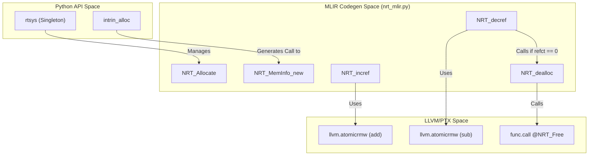
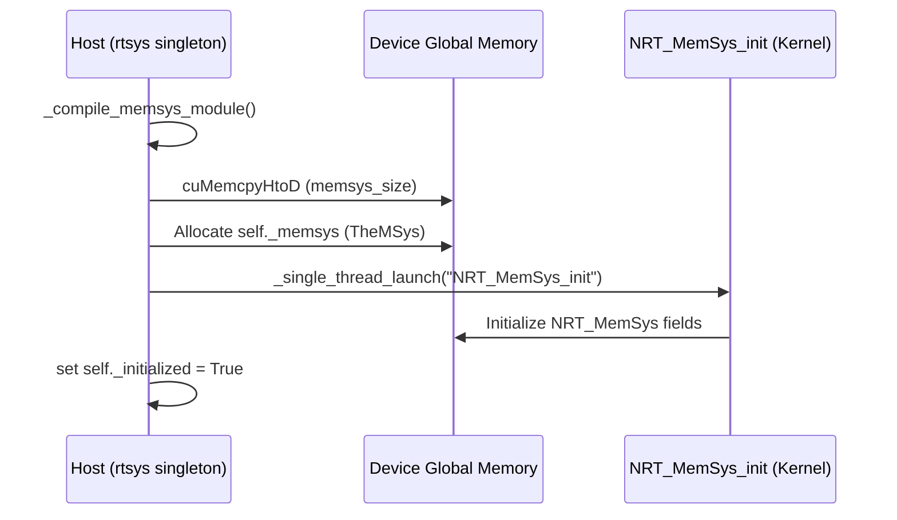

<!-- source: DeepWiki mcp.deepwiki.com · repo NVIDIA/numba-cuda-mlir · page 5.1 Numba Runtime (NRT) on Device · fetched 2026-10-26 -->

# Numba Runtime (NRT) on Device

Relevant source files

The following files were used as context for generating this wiki page:

- [ci/tools/run-cudf-source-tests](ci/tools/run-cudf-source-tests)
- [src/numba_cuda_mlir/device_declarations.py](src/numba_cuda_mlir/device_declarations.py)
- [src/numba_cuda_mlir/memory_management/__init__.py](src/numba_cuda_mlir/memory_management/__init__.py)
- [src/numba_cuda_mlir/memory_management/nrt.py](src/numba_cuda_mlir/memory_management/nrt.py)
- [src/numba_cuda_mlir/memory_management/nrt_mlir.py](src/numba_cuda_mlir/memory_management/nrt_mlir.py)
- [src/numba_cuda_mlir/numba_cuda/codegen.py](src/numba_cuda_mlir/numba_cuda/codegen.py)
- [src/numba_cuda_mlir/numba_cuda/cpython/builtins.py](src/numba_cuda_mlir/numba_cuda/cpython/builtins.py)
- [src/numba_cuda_mlir/numba_cuda/dispatcher.py](src/numba_cuda_mlir/numba_cuda/dispatcher.py)
- [src/numba_cuda_mlir/numba_cuda/memory_management/nrt.py](src/numba_cuda_mlir/numba_cuda/memory_management/nrt.py)
- [src/numba_cuda_mlir/numba_cuda/np/arrayobj.py](src/numba_cuda_mlir/numba_cuda/np/arrayobj.py)

The Numba Runtime (NRT) on device provides the infrastructure for dynamic memory management and reference counting within CUDA kernels. In the `numba-cuda-mlir` implementation, the NRT is implemented as a set of MLIR LLVM dialect operations that are injected into the GPU module during the lowering process [src/numba_cuda_mlir/memory_management/nrt_mlir.py:4-10](). This implementation replaces the legacy path that relied on compiling C++ source via NVRTC [src/numba_cuda_mlir/memory_management/nrt_mlir.py:6-10]().

## NRT_MemInfo Layout

The core data structure for managed memory is the `NRT_MemInfo` struct. Its layout is strictly defined to match the host-side NRT expectations and is represented in MLIR as a literal LLVM struct `!llvm.struct<(i64, ptr, ptr, ptr, i64)>` [src/numba_cuda_mlir/memory_management/nrt_mlir.py:63-73]().

| Field Index | Name | Type | Description |
| :--- | :--- | :--- | :--- |
| 0 | `refct` | `i64` | Atomic reference counter |
| 1 | `dtor` | `ptr` | Pointer to destructor function: `void(ptr, i64, ptr)` |
| 2 | `dtor_info` | `ptr` | Opaque pointer passed to the destructor |
| 3 | `data` | `ptr` | Pointer to the actual data payload |
| 4 | `size` | `i64` | Size of the allocated data in bytes |

Sources: [src/numba_cuda_mlir/memory_management/nrt_mlir.py:12-21](), [src/numba_cuda_mlir/memory_management/nrt_mlir.py:63-73]()

## Atomic Reference Counting

Reference counting is handled via atomic operations to ensure thread safety across the GPU grid. The implementation uses `llvm.atomicrmw` with `monotonic` ordering for performance, as strict sequential consistency is not required for incrementing/decrementing counters that do not trigger immediate side effects until they reach zero [src/numba_cuda_mlir/memory_management/nrt_mlir.py:227-232]().

### Key Reference Counting Functions

*   **`NRT_incref(ptr)`**: Performs an atomic `add` of 1 to the `refct` field (index 0) of the `MemInfo` struct [src/numba_cuda_mlir/memory_management/nrt_mlir.py:13-14](), [src/numba_cuda_mlir/memory_management/nrt_mlir.py:119-130]().
*   **`NRT_decref(ptr)`**: Performs an atomic `sub` of 1. If the resulting value is 1 (meaning the previous value was the last reference), it calls `NRT_dealloc(ptr)` [src/numba_cuda_mlir/memory_management/nrt_mlir.py:28-35]().

Sources: [src/numba_cuda_mlir/memory_management/nrt_mlir.py:12-14](), [src/numba_cuda_mlir/memory_management/nrt_mlir.py:227-232]()

## Memory Allocation and Management

The device-side NRT provides functions for allocating and freeing memory, which are resolved by the linker against the MLIR-emitted definitions [src/numba_cuda_mlir/memory_management/nrt_mlir.py:19-21]().

### Allocation Workflow
1.  **`NRT_Allocate`**: Standard allocation entry point.
2.  **`NRT_MemInfo_new`**: Allocates a new `MemInfo` structure and initializes its fields.
3.  **`NRT_MemInfo_alloc_aligned`**: The primary backend for array allocations, ensuring proper alignment for CUDA data types [src/numba_cuda_mlir/numba_cuda/memory_management/nrt.py:60-63]().

### Deallocation Workflow
1.  **`NRT_dealloc`**: Triggered when a reference count reaches zero.
2.  **`NRT_MemInfo_call_dtor`**: Executes the destructor function pointer stored in the `MemInfo` [src/numba_cuda_mlir/memory_management/nrt.py:21-37]().
3.  **`NRT_Free`**: Releases the underlying memory.

### Code-to-System Mapping: NRT Functions
This diagram maps the high-level NRT functions to their internal MLIR-emitted identifiers used during the linking phase.

Title: NRT Function Resolution Mapping

Sources: [src/numba_cuda_mlir/memory_management/nrt_mlir.py:21-37](), [src/numba_cuda_mlir/numba_cuda/memory_management/nrt.py:95-105]()

## TheMSys Global and Statistics

The NRT maintains a global state on the device named `TheMSys` [src/numba_cuda_mlir/memory_management/nrt_mlir.py:40](). This global holds the `NRT_MemSys` structure, which primarily tracks allocation statistics if enabled [src/numba_cuda_mlir/memory_management/nrt_mlir.py:76-91]().

### NRT_MemSys Structure
The `NRT_MemSys` structure contains a nested `stats` struct with the following layout:
*   `enabled` (`i8`): Boolean flag to toggle statistics collection.
*   `alloc` (`i64`): Counter for total allocations.
*   `free` (`i64`): Counter for total frees.
*   `mi_alloc` (`i64`): Counter for MemInfo allocations.
*   `mi_free` (`i64`): Counter for MemInfo frees.

### Stats Instrumentation
When `NUMBA_CUDA_NRT_STATS` is enabled, the runtime emits a conditional atomic increment (`_emit_stats_bump`) before allocation and deallocation operations [src/numba_cuda_mlir/memory_management/nrt_mlir.py:200-205]().

Sources: [src/numba_cuda_mlir/memory_management/nrt_mlir.py:40-48](), [src/numba_cuda_mlir/memory_management/nrt_mlir.py:76-91](), [src/numba_cuda_mlir/memory_management/nrt_mlir.py:200-235]()

## The `rtsys` Host-Side Singleton

The `rtsys` (Runtime System) is a host-side singleton of the `_Runtime` class that manages the lifecycle of the device-side NRT [src/numba_cuda_mlir/numba_cuda/memory_management/nrt.py:95-105]().

### Responsibilities
*   **Compilation**: Compiles the memory system module (`memsys.cu`) for the current device's compute capability [src/numba_cuda_mlir/numba_cuda/memory_management/nrt.py:119-130]().
*   **Allocation**: Allocates the global `TheMSys` memory on the device [src/numba_cuda_mlir/numba_cuda/memory_management/nrt.py:149-160]().
*   **Initialization**: Launches a single-threaded kernel (`NRT_MemSys_init`) to initialize the allocator state [src/numba_cuda_mlir/numba_cuda/memory_management/nrt.py:204-210]().
*   **Statistics Retrieval**: Provides methods to read the `_nrt_mstats` from the device and return them as a named tuple to Python [src/numba_cuda_mlir/numba_cuda/memory_management/nrt.py:28]().

### Data Flow: Host-to-Device Initialization
This diagram illustrates how the host-side `rtsys` prepares the device environment.

Title: NRT Host-Device Initialization Flow

Sources: [src/numba_cuda_mlir/numba_cuda/memory_management/nrt.py:119-167](), [src/numba_cuda_mlir/numba_cuda/memory_management/nrt.py:194-212]()

---

