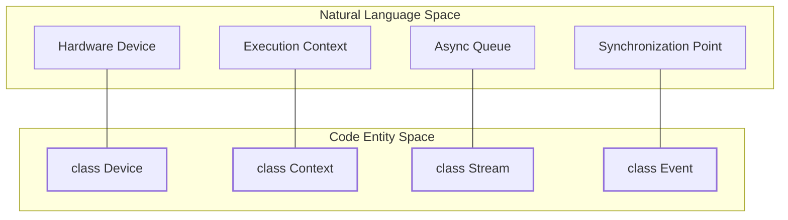
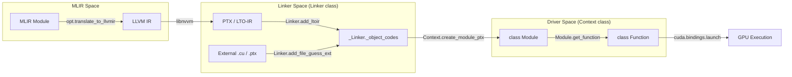

<!-- source: DeepWiki mcp.deepwiki.com · repo NVIDIA/numba-cuda-mlir · page 5.2 CUDA Driver Abstraction and EMM · fetched 2026-10-26 -->

# CUDA Driver Abstraction and EMM

Relevant source files

The following files were used as context for generating this wiki page:

- [src/numba_cuda_mlir/caching.py](src/numba_cuda_mlir/caching.py)
- [src/numba_cuda_mlir/decorators.py](src/numba_cuda_mlir/decorators.py)
- [src/numba_cuda_mlir/linker.py](src/numba_cuda_mlir/linker.py)
- [src/numba_cuda_mlir/mlir_compiler.py](src/numba_cuda_mlir/mlir_compiler.py)
- [src/numba_cuda_mlir/mlir_optimization.py](src/numba_cuda_mlir/mlir_optimization.py)
- [src/numba_cuda_mlir/numba_cuda/_compat.py](src/numba_cuda_mlir/numba_cuda/_compat.py)
- [src/numba_cuda_mlir/numba_cuda/cudadrv/driver.py](src/numba_cuda_mlir/numba_cuda/cudadrv/driver.py)
- [tests/numba_cuda_tests/cudadrv/test_cuda_driver.py](tests/numba_cuda_tests/cudadrv/test_cuda_driver.py)

The CUDA Driver Abstraction layer provides a Pythonic, object-oriented interface to the underlying CUDA Driver API. It manages the lifecycle of hardware resources such as devices, contexts, streams, and memory allocations. A critical component of this layer is the **External Memory Management (EMM)** plugin interface, which allows third-party libraries (like PyTorch or CuPy) to manage device memory while integrating seamlessly with the `numba-cuda-mlir` runtime.

## Driver Singleton and API Binding

The `Driver` class acts as a singleton that lazily binds CUDA Driver API functions using `ctypes` or `cuda.bindings`. It handles the discovery of the CUDA shared library (`nvcuda.dll` or `libcuda.so`) across different operating systems.

### Driver Initialization and Resource Safety
The implementation uses a `_PendingDeallocs` mechanism to prevent system crashes during context corruption. Instead of immediately freeing resources in an object's `__del__` method, deallocations are queued and processed when the context is known to be valid `[src/numba_cuda_mlir/numba_cuda/cudadrv/driver.py:8-15]()`.

| Entity | Role | Source |
| :--- | :--- | :--- |
| `Driver` | Singleton for lazy binding of CUDA API functions. | `[src/numba_cuda_mlir/numba_cuda/cudadrv/driver.py:236-241]()` |
| `find_driver()` | Locates and loads the `libcuda` shared library. | `[src/numba_cuda_mlir/numba_cuda/cudadrv/driver.py:196-199]()` |
| `CudaAPIError` | Exception raised when a CUDA Driver API call returns a non-zero status. | `[src/numba_cuda_mlir/numba_cuda/cudadrv/driver.py:140-148]()` |

## Resource Wrappers

The abstraction provides high-level wrappers for core CUDA entities, ensuring proper reference counting and context management.

### Context and Device Management
The `Context` class manages the CUDA execution environment. It supports "Primary Contexts," which are the preferred way to interact with devices to ensure interoperability with other CUDA libraries `[src/numba_cuda_mlir/numba_cuda/cudadrv/driver.py:1080-1100]()`.

### Streams and Events
Streams are wrapped to provide asynchronous execution control. The `Stream` wrapper includes an `auto_synchronize()` context manager to simplify blocking operations `[tests/numba_cuda_tests/cudadrv/test_cuda_driver.py:146-168]()`.

### Driver Abstraction Entity Map
This diagram maps the natural language concepts of CUDA resources to their specific class implementations in the codebase.

**Sources:** `[src/numba_cuda_mlir/numba_cuda/cudadrv/driver.py:615-618]()`, `[src/numba_cuda_mlir/numba_cuda/cudadrv/driver.py:1080-1085]()`, `[src/numba_cuda_mlir/numba_cuda/cudadrv/driver.py:1738-1745]()`, `[src/numba_cuda_mlir/numba_cuda/cudadrv/driver.py:2065-2070]()`

## External Memory Management (EMM)

The EMM Plugin interface allows `numba-cuda-mlir` to delegate memory allocation and deallocation to an external manager. This is essential for performance in data-science pipelines where memory is shared between Numba kernels and framework tensors (e.g., `torch.Tensor`).

### Implementation Details
- **Memory Allocation**: When an EMM plugin is active, `Context.memalloc()` redirects to the plugin's allocator.
- **Pending Deallocations**: The `_PendingDeallocs` queue ensures that even memory managed by EMM plugins is cleaned up safely if a context becomes invalid `[src/numba_cuda_mlir/numba_cuda/cudadrv/driver.py:8-15]()`.

## JIT Linking and Module Management

The driver abstraction includes a `Linker` (and its internal counterpart `_Linker`) to handle the Just-In-Time linking of PTX, CUBIN, and LTO-IR.

### Linking Workflow
1. **Input Resolution**: The `resolve_link_plan` function determines if the output should be PTX or LTO-IR based on `targetoptions` `[src/numba_cuda_mlir/linker.py:45-91]()`.
2. **Object Accumulation**: The `Linker` class accumulates `ObjectCode` and `LTOIR` fragments `[src/numba_cuda_mlir/linker.py:94-135]()`.
3. **Module Loading**: Once linked, the resulting binary is loaded into the CUDA context as a `Module`, from which `Function` handles (kernels) are retrieved `[tests/numba_cuda_tests/cudadrv/test_cuda_driver.py:103-104]()`.

### Compilation and Linking Data Flow
This diagram illustrates how code fragments move from the MLIR compiler through the linker into the CUDA Driver runtime.

**Sources:** `[src/numba_cuda_mlir/mlir_optimization.py:22-25]()`, `[src/numba_cuda_mlir/linker.py:140-152]()`, `[src/numba_cuda_mlir/numba_cuda/cudadrv/driver.py:1434-1440]()`, `[tests/numba_cuda_tests/cudadrv/test_cuda_driver.py:128]()`

## Key Runtime Interactions

The Driver Abstraction is also responsible for setting up the Numba Runtime (NRT) on the device.

- **NRT Setup**: The `_nrt_memsys_setup_callback` is triggered after a library is loaded. It ensures the kernel's `TheMSys` device global points to the correct host-allocated memory system for tracking allocations and reference counts `[src/numba_cuda_mlir/mlir_optimization.py:29-38]()`.
- **Primary Context Management**: The `devices` module (used in `TestCudaDriver`) ensures that a valid context is always active on the current thread before driver operations begin `[tests/numba_cuda_tests/cudadrv/test_cuda_driver.py:90-91]()`.

**Sources:**
- `src/numba_cuda_mlir/numba_cuda/cudadrv/driver.py`
- `src/numba_cuda_mlir/linker.py`
- `src/numba_cuda_mlir/mlir_optimization.py`
- `tests/numba_cuda_tests/cudadrv/test_cuda_driver.py`

---

