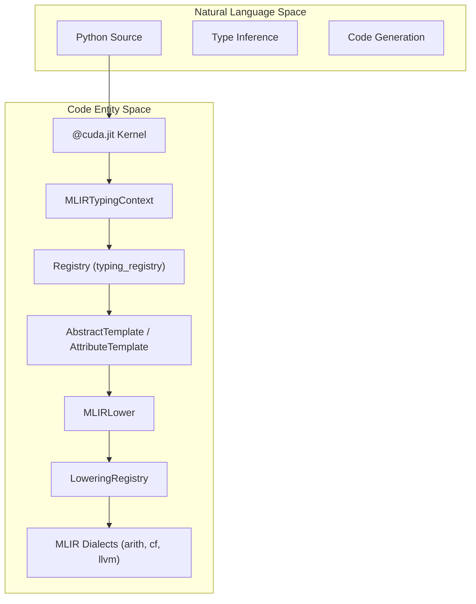
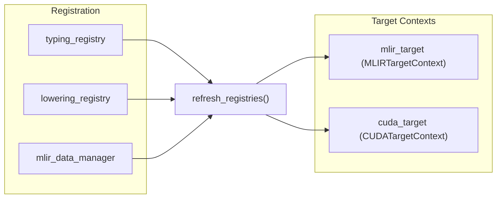

<!-- source: DeepWiki mcp.deepwiki.com · repo NVIDIA/numba-cuda-mlir · page 6 Extension API · fetched 2026-10-26 -->

# Extension API

Relevant source files

The following files were used as context for generating this wiki page:

- [docs/source/extending/high-level.rst](docs/source/extending/high-level.rst)
- [docs/source/extending/index.rst](docs/source/extending/index.rst)
- [docs/source/extending/low-level.rst](docs/source/extending/low-level.rst)
- [docs/source/index.rst](docs/source/index.rst)
- [src/numba_cuda_mlir/compiler.py](src/numba_cuda_mlir/compiler.py)
- [src/numba_cuda_mlir/extending/__init__.py](src/numba_cuda_mlir/extending/__init__.py)
- [src/numba_cuda_mlir/extending/argument_handler.py](src/numba_cuda_mlir/extending/argument_handler.py)
- [src/numba_cuda_mlir/numba_cuda/typing/templates.py](src/numba_cuda_mlir/numba_cuda/typing/templates.py)
- [tests/numba_cuda_tests/cudapy/test_extending.py](tests/numba_cuda_tests/cudapy/test_extending.py)
- [tests/test_numba_cuda_mlir_extending.py](tests/test_numba_cuda_mlir_extending.py)

The Extension API allows developers to expand the capabilities of `numba-cuda-mlir` by adding support for new Python types, functions, and methods. This enables the compilation of custom logic into device code that would otherwise be unsupported by the base compiler. The API is divided into two primary tiers: a high-level API for implementing extensions using pure Python and a low-level API for direct manipulation of the typing and MLIR lowering systems.

## Extension Architecture Overview

The extension system bridges the gap between Python-level objects and the MLIR-based compilation pipeline. It relies on a set of registries that store typing templates and lowering implementations.

### Extension Logic Flow
The following diagram illustrates how an extension is processed from a Python call within a `@cuda.jit` kernel down to the generated MLIR.

**Extension Resolution Pipeline**

Sources: [docs/source/extending/index.rst:10-31](), [src/numba_cuda_mlir/extending/__init__.py:26-33]()

## High-Level Extension API

The High-Level API is the preferred method for extending `numba-cuda-mlir`. It allows authors to write "implementation functions" in pure Python. These functions are themselves compiled by the `numba-cuda-mlir` pipeline, meaning you can use standard Python logic and supported NumPy operations to define how a new function or method should behave on the GPU.

Key features include:
* **`@overload`**: Define implementations for a Python callable based on input types. [src/numba_cuda_mlir/extending/__init__.py:133-187]()
* **`@overload_method`**: Add methods to existing Numba types (e.g., adding a custom method to `types.Array`). [src/numba_cuda_mlir/extending/__init__.py:223-255]()
* **`@overload_attribute`**: Expose read-only properties on Numba types. [src/numba_cuda_mlir/extending/__init__.py:190-221]()
* **`@register_jitable`**: Simply mark a Python function as callable from within a kernel. [src/numba_cuda_mlir/extending/__init__.py:274-298]()

For details, see [High-Level Extension API](#6.1).

## Low-Level Extension API

The Low-Level API provides direct access to the compiler's internal phases: **Typing** and **Lowering**. This is required when the high-level API is insufficient, such as when introducing entirely new data layouts or when specific MLIR instructions must be emitted.

Key components include:
* **`@intrinsic`**: A bridge between high and low levels, allowing a single decorator to handle both typing and custom MLIR code generation via a `codegen` function. [src/numba_cuda_mlir/numba_cuda/extending.py:18-45]()
* **`register_model`**: Defines the physical data layout of a type in MLIR (e.g., mapping a Python class to an `llvm.struct`). [src/numba_cuda_mlir/extending/__init__.py:33-33]()
* **`LoweringRegistry`**: The central store for mapping Numba IR operations to MLIR emission functions. [src/numba_cuda_mlir/lowering_registry.py:11-30]()
* **`ArgumentHandler`**: A protocol for customizing how Python objects are transformed into kernel arguments before launch. [src/numba_cuda_mlir/extending/argument_handler.py:7-11]()

For details, see [Low-Level Extension API](#6.2).

## Extension Registration and Management

Extensions are managed through registries that must be synchronized with the compiler targets. The `refresh_registries()` function is used to ensure that new overloads or models are visible to the `mlir_target` and `cuda_target` before compilation begins.

**Registry Synchronization**

Sources: [src/numba_cuda_mlir/extending/__init__.py:67-78](), [src/numba_cuda_mlir/descriptor.py:111-135]()

## Experimental Features

The Extension API also hosts several experimental features designed for advanced performance tuning and modern GPU hardware support. This includes:
* **Experimental Structs/Unions**: Low-level memory layouts via `cuda.experimental.struct`.
* **Consteval**: Compile-time evaluation of Python expressions to constants in MLIR.
* **TMA Descriptors**: Support for `tcgen05` Tensor Memory Accelerator descriptors.

For details, see [Experimental Features](#6.3).

Sources:
* [docs/source/extending/index.rst:7-38]()
* [src/numba_cuda_mlir/extending/__init__.py:1-50]()
* [src/numba_cuda_mlir/compiler.py:1-26]()
* [tests/test_numba_cuda_mlir_extending.py:13-26]()

---

