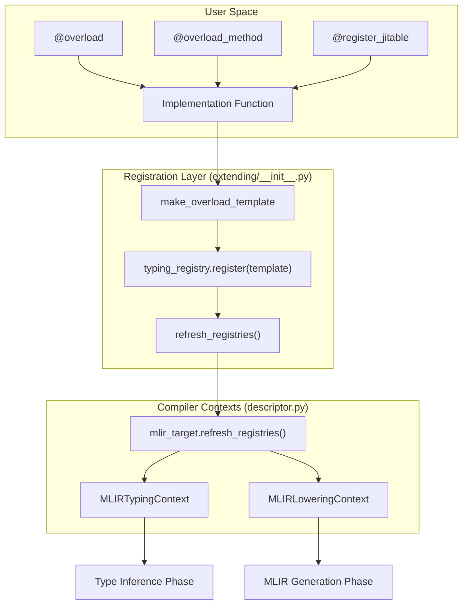
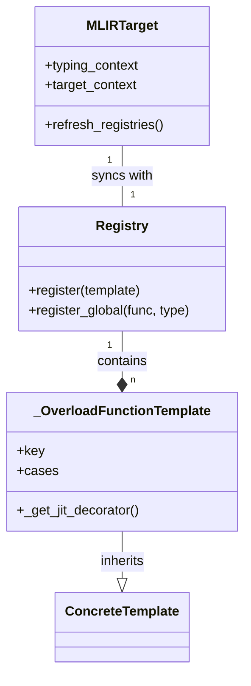

<!-- source: DeepWiki mcp.deepwiki.com · repo NVIDIA/numba-cuda-mlir · page 6.1 High-Level Extension API · fetched 2026-10-26 -->

# High-Level Extension API

<details>
<summary>Relevant source files</summary>

The following files were used as context for generating this wiki page:

- [src/numba_cuda_mlir/compiler.py](src/numba_cuda_mlir/compiler.py)
- [src/numba_cuda_mlir/extending/__init__.py](src/numba_cuda_mlir/extending/__init__.py)
- [src/numba_cuda_mlir/numba_cuda/typing/templates.py](src/numba_cuda_mlir/numba_cuda/typing/templates.py)
- [tests/numba_cuda_tests/cudapy/test_extending.py](tests/numba_cuda_tests/cudapy/test_extending.py)
- [tests/test_numba_cuda_mlir_extending.py](tests/test_numba_cuda_mlir_extending.py)

</details>


The High-Level Extension API provides a set of decorators and utilities to extend the compiler's capabilities using Python-level implementations. These tools allow developers to define how Python functions, methods, and attributes should be handled when encountered in code compiled for the MLIR pipeline. This system leverages Numba's "overload" mechanism, adapted to work with the `numba-cuda-mlir` MLIR-based lowering engine.

### Core Concepts and Registration

The extension system relies on a central `Registry` to track custom implementations. Unlike standard Numba, `numba-cuda-mlir` maintains its own `typing_registry` and `lowering_registry` to ensure that extensions are correctly routed through the MLIR compilation pipeline.

| Entity | Role | Source |
| :--- | :--- | :--- |
| `typing_registry` | Stores `Template` objects that define the type-level behavior of functions. | [src/numba_cuda_mlir/extending/__init__.py:30]() |
| `lowering_registry` | Stores the MLIR-specific lowering implementations for builtins and casts. | [src/numba_cuda_mlir/extending/__init__.py:29]() |
| `refresh_registries()` | Synchronizes the compiler's internal contexts with the current state of the registries. | [src/numba_cuda_mlir/extending/__init__.py:67-79]() |

**Sources:** [src/numba_cuda_mlir/extending/__init__.py:29-79](), [src/numba_cuda_mlir/numba_cuda/typing/templates.py:12-17]()

---

### Function Overloading with @overload

The `@overload` decorator allows you to provide a custom implementation for an existing Python function (e.g., a NumPy function or a third-party library function) when called from a `@cuda.jit` kernel.

#### Implementation Flow
1.  **Typer Phase**: The decorated function acts as a "typer." It receives the Numba types of the arguments.
2.  **Implementation Phase**: The typer returns a Python function (the "impl") that contains the actual logic to be compiled.
3.  **Compilation**: The returned implementation is compiled using the `numba-cuda-mlir` MLIR pipeline.

**Example Usage:**
```python
@extending.overload(np.sum, typing_registry=extending.typing_registry)
def sum_overload(a, b):
    def impl(a, b):
        return a + b
    return impl
```
**Sources:** [src/numba_cuda_mlir/extending/__init__.py:133-187](), [tests/test_numba_cuda_mlir_extending.py:57-68]()

---

### Method and Attribute Overloading

These decorators allow extending Numba types with new methods and properties that are only visible during device compilation.

#### @overload_method
Registers a method implementation for a specific Numba type. It dispatches through a `BoundFunction` template.
- **Key Class**: `_NumbaCudaMlirOverloadMethodTemplate` [src/numba_cuda_mlir/extending/__init__.py:231]()
- **Sources**: [tests/test_numba_cuda_mlir_extending.py:104-115]()

#### @overload_attribute
Exposes a read-only property on a Numba type. It automatically registers a `lower_getattr` implementation in the MLIR lowering registry.
- **Key Class**: `_NumbaCudaMlirOverloadAttributeTemplate` [src/numba_cuda_mlir/extending/__init__.py:190]()
- **Sources**: [src/numba_cuda_mlir/extending/__init__.py:205-215]()

---

### JIT-able Function Registration

The `@register_jitable` decorator is a convenience wrapper that makes a plain Python function callable from device code by automatically creating an overload for it.

**Data Flow for @register_jitable:**
1.  The function is wrapped in an `@overload` call.
2.  `strict` is set to `False` to allow fallback behavior if compilation fails.
3.  The implementation is registered in the `typing_registry`.

**Sources:** [src/numba_cuda_mlir/extending/__init__.py:269-286](), [tests/test_numba_cuda_mlir_extending.py:219-223]()

---

### System Architecture: Extension Registration

The following diagram illustrates how high-level decorators interact with the internal registries and the target context.

**Extension Registry Data Flow**

**Sources:** [src/numba_cuda_mlir/extending/__init__.py:169-185](), [src/numba_cuda_mlir/extending/__init__.py:67-79](), [src/numba_cuda_mlir/descriptor.py:20-22]()

---

### Entity Mapping: Natural Language to Code

This table maps extension concepts to the specific classes and functions in the codebase.

| Concept | Code Entity | File Path |
| :--- | :--- | :--- |
| Typing Template | `_OverloadFunctionTemplate` | [src/numba_cuda_mlir/numba_cuda/typing/templates.py:650]() |
| MLIR JIT Decorator | `jit_with_mlir_pipeline` | [src/numba_cuda_mlir/extending/__init__.py:118]() |
| Global Registry | `typing_registry` | [src/numba_cuda_mlir/extending/__init__.py:30]() |
| Lowering Hook | `lower_builtin` | [src/numba_cuda_mlir/extending/__init__.py:32]() |
| Signature Logic | `Signature` | [src/numba_cuda_mlir/numba_cuda/typing/templates.py:32]() |

**Entity Relationship Diagram**

**Sources:** [src/numba_cuda_mlir/numba_cuda/typing/templates.py:1000-1050](), [src/numba_cuda_mlir/extending/__init__.py:113-131](), [src/numba_cuda_mlir/descriptor.py:20-22]()

### Important Note on Registry Refresh
After using any of the extension decorators, it is mandatory to call `extending.refresh_registries()`. This function triggers a synchronization between the global extension registries and the active `MLIRTarget` contexts. Failure to call this may result in the compiler being unable to find the new implementations during the type inference or lowering stages of kernel compilation.

**Sources:** [src/numba_cuda_mlir/extending/__init__.py:67-79](), [tests/test_numba_cuda_mlir_extending.py:26]()

---

