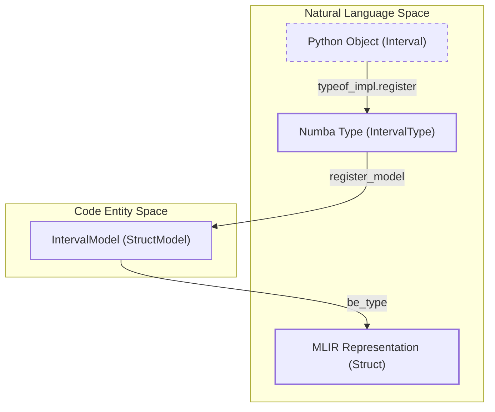
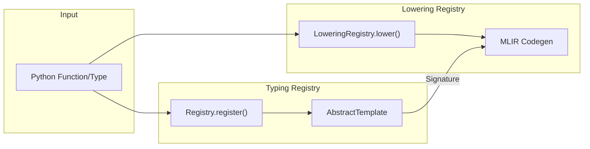

<!-- source: DeepWiki mcp.deepwiki.com · repo NVIDIA/numba-cuda-mlir · page 6.2 Low-Level Extension API · fetched 2026-10-26 -->

# Low-Level Extension API

Relevant source files

The following files were used as context for generating this wiki page:

- [docs/source/extending/high-level.rst](docs/source/extending/high-level.rst)
- [docs/source/extending/index.rst](docs/source/extending/index.rst)
- [docs/source/extending/low-level.rst](docs/source/extending/low-level.rst)
- [docs/source/index.rst](docs/source/index.rst)
- [src/numba_cuda_mlir/compiler.py](src/numba_cuda_mlir/compiler.py)
- [src/numba_cuda_mlir/extending/__init__.py](src/numba_cuda_mlir/extending/__init__.py)
- [src/numba_cuda_mlir/extending/argument_handler.py](src/numba_cuda_mlir/extending/argument_handler.py)
- [src/numba_cuda_mlir/numba_cuda/typing/templates.py](src/numba_cuda_mlir/numba_cuda/typing/templates.py)
- [tests/numba_cuda_tests/cudapy/test_extending.py](tests/numba_cuda_tests/cudapy/test_extending.py)
- [tests/test_numba_cuda_mlir_extending.py](tests/test_numba_cuda_mlir_extending.py)

The Low-Level Extension API provides direct access to the Numba-CUDA-MLIR compilation pipeline. While the High-Level API allows for Python-based overloads, the low-level interface is required for defining new data layouts, emitting MLIR operations directly, and linking against external libraries.

### Overview of Compilation Phases
Low-level extensions interact with two primary phases:
1.  **Typing**: Resolving Python objects and operations to Numba types using templates and registries [docs/source/extending/low-level.rst:12-15]().
2.  **Lowering**: Translating typed operations into MLIR using the `MLIRLower` builder [docs/source/extending/low-level.rst:16-18]().

---

### Direct MLIR Emission with @intrinsic

The `@intrinsic` decorator acts as a bridge between the high-level Python space and low-level MLIR generation. It allows a function to perform custom type inference and provide a specific "codegen" function that emits MLIR [docs/source/extending/high-level.rst:162-171]().

**Implementation Pattern:**
- The decorated function receives the `typingctx` and the Numba types of the arguments [docs/source/extending/high-level.rst:168-169]().
- It returns a tuple of `(signature, codegen)` [docs/source/extending/high-level.rst:171-171]().
- The `codegen` function receives `(builder, target, args, kwargs)` and uses the `numba_cuda_mlir._mlir` bindings to emit IR [docs/source/extending/high-level.rst:174-175]().

**Example Code Structure:**
[tests/test_numba_cuda_mlir_extending.py:14-24]()

**Entity Mapping: Intrinsic Flow**

| System Name | Code Entity | Role |
| :--- | :--- | :--- |
| **Decorator** | `extending.intrinsic` | Registers the intrinsic in the typing registry [src/numba_cuda_mlir/extending/__init__.py:22-22](). |
| **Typer** | `do_nothing(typingctx, x)` | Logic to determine the return `Signature` [tests/test_numba_cuda_mlir_extending.py:23-24](). |
| **Lowerer** | `codegen(builder, ...)` | Emits `arith` or `cf` dialect operations [tests/test_numba_cuda_mlir_extending.py:14-20](). |
| **Builder** | `MLIRLower` | The `builder` object providing `load_var` and `store_var` [docs/source/extending/high-level.rst:188-191](). |

Sources: [src/numba_cuda_mlir/extending/__init__.py:19-22](), [tests/test_numba_cuda_mlir_extending.py:13-42](), [docs/source/extending/high-level.rst:159-191]()

---

### External Function Linking

Numba-CUDA-MLIR allows calling functions defined outside the current JIT context (e.g., in a separate CUBIN, PTX file, or MLIR library).

#### declare_device()
Used to declare a symbol that exists in the CUDA environment (like a `libdevice` function or a function in a linked archive).
- **Signature**: `cuda.declare_device(name, sig)` [tests/test_numba_cuda_mlir_extending.py:131-131]().
- **Usage**: Returns a callable that can be used inside `@cuda.jit` kernels. If the symbol is not found during the linking phase, a `RuntimeError` is raised [tests/test_numba_cuda_mlir_extending.py:159-162]().

#### declare_mlir_library()
For more complex integrations, `ExternMLIRLibrary` allows bundling multiple MLIR functions and their associated types.
- **Classes**: `ExternMLIRLibrary` and `ExternMLIRLibraryFunction` [src/numba_cuda_mlir/compiler.py:23-26]().
- **Data Flow**: These libraries are integrated into the `ExternalCodeLibrary` during the compilation of the `MLIRDispatcher` [src/numba_cuda_mlir/compiler.py:18-18]().

Sources: [src/numba_cuda_mlir/compiler.py:23-26](), [tests/test_numba_cuda_mlir_extending.py:130-162]()

---

### Data Layout and register_model

Every Numba type requires a "Data Model" to define its physical representation in MLIR (e.g., as a primitive integer, a struct, or a pointer).

- **`register_model(TypeClass)`**: Associates a Numba type with a model class [src/numba_cuda_mlir/extending/__init__.py:33-33]().
- **`PrimitiveModel`**: Maps a type to a single MLIR value (e.g., `i32`, `f64`) [docs/source/extending/low-level.rst:125-135]().
- **`StructModel` / `AggregateTypeModel`**: Maps a type to an LLVM-style struct with multiple members [tests/numba_cuda_tests/cudapy/test_extending.py:102-109]().

**Diagram: Data Layout Registration**

Sources: [src/numba_cuda_mlir/extending/__init__.py:33-33](), [tests/numba_cuda_tests/cudapy/test_extending.py:88-109](), [docs/source/extending/low-level.rst:117-141]()

---

### Custom Argument Passing with ArgumentHandler

The `ArgumentHandler` protocol allows extension authors to intercept and transform arguments before they are passed to a CUDA kernel. This is essential for types that require host-side preparation or specialized memory management before a launch.

**The Protocol:**
[src/numba_cuda_mlir/extending/argument_handler.py:8-11]()

- **`prepare_args`**: Receives the Numba type `ty` and the Python value `val`. It returns a tuple of `(new_type, new_value)`.
- **`stream`**: The CUDA stream for the current launch.
- **`retr`**: A list used to track objects that must be kept alive for the duration of the kernel execution.

**Execution Flow:**
1. The `MLIRDispatcher` identifies arguments that implement or are associated with an `ArgumentHandler`.
2. Before `cuLaunchKernel`, `prepare_args` is called.
3. The resulting `new_value` is marshalled into the kernel parameters.

Sources: [src/numba_cuda_mlir/extending/argument_handler.py:1-12](), [src/numba_cuda_mlir/extending/__init__.py:27-27]()

---

### Lowering Registries

Lowering is controlled by the `LoweringRegistry`. While internal modules use private registries, extensions should use the shared registry.

**Key Registry Methods:**
- **`lower(callable, *argtys)`**: Registers a implementation for a function call [docs/source/extending/low-level.rst:177-178]().
- **`lower_getattr(type, attr)`**: Registers logic for reading an attribute [src/numba_cuda_mlir/extending/__init__.py:205-206]().
- **`lower_cast(from_ty, to_ty)`**: Defines how to convert one MLIR representation to another [src/numba_cuda_mlir/extending/__init__.py:31-31]().

**Diagram: Extension Registration Pipeline**

Sources: [src/numba_cuda_mlir/extending/__init__.py:26-33](), [docs/source/extending/low-level.rst:152-160]()

---

