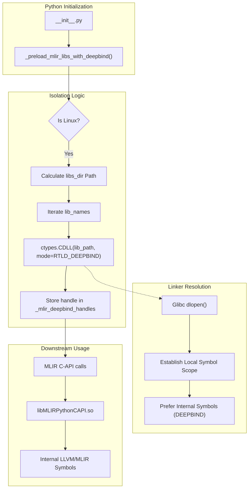
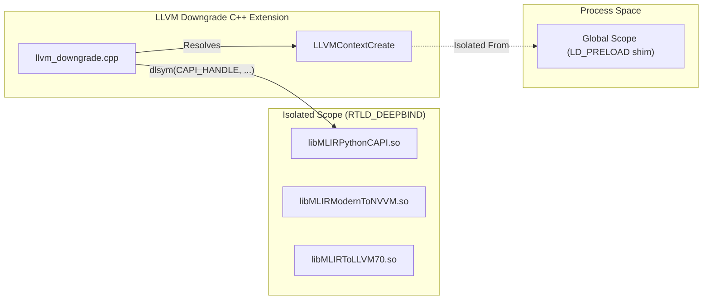

<!-- source: DeepWiki mcp.deepwiki.com · repo NVIDIA/numba-cuda-mlir · page 7.1 Symbol Isolation (RTLD_DEEPBIND) · fetched 2026-10-26 -->

# Symbol Isolation (RTLD_DEEPBIND)

Relevant source files

The following files were used as context for generating this wiki page:

- [cext/launcher/llvm_downgrade.cpp](cext/launcher/llvm_downgrade.cpp)
- [ci/tools/run-expensive-tests](ci/tools/run-expensive-tests)
- [ci/tools/run-tests](ci/tools/run-tests)
- [src/numba_cuda_mlir/__init__.py](src/numba_cuda_mlir/__init__.py)
- [tests/data/Makefile](tests/data/Makefile)
- [tests/data/fake_mlir_shim.c](tests/data/fake_mlir_shim.c)
- [tests/test_symbol_isolation.py](tests/test_symbol_isolation.py)

The `numba-cuda-mlir` package bundles its own specific versions of LLVM and MLIR shared libraries. Because Python environments often include other packages that link against different versions of LLVM (e.g., `llvmlite`, `PyTorch`, or `JAX`), symbol collisions are a significant risk. If multiple versions of LLVM are loaded into the same process, the dynamic linker may preempt symbols from one version with another, leading to crashes or undefined behavior.

To solve this, `numba-cuda-mlir` uses Linux-specific dynamic linker flags (`RTLD_DEEPBIND`) to isolate its bundled libraries from the rest of the process.

## Implementation: Preloading with DEEPBIND

The isolation logic is executed immediately upon importing the `numba-cuda-mlir` package. The `_preload_mlir_libs_with_deepbind` function in `src/numba_cuda_mlir/__init__.py` is responsible for this process.

### Mechanism
1.  **Platform Check**: The mechanism is restricted to Linux, as `RTLD_DEEPBIND` is a GLIBC extension [src/numba_cuda_mlir/__init__.py:13-14]().
2.  **Loading Mode**: Libraries are loaded using `ctypes.CDLL` with the following flags:
    *   `os.RTLD_NOW`: Resolve all symbols immediately [src/numba_cuda_mlir/__init__.py:21]().
    *   `os.RTLD_LOCAL`: Symbols are not made available for subsequent library loads [src/numba_cuda_mlir/__init__.py:21]().
    *   `os.RTLD_DEEPBIND`: Instructs the dynamic linker to prefer symbols from the library itself and its dependencies over symbols already present in the global scope [src/numba_cuda_mlir/__init__.py:21]().
3.  **Library Order**: `libMLIRPythonCAPI.so` is loaded first. Because it has no sibling `DT_NEEDED` entries for the other bundled libs, the `DEEPBIND` attribute applies at first load. Subsequent libraries that depend on it reuse the handle [src/numba_cuda_mlir/__init__.py:25-28]().

### Bundled Libraries
The following libraries are explicitly preloaded to ensure isolation:
*   `libMLIRPythonCAPI.so`
*   `libMLIRPythonSupport-numba_cuda_mlir.so`
*   `libMLIRToLLVM70.so`
*   `libMLIRModernToNVVM.so`

**Sources:** [src/numba_cuda_mlir/__init__.py:4-38]()

## Symbol Isolation Verification

The project includes a specialized test suite to verify that symbols remain isolated and do not "leak" into the global process space.

### RTLD_DEFAULT Verification
The test `test_no_llvm_symbol_leak_to_global_scope` verifies that LLVM and MLIR symbols are not visible via `dlsym(RTLD_DEFAULT, ...)`. If a symbol like `LLVMContextCreate` or `mlirModuleCreateEmpty` is found in the global scope after the compiler has run, the test fails [tests/test_symbol_isolation.py:35-66]().

### Poisoning Test (fake_mlir_shim.so)
To ensure that `RTLD_DEEPBIND` is actually effective against preemption, the CI uses a "poisoning shim" [tests/data/fake_mlir_shim.c:1-21]().

1.  **The Shim**: A C library defines a "fake" version of `mlirContextCreateWithThreading`. If called, this fake function prints an error and calls `abort()` [tests/data/fake_mlir_shim.c:16-21]().
2.  **The Test**: The test `test_poisoned_global_mlir_symbol_does_not_break_modern_path` uses `LD_PRELOAD` to force the fake shim into the global symbol table [tests/test_symbol_isolation.py:91-124]().
3.  **Validation**: The test then triggers a compilation. If `RTLD_DEEPBIND` is working, the bundled MLIR libraries will ignore the global shim and use their own internal symbols. If isolation is broken, the process hits the `abort()` in the shim, and the test fails [tests/test_symbol_isolation.py:121-124]().

**Sources:** [tests/test_symbol_isolation.py:35-125](), [tests/data/fake_mlir_shim.c:1-21](), [tests/data/Makefile:1-17]()

## Data Flow: Library Loading and Isolation

The following diagram illustrates how the `_preload_mlir_libs_with_deepbind` function interacts with the Linux dynamic linker to establish a protected symbol space.

**Library Preloading and Isolation Flow**

**Sources:** [src/numba_cuda_mlir/__init__.py:7-38](), [tests/test_symbol_isolation.py:4-29]()

## Relationship: Isolation and LLVM Downgrade

The symbol isolation is critical for the `llvm_downgrade.cpp` extension. This extension uses `dlopen` (or `GetModuleHandle` on Windows) to find the LLVM C-API functions within the already-loaded MLIR libraries, rather than linking against them at compile-time.

Because `libMLIRPythonCAPI.so` is loaded with `RTLD_DEEPBIND`, the `llvm_downgrade.cpp` extension must ensure it is accessing the correct handles to avoid version mismatch [cext/launcher/llvm_downgrade.cpp:72-161]().

**Symbol Resolution in LLVM Downgrade**

**Sources:** [cext/launcher/llvm_downgrade.cpp:72-161](), [src/numba_cuda_mlir/__init__.py:25-35](), [tests/test_symbol_isolation.py:105-113]()

## Summary of Loading Flags

The combination of flags used ensures that the bundled MLIR environment is a "black box" to the rest of the Python process.

| Flag | Purpose | Significance to numba-cuda-mlir |
| :--- | :--- | :--- |
| `RTLD_NOW` | Immediate resolution | Ensures all symbol issues are caught at import time rather than during kernel launch. |
| `RTLD_LOCAL` | Hidden symbols | Prevents other libraries (like a user's own C++ extensions) from accidentally linking against the bundled LLVM. |
| `RTLD_DEEPBIND` | Self-preference | Critical for coexistence with `llvmlite` or `torch`, ensuring the bundled MLIR uses its own internal LLVM logic. |

**Sources:** [src/numba_cuda_mlir/__init__.py:20-22]()

---

