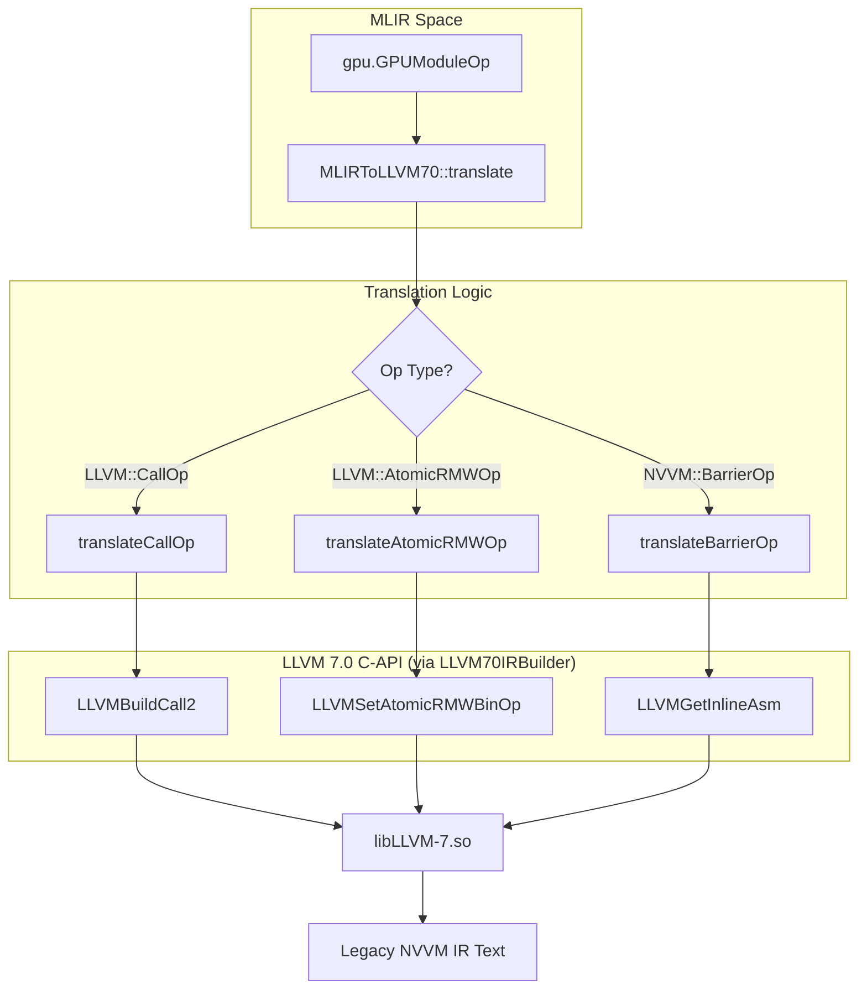
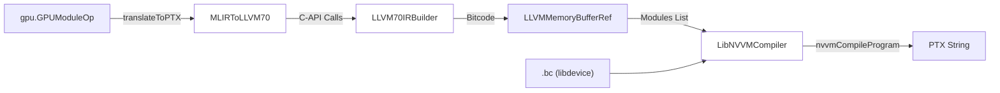

<!-- source: DeepWiki mcp.deepwiki.com · repo NVIDIA/numba-cuda-mlir · page 7.2 LLVM IR Downgrade for libnvvm · fetched 2026-10-26 -->

# LLVM IR Downgrade for libnvvm

Relevant source files

The following files were used as context for generating this wiki page:

- [cext/launcher/llvm_downgrade.cpp](cext/launcher/llvm_downgrade.cpp)
- [cext/mlir-llvm70/include/llvm70/LLVM70Target.h](cext/mlir-llvm70/include/llvm70/LLVM70Target.h)
- [cext/mlir-llvm70/lib/CAPI.cpp](cext/mlir-llvm70/lib/CAPI.cpp)
- [cext/mlir-llvm70/lib/LLVM70Target.cpp](cext/mlir-llvm70/lib/LLVM70Target.cpp)
- [cext/mlir-modern/ModernBridge.cpp](cext/mlir-modern/ModernBridge.cpp)
- [cext/mlir-modern/ModernBridgeSmoke.cpp](cext/mlir-modern/ModernBridgeSmoke.cpp)
- [cext/mlir-modern/include/ModernBridge.h](cext/mlir-modern/include/ModernBridge.h)
- [ci/tools/run-expensive-tests](ci/tools/run-expensive-tests)
- [ci/tools/run-tests](ci/tools/run-tests)
- [ci/windows-llvm-container-build.ps1](ci/windows-llvm-container-build.ps1)
- [src/numba_cuda_mlir/__init__.py](src/numba_cuda_mlir/__init__.py)
- [src/numba_cuda_mlir/lowering_utilities/llvm_utils.py](src/numba_cuda_mlir/lowering_utilities/llvm_utils.py)
- [tests/data/Makefile](tests/data/Makefile)
- [tests/data/fake_mlir_shim.c](tests/data/fake_mlir_shim.c)
- [tests/test_dynamic_shared_memory.py](tests/test_dynamic_shared_memory.py)
- [tests/test_jit_compat.py](tests/test_jit_compat.py)
- [tests/test_symbol_isolation.py](tests/test_symbol_isolation.py)

The `numba-cuda-mlir` compiler pipeline often generates LLVM IR using modern MLIR dialects that exceed the capabilities of the LLVM versions embedded in `libnvvm` (the CUDA compiler library). To maintain compatibility across a wide range of CUDA Toolkit versions, the system employs a sophisticated downgrade mechanism. This subsystem handles semantic patching of intrinsics, version-gated attribute stripping, and a custom translation path for legacy LLVM 7.0 environments.

## Overview and Implementation

The downgrade logic is split between two primary components:
1.  **`llvm_downgrade.cpp`**: A C++ extension that performs in-memory patching of LLVM IR modules using the LLVM C-API. It is loaded dynamically at runtime to avoid hard dependencies on specific LLVM development headers [cext/launcher/llvm_downgrade.cpp:27-31]().
2.  **`MLIRToLLVM70`**: A specialized translator used when targeting older CUDA Toolkits that require LLVM 7.0 compatible IR [cext/mlir-llvm70/lib/LLVM70Target.cpp:41-43]().

### Runtime Symbol Loading
To ensure symbol isolation and prevent conflicts with other LLVM-based libraries in the Python process (like Numba or PyTorch), the compiler pre-loads bundled libraries with `RTLD_DEEPBIND` [src/numba_cuda_mlir/__init__.py:7-35](). `llvm_downgrade.cpp` redeclares necessary LLVM C-API types and function pointers, which are then populated via `dlopen`/`dlsym` from `libMLIRPythonCAPI.so` [cext/launcher/llvm_downgrade.cpp:72-162]().

**Sources:**
- [cext/launcher/llvm_downgrade.cpp:1-162]()
- [src/numba_cuda_mlir/__init__.py:7-35]()
- [cext/mlir-llvm70/lib/LLVM70Target.cpp:1-46]()

---

## Semantic Patches and Adaptations

The `adapt_for_libnvvm` process applies several semantic patches to align modern MLIR-generated LLVM IR with `libnvvm` expectations.

### Barrier Synchronization
Modern MLIR may emit `llvm.nvvm.barrier0`, but `libnvvm` often requires specific intrinsic naming or inline assembly for synchronization. The downgrade pass ensures these are mapped to the correct `llvm.nvvm.barrier0` or `llvm.nvvm.bar.sync` forms based on the target NVVM IR version [cext/mlir-llvm70/lib/LLVM70Target.cpp:106205]().

### Atomic Operations
`libnvvm` has strict requirements for floating-point atomics. The downgrade pass handles:
-   **Atomic FAdd**: Translating `atomicrmw fadd` to the appropriate `llvm.nvvm.atomic.load.add.f32` (or f64) intrinsics [cext/launcher/llvm_downgrade.cpp:45-50]().
-   **CAS Loops**: For types or operations not natively supported as atomics by the hardware, the translator implements a Compare-And-Swap (CAS) loop [cext/mlir-llvm70/include/llvm70/LLVM70Target.h:140-141]().

### Math Intrinsics
Many math functions (e.g., `abs`, `minimum`, `maximum`) are downgraded from modern LLVM intrinsics to `libdevice` calls or NVVM-specific intrinsics that `libnvvm` recognizes [cext/mlir-llvm70/include/llvm70/LLVM70Target.h:145-156]().

**Sources:**
- [cext/launcher/llvm_downgrade.cpp:44-50]()
- [cext/mlir-llvm70/include/llvm70/LLVM70Target.h:139-164]()
- [cext/mlir-llvm70/lib/LLVM70Target.cpp:106205]()

---

## Version-Gated Downgrade Passes

The `llvm_downgrade.cpp` extension implements several passes that are conditionally activated based on the `NvvmIrVersion` [cext/launcher/llvm_downgrade.cpp:18-25]().

| Pass Feature | Description |
| :--- | :--- |
| **Lifetime Intrinsics** | Strips `llvm.lifetime.start` and `llvm.lifetime.end` which can cause issues in older `libnvvm` versions [cext/mlir-llvm70/include/llvm70/LLVM70Target.h:159](). |
| **Attribute Stripping** | Removes modern LLVM attributes (e.g., `willreturn`, `nofree`, `memory(...)`) that were introduced after LLVM 7/8 [cext/launcher/llvm_downgrade.cpp:93-100](). |
| **grid_constant Metadata** | Converts modern `grid_constant` parameter attributes into the specific NVVM metadata nodes required for optimized kernel parameter access [cext/mlir-llvm70/include/llvm70/LLVM70Target.h:47-50](). |
| **BFloat16 Conversion** | Since LLVM 7 lacks native `bf16` support, the `MLIRToLLVM70` translator implements `bf16` as `i16` and provides software conversion routines to/from `f32` [cext/mlir-llvm70/lib/LLVM70Target.cpp:136-151](). |

### Downgrade Logic Flow

The following diagram illustrates how the `MLIRToLLVM70` translator and `LLVM70IRBuilder` interact to produce legacy-compatible IR.

**MLIR to LLVM 7.0 Translation Path**

**Sources:**
- [cext/mlir-llvm70/lib/LLVM70Target.cpp:30-46]()
- [cext/mlir-llvm70/include/llvm70/LLVM70Target.h:116-164]()
- [cext/launcher/llvm_downgrade.cpp:122-135]()

---

## MLIRToLLVM70 Translator

The `MLIRToLLVM70` class is the core of the legacy compatibility layer. It manually traverses the MLIR module and reconstructs an LLVM IR module using the version 7.0 C-API.

### Key Functions and Classes

- **`LLVM70IRBuilder`**: A wrapper around the LLVM 7.0 C-API that provides a stable interface for creating types, values, and instructions [cext/mlir-llvm70/include/llvm70/LLVM70Target.h:17]().
- **`convertType`**: Maps MLIR types (including `IndexType`, `BFloat16Type`, and `LLVMStructType`) to LLVM 7.0 type handles [cext/mlir-llvm70/lib/LLVM70Target.cpp:157-180]().
- **`LibNVVMCompiler`**: Handles the final compilation of the downgraded IR into PTX or LTOIR using the user's local `libnvvm.so` [cext/mlir-llvm70/lib/LLVM70Target.cpp:94-105]().

### Data Flow for PTX Generation

The pipeline from MLIR to PTX via the LLVM 7 path:

**PTX Generation Data Flow**

**Sources:**
- [cext/mlir-llvm70/lib/LLVM70Target.cpp:48-108]()
- [cext/mlir-llvm70/include/llvm70/LLVM70Target.h:37-57]()
- [src/numba_cuda_mlir/lowering_utilities/llvm_utils.py:166-213]()

## Testing and Verification
The downgrade logic is verified through regression tests that force specific paths:
-   `test_symbol_isolation.py`: Uses a `fake_mlir_shim.c` to ensure that `RTLD_DEEPBIND` correctly isolates the LLVM symbols used during downgrade from the rest of the process [tests/test_symbol_isolation.py:34-66]().
-   `test_jit_compat.py`: Validates that kernel options like `opt` levels and `inline` settings are correctly propagated through the downgrade and compilation layers [tests/test_jit_compat.py:27-40]().

**Sources:**
- [tests/test_symbol_isolation.py:34-66]()
- [tests/data/fake_mlir_shim.c:1-21]()
- [tests/test_jit_compat.py:27-40]()

---

