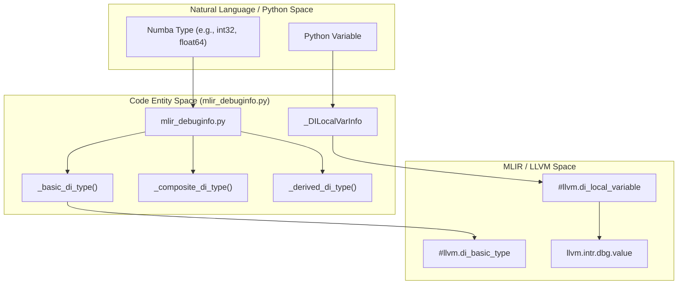
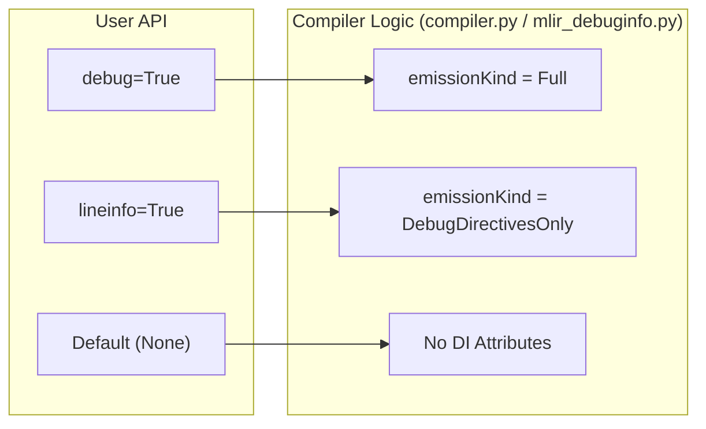

<!-- source: DeepWiki mcp.deepwiki.com · repo NVIDIA/numba-cuda-mlir · page 8 Debugging and Profiling · fetched 2026-10-26 -->

# Debugging and Profiling

Relevant source files

The following files were used as context for generating this wiki page:

- [docs/source/user/profiling.rst](docs/source/user/profiling.rst)
- [src/numba_cuda_mlir/mlir_debuginfo.py](src/numba_cuda_mlir/mlir_debuginfo.py)
- [src/numba_cuda_mlir/numba_cuda/datamodel/models.py](src/numba_cuda_mlir/numba_cuda/datamodel/models.py)
- [tests/test_debuginfo.py](tests/test_debuginfo.py)

This page provides an overview of the debugging and profiling capabilities within `numba-cuda-mlir`. The system supports standard CUDA developer workflows, including source-level debugging with `cuda-gdb` and performance analysis with NVIDIA Nsight Compute. These features are powered by a custom DWARF-based debug information builder that integrates with the MLIR pipeline.

## Overview of Debugging Capabilities

Debugging in `numba-cuda-mlir` is controlled via the `debug` and `lineinfo` flags in the `@cuda.jit` decorator or the `compiler.compile_mlir` function [tests/test_debuginfo.py:35-42](). 

The system distinguishes between two levels of debug information:
1.  **Line Information (`lineinfo=True`)**: Emits basic source-to-instruction mapping, allowing profilers to attribute performance metrics to specific Python source lines [tests/test_debuginfo.py:52-56]().
2.  **Full Debug Info (`debug=True`)**: Emits full DWARF metadata, including variable names, types, and scope information, enabling full inspection of state in a debugger [tests/test_debuginfo.py:35-40]().

### Debug Information Architecture
The `mlir_debuginfo.py` module contains the logic for translating Numba types and Python source locations into MLIR `llvm.di_*` attributes. It handles complex mappings for basic types, pointers, and composite structures [src/numba_cuda_mlir/mlir_debuginfo.py:34-134]().

For more details on the DI attribute system and DWARF mapping, see **[Debug Information (DWARF/NVVM)](#8.1)**.

## Inspection and Profiling Tools

`numba-cuda-mlir` provides several methods for inspecting the results of the compilation pipeline and profiling the resulting kernels.

### Kernel Inspection
Dispatchers (like `MLIRDispatcher`) provide methods to view the generated code at various stages:
*   **`inspect_llvm()`**: Shows the LLVM IR before translation to PTX.
*   **`inspect_asm()`**: Shows the generated PTX assembly.
*   **`inspect_sass()`**: Shows the SASS (Streaming Assembler) code executed by the GPU hardware.
*   **`inspect_types()`**: Displays the Numba-inferred types for the kernel arguments and local variables.

### Profiling Workflow
Profiling with **NVIDIA Nsight Compute** is supported. Users can correlate hardware metrics directly with Python source lines when `lineinfo=True` is used [docs/source/user/profiling.rst:10-24]().

For detailed instructions on using `cuda-gdb` and Nsight Compute, see **[Kernel Inspection and Profiling](#8.2)**.

## Debugging and Profiling System Map

The following diagrams illustrate how the debugging infrastructure associates Python-level entities with MLIR and LLVM debug metadata.

### Data Model to DWARF Mapping
This diagram shows how `DataModel` structures from the Numba frontend are transformed into DWARF-compatible attributes in the `mlir_debuginfo` module.

**Sources:** [src/numba_cuda_mlir/mlir_debuginfo.py:15-134](), [src/numba_cuda_mlir/numba_cuda/datamodel/models.py:36-62]()

### Debug Level Dispatch
This diagram maps the user-facing compilation flags to the internal MLIR `emissionKind`.

**Sources:** [tests/test_debuginfo.py:35-76]()

## Comparison of Debug Modes

| Feature | `debug=False` (Default) | `lineinfo=True` | `debug=True` |
| :--- | :--- | :--- | :--- |
| **MLIR Emission Kind** | None | `DebugDirectivesOnly` | `Full` |
| **Source Line Mapping** | No | Yes | Yes |
| **Local Variable Inspection** | No | No | Yes |
| **Type Information** | No | No | Yes |
| **Optimization Level** | Typically `opt=True` | Typically `opt=True` | Recommended `opt=False` |
| **Tool Support** | Basic Profiling | Nsight Compute (Line Info) | `cuda-gdb` |

**Sources:** [tests/test_debuginfo.py:35-62](), [docs/source/user/profiling.rst:10-24]()

## Summary of Child Pages

*   **[Debug Information (DWARF/NVVM)](#8.1)**: Deep dive into how Python types are mapped to DWARF tags (like `DW_TAG_base_type` and `DW_TAG_pointer_type`), and how NVVM-specific constraints (like boolean argument handling) are managed.
*   **[Kernel Inspection and Profiling](#8.2)**: Practical guide to using the `inspect_*` methods and integrating with external NVIDIA profiling and debugging tools.

---

