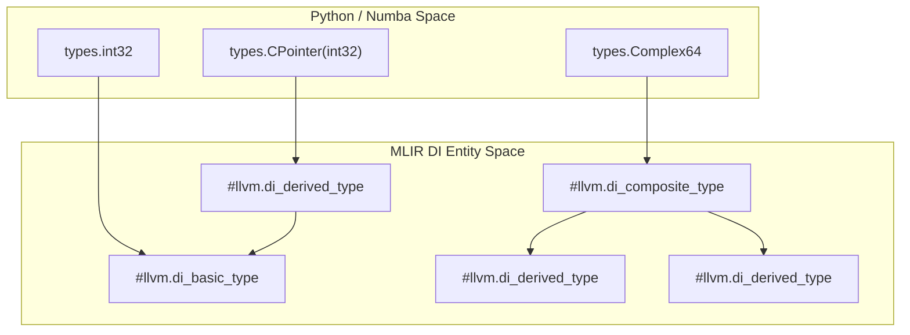
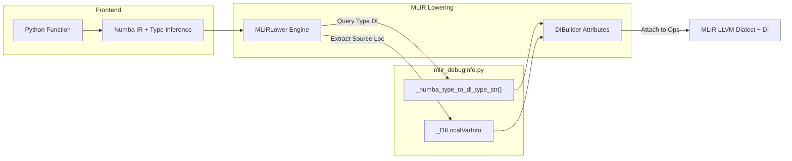

<!-- source: DeepWiki mcp.deepwiki.com · repo NVIDIA/numba-cuda-mlir · page 8.1 Debug Information (DWARF/NVVM) · fetched 2026-10-26 -->

# Debug Information (DWARF/NVVM)

Relevant source files

The following files were used as context for generating this wiki page:

- [docs/source/_static/lineinfo.png](docs/source/_static/lineinfo.png)
- [docs/source/reference/compilation.rst](docs/source/reference/compilation.rst)
- [src/numba_cuda_mlir/mlir_debuginfo.py](src/numba_cuda_mlir/mlir_debuginfo.py)
- [src/numba_cuda_mlir/numba_cuda/datamodel/models.py](src/numba_cuda_mlir/numba_cuda/datamodel/models.py)
- [tests/test_debuginfo.py](tests/test_debuginfo.py)

The `numba-cuda-mlir` compiler provides a comprehensive Debug Information (DI) system that maps Python source constructs and Numba types to DWARF metadata within the MLIR/LLVM pipeline. This system supports both full source-level debugging (via `debug=True`) and line-number information (via `lineinfo=True`), with specialized handling for NVVM-specific constraints and polymorphic data structures.

## DIBuilder System and Emission Modes

The debug information emission is controlled by the `compile_mlir` function and the `MLIRLower` engine. Depending on the flags provided, the compiler generates different levels of `llvm.di_compile_unit` attributes.

| Mode | Flag | MLIR `emissionKind` | Description |
| :--- | :--- | :--- | :--- |
| **None** | Default | N/A | No DI attributes or `dbg.value` intrinsics are emitted [tests/test_debuginfo.py:65-76](). |
| **Line Info** | `lineinfo=True` | `DebugDirectivesOnly` | Emits line-to-instruction mapping but omits variable and type metadata [tests/test_debuginfo.py:52-62](). |
| **Full Debug** | `debug=True` | `Full` | Emits full DWARF metadata including types, variables, and scopes [tests/test_debuginfo.py:35-49](). |

### Variable Tracking
*   **Arguments**: Function arguments are emitted as `di_local_variable` with an associated `arg` index [tests/test_debuginfo.py:133-149]().
*   **Locals**: Local variables assigned within the function appear as `di_local_variable` without an argument index [tests/test_debuginfo.py:152-167]().
*   **Intrinsics**: The compiler uses `llvm.intr.dbg.declare` for stack-allocated variables and `llvm.intr.dbg.value` for register-resident values [tests/test_debuginfo.py:170-199]().

**Sources:** [tests/test_debuginfo.py:35-200](), [src/numba_cuda_mlir/mlir_debuginfo.py:15-20]()

## Type-to-DWARF Mapping

The `mlir_debuginfo.py` module contains the logic for converting Numba types into MLIR LLVM-dialect DI attributes. It maps Numba's type system to DWARF tags such as `DW_TAG_base_type`, `DW_TAG_pointer_type`, and `DW_TAG_structure_type`.

### Basic and Derived Types
The system maps primitive Numba types to `di_basic_type` using appropriate DWARF encodings (`DW_ATE_signed`, `DW_ATE_float`, `DW_ATE_boolean`).

| Numba Type | DWARF Tag | Encoding |
| :--- | :--- | :--- |
| `int32` / `int64` | `DW_TAG_base_type` | `DW_ATE_signed` |
| `float32` / `float64` | `DW_TAG_base_type` | `DW_ATE_float` |
| `boolean` | `DW_TAG_base_type` | `DW_ATE_boolean` |
| `CPointer` | `DW_TAG_pointer_type` | N/A (Points to base type) |

### Composite Types
Complex structures like `Complex64` or `Complex128` are represented as `di_composite_type` with `DW_TAG_structure_type`. These are composed of `real` and `imag` members with calculated offsets [src/numba_cuda_mlir/mlir_debuginfo.py:65-82]().

### LLVM Entity Mapping
The following diagram illustrates how Python-level types are transformed into MLIR Debug Information entities:

**Type to DI Attribute Mapping**

**Sources:** [src/numba_cuda_mlir/mlir_debuginfo.py:34-82](), [tests/test_debuginfo.py:79-112](), [tests/test_debuginfo.py:242-264]()

## Polymorphic Variables and `DW_TAG_variant_part`

For complex Numba types that exhibit polymorphic behavior (such as certain record types or union-like structures), the DI system utilizes `DW_TAG_variant_part`. This allows a single memory location to be interpreted differently based on a discriminator.

*   **Implementation**: `_composite_di_type` supports a `discriminator` parameter [src/numba_cuda_mlir/mlir_debuginfo.py:111-134]().
*   **Layout Calculation**: The system manually calculates bit offsets and alignments using `_llvm_struct_layout_bits` to ensure the DWARF metadata matches the physical memory layout of the generated LLVM IR [src/numba_cuda_mlir/mlir_debuginfo.py:190-205]().

**Sources:** [src/numba_cuda_mlir/mlir_debuginfo.py:111-134](), [src/numba_cuda_mlir/mlir_debuginfo.py:190-205]()

## NVVM-Specific Workarounds

The CUDA/NVVM backend has specific limitations regarding DWARF emission that require workarounds in the MLIR lowering phase.

### Boolean Argument Handling
NVVM often struggles with `dbg.declare` on `i1` (boolean) arguments when they are passed in registers. To ensure visibility in `cuda-gdb`, the compiler forces the use of `llvm.intr.dbg.value` for boolean arguments instead of the standard stack-based `dbg.declare` [tests/test_debuginfo.py:202-217]().

### Enum Member Encoding
Current MLIR toolchains (at the time of implementation) lack a stable `#llvm.di_enumerator` attribute. Additionally, the modern LLVM translation path in `libnvvm` rejects `DW_TAG_enumerator` when encoded via generic `di_derived_type`.
*   **Workaround**: Enums are currently lowered to their underlying scalar DI basic types (e.g., `int32`) with a name string reflecting the Numba enum type to maintain stability in the debug toolchain [src/numba_cuda_mlir/mlir_debuginfo.py:52-62]().

### GridGroup Opaque Type
The CUDA `GridGroup` type (used for cooperative groups) is lowered as an opaque 64-bit unsigned basic type to allow debuggers to inspect the handle without requiring a full definition of the internal CUDA runtime structures [tests/test_debuginfo.py:219-240]().

**Sources:** [tests/test_debuginfo.py:202-217](), [src/numba_cuda_mlir/mlir_debuginfo.py:52-62](), [tests/test_debuginfo.py:219-240]()

## Implementation Data Flow

The flow of debug information from Python source to the final MLIR module is handled during the lowering phase.

**Debug Info Emission Pipeline**

**Key Functions:**
*   `_numba_type_to_di_type_str`: Dispatches Numba types to specific DI attribute generators [src/numba_cuda_mlir/mlir_debuginfo.py:236]().
*   `_llvm_type_str`: Maps Numba types to LLVM-compatible type strings for DI size calculations [src/numba_cuda_mlir/mlir_debuginfo.py:141-164]().
*   `_type_size_bits`: Computes the bit-width of types for DWARF `sizeInBits` fields [src/numba_cuda_mlir/mlir_debuginfo.py:208]().

**Sources:** [src/numba_cuda_mlir/mlir_debuginfo.py:1-250](), [src/numba_cuda_mlir/numba_cuda/datamodel/models.py:36-63]()

---

