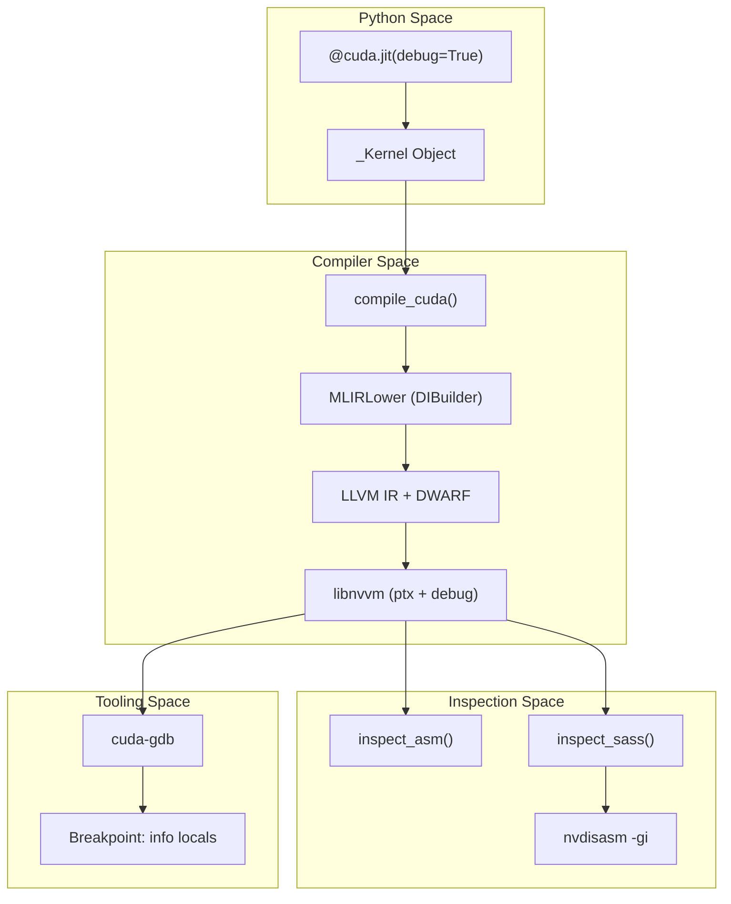
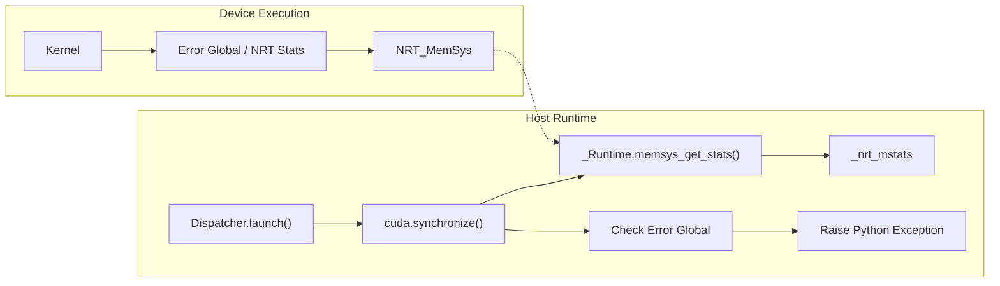

<!-- source: DeepWiki mcp.deepwiki.com · repo NVIDIA/numba-cuda-mlir · page 8.2 Kernel Inspection and Profiling · fetched 2026-10-26 -->

# Kernel Inspection and Profiling

Relevant source files

The following files were used as context for generating this wiki page:

- [ci/tools/run-cuda-gdb-tests](ci/tools/run-cuda-gdb-tests)
- [docs/source/user/profiling.rst](docs/source/user/profiling.rst)
- [src/numba_cuda_mlir/memory_management/__init__.py](src/numba_cuda_mlir/memory_management/__init__.py)
- [src/numba_cuda_mlir/memory_management/nrt.py](src/numba_cuda_mlir/memory_management/nrt.py)
- [src/numba_cuda_mlir/numba_cuda/codegen.py](src/numba_cuda_mlir/numba_cuda/codegen.py)
- [src/numba_cuda_mlir/numba_cuda/dispatcher.py](src/numba_cuda_mlir/numba_cuda/dispatcher.py)
- [src/numba_cuda_mlir/numba_cuda/memory_management/nrt.py](src/numba_cuda_mlir/numba_cuda/memory_management/nrt.py)
- [tests/doc_examples/test_globals.py](tests/doc_examples/test_globals.py)
- [tests/doc_examples/test_laplace.py](tests/doc_examples/test_laplace.py)
- [tests/doc_examples/test_matmul.py](tests/doc_examples/test_matmul.py)
- [tests/doc_examples/test_montecarlo.py](tests/doc_examples/test_montecarlo.py)
- [tests/doc_examples/test_random.py](tests/doc_examples/test_random.py)
- [tests/doc_examples/test_reduction.py](tests/doc_examples/test_reduction.py)
- [tests/doc_examples/test_sessionize.py](tests/doc_examples/test_sessionize.py)
- [tests/test_cuda_gdb.py](tests/test_cuda_gdb.py)

This page describes the infrastructure for inspecting compiled CUDA kernels, integrating with hardware-level debugging tools like `cuda-gdb`, and utilizing NVIDIA Nsight Compute for performance analysis. It also covers the internal mechanism for exception propagation from device kernels to the host.

## Kernel Inspection Methods

The `_Kernel` and dispatcher classes provide several methods to inspect the various stages of the compilation pipeline. These methods allow developers to view the intermediate representations and final machine code generated for a specific specialization.

### Code Inspection API
On a specialized kernel object (or via the dispatcher), the following methods are available:

| Method | Description | Implementation Source |
| :--- | :--- | :--- |
| `inspect_llvm()` | Returns the LLVM IR string generated after MLIR lowering and optimization. | [src/numba_cuda_mlir/numba_cuda/dispatcher.py:185-185]() |
| `inspect_asm()` | Returns the PTX (Parallel Thread Execution) assembly string. | [src/numba_cuda_mlir/numba_cuda/dispatcher.py:185-185]() |
| `inspect_sass()` | Returns the SASS (Source Automated Scheduling) binary disassembly. | [src/numba_cuda_mlir/numba_cuda/codegen.py:44-48]() |
| `inspect_types()` | Returns a report of the Numba type inference results for the kernel arguments and variables. | [src/numba_cuda_mlir/numba_cuda/dispatcher.py:145-145]() |

### SASS Disassembly via `nvdisasm`
The `inspect_sass()` method utilizes the `nvdisasm` utility from the CUDA Toolkit. The implementation writes the compiled CUBIN to a temporary file and executes `nvdisasm` with specific flags:
- `-gi`: Includes line information to correlate SASS instructions with source code [src/numba_cuda_mlir/numba_cuda/codegen.py:46-47]().
- `-cfg`: Generates a control flow graph (via `disassemble_cubin_for_cfg`) [src/numba_cuda_mlir/numba_cuda/codegen.py:52-53]().

**Sources:**
- `src/numba_cuda_mlir/numba_cuda/dispatcher.py`
- `src/numba_cuda_mlir/numba_cuda/codegen.py`

---

## Debugging with cuda-gdb

`numba-cuda-mlir` supports source-level debugging using `cuda-gdb`. This is enabled by passing `debug=True` to the `@cuda.jit` decorator.

### Debug Workflow Implementation
When `debug=True` is set, the following changes occur in the compilation flow:
1. **DWARF Emission**: The MLIR lowering engine emits DWARF debug information (via `DIBuilder`).
2. **NVVM Options**: The `nvvm_options` dictionary is updated with `{"g": None}` to signal the NVVM compiler to preserve debug symbols [src/numba_cuda_mlir/numba_cuda/dispatcher.py:153-154]().
3. **Optimization**: Optimization is typically disabled (`opt=False`) to ensure a direct mapping between source lines and machine instructions [tests/test_cuda_gdb.py:68-68]().

### Integration Test Logic
The test suite verifies `cuda-gdb` integration by spawning the debugger in batch mode and checking for expected output at kernel breakpoints.

**Kernel Inspection & Debugging Data Flow**

**Sources:**
- `src/numba_cuda_mlir/numba_cuda/dispatcher.py`
- `tests/test_cuda_gdb.py`

---

## Nsight Compute Benchmarking

Profiling with Nsight Compute (ncu) allows for deep analysis of kernel performance, including occupancy, memory throughput, and instruction pipe utilization.

### Profiling Configuration
To profile a Python script using `numba-cuda-mlir`, the Nsight Compute target should be configured as follows [docs/source/user/profiling.rst:10-21]():
- **Application Executable**: The path to the Python interpreter (e.g., `/usr/bin/python3`).
- **Command Line Arguments**: The script name and its arguments (e.g., `myscript.py --size 1024`).

### Source Correlation
When kernels are compiled with `lineinfo=True` or `debug=True`, Nsight Compute can correlate hardware metrics directly to Python source lines in the "Source" view [docs/source/user/profiling.rst:24-27](). This is achieved by embedding `.loc` directives in the PTX, which map back to the original `.py` file.

**Sources:**
- `docs/source/user/profiling.rst`
- `src/numba_cuda_mlir/numba_cuda/dispatcher.py`

---

## Exception Propagation and Error Codes

Since CUDA kernels execute asynchronously on the device, Python exceptions cannot be raised directly. `numba-cuda-mlir` uses a global error code mechanism to propagate device-side failures back to the host.

### Implementation Details
1. **Global Error Buffer**: A specific memory location is reserved to hold an integer error code.
2. **Device-side Traps**: When an assertion fails or an out-of-bounds access is detected, the kernel writes a non-zero value to the error code global and terminates the thread.
3. **Host-side Check**: After a kernel launch, the dispatcher or the `synchronize()` call checks this global buffer. If a non-zero value is found, Numba maps the error code to a Python exception (e.g., `IndexError`) and raises it on the host.

### Numba Runtime (NRT) Statistics
The Numba Runtime also provides hooks for tracking memory allocation failures on the device.
- `NUMBA_CUDA_NRT_STATS`: Environment variable to enable tracking of `alloc`, `free`, `mi_alloc`, and `mi_free` counts [src/numba_cuda_mlir/numba_cuda/memory_management/nrt.py:32-34]().
- `_nrt_mstats`: A named tuple used to report these statistics back to the host [src/numba_cuda_mlir/numba_cuda/memory_management/nrt.py:28-28]().

**NRT Statistics and Error Flow**

**Sources:**
- `src/numba_cuda_mlir/numba_cuda/memory_management/nrt.py`
- `src/numba_cuda_mlir/memory_management/__init__.py`
- `src/numba_cuda_mlir/numba_cuda/dispatcher.py`

---

