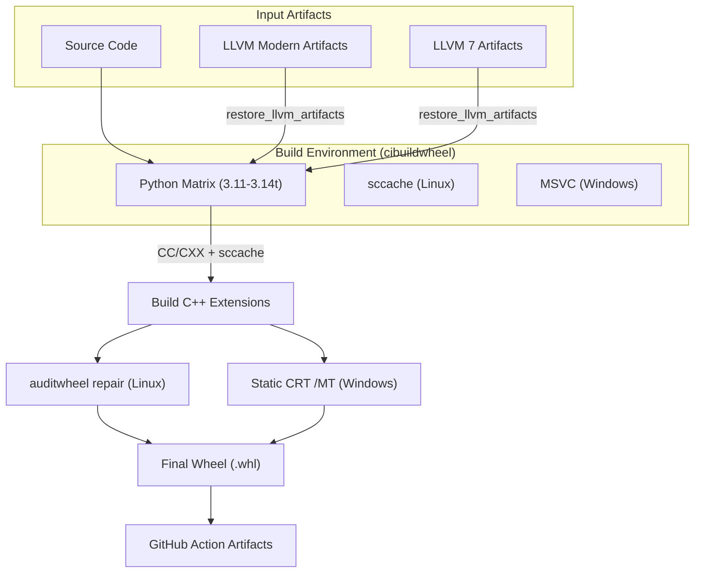
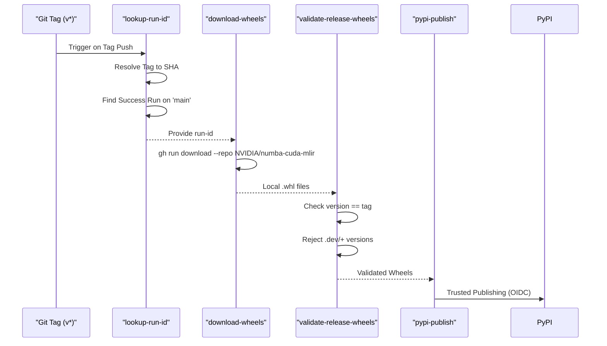

<!-- source: DeepWiki mcp.deepwiki.com · repo NVIDIA/numba-cuda-mlir · page 9.1 Wheel Build and Release Pipeline · fetched 2026-10-26 -->

# Wheel Build and Release Pipeline

Relevant source files

The following files were used as context for generating this wiki page:

- [.github/workflows/bandit.yml](.github/workflows/bandit.yml)
- [.github/workflows/build-llvm.yml](.github/workflows/build-llvm.yml)
- [.github/workflows/build-wheel.yml](.github/workflows/build-wheel.yml)
- [.github/workflows/codeql.yml](.github/workflows/codeql.yml)
- [.github/workflows/publish.yaml](.github/workflows/publish.yaml)
- [.github/workflows/simulator-test.yaml](.github/workflows/simulator-test.yaml)
- [.github/workflows/test-expensive-linux.yml](.github/workflows/test-expensive-linux.yml)
- [.github/workflows/test-wheel-linux.yml](.github/workflows/test-wheel-linux.yml)
- [.github/workflows/test-wheel-windows.yml](.github/workflows/test-wheel-windows.yml)
- [ci/tools/download-wheels](ci/tools/download-wheels)
- [ci/tools/lookup-run-id](ci/tools/lookup-run-id)
- [ci/tools/validate-release-wheels](ci/tools/validate-release-wheels)

The `numba-cuda-mlir` build and release pipeline is a multi-stage GitHub Actions infrastructure designed to produce highly optimized, self-contained Python wheels for multiple architectures and Python versions. It manages complex C++ dependencies (LLVM/MLIR), implements robust symbol isolation, and provides a validated release path from main-branch CI to PyPI.

## Build Pipeline Architecture

The core of the build process is defined in `.github/workflows/build-wheel.yml`, which utilizes `cibuildwheel` to manage the build environment across different host platforms and Python versions.

### Build Matrix and Environments
The pipeline supports a matrix of Python versions and platforms:
*   **Python Versions**: 3.11, 3.12, 3.13, 3.14, and 3.14t (freethreading) `[.github/workflows/build-wheel.yml:29-35]()`.
*   **Platforms**:
    *   `linux-64` (AMD64) using `manylinux_2_28` `[.github/workflows/build-wheel.yml:37,123]()`.
    *   `linux-aarch64` (ARM64) using `manylinux_2_28` `[.github/workflows/build-wheel.yml:38,124]()`.
    *   `win-64` (Windows 2022) `[.github/workflows/build-wheel.yml:39]()`.

### LLVM Artifact Restoration
Because building LLVM/MLIR is time-consuming, the wheel build workflow does not compile LLVM from scratch. Instead, it uses a custom action `restore_llvm_artifacts` `[.github/workflows/build-wheel.yml:90-94]()` to fetch pre-built binaries specific to the `host-platform` and `llvm-py-tag` (e.g., `cp312`) `[.github/workflows/build-wheel.yml:81-82]()`.

### Compilation and Caching
*   **sccache**: For Linux builds, `sccache` is installed and configured to use GitHub Actions as a storage backend to speed up C++ compilation `[.github/workflows/build-wheel.yml:52-70]()`.
*   **Compilers**: On Linux, `CC` and `CXX` are wrapped with `sccache` `[.github/workflows/build-wheel.yml:128-129]()`. On Windows, the `msvc-dev-cmd` action sets up the MSVC environment `[.github/workflows/build-wheel.yml:114]()`.

### Dependency Injection
The build environment is injected with paths to the restored LLVM components via environment variables:
*   `MLIR_DIR`: Points to the MLIR CMake configuration `[.github/workflows/build-wheel.yml:126,137]()`.
*   `LIBLLVM7`: Points to the legacy LLVM 7 library required for `libnvvm` compatibility `[.github/workflows/build-wheel.yml:127,138]()`.

**Sources:** `[.github/workflows/build-wheel.yml]()`, `[.github/workflows/build-llvm.yml]()`.

---

## Wheel Repair and Symbol Isolation

The pipeline performs specific "repair" steps to ensure the resulting wheels are portable and do not conflict with other MLIR-based packages (like `mlir-python-bindings`).

### Linux: auditwheel and Exclusion
On Linux, `auditwheel repair` is invoked with specific exclusions:
*   `libMLIRPythonCAPI.so` and `libMLIRPythonSupport-numba_cuda_mlir.so` are excluded from being bundled into the wheel's internal library directory `[.github/workflows/build-wheel.yml:141-142]()`.
*   `libLLVM-7.so` is also excluded `[.github/workflows/build-wheel.yml:143]()`.
*   This exclusion strategy works in tandem with `RTLD_DEEPBIND` loading logic in the C++ extension to prevent symbol preemption.

### Windows: Static CRT and Search Patching
*   **Static Linking**: Windows wheels are built with `/MT` (Static CRT) `[.github/workflows/build-wheel.yml:146]()`.
*   **No Delvewheel**: The workflow explicitly opts out of `delvewheel repair` (setting it to an empty string) to maintain a self-contained structure without external DLL bundling `[.github/workflows/build-wheel.yml:150]()`.

### Isolation Testing
To verify that the symbol isolation mechanism is functioning, the pipeline builds a `fake_mlir_shim.so` `[.github/workflows/build-wheel.yml:166-170]()`. This artifact is shipped alongside the wheel and used in tests to ensure that the internal MLIR symbols remain isolated from the global symbol table.

**Sources:** `[.github/workflows/build-wheel.yml]()`.

---

## Release and Publication Workflow

The publication process (`.github/workflows/publish.yaml`) is triggered by git tags (e.g., `v0.4.0`) `[.github/workflows/publish.yaml:13-16]()`. It follows a "Validated Release" pattern where wheels are not rebuilt on the tag, but rather promoted from a successful CI run on the `main` branch.

### 1. Run Identification
The script `ci/tools/lookup-run-id` resolves the git tag to a commit SHA and searches for the most recent successful CI run on the `main` branch for that specific SHA `[.github/workflows/publish.yaml:43](), [ci/tools/lookup-run-id:51-87]()`.

### 2. Artifact Retrieval
Once the `run-id` is identified, `ci/tools/download-wheels` fetches the wheel artifacts from the validated CI run using the GitHub CLI (`gh run download`) `[.github/workflows/publish.yaml:65](), [ci/tools/download-wheels:35-43]()`.

### 3. Validation
The `ci/tools/validate-release-wheels` script performs safety checks:
*   Ensures the wheel version matches the git tag exactly `[ci/tools/validate-release-wheels:87-92]()`.
*   Rejects any wheels containing `.dev` or `+` (local) version markers `[ci/tools/validate-release-wheels:81-86]()`.
*   Verifies the distribution name is `numba_cuda_mlir` `[ci/tools/validate-release-wheels:72-77]()`.

### 4. Publication
*   **PyPI**: Uses `pypa/gh-action-pypi-publish` with Trusted Publishing (OIDC) `[.github/workflows/publish.yaml:71-74]()`.
*   **GitHub Releases**: Creates a GitHub release and uploads the validated wheels `[.github/workflows/publish.yaml:100-126]()`.

**Sources:** `[.github/workflows/publish.yaml]()`, `[ci/tools/lookup-run-id]()`, `[ci/tools/download-wheels]()`, `[ci/tools/validate-release-wheels]()`.

---

## Pipeline Data Flow Diagrams

### Build and Artifact Flow
This diagram shows how source code and pre-built LLVM artifacts converge in `cibuildwheel` to produce the final wheel.

Title: Wheel Build Data Flow

**Sources:** `[.github/workflows/build-wheel.yml:28-40, 90-94, 117-150]()`.

### Release Promotion Flow
This diagram maps the logical "Release" process to the specific scripts and entities that handle the promotion of validated artifacts.

Title: Release Promotion Pipeline

**Sources:** `[.github/workflows/publish.yaml:24-75](), [ci/tools/lookup-run-id:1-88](), [ci/tools/download-wheels:1-53](), [ci/tools/validate-release-wheels:1-116]()`.

---

## Testing Integration

Before a wheel is eligible for release, it must pass the test matrix defined in `ci/test-matrix.yml`.

*   **Test Matrix**: Covers various combinations of Python versions, CUDA versions, and GPU architectures (e.g., `amd64`, `arm64`) `[.github/workflows/test-wheel-linux.yml:65-70]()`.
*   **Wheel-Only Testing**: When testing wheels, the pipeline sets `NUMBA_CUDA_MLIR_TEST_WHEEL_ONLY=1` to ensure the installed package is tested rather than the source tree `[.github/workflows/test-wheel-linux.yml:175-179]()`.
*   **Simulator Tests**: For environments without physical GPUs, a simulator test workflow uses `pixi` to manage dependencies and run tests `[.github/workflows/simulator-test.yaml:107-114]()`.

**Sources:** `[.github/workflows/test-wheel-linux.yml]()`, `[.github/workflows/simulator-test.yaml]()`.

---

