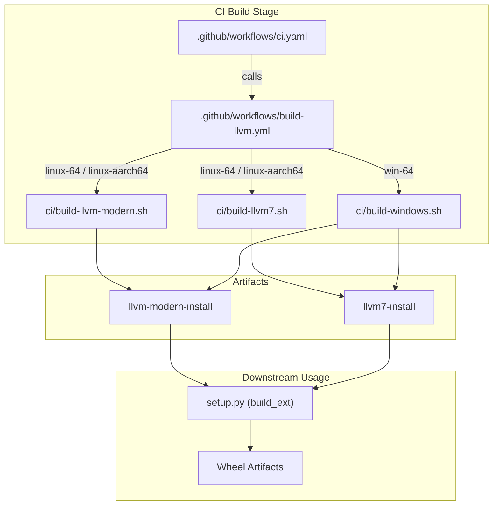
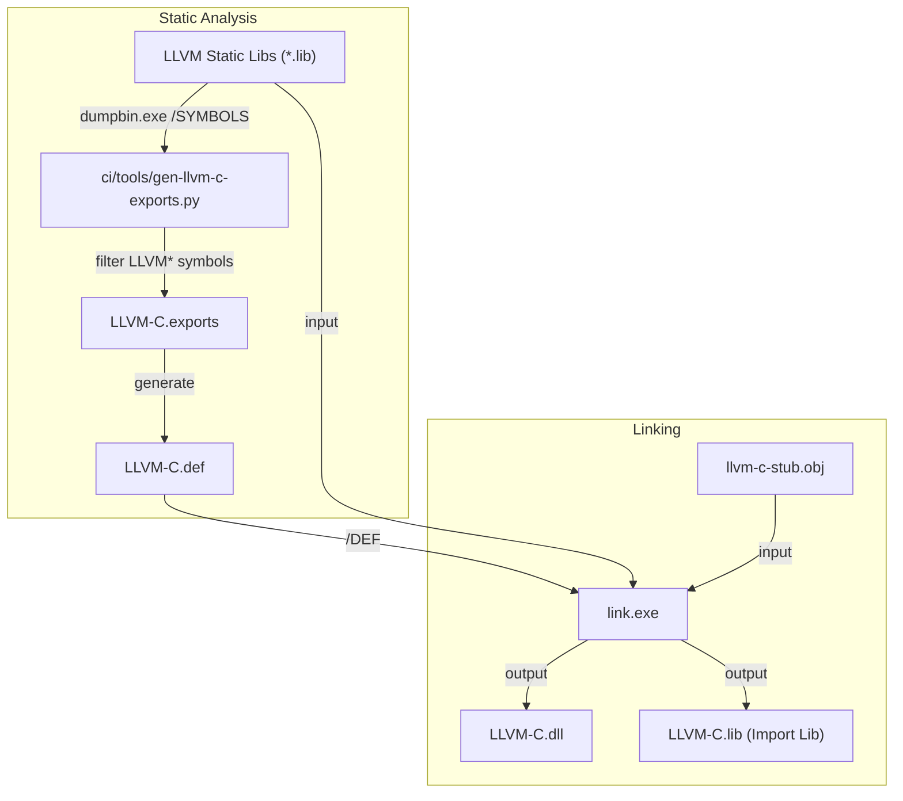

<!-- source: DeepWiki mcp.deepwiki.com · repo NVIDIA/numba-cuda-mlir · page 9.2 LLVM Build Scripts · fetched 2026-10-26 -->

# LLVM Build Scripts

Relevant source files

The following files were used as context for generating this wiki page:

- [.github/actions/fetch_ctk/action.yml](.github/actions/fetch_ctk/action.yml)
- [.github/actions/restore_llvm_artifacts/action.yml](.github/actions/restore_llvm_artifacts/action.yml)
- [.github/workflows/ci.yaml](.github/workflows/ci.yaml)
- [.github/workflows/test-numbast-mlir-linux.yml](.github/workflows/test-numbast-mlir-linux.yml)
- [CMakeLists.txt](CMakeLists.txt)
- [cext/CMakeLists.txt](cext/CMakeLists.txt)
- [cext/helperlib/CMakeLists.txt](cext/helperlib/CMakeLists.txt)
- [ci/build-llvm-modern.sh](ci/build-llvm-modern.sh)
- [ci/build-llvm7.sh](ci/build-llvm7.sh)
- [ci/build-windows.sh](ci/build-windows.sh)
- [ci/test-matrix.yml](ci/test-matrix.yml)
- [ci/tools/env-vars](ci/tools/env-vars)
- [ci/tools/run-numbast-mlir-tests](ci/tools/run-numbast-mlir-tests)
- [setup.py](setup.py)

The `numba-cuda-mlir` project relies on two distinct LLVM environments: a **modern LLVM/MLIR** stack (typically LLVM 19+) for the primary compilation pipeline and a **legacy LLVM 7** stack for compatibility with `libnvvm`. Because these specific versions and configurations (e.g., Python bindings isolation, static-linked CRT on Windows) are not available in standard package managers, they are built from source using specialized scripts.

## Build Orchestration

The build process is orchestrated by GitHub Actions, specifically through the `build-llvm.yml` reusable workflow. This workflow executes the platform-specific scripts and uploads the resulting binaries as artifacts for use in the wheel-building and testing stages.

### Build Workflow Data Flow
The following diagram illustrates how the build scripts interact with the CI environment and produce the artifacts required by the downstream `setup.py` and `build-wheel.yml` processes.

**LLVM Artifact Generation and Consumption**

**Sources:** [.github/workflows/ci.yaml:66-91](), [ci/build-llvm-modern.sh:5-16](), [ci/build-llvm7.sh:4-17](), [setup.py:112-168]()

---

## Modern LLVM & MLIR Build (`build-llvm-modern.sh`)

The script `ci/build-llvm-modern.sh` builds the modern LLVM project with MLIR and Python bindings enabled. A critical requirement for this project is **symbol isolation** to prevent conflicts with other MLIR-based Python packages (like `torch-mlir` or `jax`).

### Implementation Details
- **Namespace Isolation**: The script uses `MLIR_PYTHON_PACKAGE_PREFIX` set to `numba_cuda_mlir._mlir` [ci/build-llvm-modern.sh:67-68](). This ensures that the generated Python bindings look for `numba_cuda_mlir._mlir.ir` instead of the global `mlir.ir`.
- **Nanobind Domain**: `MLIR_BINDINGS_PYTHON_NB_DOMAIN` is set to `numba_cuda_mlir` to isolate nanobind type identifiers [ci/build-llvm-modern.sh:70]().
- **Stripping**: The script performs a `cmake --install --strip` which removes the static symbol table (`.symtab`), reducing the size of `libMLIRPythonCAPI.so` by approximately 70MB [ci/build-llvm-modern.sh:83-88]().
- **Caching**: Integration with `sccache` is mandatory to speed up repeated CI runs [ci/build-llvm-modern.sh:38-40]().

**Sources:** [ci/build-llvm-modern.sh:38-88]()

---

## Legacy LLVM 7 Build (`build-llvm7.sh`)

The `libnvvm` library used for PTX generation requires LLVM IR that is semantically compatible with LLVM 7.0. The `ci/build-llvm7.sh` script builds a minimal shared library (`libLLVM-7.so`) to support the `MLIRToLLVM70` translation path.

### Build Characteristics
- **Shared Library**: It specifically builds the LLVM dylib (`-DLLVM_BUILD_LLVM_DYLIB=ON`) [ci/build-llvm7.sh:47]().
- **Manual Artifact Creation**: Unlike the modern build, it does not use `cmake --install`. Instead, it manually copies the `.so` and strips it to avoid zip-bloat caused by symlinks in the standard LLVM build directory [ci/build-llvm7.sh:60-69]().
- **Compatibility Patch**: It applies a `sed` patch to `CMakeLists.txt` to set `CMP0051` to `NEW`, allowing the legacy codebase to build with modern CMake versions [ci/build-llvm7.sh:33-35]().

**Sources:** [ci/build-llvm7.sh:33-69]()

---

## Windows Build Infrastructure (`build-windows.sh`)

Windows builds are handled by `ci/build-windows.sh`, which manages the complexities of MSVC, static linking, and DLL export generation.

### LLVM-C.dll Export Generation
LLVM 7 on Windows does not natively export all necessary C-API symbols into a single DLL. The script uses a Python utility, `gen-llvm-c-exports.py`, to create a custom `LLVM-C.dll`.

**LLVM-C.dll Build Pipeline**

### Key Functions and Implementations
- **`resolve_msvc_linker`**: Locates `link.exe` by inspecting the `CMakeCache.txt` or searching the system `PATH` [ci/build-windows.sh:72-100]().
- **`resolve_dumpbin_tool`**: Locates `dumpbin.exe`, which is required to extract symbols from static libraries [ci/build-windows.sh:102-126]().
- **Static CRT Linking**: Both LLVM 7 and Modern LLVM are built with `-DCMAKE_MSVC_RUNTIME_LIBRARY=MultiThreaded` (`/MT`). This ensures that the resulting DLLs embed their own C runtime, removing dependencies on specific `msvcp140.dll` versions at runtime [ci/build-windows.sh:163-164]().

**Sources:** [ci/build-windows.sh:72-212](), [setup.py:128-140]()

---

## Environment Configuration

The `ci/tools/env-vars` script acts as the bridge between the build scripts and the GitHub Actions environment. It normalizes paths across Linux and Windows (using `cygpath` for the latter) and sets the following critical variables:

| Variable | Purpose |
| :--- | :--- |
| `LLVM_MODERN_INSTALL_DIR` | Path to the modern LLVM/MLIR installation root [ci/tools/env-vars:44](). |
| `LLVM7_INSTALL_DIR` | Path to the LLVM 7 installation root [ci/tools/env-vars:45](). |
| `NUMBA_CUDA_MLIR_CUDA_ARTIFACT_NAME` | Unique name for the build artifact including the git SHA [ci/tools/env-vars:72](). |

**Sources:** [ci/tools/env-vars:18-75]()

---

