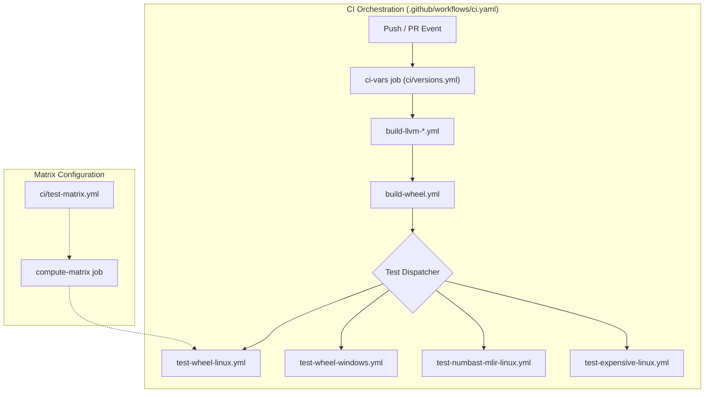
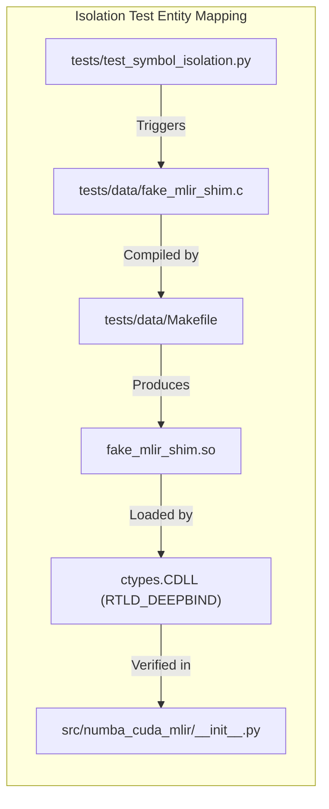

<!-- source: DeepWiki mcp.deepwiki.com · repo NVIDIA/numba-cuda-mlir · page 9.3 Test Matrix and CI Execution · fetched 2026-10-26 -->

# Test Matrix and CI Execution

Relevant source files

The following files were used as context for generating this wiki page:

- [.github/workflows/bandit.yml](.github/workflows/bandit.yml)
- [.github/workflows/build-docs.yml](.github/workflows/build-docs.yml)
- [.github/workflows/build-wheel.yml](.github/workflows/build-wheel.yml)
- [.github/workflows/ci.yaml](.github/workflows/ci.yaml)
- [.github/workflows/cleanup-pr-previews.yml](.github/workflows/cleanup-pr-previews.yml)
- [.github/workflows/codeql.yml](.github/workflows/codeql.yml)
- [.github/workflows/simulator-test.yaml](.github/workflows/simulator-test.yaml)
- [.github/workflows/test-cudf-source-linux.yml](.github/workflows/test-cudf-source-linux.yml)
- [.github/workflows/test-numbast-mlir-linux.yml](.github/workflows/test-numbast-mlir-linux.yml)
- [cext/launcher/llvm_downgrade.cpp](cext/launcher/llvm_downgrade.cpp)
- [ci/build-windows.sh](ci/build-windows.sh)
- [ci/test-matrix.yml](ci/test-matrix.yml)
- [ci/tools/env-vars](ci/tools/env-vars)
- [ci/tools/run-cudf-source-tests](ci/tools/run-cudf-source-tests)
- [ci/tools/run-expensive-tests](ci/tools/run-expensive-tests)
- [ci/tools/run-tests](ci/tools/run-tests)
- [setup.py](setup.py)
- [src/numba_cuda_mlir/__init__.py](src/numba_cuda_mlir/__init__.py)
- [src/numba_cuda_mlir/device_declarations.py](src/numba_cuda_mlir/device_declarations.py)
- [src/numba_cuda_mlir/memory_management/nrt_mlir.py](src/numba_cuda_mlir/memory_management/nrt_mlir.py)
- [src/numba_cuda_mlir/numba_cuda/cpython/builtins.py](src/numba_cuda_mlir/numba_cuda/cpython/builtins.py)
- [src/numba_cuda_mlir/numba_cuda/np/arrayobj.py](src/numba_cuda_mlir/numba_cuda/np/arrayobj.py)
- [tests/data/Makefile](tests/data/Makefile)
- [tests/data/fake_mlir_shim.c](tests/data/fake_mlir_shim.c)
- [tests/test_symbol_isolation.py](tests/test_symbol_isolation.py)

This page describes the multi-dimensional testing infrastructure for `numba-cuda-mlir`, covering the GitHub Actions (GHA) test matrix, specialized execution scripts for local and remote testing, and integration tests with external libraries like cuDF and Numbast.

## CI Matrix and Orchestration

The project utilizes a centralized configuration file at `ci/test-matrix.yml` to define the combinations of Python versions, CUDA versions, and GPU hardware used across CI workflows. This file is parsed by GHA jobs to dynamically generate job matrices.

### Multi-Dimensional Matrix
The matrix typically covers the following dimensions:
*   **Architecture (`ARCH`)**: `amd64` (linux-64) and `arm64` (linux-aarch64) [[ci/test-matrix.yml:19-42]]().
*   **Python Version (`PY_VER`)**: 3.11, 3.12, 3.13, 3.14, and 3.14t (freethreaded) [[ci/test-matrix.yml:23-41]]().
*   **CUDA Version (`CUDA_VER`)**: Spanning from 12.2 to 13.2 [[ci/test-matrix.yml:26-31]]().
*   **Hardware (`GPU`)**: Includes T4, V100, L4, H100, and RTX Pro 6000 [[ci/test-matrix.yml:23-33]]().
*   **CTK Mode (`LOCAL_CTK`)**: Boolean flag (0 or 1) determining if a local CUDA Toolkit is used or if dependencies are pulled from PyPI [[ci/test-matrix.yml:23-25]]().

### CI Workflow Data Flow
The primary CI entry point is `.github/workflows/ci.yaml`, which orchestrates building LLVM artifacts, building Python wheels, and dispatching test jobs [[.github/workflows/ci.yaml:66-151]]().

Sources: [[.github/workflows/ci.yaml:19-201]](), [[ci/test-matrix.yml:1-74]]()

## Test Execution Scripts

Test execution is standardized through shell scripts in `ci/tools/` to ensure parity between local development and CI environments.

### `run-tests`
This script handles the standard test suite execution. It automatically identifies the built wheel in the artifacts directory, installs it with appropriate CUDA extras (e.g., `[cu12]`), and executes `pytest` [[ci/tools/run-tests:11-45]]().
*   **Parallelism**: Uses `pytest-xdist` (`-n auto --dist loadscope`) [[ci/tools/run-tests:25]]().
*   **Coverage**: If `NUMBA_CUDA_MLIR_COVERAGE` is set, it enables `pytest-cov` and generates a markdown summary for GHA [[ci/tools/run-tests:26-29]]().
*   **Isolation**: Ignores benchmarks and symbol isolation tests which require special handling [[ci/tools/run-tests:25]]().

### `run-expensive-tests`
Targets benchmarks and integration tests that require large dependencies (e.g., PyTorch, CuPy, nvmath-python) [[ci/tools/run-expensive-tests:117-127]]().
*   **Environment**: Creates a temporary virtual environment to avoid polluting the CI runner [[ci/tools/run-expensive-tests:86-91]]().
*   **Version Mapping**: Maps `CUDA_VERSION` to specific PyPI packages (e.g., `cupy-cuda12x` for CUDA 12.8) [[ci/tools/run-expensive-tests:17-51]]().

Sources: [[ci/tools/run-tests:1-58]](), [[ci/tools/run-expensive-tests:1-137]]()

## Integration Testing

### cuDF Source Tests
The `ci/tools/run-cudf-source-tests` script clones a specific branch of cuDF to verify that the `numba-cuda-mlir` backend correctly supports cuDF's User Defined Functions (UDFs) [[ci/tools/run-cudf-source-tests:15-16]]().
*   **Conda/Mamba**: Uses a Miniforge installation to manage complex cuDF dependencies [[ci/tools/run-cudf-source-tests:57-64]]().
*   **Verification**: Specifically runs `test_apply.py` (Scalar UDFs), `test_nrt_stats.py` (Numba Runtime stats), and GroupBy UDF tests [[ci/tools/run-cudf-source-tests:114-142]]().

### Numbast MLIR Tests
Numbast integration is handled via `.github/workflows/test-numbast-mlir-linux.yml`. This workflow tests the project's compatibility with the Numbast frontend [[.github/workflows/test-numbast-mlir-linux.yml:4-10]]().
*   **LLVM Dependencies**: Downloads and restores both "Modern LLVM" and "LLVM 7" artifacts to ensure the downgrade path for `libnvvm` is functional [[.github/workflows/test-numbast-mlir-linux.yml:107-123]]().

## Simulator and Static Analysis

### Simulator Testing
The `simulator-test.yaml` workflow utilizes `pixi` environments to run tests in environments without physical GPUs [[.github/workflows/simulator-test.yaml:107-113]](). It uses `yq` and `jq` to filter the test matrix specifically for simulator-compatible configurations [[.github/workflows/simulator-test.yaml:64-67]]().

### Static Analysis
*   **Bandit**: Performed using the `ruff` implementation of Bandit checks (`S` codes). It programmatically extracts ignored codes from `pyproject.toml` to ensure consistency [[.github/workflows/bandit.yml:42-52]]().
*   **CodeQL**: Scans both Python and C/C++ code for security vulnerabilities [[.github/workflows/codeql.yml:28-33]]().

## Symbol Isolation Verification
A critical part of CI is verifying that the MLIR libraries loaded with `RTLD_DEEPBIND` are not preempted by other LLVM versions in the same process.
*   **`fake_mlir_shim.so`**: A dummy library built during CI [[.github/workflows/build-wheel.yml:166-170]]().
*   **`test_symbol_isolation.py`**: Loads the shim and verifies that `numba_cuda_mlir` remains isolated from the shim's symbols [[.github/workflows/build-wheel.yml:165]]().

Sources: [[.github/workflows/build-wheel.yml:166-170]](), [[src/numba_cuda_mlir/__init__.py:7-38]](), [[tests/test_symbol_isolation.py:1-10]]()

Sources:
*   `ci/test-matrix.yml`
*   `.github/workflows/ci.yaml`
*   `.github/workflows/build-wheel.yml`
*   `ci/tools/run-tests`
*   `ci/tools/run-expensive-tests`
*   `ci/tools/run-cudf-source-tests`
*   `.github/workflows/test-numbast-mlir-linux.yml`
*   `.github/workflows/simulator-test.yaml`
*   `.github/workflows/bandit.yml`
*   `.github/workflows/codeql.yml`
*   `src/numba_cuda_mlir/__init__.py`

---

