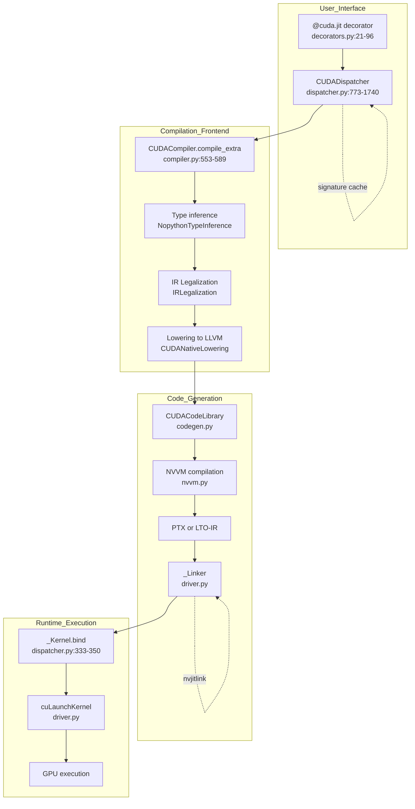
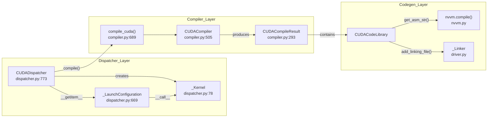

<!-- source: DeepWiki mcp.deepwiki.com · repo NVIDIA/numba-cuda · page 1 Overview · fetched 2026-10-26 -->

# Overview

<details>
<summary>Relevant source files</summary>

The following files were used as context for generating this wiki page:

- [conda/recipes/numba-cuda/meta.yaml](conda/recipes/numba-cuda/meta.yaml)
- [numba_cuda/numba/cuda/compiler.py](numba_cuda/numba/cuda/compiler.py)
- [numba_cuda/numba/cuda/cudadrv/mappings.py](numba_cuda/numba/cuda/cudadrv/mappings.py)
- [numba_cuda/numba/cuda/decorators.py](numba_cuda/numba/cuda/decorators.py)
- [numba_cuda/numba/cuda/dispatcher.py](numba_cuda/numba/cuda/dispatcher.py)
- [numba_cuda/numba/cuda/tests/benchmarks/test_kernel_launch.py](numba_cuda/numba/cuda/tests/benchmarks/test_kernel_launch.py)
- [numba_cuda/numba/cuda/tests/cudadrv/test_linker.py](numba_cuda/numba/cuda/tests/cudadrv/test_linker.py)
- [numba_cuda/numba/cuda/tests/cudadrv/test_module_callbacks.py](numba_cuda/numba/cuda/tests/cudadrv/test_module_callbacks.py)
- [numba_cuda/numba/cuda/tests/cudadrv/test_nvjitlink.py](numba_cuda/numba/cuda/tests/cudadrv/test_nvjitlink.py)
- [numba_cuda/numba/cuda/tests/cudapy/test_debug.py](numba_cuda/numba/cuda/tests/cudapy/test_debug.py)
- [numba_cuda/numba/cuda/tests/cudapy/test_errors.py](numba_cuda/numba/cuda/tests/cudapy/test_errors.py)
- [numba_cuda/numba/cuda/tests/cudapy/test_inline.py](numba_cuda/numba/cuda/tests/cudapy/test_inline.py)
- [pixi.lock](pixi.lock)
- [pixi.toml](pixi.toml)
- [pyproject.toml](pyproject.toml)
- [scripts/bench-against.py](scripts/bench-against.py)
- [testing/pytest.ini](testing/pytest.ini)

</details>


This document provides an overview of the numba-cuda repository, which implements a CUDA target for Numba's JIT compiler. The system enables Python developers to write GPU kernels using a restricted subset of Python syntax and execute them on NVIDIA CUDA devices.

For information about specific installation procedures and configuration options, see [Installation and Configuration](#1.1). For details about the core compilation pipeline, see [JIT Compilation Pipeline](#2.1). For CUDA driver interaction specifics, see [CUDA Driver Interface](#2.2).

## Purpose and Scope

Numba-CUDA is a JIT compiler that transforms Python functions into executable CUDA GPU code. The system provides:

- **JIT Compilation**: Compiles Python functions decorated with `@cuda.jit` into CUDA kernels via LLVM and NVVM
- **Type Inference**: Automatically infers types from Python code to generate typed intermediate representations
- **Code Generation**: Produces PTX or LTO-IR that is linked and loaded onto CUDA devices
- **Memory Management**: Provides `DeviceNDArray` and configurable memory allocators including NRT (Numba Runtime)
- **Device Management**: Interfaces with CUDA Driver API for context, device, and stream management
- **Debugging Support**: Generates debug information and provides kernel inspection methods

The package requires Python ≥3.9, Numba ≥0.60.0, and supports CUDA Toolkit versions 12.x and 13.x through `cuda-bindings` and `cuda-python` packages.

Sources: [pyproject.toml:23-24](), [numba_cuda/numba/cuda/dispatcher.py:78-228](), [numba_cuda/numba/cuda/decorators.py:21-96]()

## High-Level Architecture

Numba-CUDA implements a four-layer architecture that transforms Python code into executable GPU kernels:

### Compilation Flow: Python to GPU Executable



The dispatcher maintains a cache of compiled kernels indexed by argument type signatures. Each compilation produces a `_Kernel` instance that encapsulates the compiled code and launch configuration.

Sources: [numba_cuda/numba/cuda/dispatcher.py:773-1051](), [numba_cuda/numba/cuda/compiler.py:505-759](), [numba_cuda/numba/cuda/decorators.py:21-265]()

### Core Compilation Classes



The `CUDADispatcher` serves as the primary user-facing interface, managing compilation and kernel invocation. It creates `_Kernel` instances for each unique type signature and coordinates with `CUDACompiler` for code generation.

Sources: [numba_cuda/numba/cuda/dispatcher.py:773-1051](), [numba_cuda/numba/cuda/compiler.py:505-759]()

## Core Subsystems

### JIT Compilation Pipeline

The compilation pipeline consists of multiple compiler passes organized in `DefaultPassBuilder`:

| Pass Stage | Implementation | Purpose |
|------------|---------------|---------|
| **Bytecode Translation** | `CUDATranslateBytecode` | Converts Python bytecode to Numba IR |
| **Type Inference** | `NopythonTypeInference` | Infers types for all IR variables |
| **IR Optimization** | `InlineOverloads`, `NopythonRewrites` | Optimizes typed IR |
| **IR Legalization** | `IRLegalization` | Ensures IR is valid for lowering |
| **Lowering** | `CUDANativeLowering` | Generates LLVM IR |
| **Backend** | `CUDABackend` | Packages result as `CUDACompileResult` |

The pipeline is defined in [numba_cuda/numba/cuda/compiler.py:505-550]() and executed by `CUDACompiler.compile_extra()`.

Sources: [numba_cuda/numba/cuda/compiler.py:120-254](), [numba_cuda/numba/cuda/compiler.py:505-550]()

### Kernel Launch and Configuration

Kernel launches use Python's `__getitem__` syntax for configuration:

```python
# Example from test files
kernel[griddim, blockdim](args)
kernel[griddim, blockdim, stream, sharedmem](args)
```

The `CUDADispatcher.__getitem__()` method creates a `_LaunchConfiguration` object that validates grid and block dimensions, then invokes `_Kernel.launch()` to prepare arguments and call the CUDA driver.

Sources: [numba_cuda/numba/cuda/dispatcher.py:1307-1344](), [numba_cuda/numba/cuda/dispatcher.py:460-530]()

### Memory Management

The memory subsystem provides several allocation strategies:

- **`DeviceNDArray`**: GPU arrays with NumPy-like interface for device memory
- **`ManagedNDArray`**: Unified memory accessible from both CPU and GPU
- **NRT System**: Reference-counted memory management when `enable_nrt=True`
- **External Memory Managers**: Pluggable EMM architecture for custom allocators

Sources: [numba_cuda/numba/cuda/dispatcher.py:532-618]()

### Driver Interface and Context Management

The driver layer provides:

- **`Driver` class**: Singleton interface to CUDA driver API
- **`Device` class**: Represents individual GPU devices with properties
- **`Context` class**: Manages CUDA context lifecycle and memory
- **`_Linker` class**: Links PTX, cubin, CUDA C++ and other object files

The system automatically selects between `cuda-python` bindings (default) or legacy ctypes bindings based on configuration.

Sources: [numba_cuda/numba/cuda/dispatcher.py:1-54]()

### Configuration System

Key configuration options control compilation and runtime behavior:

| Configuration Option | Default | Purpose |
|---------------------|---------|---------|
| `debug` | `False` | Enables exception checking in kernels (degrades performance) |
| `opt` | `True` | Enables NVVM optimizations (level 3) |
| `lineinfo` | `False` | Generates line mapping for profiling tools |
| `fastmath` | `False` | Enables fast math optimizations |
| `max_registers` | `None` | Limits register usage per thread |
| `lto` | auto | Enables Link-Time Optimization via nvjitlink |
| `cache` | `False` | Enables file-based caching of compiled kernels |

LTO is automatically enabled when `nvjitlink` is available (requires CUDA ≥12.3) unless `debug=True`. The `lto` option generates LTO-IR that can be optimized across compilation units during linking.

Sources: [numba_cuda/numba/cuda/decorators.py:21-158](), [numba_cuda/numba/cuda/dispatcher.py:100-163]()

## Code Generation and Linking

### NVVM Compilation

The `CUDACodeLibrary` class manages code generation:

1. **LLVM IR Generation**: The lowering pass produces LLVM IR with NVVM intrinsics
2. **NVVM Compilation**: Converts LLVM IR to PTX or LTO-IR via `libNVVM`
3. **Assembly Options**: Controlled by `nvvm_options` dict (e.g., `{"opt": 3, "fastmath": True}`)

When `lto=True`, the library generates LTO-IR that is optimized during linking rather than at compile time.

Sources: [numba_cuda/numba/cuda/compiler.py:144-163]()

### Linking External Code

The `_Linker` class supports linking various file types:

| File Extension | Input Type | Notes |
|----------------|-----------|-------|
| `.ptx` | PTX assembly | Intermediate text representation |
| `.cu` | CUDA C++ | Compiled via NVRTC at link time |
| `.cubin` | Cubin binary | Architecture-specific binary |
| `.a`, `.lib` | Static library | Archive of object files |
| `.ltoir` | LTO-IR | Link-Time Optimization IR |
| `.fatbin` | Fat binary | Multi-architecture binary |

External code is linked using `cuda.jit(link=[files])` or `cuda.declare_device(sig, link=[files])`. The `LinkableCode` class can attach setup/teardown callbacks for module initialization.

Sources: [numba_cuda/numba/cuda/cudadrv/mappings.py:6-14](), [numba_cuda/numba/cuda/tests/cudadrv/test_nvjitlink.py:79-100](), [numba_cuda/numba/cuda/tests/cudadrv/test_module_callbacks.py:40-68]()

## Package Structure and Dependencies

### Runtime Dependencies

Core dependencies from [pyproject.toml:24]():

| Package | Version Constraint | Purpose |
|---------|-------------------|---------|
| `numba` | `>=0.60.0` | Base JIT compiler infrastructure |
| `cuda-bindings` | `>=12.9.1, <14.0.0` | Low-level CUDA driver bindings |
| `cuda-core` | `>=0.3.2, <1.0.0` | CUDA core utilities |

### Optional Dependencies

Optional extras for different CUDA versions:

- **`cu12`**: CUDA 12.x packages including `nvidia-cuda-nvcc-cu12`, `nvidia-nvjitlink-cu12`, `nvidia-cuda-cccl-cu12`
- **`cu13`**: CUDA 13.x packages with `nvidia-nvvm==13.*`, `nvidia-nvjitlink==13.*`

Testing dependencies include `pytest>=8`, `filecheck`, `cffi`, and `ml_dtypes`.

Sources: [pyproject.toml:26-68]()

### Module Organization

```
numba_cuda/
├── numba/cuda/
│   ├── __init__.py          # Main entry point
│   ├── decorators.py        # @cuda.jit decorator
│   ├── dispatcher.py        # CUDADispatcher, _Kernel
│   ├── compiler.py          # CUDACompiler pipeline
│   ├── cudadrv/             # Driver interface layer
│   │   ├── driver.py        # Driver, Device, Context
│   │   ├── devices.py       # Device enumeration
│   │   └── nvvm.py          # NVVM compilation
│   ├── typing/              # Type system
│   ├── lowering/            # LLVM IR lowering
│   └── tests/               # Test suite
└── VERSION                  # Version file
```

Sources: [pyproject.toml:80-84]()

## Development and Testing Infrastructure

The project includes comprehensive CI/CD infrastructure:

### Testing Framework

- **Hardware Testing**: Real GPU device testing
- **Simulation Testing**: CUDA simulator for development
- **Context Management**: Specialized test utilities for CUDA contexts

### Release Pipeline

Automated release process triggered by git tags:
- **Multi-platform Builds**: Conda and wheel package generation
- **Documentation Building**: Sphinx-based documentation
- **Artifact Distribution**: Package upload to PyPI and conda-forge

Sources: [numba_cuda/numba/cuda/tests/cudadrv/test_context_stack.py:1-171](), [CONTRIBUTING.md:38-60]()

---

