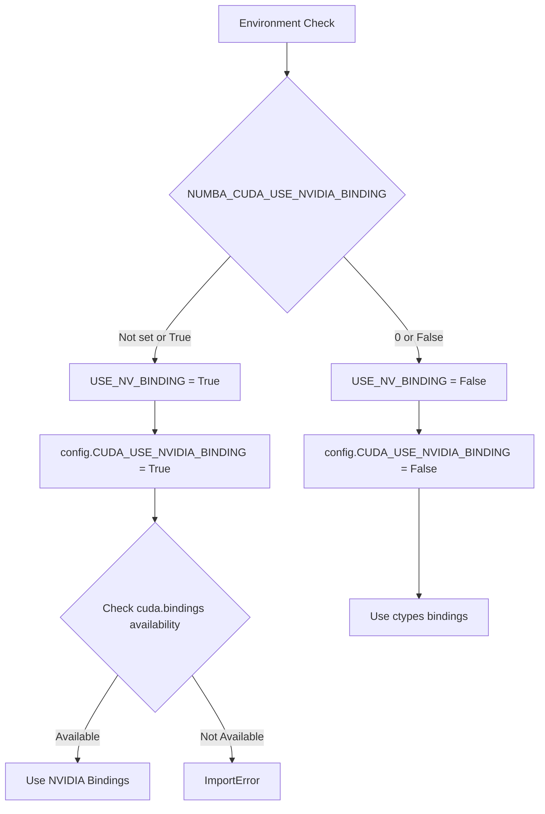
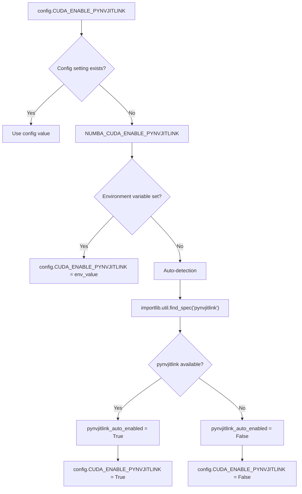
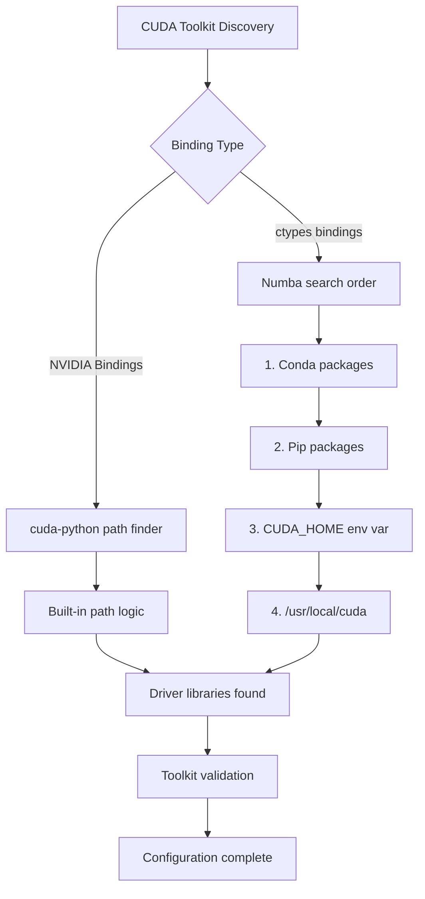

<!-- source: DeepWiki mcp.deepwiki.com · repo NVIDIA/numba-cuda · page 1.1 Installation and Configuration · fetched 2026-10-26 -->

# Installation and Configuration

<details>
<summary>Relevant source files</summary>

The following files were used as context for generating this wiki page:

- [.github/workflows/conda-python-build.yaml](.github/workflows/conda-python-build.yaml)
- [.github/workflows/publish.yaml](.github/workflows/publish.yaml)
- [.github/workflows/wheels-build.yaml](.github/workflows/wheels-build.yaml)
- [.github/workflows/wheels-test.yaml](.github/workflows/wheels-test.yaml)
- [README.md](README.md)
- [ci/build_conda.sh](ci/build_conda.sh)
- [ci/build_wheel.sh](ci/build_wheel.sh)
- [ci/test_conda.sh](ci/test_conda.sh)
- [ci/test_wheel.sh](ci/test_wheel.sh)
- [ci/test_wheel_deps_wheels.sh](ci/test_wheel_deps_wheels.sh)
- [conda/recipes/numba-cuda/meta.yaml](conda/recipes/numba-cuda/meta.yaml)
- [numba_cuda/VERSION](numba_cuda/VERSION)
- [numba_cuda/numba/cuda/tests/benchmarks/test_kernel_launch.py](numba_cuda/numba/cuda/tests/benchmarks/test_kernel_launch.py)
- [pixi.lock](pixi.lock)
- [pixi.toml](pixi.toml)
- [pyproject.toml](pyproject.toml)
- [scripts/bench-against.py](scripts/bench-against.py)
- [testing/Makefile](testing/Makefile)
- [testing/pytest.ini](testing/pytest.ini)

</details>


This document covers the installation processes and configuration options for numba-cuda. It explains how to install the package using different methods, configure CUDA bindings, set up environment variables, and understand the toolkit discovery process. For information about minor version compatibility features, see [Minor Version Compatibility](#3.1).

## Installation Methods

### Package Installation Options

Numba-cuda can be installed through multiple package managers with different CUDA toolkit configurations:

| Installation Method | Command | CUDA Version | Dependencies |
|-------------------|---------|-------------|-------------|
| Conda (CUDA 12) | `conda install -c conda-forge numba-cuda "cuda-version>=12.0"` | 12.x | Auto-resolved |
| Pip (CUDA 12) | `pip install numba-cuda[cu12]` | 12.x | From PyPI |
| Conda (CUDA 11) | `conda install -c conda-forge numba-cuda "cuda-version>=11.2,<12.0"` | 11.2+ | Auto-resolved |
| Pip (CUDA 11) | `pip install numba-cuda[cu11]` | 11.x | From PyPI |

The core dependencies are defined in [`pyproject.toml:21`]() with `numba>=0.59.1` as the base requirement. Optional dependencies are specified for different CUDA versions:

- **CUDA 11 extras** ([`pyproject.toml:24-31`]()): Includes `cuda-bindings==11.8.*`, `cuda-python==11.8.*`, and NVIDIA packages
- **CUDA 12 extras** ([`pyproject.toml:32-40`]()): Includes `cuda-bindings==12.9.*`, `cuda-python==12.9.*`, and `nvidia-nvjitlink-cu12`

### Conda Package Configuration

The conda package is configured through [`conda/recipes/numba-cuda/meta.yaml`]() with default dependencies:

```yaml
run:
  - python
  - numba >=0.59.1
  - cuda-bindings
  - cuda-core ==0.3.*
```

Sources: [`pyproject.toml:10-54`](), [`conda/recipes/numba-cuda/meta.yaml:23-33`](), [`docs/source/user/installation.rst:30-53`]()

## CUDA Bindings Configuration

### Binding Selection Process

Numba-cuda supports two types of CUDA driver bindings, controlled by the `NUMBA_CUDA_USE_NVIDIA_BINDING` environment variable:



**CUDA Bindings Configuration Flow**

The binding selection is implemented in [`numba_cuda/numba/cuda/__init__.py:30-51`]():

1. **Environment Variable Check**: `_readenv("NUMBA_CUDA_USE_NVIDIA_BINDING", bool, None)`
2. **Default Behavior**: If not explicitly set to `False`, NVIDIA bindings are preferred
3. **Availability Check**: Validates presence of `cuda` and `cuda.bindings` modules
4. **Fallback**: Raises `ImportError` if NVIDIA bindings are requested but unavailable

### Binding Impact on File Extensions

The binding choice affects how file extensions are mapped for linking, as shown in [`numba_cuda/numba/cuda/cudadrv/mappings.py:4-25`]():

```python
if config.CUDA_USE_NVIDIA_BINDING:
    from cuda.bindings.driver import CUjitInputType
    FILE_EXTENSION_MAP = {
        "ptx": CUjitInputType.CU_JIT_INPUT_PTX,
        "cubin": CUjitInputType.CU_JIT_INPUT_CUBIN,
        # ... other mappings
    }
else:
    FILE_EXTENSION_MAP = {
        "ptx": enums.CU_JIT_INPUT_PTX,
        "cubin": enums.CU_JIT_INPUT_CUBIN,
        # ... other mappings
    }
```

Sources: [`numba_cuda/numba/cuda/__init__.py:28-51`](), [`numba_cuda/numba/cuda/cudadrv/mappings.py:1-26`](), [`docs/source/user/installation.rst:60-71`]()

## Environment Variables

### Core Configuration Variables

| Variable | Purpose | Default | Example |
|----------|---------|---------|---------|
| `NUMBA_CUDA_USE_NVIDIA_BINDING` | Select CUDA bindings | `1` | `0` (use ctypes) |
| `NUMBA_CUDA_ENABLE_PYNVJITLINK` | Enable pynvjitlink | Auto-detected | `1` |
| `NUMBA_CUDA_DEFAULT_PTX_CC` | Default compute capability | `"7.5"` | `"8.0"` |
| `NUMBA_DISABLE_CUDA` | Disable CUDA support | `0` | `1` |
| `NUMBA_FORCE_CUDA_CC` | Force compute capability | Not set | `"7.5"` |

### Runtime Configuration Variables

| Variable | Purpose | Default | Values |
|----------|---------|---------|---------|
| `NUMBA_CUDA_LOG_LEVEL` | API call logging | `CRITICAL` | `DEBUG`, `INFO`, `WARNING` |
| `NUMBA_CUDA_LOG_API_ARGS` | Include API arguments | `0` | `1` |
| `NUMBA_CUDA_PER_THREAD_DEFAULT_STREAM` | Stream behavior | `0` | `1` |
| `NUMBA_CUDA_LOW_OCCUPANCY_WARNINGS` | Grid size warnings | `1` | `0` |
| `NUMBA_CUDA_WARN_ON_IMPLICIT_COPY` | Memory copy warnings | `1` | `0` |

### Advanced Configuration Variables

| Variable | Purpose | Default |
|----------|---------|---------|
| `NUMBA_CUDA_DRIVER` | CUDA driver library path | Auto-detected |
| `NUMBA_CUDA_INCLUDE_PATH` | CUDA include files path | `/usr/local/cuda/include` |
| `NUMBA_CUDA_NVRTC_EXTRA_SEARCH_PATHS` | NVRTC search paths | Not set |
| `NUMBA_CUDA_LOG_SIZE` | Log buffer size | `1024` |
| `NUMBA_CUDA_VERBOSE_JIT_LOG` | JIT log verbosity | `1` |

Sources: [`docs/source/reference/envvars.rst:1-139`](), [`numba_cuda/numba/cuda/__init__.py:8-96`]()

## PyNVJitLink Configuration

### Automatic Detection and Configuration

The pynvjitlink configuration follows a three-tier precedence system implemented in [`numba_cuda/numba/cuda/__init__.py:8-26`]():



**PyNVJitLink Configuration Decision Tree**

### Validation Logic

The configuration includes validation logic in [`numba_cuda/numba/cuda/__init__.py:53-66`]():

- **NVIDIA Bindings + pynvjitlink**: Issues deprecation warning, uses `cuda.core` instead
- **ctypes + pynvjitlink (auto-enabled)**: Silently ignores pynvjitlink
- **ctypes + pynvjitlink (explicit)**: Raises `RuntimeError`

Sources: [`numba_cuda/numba/cuda/__init__.py:8-66`](), [`docs/source/user/minor_version_compatibility.rst:52-89`]()

## CUDA Toolkit Discovery

### Discovery Process Flow

The toolkit discovery process varies based on the selected bindings:



**CUDA Toolkit Discovery Process**

### Search Order for ctypes Bindings

When using ctypes bindings, the search follows this order ([`docs/source/user/installation.rst:87-96`]()):

1. **Conda-installed packages**: Highest priority for conda environments
2. **Pip-installed packages**: Second priority for pip environments  
3. **`CUDA_HOME` environment variable**: User-specified toolkit location
4. **System installation**: Fixed path at `/usr/local/cuda` on Linux

### Driver Library Location

The CUDA driver library (`libcuda`) discovery can be overridden using `NUMBA_CUDA_DRIVER` environment variable, which should point to the full file path (not directory) of the shared library.

Sources: [`docs/source/user/installation.rst:75-105`](), [`docs/source/reference/envvars.rst:52-56`]()

## Default Compute Capability Configuration

### Version Override Logic

Numba-cuda overrides the upstream Numba default compute capability through [`numba_cuda/numba/cuda/__init__.py:86-96`]():

```python
# The default compute capability as set by the upstream Numba implementation.
config_default_cc = config.CUDA_DEFAULT_PTX_CC

# The default compute capability for Numba-CUDA. This will usually override the
# upstream Numba built-in default of 5.0, unless the user has set it even
# higher, in which case we should use the user-specified value.
numba_cuda_default_ptx_cc = (7, 5)

if numba_cuda_default_ptx_cc > config_default_cc:
    config.CUDA_DEFAULT_PTX_CC = numba_cuda_default_ptx_cc
```

This ensures that numba-cuda uses a more recent default compute capability (7.5) compared to upstream Numba's default (5.0), while respecting any user-specified higher values.

Sources: [`numba_cuda/numba/cuda/__init__.py:86-96`]()

## Configuration Summary

The complete configuration system integrates multiple components:

- **Package Installation**: Via conda or pip with version-specific dependencies
- **Binding Selection**: NVIDIA bindings (default) or ctypes bindings (deprecated)
- **Environment Variables**: Extensive configuration options for runtime behavior
- **Toolkit Discovery**: Automated search with fallback mechanisms
- **Compute Capability**: Sensible defaults with user override capability

This configuration system ensures numba-cuda can adapt to different deployment scenarios while maintaining backward compatibility and providing clear upgrade paths.

Sources: [`pyproject.toml:1-137`](), [`numba_cuda/numba/cuda/__init__.py:1-104`](), [`docs/source/reference/envvars.rst:1-139`](), [`docs/source/user/installation.rst:1-106`]()

---

