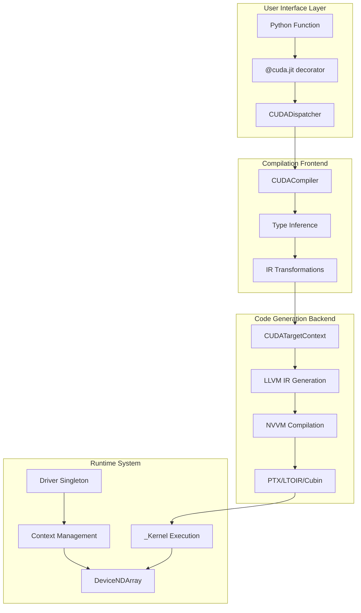
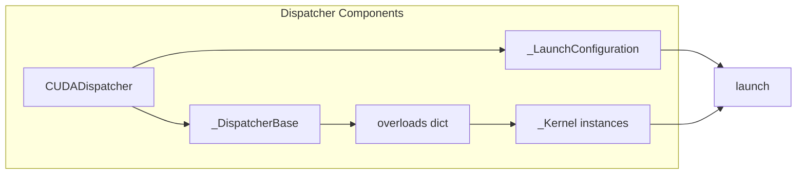
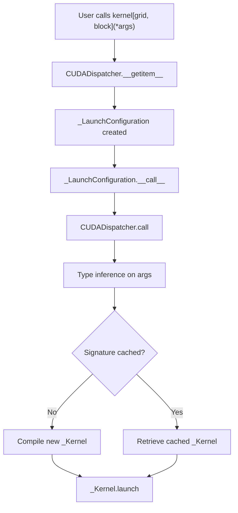
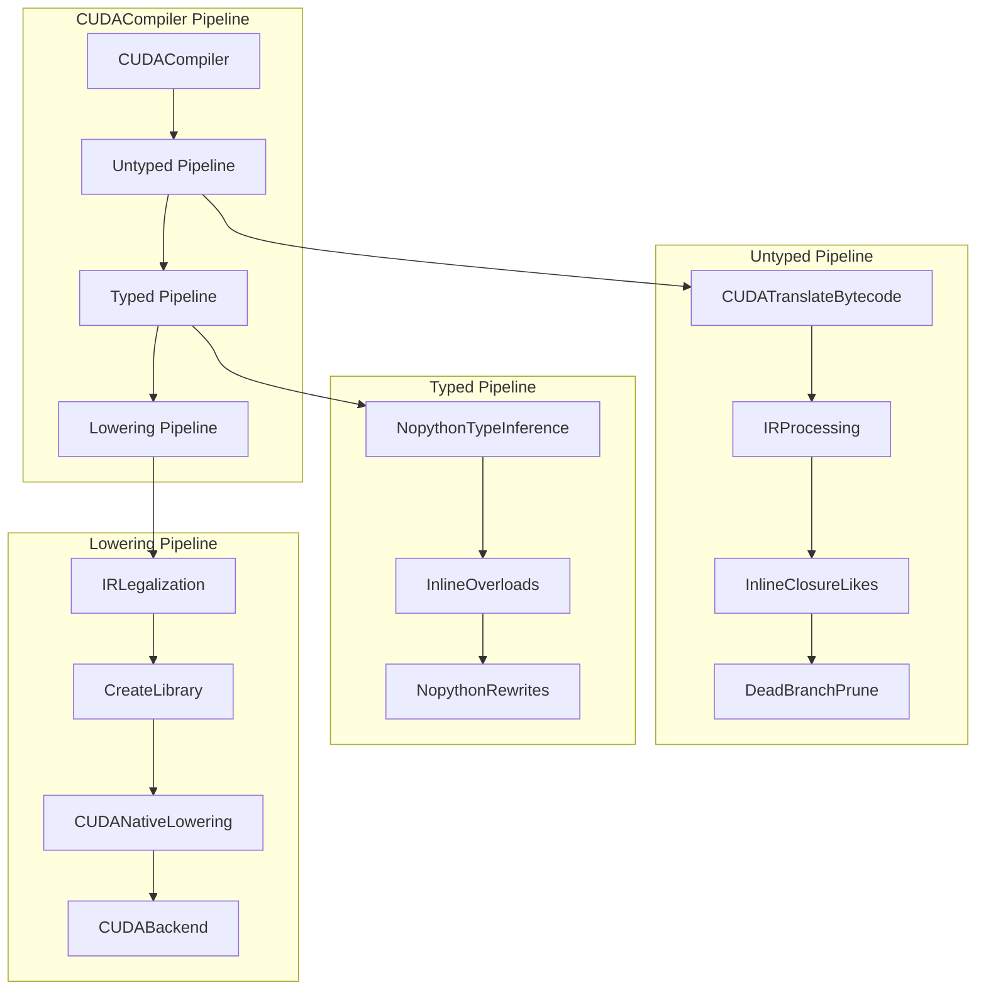
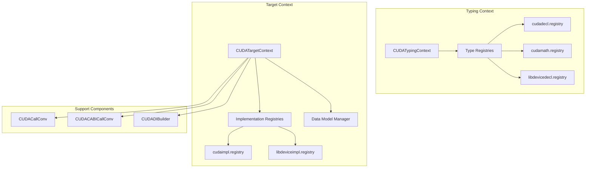
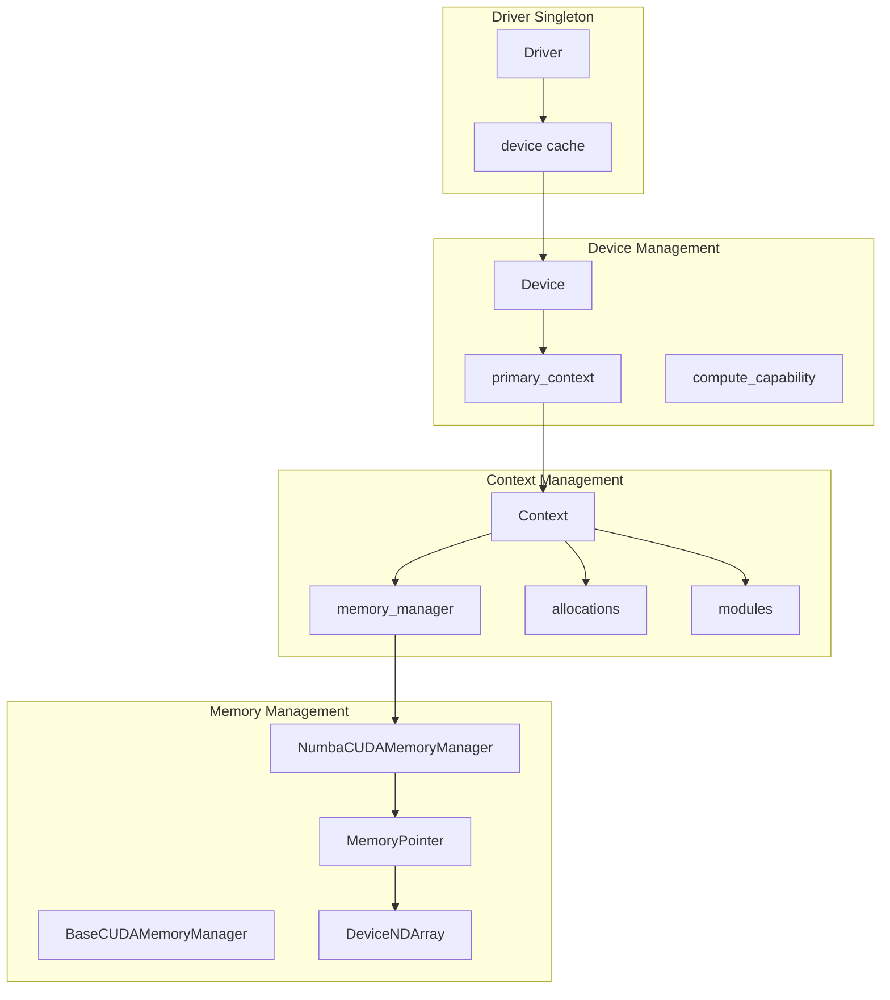
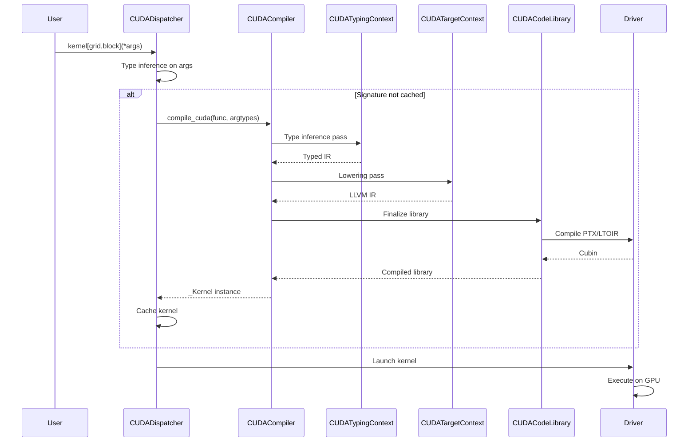
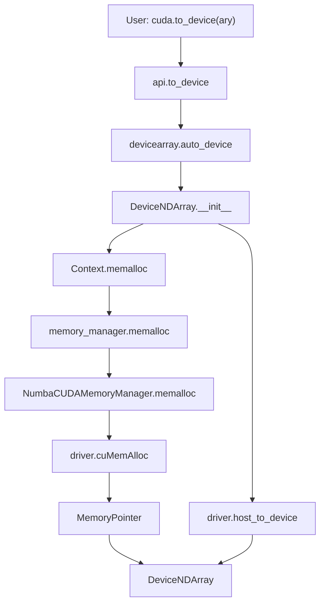
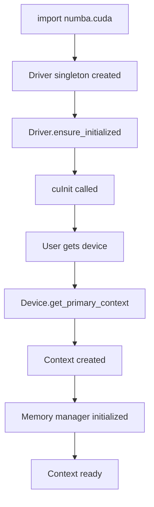

<!-- source: DeepWiki mcp.deepwiki.com · repo NVIDIA/numba-cuda · page 2 Core Architecture · fetched 2026-10-26 -->

# Core Architecture

<details>
<summary>Relevant source files</summary>

The following files were used as context for generating this wiki page:

- [numba_cuda/numba/cuda/api.py](numba_cuda/numba/cuda/api.py)
- [numba_cuda/numba/cuda/compiler.py](numba_cuda/numba/cuda/compiler.py)
- [numba_cuda/numba/cuda/core/inline_closurecall.py](numba_cuda/numba/cuda/core/inline_closurecall.py)
- [numba_cuda/numba/cuda/cudadrv/devicearray.py](numba_cuda/numba/cuda/cudadrv/devicearray.py)
- [numba_cuda/numba/cuda/cudadrv/driver.py](numba_cuda/numba/cuda/cudadrv/driver.py)
- [numba_cuda/numba/cuda/dispatcher.py](numba_cuda/numba/cuda/dispatcher.py)
- [numba_cuda/numba/cuda/target.py](numba_cuda/numba/cuda/target.py)
- [numba_cuda/numba/cuda/tests/cudadrv/test_cuda_memory.py](numba_cuda/numba/cuda/tests/cudadrv/test_cuda_memory.py)
- [numba_cuda/numba/cuda/tests/cudadrv/test_emm_plugins.py](numba_cuda/numba/cuda/tests/cudadrv/test_emm_plugins.py)
- [numba_cuda/numba/cuda/tests/nocuda/test_import.py](numba_cuda/numba/cuda/tests/nocuda/test_import.py)

</details>


## Purpose and Scope

This document provides an architectural overview of the Numba CUDA system, explaining how the major components interact to enable JIT compilation of Python functions to CUDA GPU code. It covers the high-level organization of the system's four main layers: the user interface, compilation frontend, code generation backend, and runtime system.

For detailed information about specific subsystems, see:
- [JIT Compilation Pipeline](#2.1) for the end-to-end compilation process
- [CUDA Driver Interface](#2.2) for driver abstractions and device management
- [Memory Management System](#2.3) for memory allocation strategies
- [Type System and Lowering](#2.4) for type inference and IR lowering

---

## System Overview

The Numba CUDA architecture consists of four primary layers that transform Python functions into executable GPU code:



**Figure 1: Four-Layer System Architecture**

Sources: [numba_cuda/numba/cuda/dispatcher.py:1-1500](), [numba_cuda/numba/cuda/compiler.py:1-900](), [numba_cuda/numba/cuda/target.py:1-506]()

| Layer | Primary Classes | Responsibilities |
|-------|----------------|------------------|
| User Interface | `CUDADispatcher`, `_LaunchConfiguration` | Decorator implementation, launch configuration, argument processing |
| Compilation Frontend | `CUDACompiler`, `CUDATypingContext` | Type inference, IR generation, optimization passes |
| Code Generation | `CUDATargetContext`, `CUDACodeLibrary` | LLVM IR generation, NVVM compilation, code caching |
| Runtime System | `Driver`, `Context`, `Device`, `_Kernel` | Driver API wrapping, context management, kernel launch |

---

## Core Components

### Dispatcher Layer

The dispatcher is the entry point for user code, implemented by the `CUDADispatcher` class. It manages kernel specialization for different argument types and handles kernel invocation.



**Figure 2: Dispatcher Component Structure**

**Key Classes:**

- **`CUDADispatcher`** [numba_cuda/numba/cuda/dispatcher.py:1140-1500](): The main dispatcher class that extends `_DispatcherBase`. Handles the `@cuda.jit` decorator and provides the call interface for kernels.

- **`_DispatcherBase`** [numba_cuda/numba/cuda/dispatcher.py:773-945](): Base class managing the compilation of specializations for different type signatures. Maintains the `overloads` dictionary mapping signatures to compiled kernels.

- **`_Kernel`** [numba_cuda/numba/cuda/dispatcher.py:78-619](): Represents a compiled kernel specialized for a specific set of argument types. Handles argument preparation and kernel launch.

- **`_LaunchConfiguration`** [numba_cuda/numba/cuda/dispatcher.py:669-701](): Captures grid and block dimensions, stream, and shared memory settings for kernel launch.

**Dispatcher Workflow:**



**Figure 3: Kernel Dispatch and Launch Flow**

Sources: [numba_cuda/numba/cuda/dispatcher.py:78-701](), [numba_cuda/numba/cuda/dispatcher.py:1140-1500]()

---

### Compiler Layer

The compiler transforms Python bytecode into GPU-executable code through a series of compilation passes.



**Figure 4: Compilation Pipeline Stages**

**Key Classes:**

- **`CUDACompiler`** [numba_cuda/numba/cuda/compiler.py:505-551](): Extends `CompilerBase` and defines the complete compilation pipeline including untyped, typed, and lowering passes.

- **`CUDATranslateBytecode`** [numba_cuda/numba/cuda/compiler.py:489-503](): Custom bytecode translation pass that uses `CUDABytecodeInterpreter` to generate Numba IR from Python bytecode.

- **`CreateLibrary`** [numba_cuda/numba/cuda/compiler.py:416-443](): Creates a `CUDACodeLibrary` instance configured with NVVM options from compilation flags.

- **`CUDANativeLowering`** [numba_cuda/numba/cuda/compiler.py:446-456](): Lowering pass that uses `CUDALower` to transform typed IR into LLVM IR.

- **`CUDABackend`** [numba_cuda/numba/cuda/compiler.py:388-413](): Final pass that packages the lowering output into a `CUDACompileResult`.

**Entry Points:**

| Function | Purpose | Location |
|----------|---------|----------|
| `compile_cuda` | Main compilation entry point for kernels | [numba_cuda/numba/cuda/compiler.py:689-759]() |
| `compile_extra` | Generic compiler entry point | [numba_cuda/numba/cuda/compiler.py:553-590]() |
| `compile_ir` | Compile from existing Numba IR | [numba_cuda/numba/cuda/compiler.py:592-675]() |

Sources: [numba_cuda/numba/cuda/compiler.py:1-760]()

---

### Target Contexts

Target contexts manage type inference and code generation for the CUDA target. They provide the infrastructure for type resolution and LLVM IR generation.



**Figure 5: Target Context Architecture**

**Key Classes:**

- **`CUDATypingContext`** [numba_cuda/numba/cuda/target.py:40-121](): Extends `typing.BaseContext` to provide CUDA-specific type resolution. Loads type declaration registries for CUDA intrinsics, math functions, and device functions.

- **`CUDATargetContext`** [numba_cuda/numba/cuda/target.py:130-425](): Extends `BaseContext` to provide code generation infrastructure. Manages implementation registries, data models, and the internal code generator (`JITCUDACodegen`).

- **`CUDACallConv`** [numba_cuda/numba/cuda/target.py:427-438](): Calling convention for CUDA kernels using Numba's ABI.

- **`CUDACABICallConv`** [numba_cuda/numba/cuda/target.py:440-506](): Calling convention matching the CUDA C/C++ ABI for device functions.

**Context Properties:**

| Property | Context | Description |
|----------|---------|-------------|
| `enable_nrt` | `CUDATargetContext` | Whether the Numba Runtime (NRT) is enabled for reference counting |
| `enable_boundscheck` | `CUDATargetContext` | Always `False` for CUDA (unconditionally disabled) |
| `strict_alignment` | `CUDATargetContext` | Always `True` (CUDA requires strict alignment) |
| `DIBuilder` | `CUDATargetContext` | Returns `CUDADIBuilder` for debug information generation |

Sources: [numba_cuda/numba/cuda/target.py:1-506](), [numba_cuda/numba/cuda/descriptor.py:1-100]()

---

### Driver Layer

The driver layer provides a Python interface to the CUDA Driver API, managing devices, contexts, memory, and kernel execution.



**Figure 6: Driver Component Hierarchy**

**Key Classes:**

- **`Driver`** [numba_cuda/numba/cuda/cudadrv/driver.py:247-465](): Singleton class that wraps the CUDA Driver API. Lazily binds to driver functions and maintains a cache of `Device` objects. Uses `cuda-python` bindings for driver API calls.

- **`Device`** [numba_cuda/numba/cuda/cudadrv/driver.py:530-632](): Represents a CUDA device. Stores device properties like compute capability, name, and UUID. Manages the device's primary context.

- **`Context`** [numba_cuda/numba/cuda/cudadrv/driver.py:1106-1371](): Wraps a CUDA context resource. Owns allocations, modules, and the memory manager. Provides methods for memory info and occupancy calculations.

- **`BaseCUDAMemoryManager`** [numba_cuda/numba/cuda/cudadrv/driver.py:634-748](): Abstract base class for External Memory Management (EMM) plugins. Defines the interface for device memory allocation.

- **`NumbaCUDAMemoryManager`** [numba_cuda/numba/cuda/cudadrv/driver.py:926-956](): Default implementation of the EMM plugin interface using `cuMemAlloc` for device allocations.

**Driver Initialization Flow:**

```mermaid
graph LR
    A["Import numba.cuda"]
    B["Driver.__new__"]
    C["find_driver"]
    D["Driver.ensure_initialized"]
    E["cuInit"]
    F["Driver.get_device"]
    G["Device.__init__"]
    H["Device.get_primary_context"]
    I["Context.__init__"]
    J["Context.memory_manager"]
    
    A --> B
    B --> C
    C --> D
    D --> E
    E --> F
    F --> G
    G --> H
    H --> I
    I --> J
```



**Figure 7: Driver and Context Initialization**

Sources: [numba_cuda/numba/cuda/cudadrv/driver.py:1-2500](), [numba_cuda/numba/cuda/cudadrv/devices.py:1-200]()

---

## Component Interactions

### Compilation Flow

The following diagram shows how components interact during the compilation of a CUDA kernel:



**Figure 8: End-to-End Compilation and Execution Flow**

Sources: [numba_cuda/numba/cuda/dispatcher.py:939-1100](), [numba_cuda/numba/cuda/compiler.py:689-759]()

---

### Memory Management Flow

Memory allocation and transfer operations flow through the driver and memory manager:



**Figure 9: Device Memory Allocation Flow**

**Memory Manager Interface:**

| Method | Purpose | Implementation |
|--------|---------|----------------|
| `memalloc(size)` | Allocate device memory | [numba_cuda/numba/cuda/cudadrv/driver.py:936-947]() |
| `memhostalloc(size, ...)` | Allocate pinned host memory | [numba_cuda/numba/cuda/cudadrv/driver.py:792-824]() |
| `mempin(owner, ptr, ...)` | Pin existing host memory | [numba_cuda/numba/cuda/cudadrv/driver.py:826-862]() |
| `get_ipc_handle(memory)` | Create IPC handle for memory | [numba_cuda/numba/cuda/cudadrv/driver.py:909-923]() |
| `get_memory_info()` | Query free/total memory | [numba_cuda/numba/cuda/cudadrv/driver.py:949-951]() |

Sources: [numba_cuda/numba/cuda/cudadrv/driver.py:634-1003](), [numba_cuda/numba/cuda/cudadrv/devicearray.py:1-700]()

---

## Key Data Structures

### CUDACompileResult

The `CUDACompileResult` is the output of the compilation process, containing all information about a compiled function:

```python
# Fields of CUDACompileResult namedtuple:
- typing_context      # CUDATypingContext instance
- target_context      # CUDATargetContext instance  
- entry_point         # id(self) - unique identifier
- typing_error        # Any typing error encountered
- type_annotation     # String representation of types
- signature           # Function signature
- objectmode          # Always False for CUDA
- lifted              # Lifted loop information
- fndesc              # Function descriptor
- library             # CUDACodeLibrary with compiled code
- call_helper         # Exception handling helper
- environment         # Compilation environment
- metadata            # Additional metadata
- reload_init         # Cache reload initialization
- referenced_envs     # Referenced environments (empty for CUDA)
```

Sources: [numba_cuda/numba/cuda/compiler.py:272-386]()

### _Kernel Attributes

The `_Kernel` class provides access to compiled kernel properties:

| Property | Type | Description | Access Path |
|----------|------|-------------|-------------|
| `regs_per_thread` | `int` | Registers per thread | [numba_cuda/numba/cuda/dispatcher.py:352-357]() |
| `const_mem_size` | `int` | Constant memory usage | [numba_cuda/numba/cuda/dispatcher.py:359-364]() |
| `shared_mem_per_block` | `int` | Shared memory per block | [numba_cuda/numba/cuda/dispatcher.py:366-371]() |
| `max_threads_per_block` | `int` | Max threads per block | [numba_cuda/numba/cuda/dispatcher.py:373-378]() |
| `local_mem_per_thread` | `int` | Local memory per thread | [numba_cuda/numba/cuda/dispatcher.py:380-385]() |

Sources: [numba_cuda/numba/cuda/dispatcher.py:78-619]()

---

## System Initialization

The initialization sequence for Numba CUDA:



**Figure 10: System Initialization Sequence**

**Initialization Details:**

1. **Driver Singleton**: Created on first access, remains cached [numba_cuda/numba/cuda/cudadrv/driver.py:247-280]()

2. **Lazy Initialization**: Driver API functions are lazily bound on first use [numba_cuda/numba/cuda/cudadrv/driver.py:281-423]()

3. **Primary Context**: Each device has one primary context, retained on first use [numba_cuda/numba/cuda/cudadrv/driver.py:588-606]()

4. **Memory Manager**: Initialized when context is created, uses `NumbaCUDAMemoryManager` by default [numba_cuda/numba/cuda/cudadrv/driver.py:1106-1122]()

Sources: [numba_cuda/numba/cuda/cudadrv/driver.py:1-600](), [numba_cuda/numba/cuda/cudadrv/devices.py:1-200]()

---

## Configuration and Extension

The architecture supports several extension points:

| Extension Point | Interface | Purpose | Location |
|----------------|-----------|---------|----------|
| Memory Manager | `BaseCUDAMemoryManager` | Custom memory allocation | [numba_cuda/numba/cuda/cudadrv/driver.py:634-748]() |
| Typing Registry | `typing.Registry` | Custom type inference | [numba_cuda/numba/cuda/target.py:41-61]() |
| Implementation Registry | `imputils.Registry` | Custom lowering | [numba_cuda/numba/cuda/target.py:161-221]() |
| Code Library | `CodeLibrary` | Custom code generation | [numba_cuda/numba/cuda/codegen.py:1-500]() |

**Configuration Options:**

Configuration is managed through environment variables and the `config` module:

- `CUDA_ENABLE_NRT`: Enable Numba Runtime for reference counting
- `CUDA_MEMORY_MANAGER`: Custom memory manager module
- `CUDA_LOG_LEVEL`: Driver API logging level
- `CUDA_DEALLOCS_COUNT`: Pending deallocation threshold
- `CUDA_DEALLOCS_RATIO`: Memory ratio trigger for deallocation

Sources: [numba_cuda/numba/cuda/core/config.py:1-300](), [numba_cuda/numba/cuda/cudadrv/driver.py:963-1002]()

---

