<!-- source: DeepWiki mcp.deepwiki.com · repo NVIDIA/numba-cuda · page 2.1 JIT Compilation Pipeline · fetched 2026-10-26 -->

# JIT Compilation Pipeline

Relevant source files

The following files were used as context for generating this wiki page:

- [numba_cuda/numba/cuda/compiler.py](numba_cuda/numba/cuda/compiler.py)
- [numba_cuda/numba/cuda/core/ir_utils.py](numba_cuda/numba/cuda/core/ir_utils.py)
- [numba_cuda/numba/cuda/core/typed_passes.py](numba_cuda/numba/cuda/core/typed_passes.py)
- [numba_cuda/numba/cuda/core/untyped_passes.py](numba_cuda/numba/cuda/core/untyped_passes.py)
- [numba_cuda/numba/cuda/cudadrv/mappings.py](numba_cuda/numba/cuda/cudadrv/mappings.py)
- [numba_cuda/numba/cuda/decorators.py](numba_cuda/numba/cuda/decorators.py)
- [numba_cuda/numba/cuda/dispatcher.py](numba_cuda/numba/cuda/dispatcher.py)
- [numba_cuda/numba/cuda/tests/cudadrv/test_linker.py](numba_cuda/numba/cuda/tests/cudadrv/test_linker.py)
- [numba_cuda/numba/cuda/tests/cudadrv/test_module_callbacks.py](numba_cuda/numba/cuda/tests/cudadrv/test_module_callbacks.py)
- [numba_cuda/numba/cuda/tests/cudadrv/test_nvjitlink.py](numba_cuda/numba/cuda/tests/cudadrv/test_nvjitlink.py)
- [numba_cuda/numba/cuda/tests/cudapy/test_debug.py](numba_cuda/numba/cuda/tests/cudapy/test_debug.py)
- [numba_cuda/numba/cuda/tests/cudapy/test_errors.py](numba_cuda/numba/cuda/tests/cudapy/test_errors.py)
- [numba_cuda/numba/cuda/tests/cudapy/test_inline.py](numba_cuda/numba/cuda/tests/cudapy/test_inline.py)
- [numba_cuda/numba/cuda/typing/templates.py](numba_cuda/numba/cuda/typing/templates.py)

This document covers the core JIT (Just-In-Time) compilation system in numba-cuda, which transforms Python functions into executable CUDA kernels. The compilation pipeline handles the entire process from Python function decoration to GPU kernel execution, including type specialization, caching, and code generation.

For information about CUDA driver interaction and context management, see [CUDA Driver Interface](#2.2). For details about memory management during compilation and execution, see [Memory Management System](#2.3).

## Overview

The JIT compilation pipeline is the heart of numba-cuda, responsible for converting Python functions decorated with `@cuda.jit` into optimized CUDA kernels. The system performs lazy compilation, meaning kernels are compiled only when first invoked with specific argument types, and compiled versions are cached for future use.

## High-Level Compilation Flow

The compilation process follows a multi-stage pipeline that transforms Python source code into executable GPU kernels:

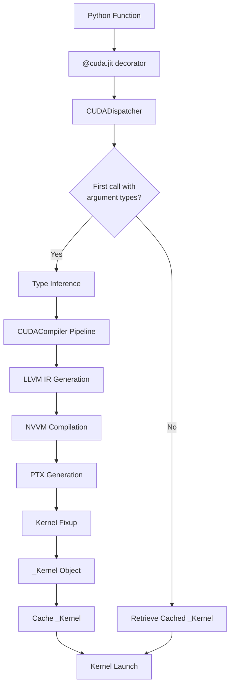

Sources: [numba_cuda/numba/cuda/dispatcher.py:728-888](), [numba_cuda/numba/cuda/compiler.py:190-236](), [numba_cuda/numba/cuda/decorators.py:17-262]()

## Core Components

### CUDADispatcher

The `CUDADispatcher` class serves as the primary interface between user code and the compilation system. It manages kernel compilation, specialization, and caching:

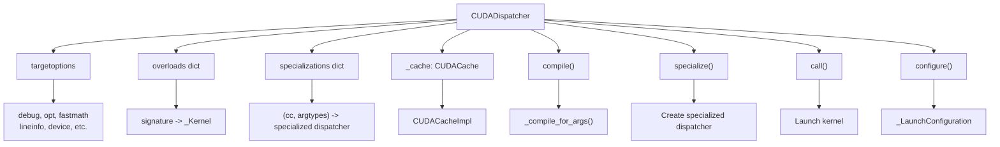

Sources: [numba_cuda/numba/cuda/dispatcher.py:728-888]()

### _Kernel Class

The `_Kernel` class represents a compiled kernel specialized for specific argument types. It encapsulates the compilation result and provides kernel launch capabilities:

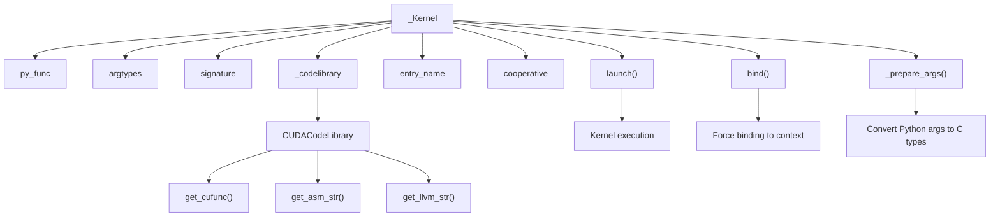

Sources: [numba_cuda/numba/cuda/dispatcher.py:60-608]()

### CUDACompiler Pipeline

The `CUDACompiler` implements the compilation pipeline using Numba's pass manager system:

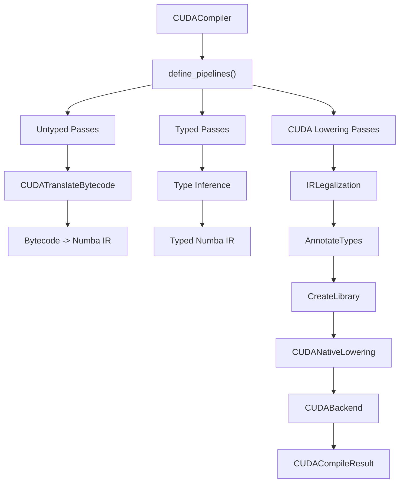

Sources: [numba_cuda/numba/cuda/compiler.py:190-236]()

## Type Specialization and Caching

The compilation system performs type specialization to create efficient kernels for specific argument types:

### Specialization Process

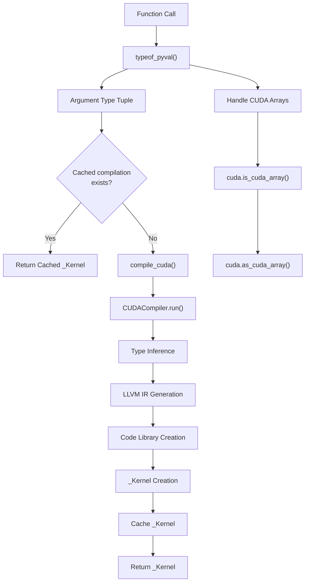

Sources: [numba_cuda/numba/cuda/dispatcher.py:838-857](), [numba_cuda/numba/cuda/compiler.py:238-311]()

### Caching System

The `CUDACache` system provides persistent caching of compiled kernels:

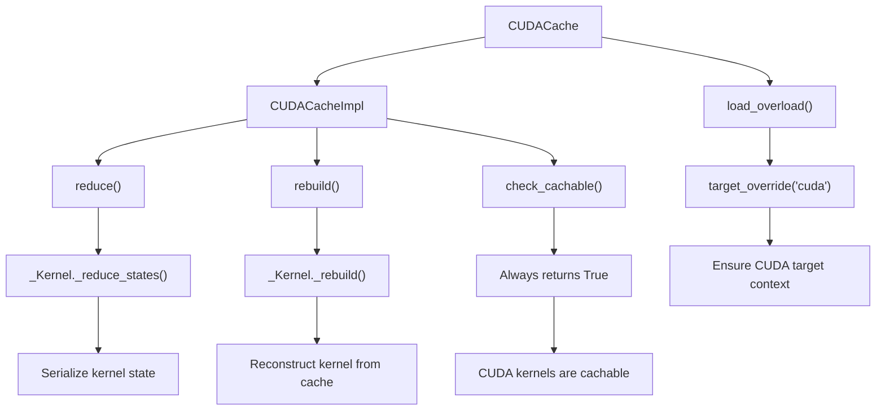

Sources: [numba_cuda/numba/cuda/dispatcher.py:693-726]()

## Code Generation Process

The compilation pipeline transforms Python code through several intermediate representations:

### LLVM IR Generation

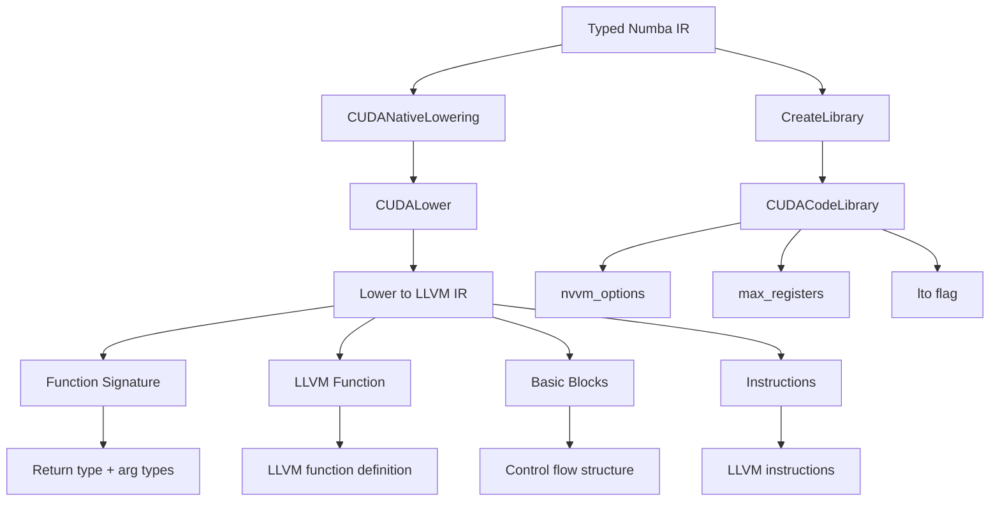

Sources: [numba_cuda/numba/cuda/compiler.py:131-141](), [numba_cuda/numba/cuda/compiler.py:100-128]()

### PTX Generation and Kernel Fixup

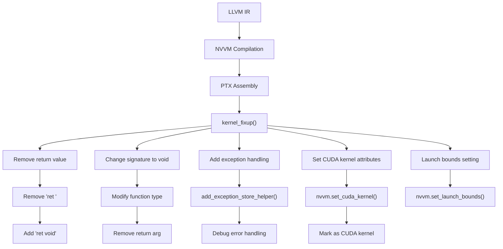

Sources: [numba_cuda/numba/cuda/compiler.py:365-457]()

## Kernel Launch Process

Once compiled, kernels are launched through a structured process that handles argument marshalling and GPU execution:

### Launch Configuration

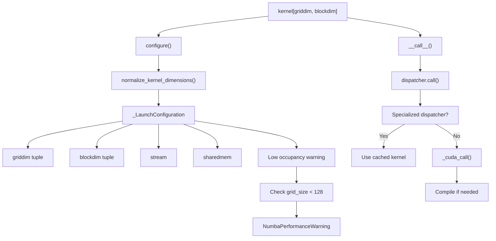

Sources: [numba_cuda/numba/cuda/dispatcher.py:658-691](), [numba_cuda/numba/cuda/dispatcher.py:770-778]()

### Argument Preparation

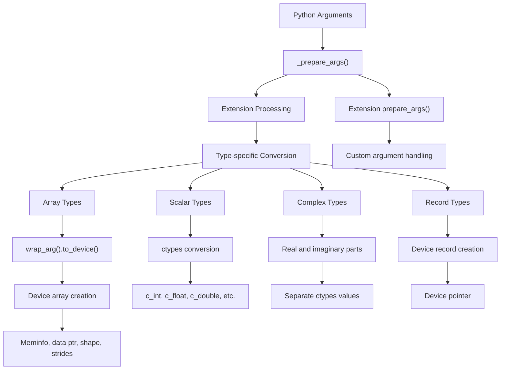

Sources: [numba_cuda/numba/cuda/dispatcher.py:518-608]()

## Debug and Inspection Support

The compilation pipeline includes comprehensive debugging and inspection capabilities:

### Debug Information Generation

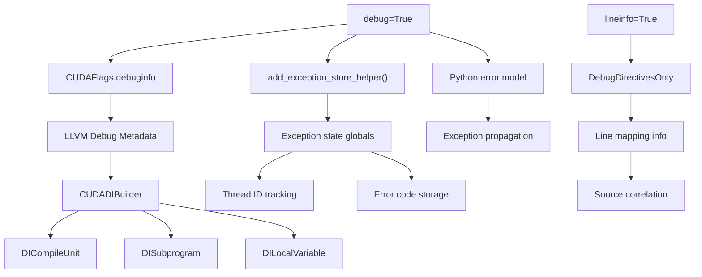

Sources: [numba_cuda/numba/cuda/compiler.py:271-279](), [numba_cuda/numba/cuda/compiler.py:459-525]()

### Code Inspection Methods

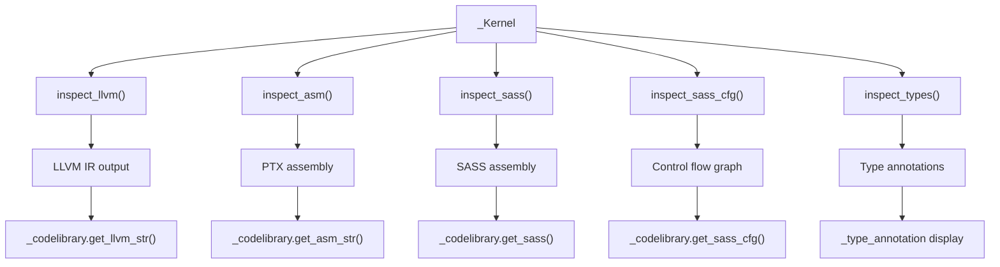

Sources: [numba_cuda/numba/cuda/dispatcher.py:375-418]()

## Integration Points

The JIT compilation pipeline integrates with several other numba-cuda subsystems:

### Memory Management Integration

The compilation system automatically links with the NRT (Numba Runtime) memory system when needed:

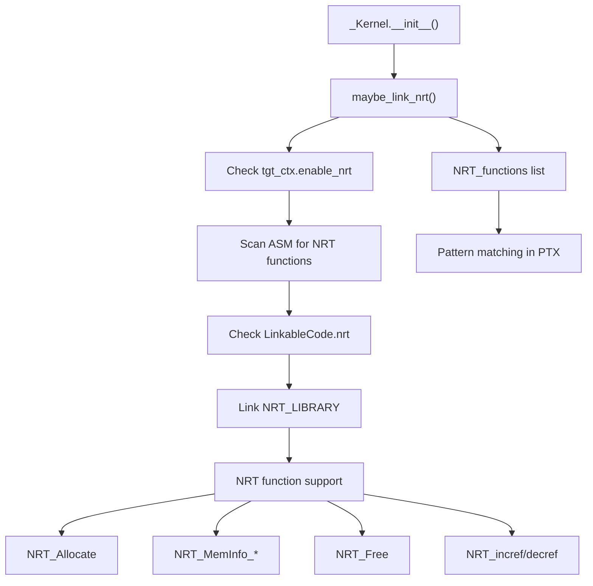

Sources: [numba_cuda/numba/cuda/dispatcher.py:216-246]()

### External Code Linking

The pipeline supports linking external CUDA code during compilation:

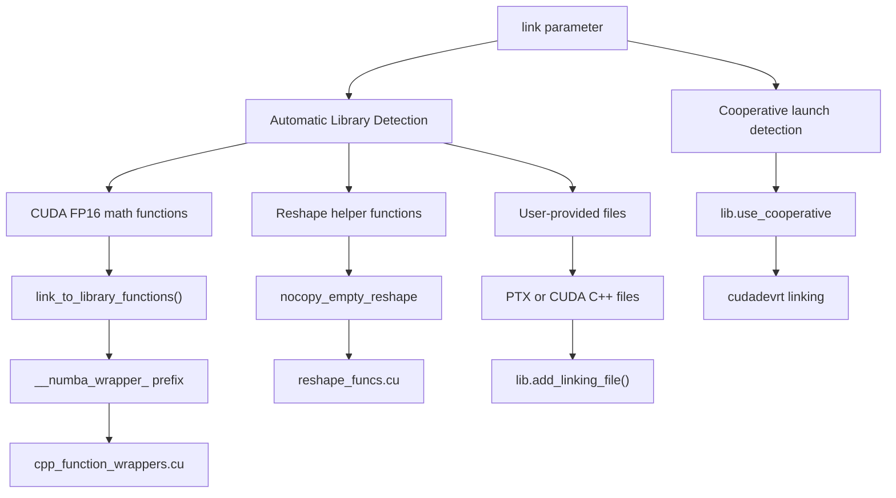

Sources: [numba_cuda/numba/cuda/dispatcher.py:164-197]()

This comprehensive JIT compilation pipeline enables numba-cuda to efficiently transform Python functions into high-performance CUDA kernels while providing extensive debugging and inspection capabilities.

---

