<!-- source: DeepWiki mcp.deepwiki.com · repo NVIDIA/numba-cuda · page 2.2 CUDA Driver Interface · fetched 2026-10-26 -->

# CUDA Driver Interface

<details>
<summary>Relevant source files</summary>

The following files were used as context for generating this wiki page:

- [numba_cuda/numba/cuda/api.py](numba_cuda/numba/cuda/api.py)
- [numba_cuda/numba/cuda/cudadrv/devicearray.py](numba_cuda/numba/cuda/cudadrv/devicearray.py)
- [numba_cuda/numba/cuda/cudadrv/driver.py](numba_cuda/numba/cuda/cudadrv/driver.py)
- [numba_cuda/numba/cuda/cudadrv/mappings.py](numba_cuda/numba/cuda/cudadrv/mappings.py)
- [numba_cuda/numba/cuda/decorators.py](numba_cuda/numba/cuda/decorators.py)
- [numba_cuda/numba/cuda/tests/cudadrv/test_cuda_memory.py](numba_cuda/numba/cuda/tests/cudadrv/test_cuda_memory.py)
- [numba_cuda/numba/cuda/tests/cudadrv/test_emm_plugins.py](numba_cuda/numba/cuda/tests/cudadrv/test_emm_plugins.py)
- [numba_cuda/numba/cuda/tests/cudadrv/test_linker.py](numba_cuda/numba/cuda/tests/cudadrv/test_linker.py)
- [numba_cuda/numba/cuda/tests/cudadrv/test_module_callbacks.py](numba_cuda/numba/cuda/tests/cudadrv/test_module_callbacks.py)
- [numba_cuda/numba/cuda/tests/cudadrv/test_nvjitlink.py](numba_cuda/numba/cuda/tests/cudadrv/test_nvjitlink.py)
- [numba_cuda/numba/cuda/tests/cudapy/test_debug.py](numba_cuda/numba/cuda/tests/cudapy/test_debug.py)
- [numba_cuda/numba/cuda/tests/cudapy/test_errors.py](numba_cuda/numba/cuda/tests/cudapy/test_errors.py)
- [numba_cuda/numba/cuda/tests/cudapy/test_inline.py](numba_cuda/numba/cuda/tests/cudapy/test_inline.py)

</details>


## Purpose and Scope

The CUDA Driver Interface is the abstraction layer that bridges Numba's high-level Python API with the low-level CUDA driver functions. It provides Python-friendly wrappers around CUDA driver operations including device management, context lifecycle, memory allocation, stream/event synchronization, and module loading. This interface is the foundation of the runtime system that executes compiled kernels.

For information about memory allocation strategies and the NRT system, see [Memory Management System](#2.3). For kernel compilation and code generation, see [JIT Compilation Pipeline](#2.1).

---

## Architecture Overview

The driver interface is organized into several key components that work together to manage GPU resources:

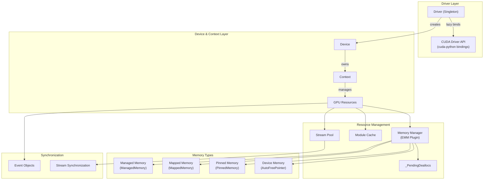

**Diagram: CUDA Driver Interface Architecture**

The `Driver` singleton provides lazy-bound access to CUDA driver functions, `Device` objects represent individual GPUs, `Context` objects wrap CUDA contexts and manage resources, and the memory manager handles all memory allocations through a pluggable EMM (External Memory Management) interface.

Sources: [numba_cuda/numba/cuda/cudadrv/driver.py:247-515]()

---

## Driver Singleton

### Driver Class Overview

The `Driver` class is implemented as a singleton that manages the CUDA driver library and provides access to all driver API functions:

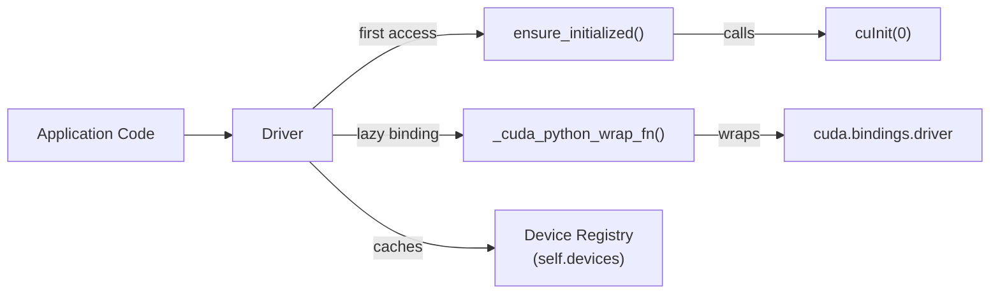

**Diagram: Driver Initialization and Function Binding**

The driver performs lazy initialization on first API access and caches device objects in a registry.

Sources: [numba_cuda/numba/cuda/cudadrv/driver.py:247-465]()

### Key Responsibilities

| Responsibility | Implementation | File Reference |
|---------------|----------------|----------------|
| **Initialization** | Calls `cuInit(0)` on first use, stores PID to detect forks | [driver.py:281-298]() |
| **Function Binding** | Wraps cuda-python bindings with error checking | [driver.py:351-370]() |
| **Error Handling** | Converts CUDA error codes to Python exceptions | [driver.py:409-422]() |
| **Device Management** | Maintains registry of `Device` objects | [driver.py:424-429]() |
| **Fork Detection** | Raises error if CUDA initialized before fork | [driver.py:394-398]() |

### Lazy Function Binding

The `Driver` uses the `__getattr__` mechanism to lazily bind CUDA driver functions:

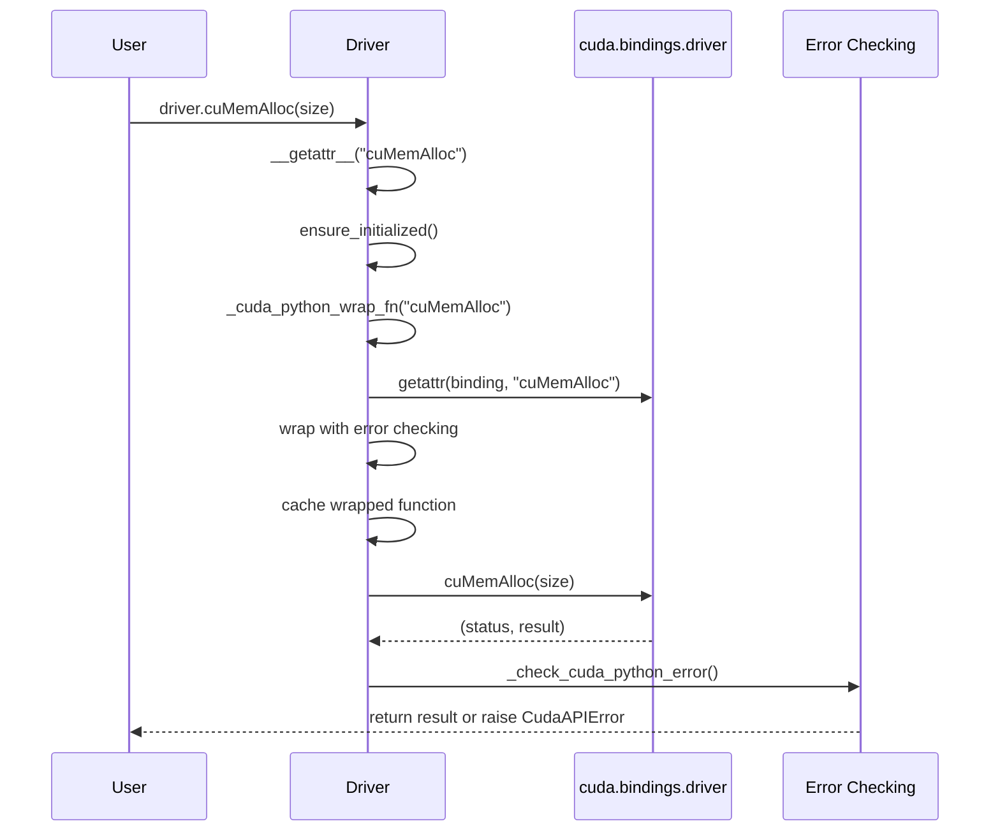

**Diagram: Lazy Function Binding Sequence**

Functions are bound on first access and cached for subsequent calls. All calls include automatic error checking.

Sources: [numba_cuda/numba/cuda/cudadrv/driver.py:305-370]()

---

## Device Management

### Device Class

The `Device` class represents a physical GPU device and provides access to device attributes:

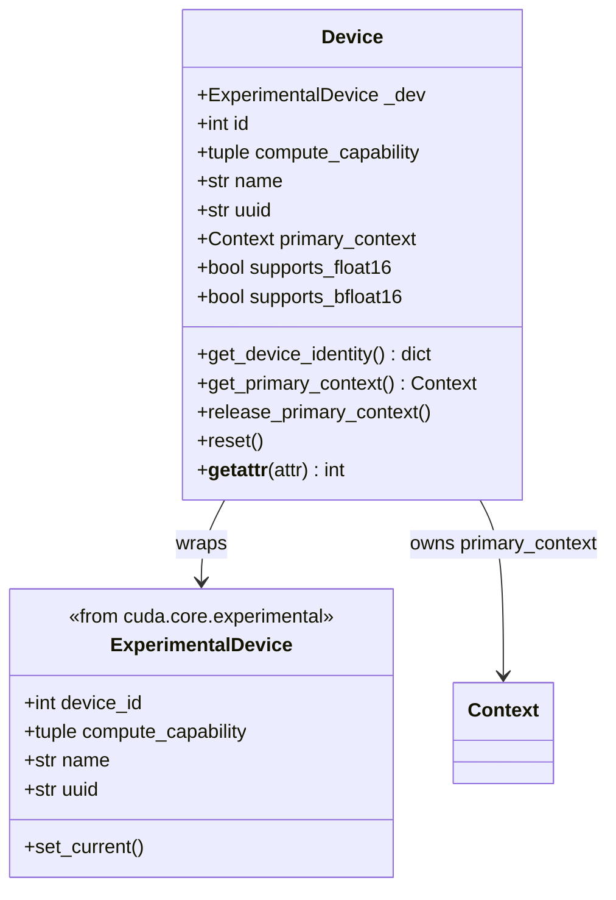

**Diagram: Device Class Structure**

The `Device` class wraps `cuda.core.experimental.Device` and manages the primary context for the device.

Sources: [numba_cuda/numba/cuda/cudadrv/driver.py:530-633]()

### Device Attributes

Device attributes are accessed lazily through `__getattr__`:

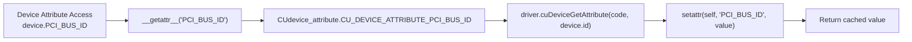

**Diagram: Lazy Device Attribute Loading**

Attributes are queried from the driver once and cached on the device instance.

Sources: [numba_cuda/numba/cuda/cudadrv/driver.py:569-577]()

### Device Selection and Enumeration

The driver maintains a registry of devices:

| Method | Purpose | Returns |
|--------|---------|---------|
| `driver.get_device(devnum)` | Get or create device by ID | `Device` proxy |
| `driver.get_device_count()` | Query total device count | `int` |
| `driver.list_devices()` | List active devices | `list[Device]` |
| `Device.from_identity(identity)` | Find device by PCI identity | `Device` |

Sources: [numba_cuda/numba/cuda/cudadrv/driver.py:424-436](), [numba_cuda/numba/cuda/cudadrv/driver.py:536-549]()

---

## Context Management

### Context Class

The `Context` class wraps a CUDA context and manages all resources within it:

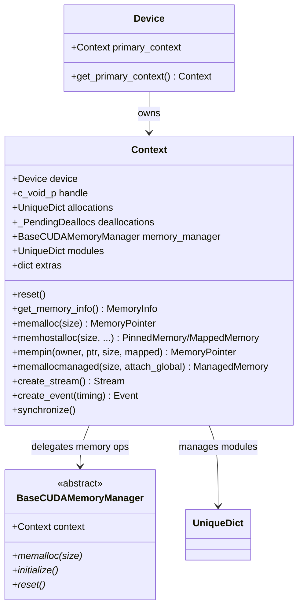

**Diagram: Context Class Relationships**

The context delegates memory operations to a pluggable memory manager and maintains caches for modules and allocations.

Sources: [numba_cuda/numba/cuda/cudadrv/driver.py:1106-1292]()

### Primary Context Model

Numba uses CUDA's primary context for each device:

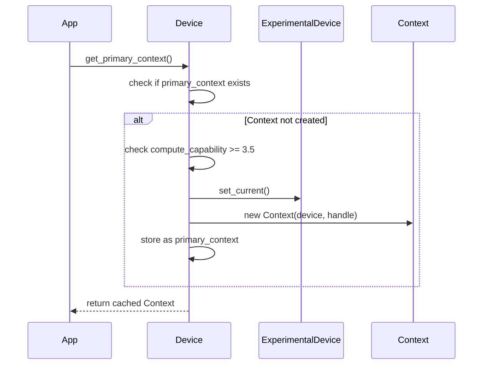

**Diagram: Primary Context Creation**

Each device creates its primary context on first access, which is then cached and reused.

Sources: [numba_cuda/numba/cuda/cudadrv/driver.py:588-606]()

### Active Context Tracking

The `_ActiveContext` class caches the active context in thread-local storage to reduce driver API queries:

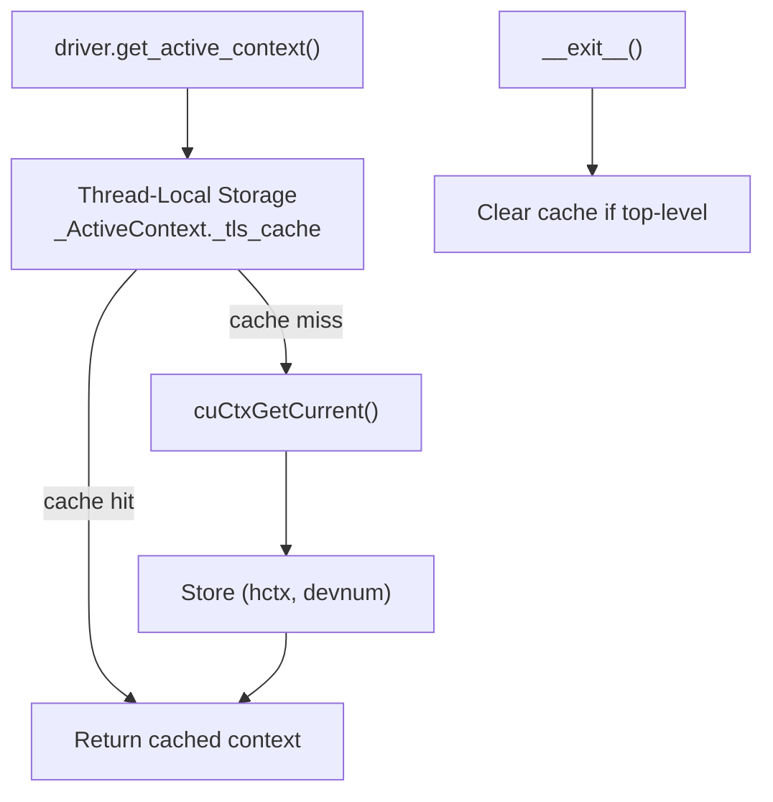

**Diagram: Active Context Caching**

The active context is cached per-thread to minimize expensive driver queries during nested calls.

Sources: [numba_cuda/numba/cuda/cudadrv/driver.py:467-512]()

---

## Memory Management Architecture

### Memory Pointer Hierarchy

The driver provides several memory pointer types for different allocation strategies:

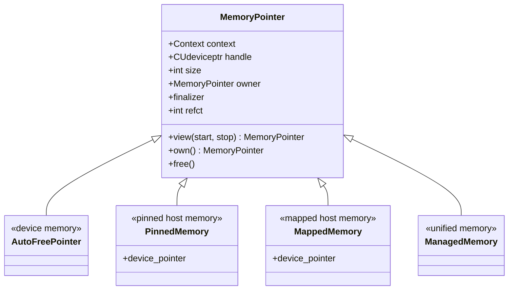

**Diagram: Memory Pointer Class Hierarchy**

Each memory type extends `MemoryPointer` with specific allocation and access semantics.

Sources: [numba_cuda/numba/cuda/cudadrv/driver.py:1344-1648]()

### Pending Deallocations System

The `_PendingDeallocs` class defers memory deallocations to prevent driver corruption during context errors:

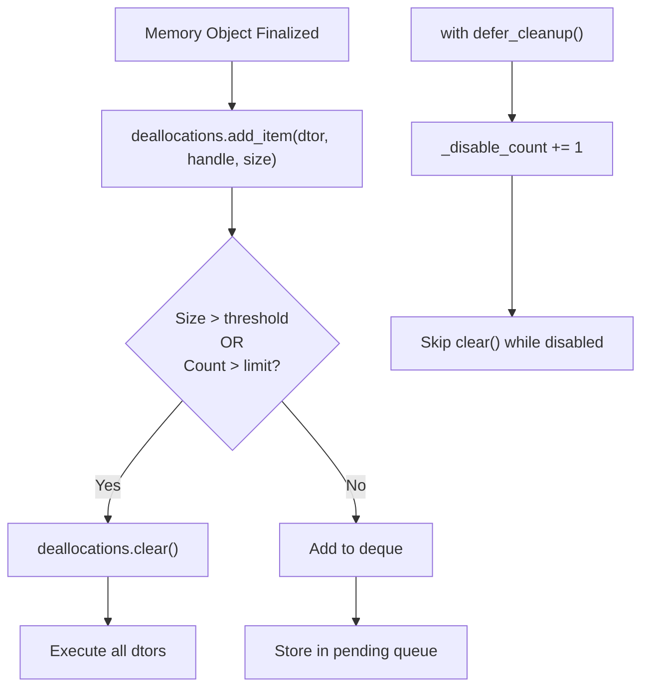

**Diagram: Pending Deallocations Flow**

Deallocations are batched and flushed when thresholds are exceeded, unless explicitly disabled via `defer_cleanup()`.

Sources: [numba_cuda/numba/cuda/cudadrv/driver.py:1020-1091]()

### Deallocation Thresholds

| Configuration | Default | Purpose |
|--------------|---------|---------|
| `CUDA_DEALLOCS_COUNT` | 10 | Max pending deallocations before flush |
| `CUDA_DEALLOCS_RATIO` | 0.2 | Max pending bytes as fraction of total memory |

Sources: [numba_cuda/numba/cuda/cudadrv/driver.py:1035-1054]()

---

## External Memory Management (EMM) Plugins

### EMM Plugin Interface

The driver supports pluggable memory managers through the `BaseCUDAMemoryManager` abstract class:

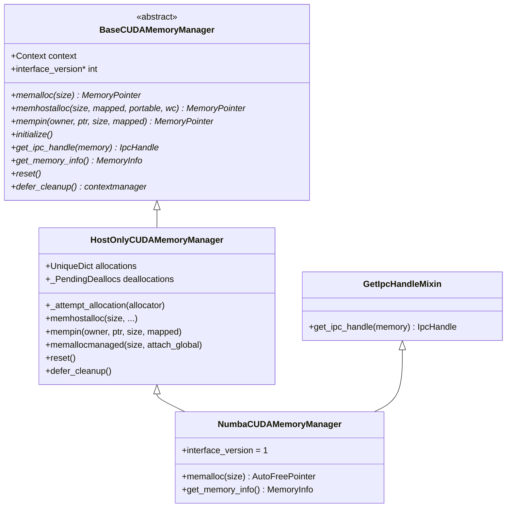

**Diagram: EMM Plugin Class Hierarchy**

The EMM interface allows custom memory managers. `NumbaCUDAMemoryManager` is the default implementation.

Sources: [numba_cuda/numba/cuda/cudadrv/driver.py:634-957]()

### Memory Manager Registration

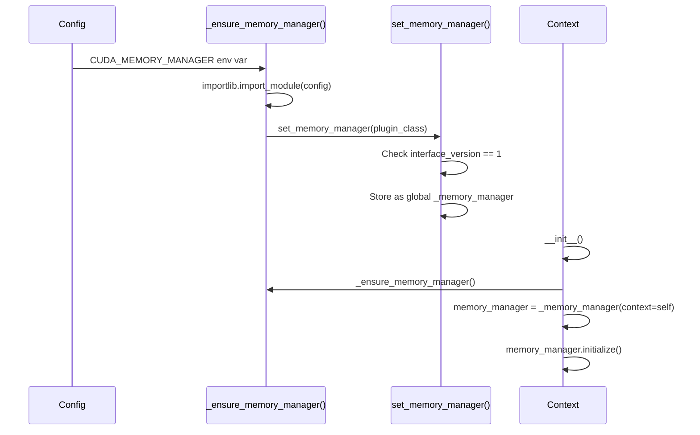

**Diagram: Memory Manager Registration and Initialization**

Custom memory managers are registered via `set_memory_manager()` or the `CUDA_MEMORY_MANAGER` environment variable.

Sources: [numba_cuda/numba/cuda/cudadrv/driver.py:963-1003]()

### Memory Allocation Flow

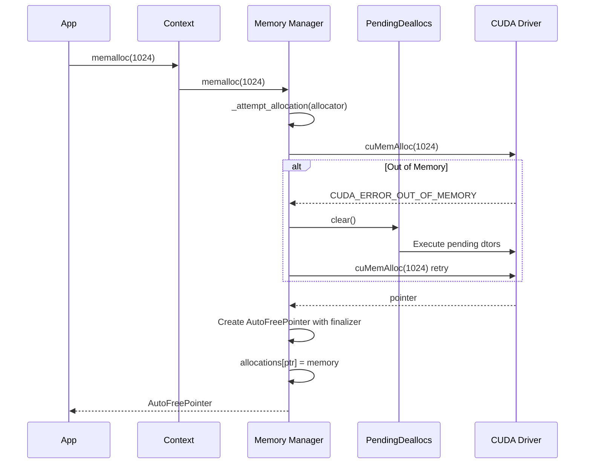

**Diagram: Memory Allocation with OOM Recovery**

The memory manager attempts to recover from out-of-memory errors by flushing pending deallocations and retrying.

Sources: [numba_cuda/numba/cuda/cudadrv/driver.py:773-948]()

---

## Stream and Event Management

### Stream Operations

The `Stream` class wraps CUDA streams for asynchronous operations:

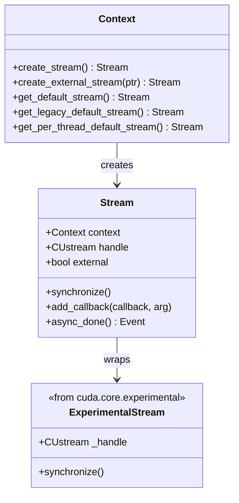

**Diagram: Stream Class Relationships**

Streams are created through the context and can be either managed by Numba or external.

Sources: [numba_cuda/numba/cuda/cudadrv/driver.py:1650-1761]()

### Event Synchronization

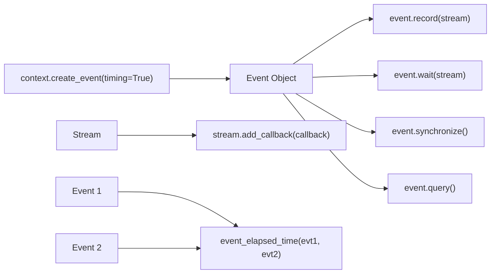

**Diagram: Event Operations**

Events provide synchronization points and timing measurements between streams.

Sources: [numba_cuda/numba/cuda/cudadrv/driver.py:1763-1852]()

---

## Module Loading and Linking

### Module Class

The `Module` class manages loaded GPU code modules:

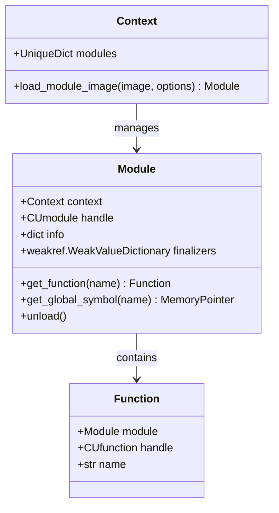

**Diagram: Module and Function Classes**

Modules contain compiled GPU code and provide access to kernel functions and global symbols.

Sources: [numba_cuda/numba/cuda/cudadrv/driver.py:1854-2005]()

### Linker Class

The `_Linker` class combines multiple code objects into a single module:

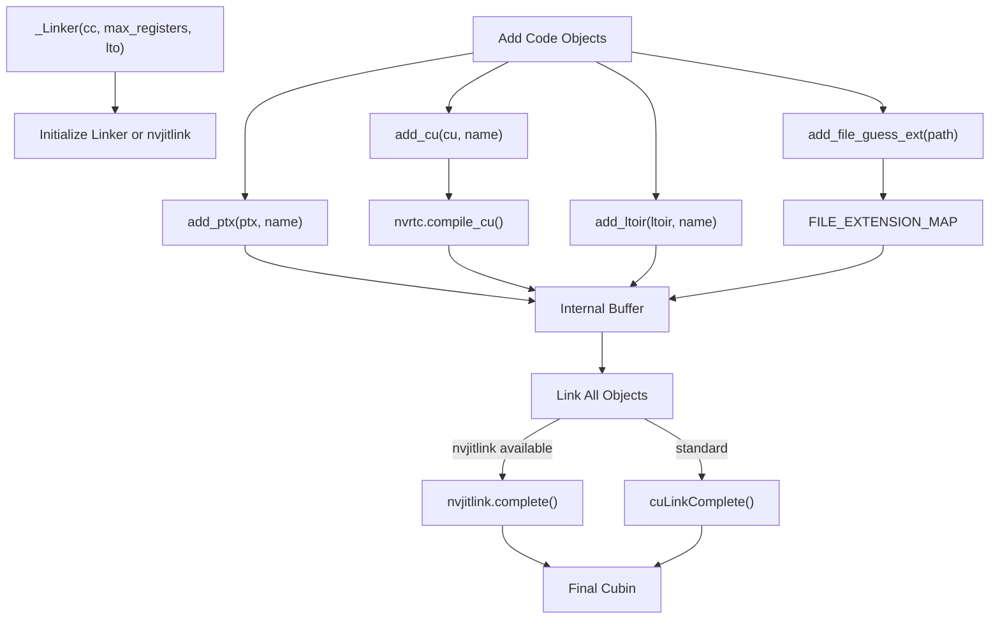

**Diagram: Linker Code Addition and Linking Flow**

The linker accepts various code formats, compiles CUDA C++ sources with NVRTC, and links everything into a cubin.

Sources: [numba_cuda/numba/cuda/cudadrv/driver.py:2184-2678]()

### Supported Input Formats

| Format | Extension | Description | Added Via |
|--------|-----------|-------------|-----------|
| PTX | `.ptx` | Assembly code | `add_ptx()` |
| CUDA C++ | `.cu` | Source code (compiled via NVRTC) | `add_cu()` |
| LTO-IR | `.ltoir` | LLVM bitcode for LTO | `add_ltoir()` |
| Object | `.o` | Compiled object file | `add_file_guess_ext()` |
| Library | `.a`, `.lib` | Archive of objects | `add_file_guess_ext()` |
| Cubin | `.cubin` | Binary code | `add_file_guess_ext()` |
| Fatbin | `.fatbin` | Multi-architecture binary | `add_file_guess_ext()` |

Sources: [numba_cuda/numba/cuda/cudadrv/driver.py:2428-2631](), [numba_cuda/numba/cuda/cudadrv/mappings.py:1-15]()

### Link-Time Optimization (LTO)

When nvjitlink is available, the linker supports LTO mode:

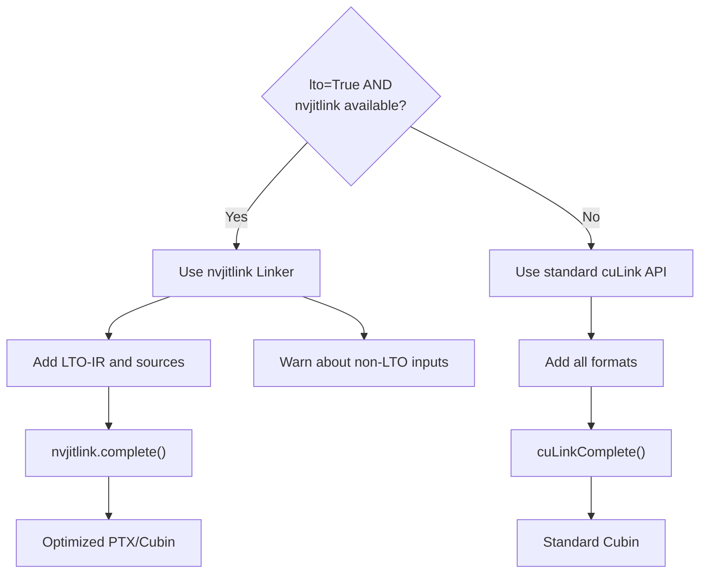

**Diagram: LTO vs Standard Linking**

LTO linking produces more optimized code but requires LTO-IR inputs for full benefit.

Sources: [numba_cuda/numba/cuda/cudadrv/driver.py:2184-2272](), [numba_cuda/numba/cuda/cudadrv/driver.py:113-136]()

---

## Error Handling

### Error Detection and Reporting

All CUDA driver API calls are wrapped with error checking:

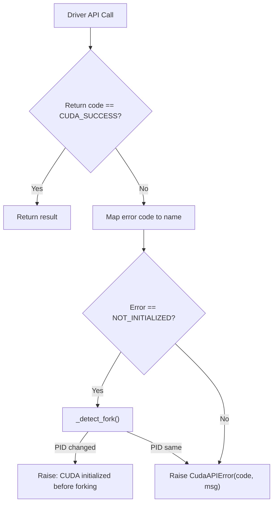

**Diagram: Error Handling Flow**

All errors are caught, logged, and converted to `CudaAPIError` exceptions. Fork detection prevents subtle corruption.

Sources: [numba_cuda/numba/cuda/cudadrv/driver.py:394-422]()

### Error Types

| Exception | Purpose | Example |
|-----------|---------|---------|
| `CudaAPIError` | CUDA driver error | Out of memory, invalid value |
| `CudaSupportError` | Driver unavailable | No driver installed |
| `LinkerError` | Linking failure | File not found, incompatible code |
| `DeadMemoryError` | Access after free | Using freed memory |

Sources: [numba_cuda/numba/cuda/cudadrv/driver.py:139-153](), [numba_cuda/numba/cuda/cudadrv/error.py]()

---

## Integration with Higher Layers

### Driver Usage by Dispatcher

The dispatcher uses the driver interface to execute compiled kernels:

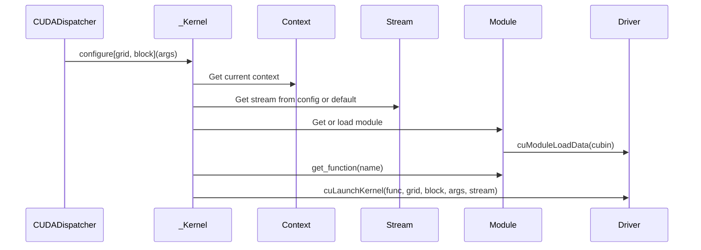

**Diagram: Kernel Launch Sequence**

The dispatcher uses driver primitives to load modules and launch kernels on streams.

Sources: [numba_cuda/numba/cuda/dispatcher.py](), [numba_cuda/numba/cuda/cudadrv/driver.py:2007-2182]()

### Memory Transfer Operations

```mermaid
graph LR
    Host["Host Memory<br/>(numpy array)"] --> H2D["driver.host_to_device()"]
    H2D --> Device["Device Memory<br/>(MemoryPointer)"]
    Device --> D2H["driver.device_to_host()"]
    D2H --> Host
    Device --> D2D["driver.device_to_device()"]
    D2D --> Device
    
    Stream["Stream"] -.-> |"async"| H2D
    Stream -.-> |"async"| D2H
    Stream -.-> |"async"| D2D
```

**Diagram: Memory Transfer Paths**

All transfers can be made asynchronous by passing a stream parameter.

Sources: [numba_cuda/numba/cuda/cudadrv/driver.py:3192-3293]()

---

## Configuration and Tuning

### Environment Variables

| Variable | Purpose | Default |
|----------|---------|---------|
| `NUMBA_CUDA_LOG_LEVEL` | Driver logging level | `CRITICAL` |
| `NUMBA_CUDA_LOG_API_ARGS` | Log API call arguments | `False` |
| `NUMBA_CUDA_DEALLOCS_COUNT` | Pending dealloc threshold (count) | 10 |
| `NUMBA_CUDA_DEALLOCS_RATIO` | Pending dealloc threshold (ratio) | 0.2 |
| `NUMBA_CUDA_MEMORY_MANAGER` | Custom EMM plugin module | `"default"` |

Sources: [numba_cuda/numba/cuda/cudadrv/driver.py:89-110](), [numba_cuda/numba/cuda/core/config.py]()

### Performance Considerations

The driver interface includes several optimizations:

1. **Active Context Caching**: Thread-local cache reduces `cuCtxGetCurrent()` calls
2. **Lazy Function Binding**: Driver functions are bound only when first used
3. **Pending Deallocations**: Batching reduces synchronization overhead
4. **Module Caching**: Compiled modules are reused across calls
5. **Weak References**: Automatic cleanup without explicit memory management

Sources: [numba_cuda/numba/cuda/cudadrv/driver.py:467-512](), [numba_cuda/numba/cuda/cudadrv/driver.py:1020-1091]()

---

