<!-- source: DeepWiki mcp.deepwiki.com · repo NVIDIA/numba-cuda · page 2.3 Memory Management System · fetched 2026-10-26 -->

# Memory Management System

<details>
<summary>Relevant source files</summary>

The following files were used as context for generating this wiki page:

- [numba_cuda/numba/cuda/api.py](numba_cuda/numba/cuda/api.py)
- [numba_cuda/numba/cuda/core/config.py](numba_cuda/numba/cuda/core/config.py)
- [numba_cuda/numba/cuda/cudadrv/devicearray.py](numba_cuda/numba/cuda/cudadrv/devicearray.py)
- [numba_cuda/numba/cuda/cudadrv/driver.py](numba_cuda/numba/cuda/cudadrv/driver.py)
- [numba_cuda/numba/cuda/memory_management/nrt.py](numba_cuda/numba/cuda/memory_management/nrt.py)
- [numba_cuda/numba/cuda/tests/cudadrv/test_cuda_memory.py](numba_cuda/numba/cuda/tests/cudadrv/test_cuda_memory.py)
- [numba_cuda/numba/cuda/tests/cudadrv/test_emm_plugins.py](numba_cuda/numba/cuda/tests/cudadrv/test_emm_plugins.py)
- [numba_cuda/numba/cuda/typeconv/rules.py](numba_cuda/numba/cuda/typeconv/rules.py)

</details>


## Purpose and Scope

This document describes the memory management system in numba-cuda, which handles allocation, deallocation, and transfer of memory between the host (CPU) and device (GPU). The system provides an External Memory Management (EMM) plugin architecture that allows customization of memory allocation strategies, supports multiple memory types (device, managed, pinned, mapped), and implements deferred deallocation to prevent crashes during context corruption. For information about the CUDA Driver API interface, see [2.2](#2.2). For type system details related to array types, see [2.4](#2.4).

---

## Memory Manager Architecture

The memory management system is built around a pluggable architecture that allows users to provide custom memory allocators through the EMM (External Memory Management) plugin interface.

### Memory Manager Class Hierarchy

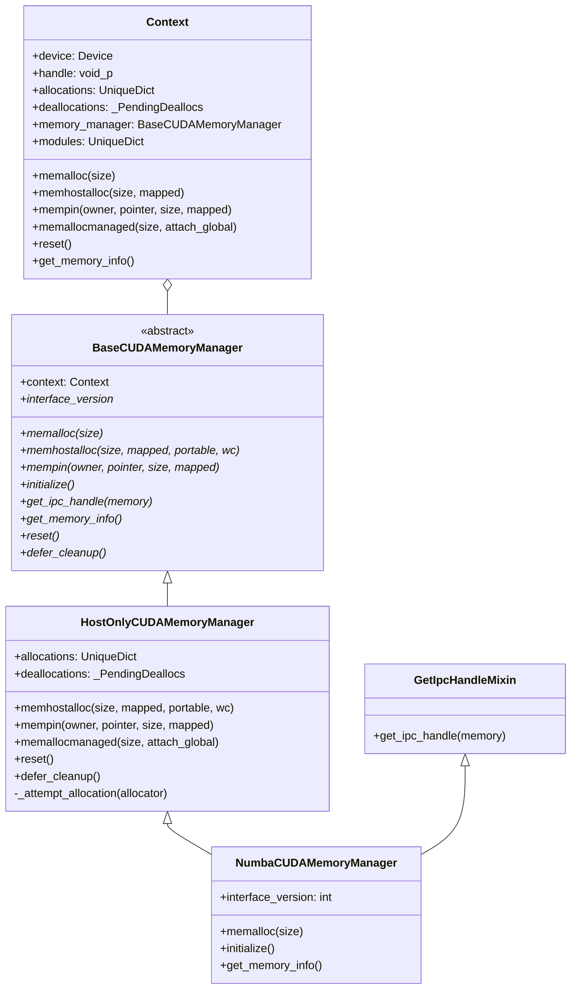

**Memory Manager Class Hierarchy**: Shows the EMM plugin architecture with abstract base classes and the default implementation.

Sources: [numba_cuda/numba/cuda/cudadrv/driver.py:634-956]()

### EMM Plugin Interface

The `BaseCUDAMemoryManager` abstract base class defines the interface that all EMM plugins must implement:

| Method | Purpose | Required |
|--------|---------|----------|
| `memalloc(size)` | Allocate device memory | Yes |
| `memhostalloc(size, mapped, portable, wc)` | Allocate pinned host memory | Yes |
| `mempin(owner, pointer, size, mapped)` | Pin existing host memory | Yes |
| `initialize()` | Initialize the memory manager | Yes |
| `get_ipc_handle(memory)` | Get IPC handle for sharing | Yes |
| `get_memory_info()` | Return free/total memory | Yes |
| `reset()` | Clear all allocations | Yes |
| `defer_cleanup()` | Return context manager for deferred cleanup | Yes |
| `interface_version` | Return EMM interface version (must be 1) | Yes |

The `HostOnlyCUDAMemoryManager` class provides a base implementation that handles host memory allocations (pinned and mapped), allowing EMM plugin authors to focus solely on implementing device memory allocation (`memalloc`). This class implements `memhostalloc`, `mempin`, and `memallocmanaged` methods internally.

Sources: [numba_cuda/numba/cuda/cudadrv/driver.py:634-904]()

### Memory Manager Selection and Configuration

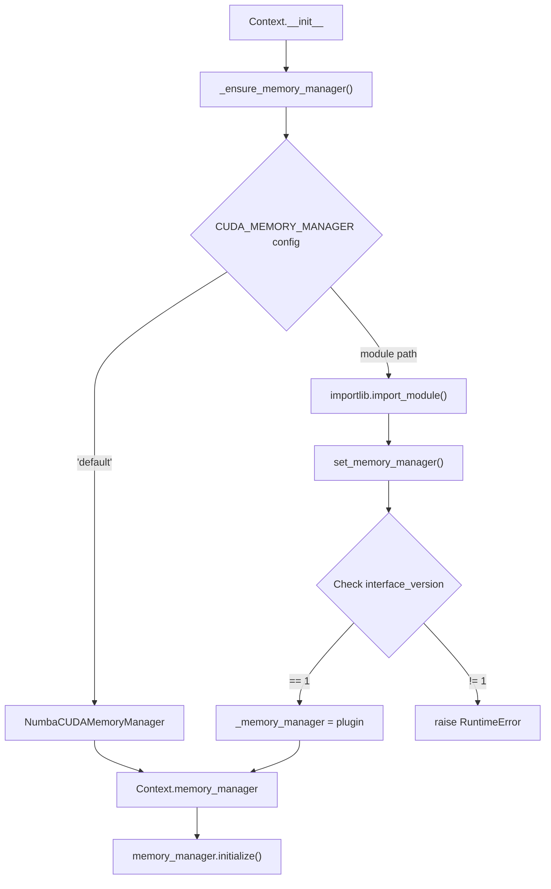

**Memory Manager Initialization Flow**: Shows how the memory manager is selected and initialized when a context is created.

The global `_memory_manager` variable [numba_cuda/numba/cuda/cudadrv/driver.py:960]() holds the memory manager class (not instance). Each `Context` instance creates its own instance of the memory manager class and stores it in `Context.memory_manager` [numba_cuda/numba/cuda/cudadrv/driver.py:1119]().

Configuration is controlled via the `NUMBA_CUDA_MEMORY_MANAGER` environment variable [numba_cuda/numba/cuda/core/config.py:588-590](), which can be either `"default"` for the built-in `NumbaCUDAMemoryManager`, or a module path to a custom EMM plugin.

Sources: [numba_cuda/numba/cuda/cudadrv/driver.py:963-1003](), [numba_cuda/numba/cuda/core/config.py:588-590]()

---

## Memory Types and Allocation

numba-cuda supports four distinct memory types, each with specific characteristics and use cases:

### Memory Type Comparison

| Memory Type | Location | Accessibility | Allocation Function | Use Case |
|-------------|----------|---------------|---------------------|----------|
| Device | GPU | Device only | `memalloc()` | Standard GPU computations |
| Managed | GPU/CPU | Both (automatic migration) | `memallocmanaged()` | Simplified unified memory access |
| Pinned | CPU | Host only | `memhostalloc(mapped=False)` | Fast host-device transfers |
| Mapped | CPU | Both | `memhostalloc(mapped=True)` | Zero-copy access from device |

### Memory Allocation Flow

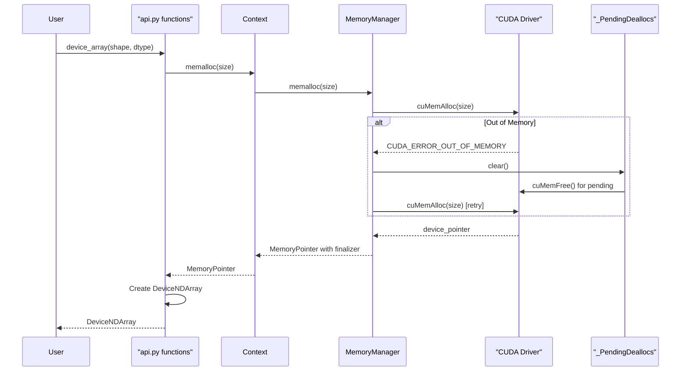

**Memory Allocation with Retry Logic**: Shows how allocation attempts retry after clearing pending deallocations on OOM errors.

The `_attempt_allocation` method [numba_cuda/numba/cuda/cudadrv/driver.py:773-790]() implements a two-phase allocation strategy: first attempt direct allocation, and on out-of-memory error, clear pending deallocations and retry once.

Sources: [numba_cuda/numba/cuda/cudadrv/driver.py:773-790](), [numba_cuda/numba/cuda/cudadrv/driver.py:936-947]()

### Device Memory Allocation

Device memory is allocated on the GPU using `cuMemAlloc`:

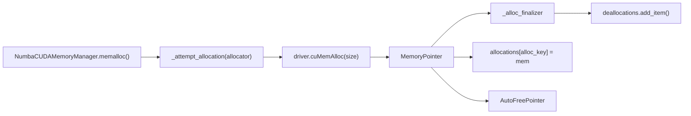

**Device Memory Allocation Process**: Shows the creation of `AutoFreePointer` with finalizer registration.

The `AutoFreePointer` class [numba_cuda/numba/cuda/cudadrv/driver.py:1205-1257]() wraps the device pointer and registers a finalizer that adds the deallocation to the pending queue when the reference count drops to zero.

Sources: [numba_cuda/numba/cuda/cudadrv/driver.py:936-947](), [numba_cuda/numba/cuda/cudadrv/driver.py:1205-1257]()

### Managed Memory Allocation

Managed memory (Unified Memory) is accessible from both CPU and GPU with automatic data migration:

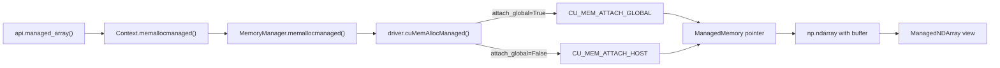

**Managed Memory Creation Flow**: Shows the creation of managed arrays with host/global attachment flags.

The `attach_global` parameter [numba_cuda/numba/cuda/api.py:181-186]() controls whether the memory is accessible from any stream on any device (`True`) or only from devices with compute capability 6.0+ (`False`).

Sources: [numba_cuda/numba/cuda/cudadrv/driver.py:864-883](), [numba_cuda/numba/cuda/api.py:164-199]()

### Pinned and Mapped Memory Allocation

Pinned (page-locked) memory enables faster host-device transfers, while mapped memory provides zero-copy access:

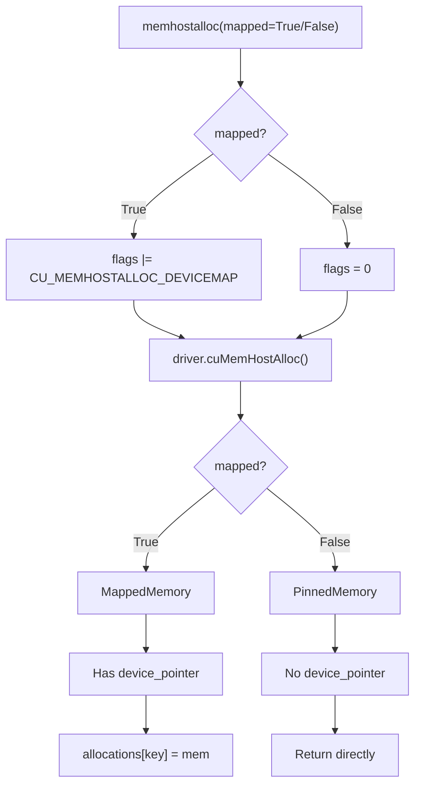

**Pinned vs Mapped Memory Allocation**: Shows the difference in handling for mapped and non-mapped pinned allocations.

Mapped memory is tracked in the `allocations` dictionary [numba_cuda/numba/cuda/cudadrv/driver.py:821]() because it has device-side resources that need cleanup, while plain pinned memory is returned directly without tracking.

Sources: [numba_cuda/numba/cuda/cudadrv/driver.py:792-824]()

---

## Device Array Types

Device arrays are the primary data structures for working with GPU memory in numba-cuda.

### Device Array Class Hierarchy

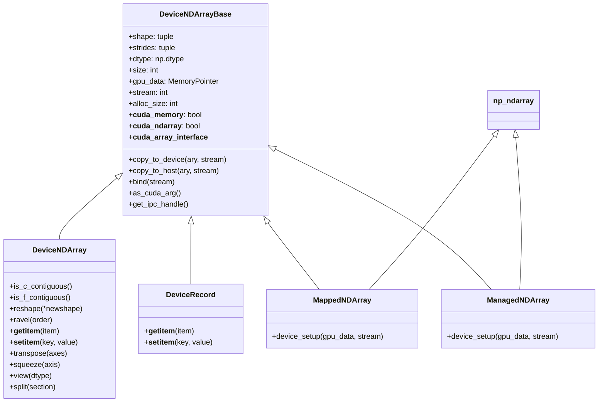

**Device Array Type Hierarchy**: Shows the inheritance structure of device array types and their numpy integration.

Sources: [numba_cuda/numba/cuda/cudadrv/devicearray.py:58-831]()

### CUDA Array Interface

All device array types implement the `__cuda_array_interface__` protocol [numba_cuda/numba/cuda/cudadrv/devicearray.py:120-133]():

| Field | Description | Type |
|-------|-------------|------|
| `shape` | Array dimensions | `tuple[int, ...]` |
| `strides` | Byte strides (None if C-contiguous) | `tuple[int, ...] \| None` |
| `data` | `(pointer, read_only)` tuple | `tuple[int, bool]` |
| `typestr` | Data type string | `str` |
| `version` | Interface version (3) | `int` |
| `stream` | CUDA stream pointer (optional) | `int \| None` |

This interface enables interoperability with other GPU libraries like CuPy, PyTorch, and JAX.

Sources: [numba_cuda/numba/cuda/cudadrv/devicearray.py:120-133]()

### Device Array Creation and Initialization

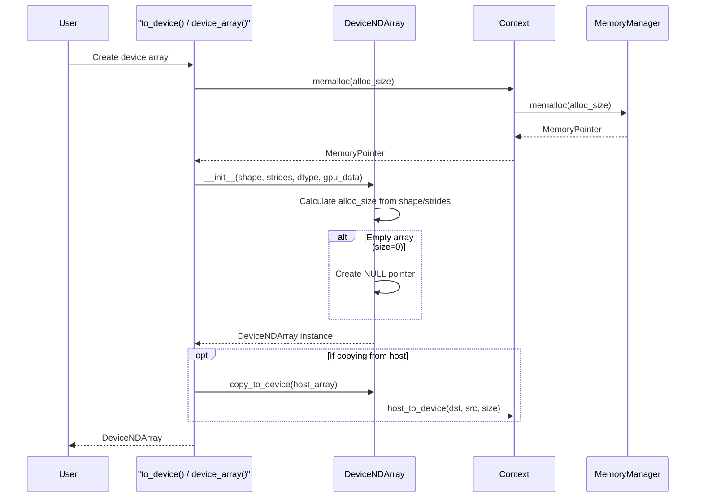

**Device Array Creation and Initialization**: Shows the initialization sequence including memory allocation and optional host-to-device copy.

The `alloc_size` calculation [numba_cuda/numba/cuda/cudadrv/devicearray.py:103-105]() uses `memory_size_from_info()` to determine the actual memory needed based on shape, strides, and item size, which may differ from `size * itemsize` for non-contiguous arrays.

Sources: [numba_cuda/numba/cuda/cudadrv/devicearray.py:64-117](), [numba_cuda/numba/cuda/api.py:109-146]()

---

## Memory Transfer Operations

Memory transfers between host and device are fundamental operations in GPU computing.

### Transfer Operation Types

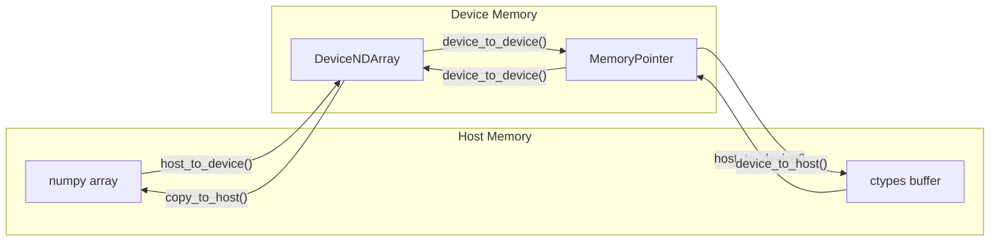

**Memory Transfer Operations**: Shows the three types of memory transfers supported by the system.

Sources: [numba_cuda/numba/cuda/cudadrv/driver.py:1649-1753]()

### Host-to-Device Transfer

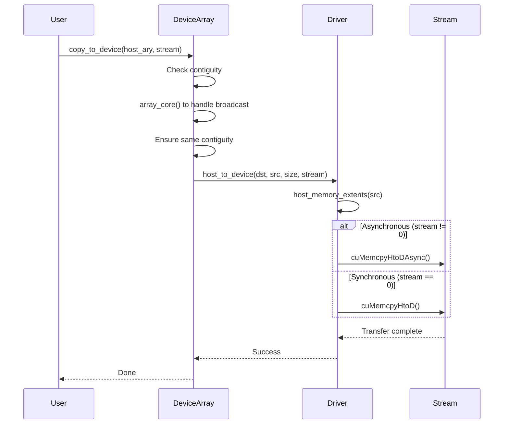

**Host-to-Device Transfer Flow**: Shows the transfer process with stream-based synchronization control.

The `array_core()` function [numba_cuda/numba/cuda/cudadrv/devicearray.py:845-860]() extracts the repeated core of broadcast arrays by creating a view without repeated (stride-0) dimensions, ensuring memory contiguity for transfer operations.

Sources: [numba_cuda/numba/cuda/cudadrv/devicearray.py:205-237](), [numba_cuda/numba/cuda/cudadrv/driver.py:1649-1705]()

### Device-to-Host Transfer

The `copy_to_host()` method [numba_cuda/numba/cuda/cudadrv/devicearray.py:240-290]() transfers data from device to host:

1. Check for negative strides (not supported) [numba_cuda/numba/cuda/cudadrv/devicearray.py:262-264]()
2. Allocate host buffer if not provided [numba_cuda/numba/cuda/cudadrv/devicearray.py:267-268]()
3. Validate array compatibility if buffer provided [numba_cuda/numba/cuda/cudadrv/devicearray.py:270]()
4. Execute asynchronous or synchronous transfer [numba_cuda/numba/cuda/cudadrv/devicearray.py:273-276]()
5. Reconstruct ndarray with proper shape/strides [numba_cuda/numba/cuda/cudadrv/devicearray.py:278-289]()

Sources: [numba_cuda/numba/cuda/cudadrv/devicearray.py:240-290]()

### Device-to-Device Transfer

Device-to-device transfers [numba_cuda/numba/cuda/cudadrv/driver.py:1707-1753]() copy data between GPU memory locations:

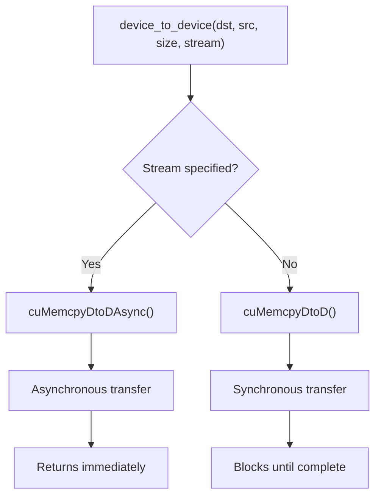

**Device-to-Device Transfer Modes**: Shows synchronous vs asynchronous transfer paths.

Device-to-device transfers can occur between allocations within the same device or across different devices (peer-to-peer), depending on GPU capabilities.

Sources: [numba_cuda/numba/cuda/cudadrv/driver.py:1707-1753]()

---

## Pending Deallocation System

The pending deallocation system prevents crashes during context corruption by deferring memory cleanup operations.

### Deallocation Mechanism

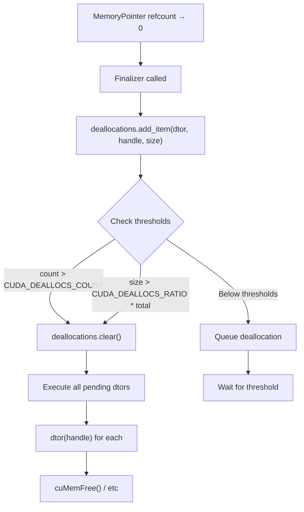

**Pending Deallocation Threshold System**: Shows how deallocations are queued and flushed based on count and memory thresholds.

Sources: [numba_cuda/numba/cuda/cudadrv/driver.py:1020-1091]()

### _PendingDeallocs Class

The `_PendingDeallocs` class [numba_cuda/numba/cuda/cudadrv/driver.py:1020-1091]() manages a queue of pending deallocations:

| Attribute | Type | Purpose |
|-----------|------|---------|
| `_cons` | `deque` | Queue of `(dtor, handle, size)` tuples |
| `_disable_count` | `int` | Nesting level for cleanup deferral |
| `_size` | `int` | Total bytes in pending deallocations |
| `memory_capacity` | `int` | Total device memory capacity |

Configuration parameters control when pending deallocations are flushed:

- `CUDA_DEALLOCS_COUNT` [numba_cuda/numba/cuda/core/config.py:469-471](): Maximum number of pending deallocations (default: 10)
- `CUDA_DEALLOCS_RATIO` [numba_cuda/numba/cuda/core/config.py:473-476](): Maximum ratio of pending bytes to total memory (default: 0.2)

When either threshold is exceeded, `clear()` [numba_cuda/numba/cuda/cudadrv/driver.py:1056-1067]() is called to flush all pending deallocations.

Sources: [numba_cuda/numba/cuda/cudadrv/driver.py:1020-1091](), [numba_cuda/numba/cuda/core/config.py:469-476]()

### Deferred Cleanup Context Manager

The `defer_cleanup()` context manager [numba_cuda/numba/cuda/cudadrv/driver.py:894-903]() temporarily disables deallocation flushing:

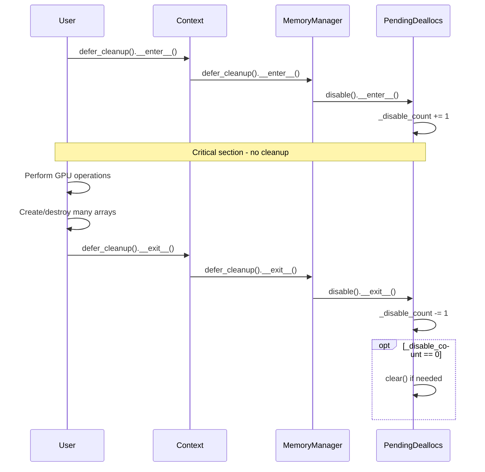

**Deferred Cleanup Context Manager Flow**: Shows how cleanup deferral is nested and controlled during critical operations.

This is essential for asynchronous execution where immediate deallocation could break stream-dependent operations. The context manager can be nested [numba_cuda/numba/cuda/cudadrv/driver.py:1080](), with cleanup only resuming when the outermost context exits.

Sources: [numba_cuda/numba/cuda/cudadrv/driver.py:894-903](), [numba_cuda/numba/cuda/cudadrv/driver.py:1069-1084](), [numba_cuda/numba/cuda/api.py:559-575]()

---

## NRT (Non-Reference-Counted) Memory System

The NRT system provides device-side memory management for dynamically allocated arrays within CUDA kernels.

### NRT Architecture

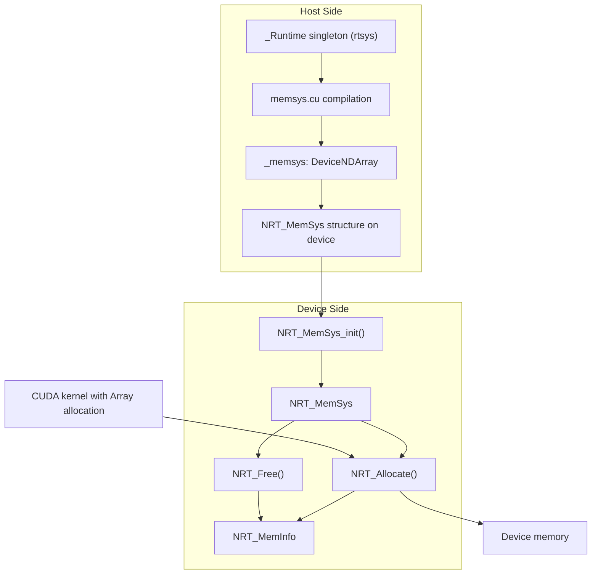

**NRT System Architecture**: Shows the host-side runtime and device-side memory system integration.

Sources: [numba_cuda/numba/cuda/memory_management/nrt.py:94-382]()

### NRT Initialization and Allocation

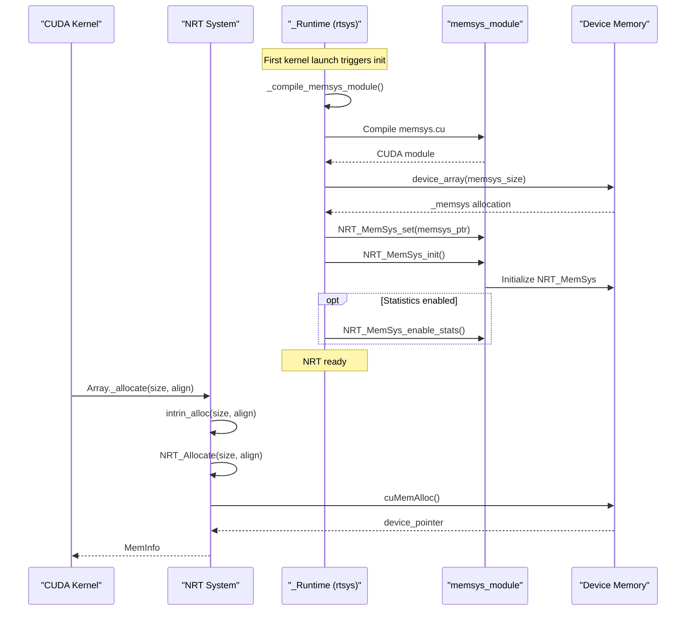

**NRT Initialization and Memory Allocation**: Shows the initialization sequence and how kernels allocate arrays through NRT.

The NRT system is initialized lazily on first use [numba_cuda/numba/cuda/memory_management/nrt.py:140-148](). The `memsys.cu` file is compiled into a module [numba_cuda/numba/cuda/memory_management/nrt.py:118-138](), and the `NRT_MemSys` structure is allocated on the device [numba_cuda/numba/cuda/memory_management/nrt.py:150-172]().

Sources: [numba_cuda/numba/cuda/memory_management/nrt.py:94-215]()

### Array Allocation in Device Code

The intrinsic function `intrin_alloc()` [numba_cuda/numba/cuda/memory_management/nrt.py:55-66]() provides the low-level interface for array allocation:

```python
@intrinsic
def intrin_alloc(typingctx, allocsize, align):
    """Intrinsic to call into the allocator for Array"""
    
    def codegen(context, builder, signature, args):
        allocsize, align = args
        meminfo = context.nrt.meminfo_alloc_aligned(builder, allocsize, align)
        return meminfo
    
    mip = types.MemInfoPointer(types.voidptr)
    sig = signature(mip, allocsize, align)
    return sig, codegen
```

This intrinsic is registered as the implementation of `Array._allocate()` for the CUDA target [numba_cuda/numba/cuda/memory_management/nrt.py:69-76](), allowing kernels to create arrays dynamically:

```python
from numba.cuda.types import Array, int64

@cuda.jit
def kernel():
    # Creates array via NRT allocation
    arr = Array.empty((10,), dtype=int64)
```

Sources: [numba_cuda/numba/cuda/memory_management/nrt.py:55-76]()

### NRT Statistics

The NRT system provides optional statistics tracking [numba_cuda/numba/cuda/memory_management/nrt.py:220-354](). When enabled via `NUMBA_CUDA_NRT_STATS` [numba_cuda/numba/cuda/memory_management/nrt.py:31-35](), the system tracks:

| Statistic | Description |
|-----------|-------------|
| `alloc` | Total number of allocations |
| `free` | Total number of frees |
| `mi_alloc` | Total MemInfo allocations |
| `mi_free` | Total MemInfo frees |

Statistics can be queried via `rtsys.get_allocation_stats()` [numba_cuda/numba/cuda/memory_management/nrt.py:282-295]() or individual methods like `memsys_get_stats_alloc()` [numba_cuda/numba/cuda/memory_management/nrt.py:313-321]().

Sources: [numba_cuda/numba/cuda/memory_management/nrt.py:220-354]()

---

## IPC Memory Sharing

Inter-Process Communication (IPC) enables sharing GPU memory allocations between processes on the same machine.

### IPC Handle Architecture

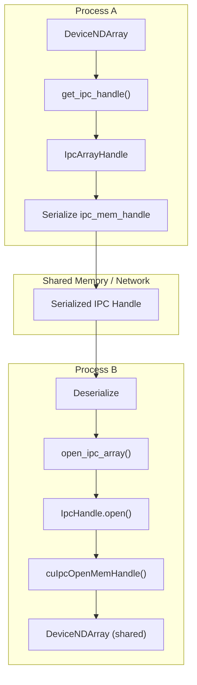

**IPC Memory Sharing Architecture**: Shows the process of sharing device memory between processes using IPC handles.

Sources: [numba_cuda/numba/cuda/cudadrv/devicearray.py:322-331](), [numba_cuda/numba/cuda/cudadrv/driver.py:1303-1373]()

### Creating and Opening IPC Handles

The `IpcHandle` class [numba_cuda/numba/cuda/cudadrv/driver.py:1303-1373]() wraps CUDA IPC memory handles:

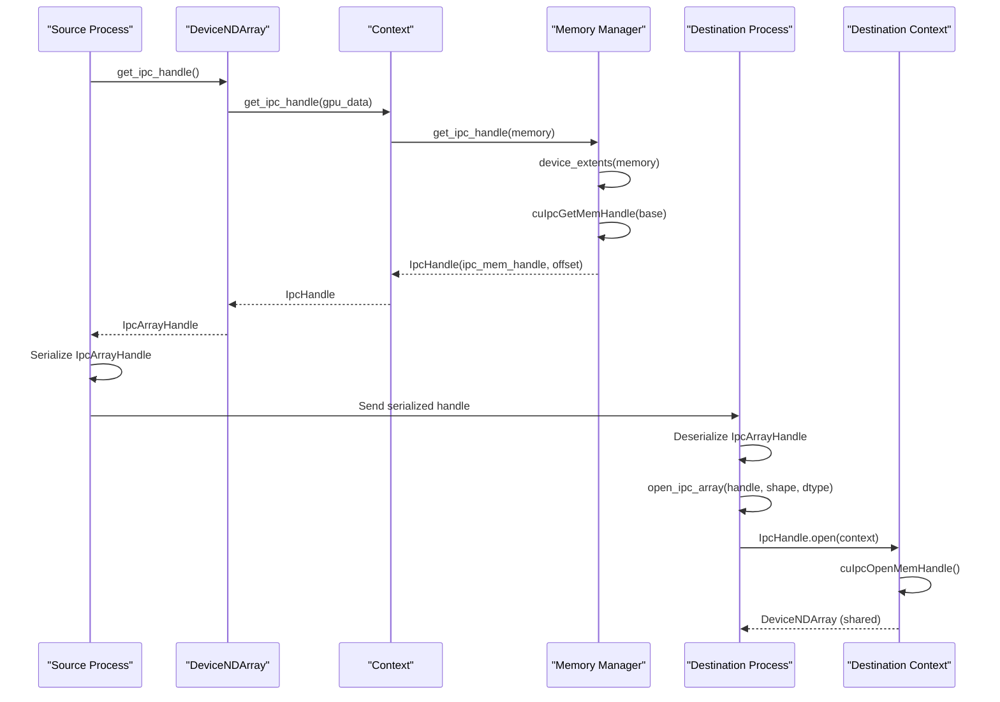

**IPC Handle Creation and Opening**: Shows the complete flow of sharing memory between processes.

The `IpcArrayHandle` class [numba_cuda/numba/cuda/cudadrv/devicearray.py:768-810]() provides a serializable wrapper that includes array metadata (shape, strides, dtype) along with the IPC memory handle.

Important notes on IPC memory:
- Only supported on Linux [numba_cuda/numba/cuda/cudadrv/driver.py:80]()
- Source info includes device identity for validation [numba_cuda/numba/cuda/cudadrv/driver.py:919-922]()
- Handles must be closed when done [numba_cuda/numba/cuda/cudadrv/driver.py:1365-1367]()
- Uses base pointer via `cuMemGetAddressRange` [numba_cuda/numba/cuda/cudadrv/driver.py:916]()

Sources: [numba_cuda/numba/cuda/cudadrv/driver.py:906-924](), [numba_cuda/numba/cuda/cudadrv/driver.py:1303-1373](), [numba_cuda/numba/cuda/cudadrv/devicearray.py:768-810](), [numba_cuda/numba/cuda/api.py:254-279]()

---

## Memory Pointer Types

The memory management system uses several pointer wrapper classes to represent different types of memory allocations.

### Memory Pointer Class Hierarchy

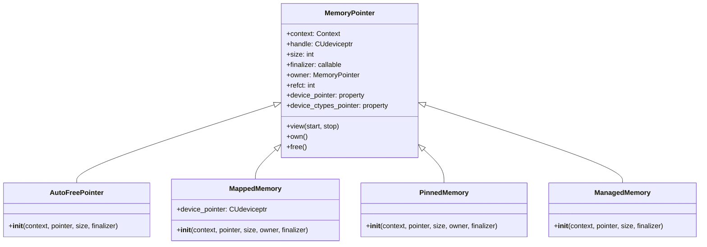

**Memory Pointer Type Hierarchy**: Shows the specialized pointer types for different memory allocations.

Sources: [numba_cuda/numba/cuda/cudadrv/driver.py:1175-1301]()

### MemoryPointer Base Class

The `MemoryPointer` class [numba_cuda/numba/cuda/cudadrv/driver.py:1175-1264]() provides:

- Reference counting via `own()` [numba_cuda/numba/cuda/cudadrv/driver.py:1249-1253]() method
- View creation via `view(start, stop)` [numba_cuda/numba/cuda/cudadrv/driver.py:1221-1238]()
- Finalizer execution on reference drop to zero [numba_cuda/numba/cuda/cudadrv/driver.py:1240-1246]()
- Device pointer properties for accessing the raw pointer

Key properties:
- `device_pointer`: Returns raw integer pointer value [numba_cuda/numba/cuda/cudadrv/driver.py:1206-1208]()
- `device_ctypes_pointer`: Returns ctypes-compatible pointer [numba_cuda/numba/cuda/cudadrv/driver.py:1210-1219]()

Sources: [numba_cuda/numba/cuda/cudadrv/driver.py:1175-1264]()

### Specialized Pointer Types

| Class | Purpose | Unique Behavior |
|-------|---------|-----------------|
| `AutoFreePointer` | Standard device memory | Registers deallocation in pending queue |
| `MappedMemory` | Mapped pinned memory | Has both host and device pointers |
| `PinnedMemory` | Pinned host memory | Only host pointer, fast transfers |
| `ManagedMemory` | Unified memory | Accessible from both host and device |

The `MappedMemory` class [numba_cuda/numba/cuda/cudadrv/driver.py:1266-1282]() is unique in providing a `device_pointer` property that queries the device pointer via `cuMemHostGetDevicePointer()` [numba_cuda/numba/cuda/cudadrv/driver.py:1277-1280]().

Sources: [numba_cuda/numba/cuda/cudadrv/driver.py:1205-1301]()

---

## Memory Manager Testing

The codebase includes comprehensive tests for EMM plugins and memory operations.

### EMM Plugin Test Coverage

The test suite [numba_cuda/numba/cuda/tests/cudadrv/test_emm_plugins.py]() validates:

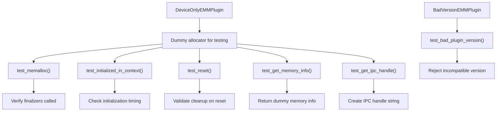

**EMM Plugin Test Coverage**: Shows the testing approach for validating EMM plugin implementations.

The `DeviceOnlyEMMPlugin` class [numba_cuda/numba/cuda/tests/cudadrv/test_emm_plugins.py:15-95]() provides a reference implementation that tracks method calls and allocation lifecycles, enabling verification that Numba correctly uses the plugin interface.

Sources: [numba_cuda/numba/cuda/tests/cudadrv/test_emm_plugins.py:1-200]()

### Memory Operation Tests

Basic memory operation tests [numba_cuda/numba/cuda/tests/cudadrv/test_cuda_memory.py]() cover:

| Test | Validates |
|------|-----------|
| `test_device_memory()` | Basic device allocation and pointer access |
| `test_device_view()` | Memory view creation |
| `test_host_alloc()` | Mapped memory allocation |
| `test_pinned_memory()` | Pinning existing arrays |
| `test_managed_memory()` | Unified memory allocation |
| `test_derived_pointer()` | Reference counting in views |
| `test_memcpy()` | Host-device transfers |
| `test_memset()` | Device memory initialization |
| `test_d2d()` | Device-to-device transfers |

Sources: [numba_cuda/numba/cuda/tests/cudadrv/test_cuda_memory.py:14-191]()

---

