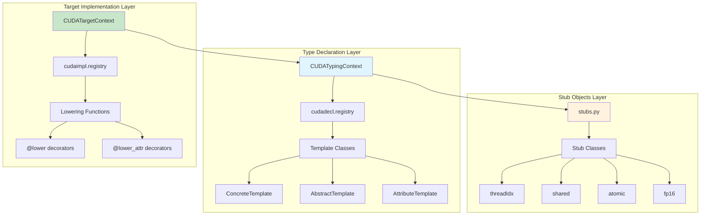
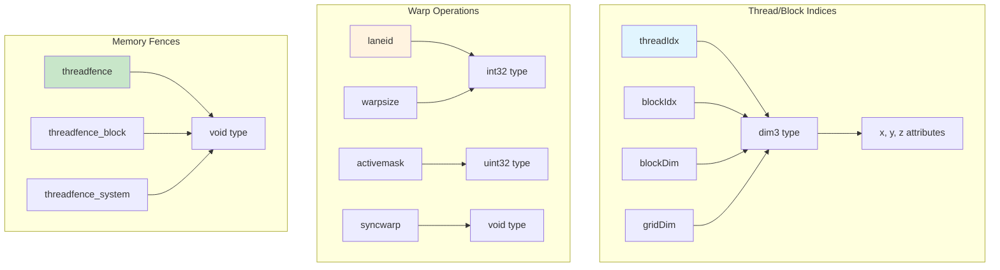
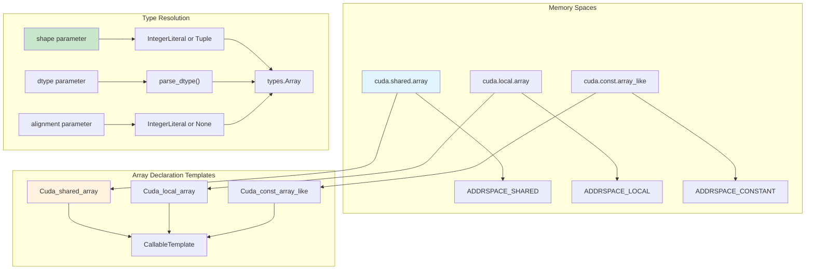
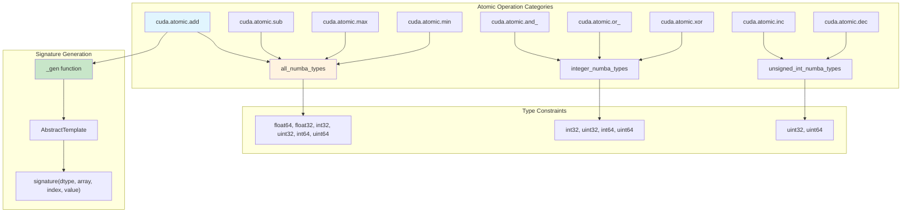
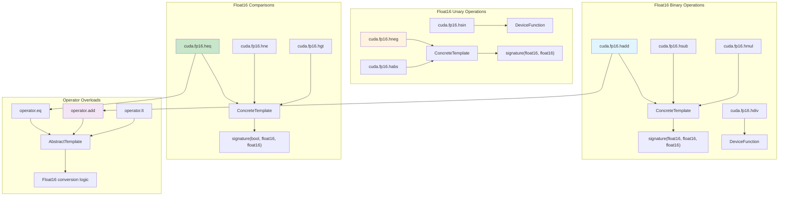
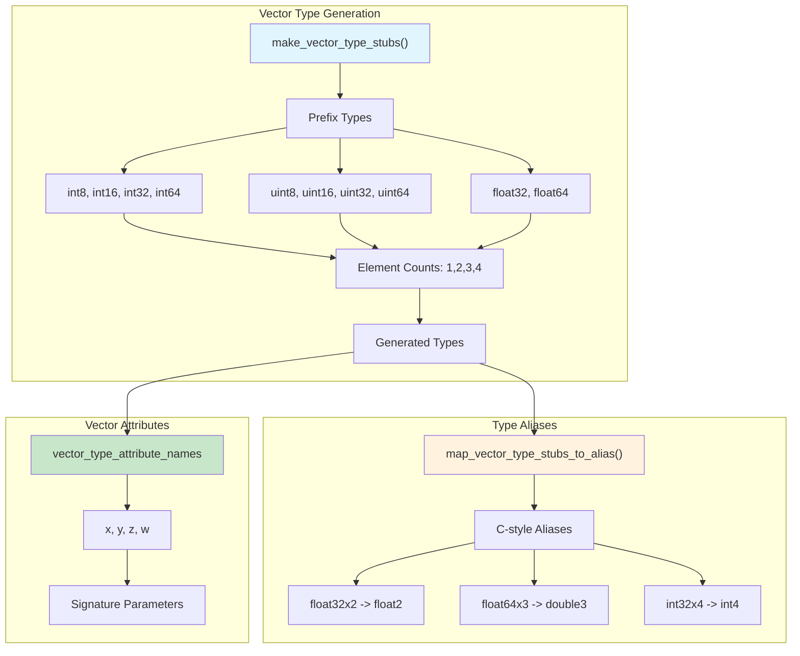
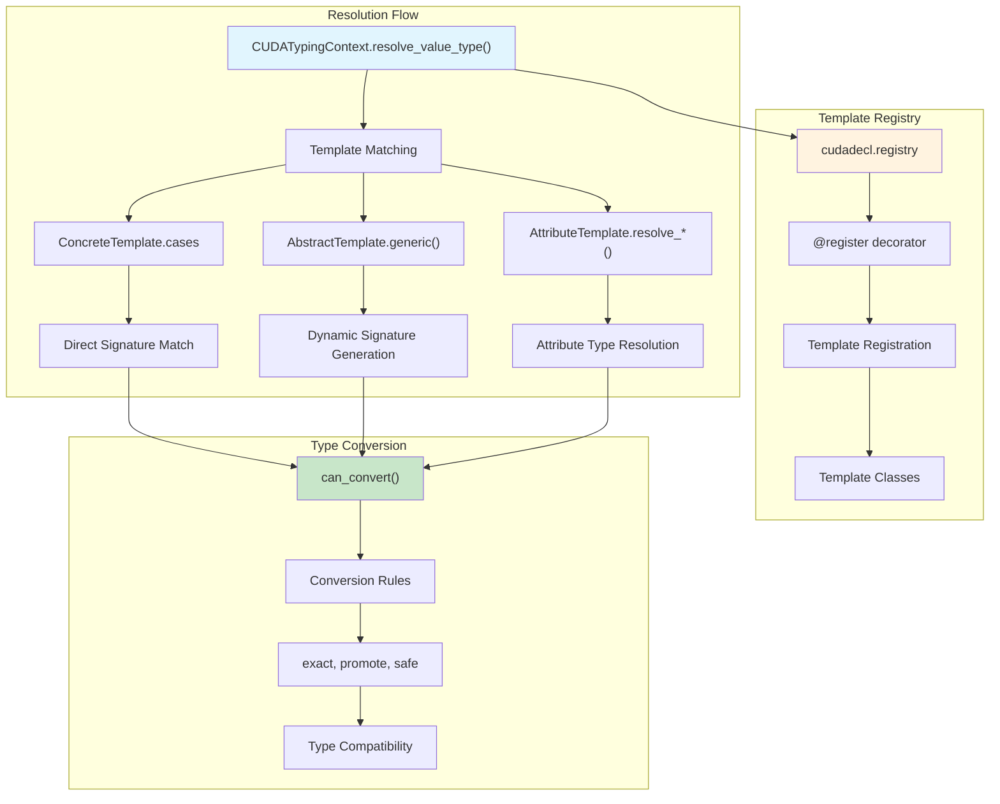
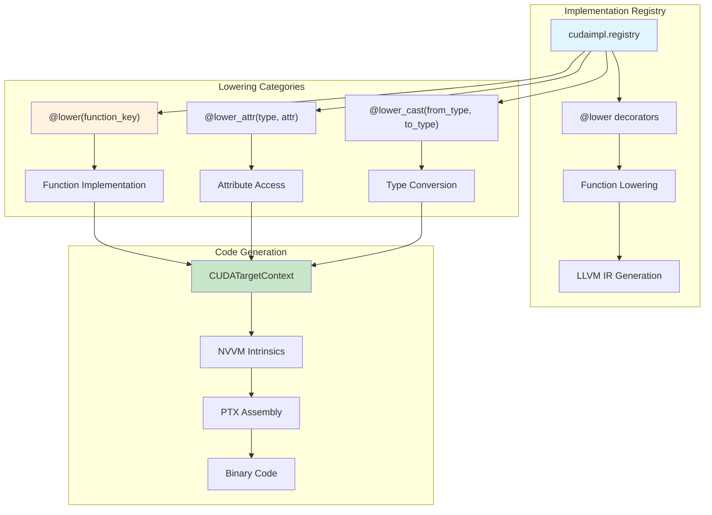

<!-- source: DeepWiki mcp.deepwiki.com · repo NVIDIA/numba-cuda · page 2.4 Type System and Lowering · fetched 2026-10-26 -->

# Type System and Declarations

<details>
<summary>Relevant source files</summary>

The following files were used as context for generating this wiki page:

- [numba_cuda/numba/cuda/core/inline_closurecall.py](numba_cuda/numba/cuda/core/inline_closurecall.py)
- [numba_cuda/numba/cuda/core/ir_utils.py](numba_cuda/numba/cuda/core/ir_utils.py)
- [numba_cuda/numba/cuda/core/typed_passes.py](numba_cuda/numba/cuda/core/typed_passes.py)
- [numba_cuda/numba/cuda/core/untyped_passes.py](numba_cuda/numba/cuda/core/untyped_passes.py)
- [numba_cuda/numba/cuda/cudadecl.py](numba_cuda/numba/cuda/cudadecl.py)
- [numba_cuda/numba/cuda/cudaimpl.py](numba_cuda/numba/cuda/cudaimpl.py)
- [numba_cuda/numba/cuda/debuginfo.py](numba_cuda/numba/cuda/debuginfo.py)
- [numba_cuda/numba/cuda/device_init.py](numba_cuda/numba/cuda/device_init.py)
- [numba_cuda/numba/cuda/intrinsics.py](numba_cuda/numba/cuda/intrinsics.py)
- [numba_cuda/numba/cuda/lowering.py](numba_cuda/numba/cuda/lowering.py)
- [numba_cuda/numba/cuda/stubs.py](numba_cuda/numba/cuda/stubs.py)
- [numba_cuda/numba/cuda/target.py](numba_cuda/numba/cuda/target.py)
- [numba_cuda/numba/cuda/tests/cudapy/test_array_alignment.py](numba_cuda/numba/cuda/tests/cudapy/test_array_alignment.py)
- [numba_cuda/numba/cuda/tests/cudapy/test_debuginfo.py](numba_cuda/numba/cuda/tests/cudapy/test_debuginfo.py)
- [numba_cuda/numba/cuda/tests/cudapy/test_debuginfo_types.py](numba_cuda/numba/cuda/tests/cudapy/test_debuginfo_types.py)
- [numba_cuda/numba/cuda/tests/cudapy/test_warp_ops.py](numba_cuda/numba/cuda/tests/cudapy/test_warp_ops.py)
- [numba_cuda/numba/cuda/tests/nocuda/test_import.py](numba_cuda/numba/cuda/tests/nocuda/test_import.py)
- [numba_cuda/numba/cuda/typing/templates.py](numba_cuda/numba/cuda/typing/templates.py)

</details>


This document covers the type system and type declarations in numba-cuda, explaining how CUDA-specific types are defined, declared, and resolved during compilation. The type system enables Python functions to interact with CUDA hardware features like special registers, memory spaces, and atomic operations.

For information about the compilation pipeline that uses these type declarations, see [JIT Compilation Pipeline](#2.1). For details about code generation and lowering, see [Code Generation and Compilation](#3).

## Type System Architecture

The numba-cuda type system consists of three main components that work together to provide type information for CUDA kernels:



Sources: [numba_cuda/numba/cuda/target.py:34-46](), [numba_cuda/numba/cuda/cudadecl.py:26-29](), [numba_cuda/numba/cuda/stubs.py:12-26]()

## Intrinsic Types and Special Objects

CUDA provides special objects that represent hardware features accessible only within kernels. These are implemented as stub objects that raise errors when used outside CUDA contexts:



The `dim3` type represents 3D indices and dimensions:

| Attribute | Type | Description |
|-----------|------|-------------|
| `x` | `int32` | X-dimension value |
| `y` | `int32` | Y-dimension value |
| `z` | `int32` | Z-dimension value |

Sources: [numba_cuda/numba/cuda/stubs.py:45-117](), [numba_cuda/numba/cuda/cudadecl.py:559-571](), [numba_cuda/numba/cuda/cudadecl.py:740-757]()

## Array Types and Memory Spaces

CUDA kernels can create arrays in different memory spaces, each with specific characteristics and access patterns:



### Array Declaration Requirements

Arrays must be declared with compile-time constant parameters:

| Parameter | Type | Constraints |
|-----------|------|-------------|
| `shape` | `IntegerLiteral` or `Tuple[IntegerLiteral]` | Must be known at compile time |
| `dtype` | Type object | Standard NumPy dtypes |
| `alignment` | `IntegerLiteral` or `None` | Power of 2, multiple of pointer size |

Sources: [numba_cuda/numba/cuda/cudadecl.py:34-86](), [numba_cuda/numba/cuda/cudaimpl.py:144-217](), [numba_cuda/numba/cuda/stubs.py:124-184]()

## Atomic Operations Type System

Atomic operations provide thread-safe memory access with specific type constraints:



### Atomic Operation Signatures

Each atomic operation follows a consistent signature pattern:

```python
# General form: atomic_op(array, index, value) -> old_value
signature(array.dtype, array_type, index_type, array.dtype)
```

Sources: [numba_cuda/numba/cuda/cudadecl.py:468-544](), [numba_cuda/numba/cuda/stubs.py:365-528]()

## Float16 Operations

Float16 operations require special handling due to hardware constraints:



Sources: [numba_cuda/numba/cuda/cudadecl.py:284-418](), [numba_cuda/numba/cuda/stubs.py:549-851]()

## Vector Types

Vector types provide SIMD-style operations with automatically generated type stubs:



### Vector Type Examples

| Type | Aliases | Attributes | Usage |
|------|---------|------------|-------|
| `int32x2` | `int2` | `x, y` | 2D integer vectors |
| `float32x3` | `float3` | `x, y, z` | 3D float vectors |
| `float64x4` | `double4` | `x, y, z, w` | 4D double vectors |

Sources: [numba_cuda/numba/cuda/stubs.py:857-941]()

## Type Resolution Process

The type resolution process involves multiple stages of template matching and signature generation:



### Template Types and Their Purposes

| Template Type | Purpose | Example |
|---------------|---------|---------|
| `ConcreteTemplate` | Fixed signatures | `cuda.threadfence` |
| `AbstractTemplate` | Dynamic signatures | `cuda.selp` |
| `AttributeTemplate` | Module attributes | `cuda.threadIdx` |
| `CallableTemplate` | Function calls | `cuda.shared.array` |

Sources: [numba_cuda/numba/cuda/target.py:34-101](), [numba_cuda/numba/cuda/cudadecl.py:13-29]()

## Implementation and Lowering

Type declarations are paired with implementation functions that generate LLVM IR:



### Lowering Function Examples

| Type Declaration | Lowering Function | Implementation |
|------------------|-------------------|----------------|
| `cuda.threadIdx` | `@lower_attr(Module(cuda), "threadIdx")` | `initialize_dim3(builder, "tid")` |
| `cuda.syncwarp` | `@lower(stubs.syncwarp)` | `llvm.nvvm.bar.warp.sync` |
| `cuda.shared.array` | `@lower(cuda.shared.array, ...)` | `_generic_array(...)` |

Sources: [numba_cuda/numba/cuda/cudaimpl.py:20-24](), [numba_cuda/numba/cuda/cudaimpl.py:33-71](), [numba_cuda/numba/cuda/cudaimpl.py:144-217]()

---

