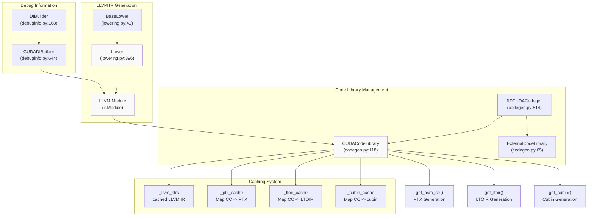
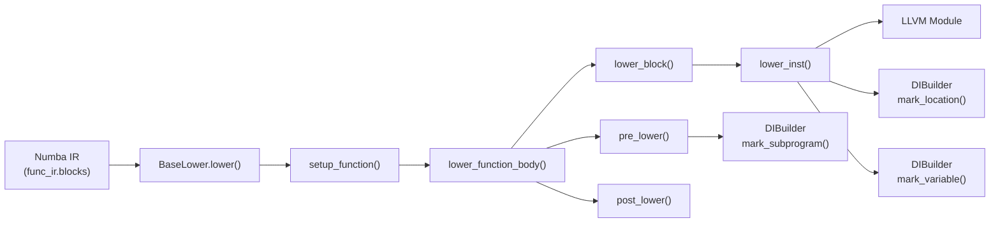
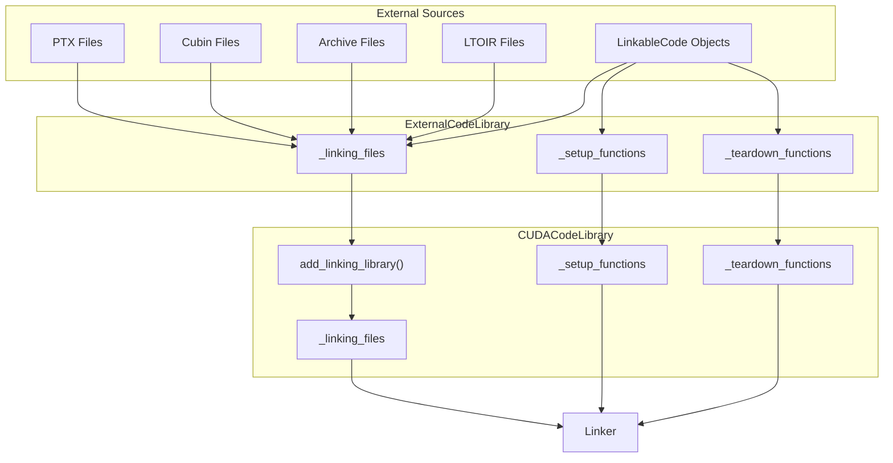
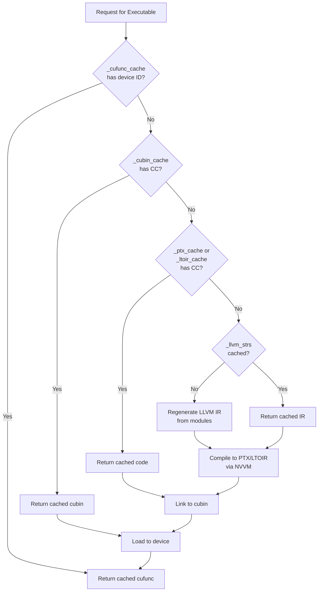
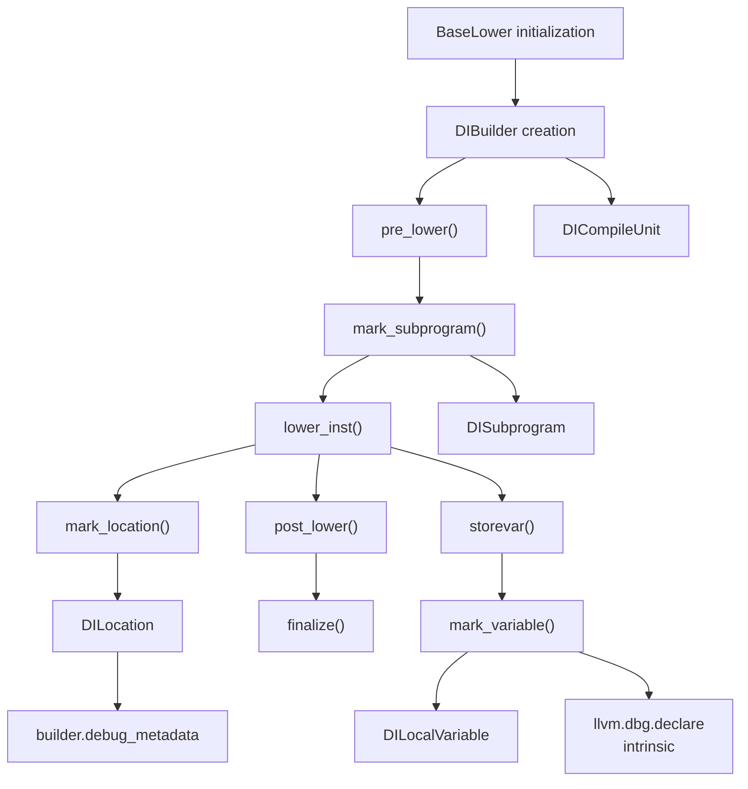
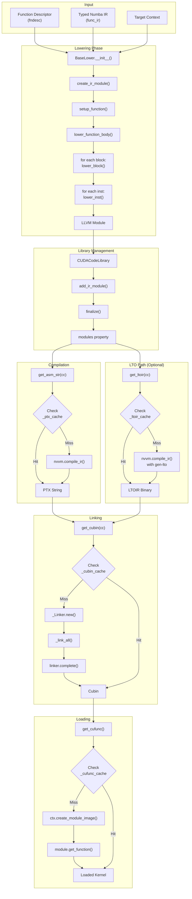

<!-- source: DeepWiki mcp.deepwiki.com · repo NVIDIA/numba-cuda · page 3 Code Generation and Compilation · fetched 2026-10-26 -->

# Code Generation and Compilation

<details>
<summary>Relevant source files</summary>

The following files were used as context for generating this wiki page:

- [numba_cuda/numba/cuda/codegen.py](numba_cuda/numba/cuda/codegen.py)
- [numba_cuda/numba/cuda/cudadrv/linkable_code.py](numba_cuda/numba/cuda/cudadrv/linkable_code.py)
- [numba_cuda/numba/cuda/cudadrv/nvrtc.py](numba_cuda/numba/cuda/cudadrv/nvrtc.py)
- [numba_cuda/numba/cuda/debuginfo.py](numba_cuda/numba/cuda/debuginfo.py)
- [numba_cuda/numba/cuda/lowering.py](numba_cuda/numba/cuda/lowering.py)
- [numba_cuda/numba/cuda/tests/cudapy/test_debuginfo.py](numba_cuda/numba/cuda/tests/cudapy/test_debuginfo.py)
- [numba_cuda/numba/cuda/tests/cudapy/test_debuginfo_types.py](numba_cuda/numba/cuda/tests/cudapy/test_debuginfo_types.py)

</details>


## Purpose and Scope

This page explains how LLVM IR is managed, cached, and transformed through the code generation backend to produce GPU-executable code. The code generation system takes lowered Numba IR and produces LLVM IR modules, which are then compiled into PTX, LTOIR, and ultimately cubins that can be loaded onto GPU devices.

For information about the lowering process from Numba IR to LLVM IR, see [Type System and Lowering](#2.4). For details about NVVM compilation to PTX/LTOIR, see [NVVM Integration](#3.1). For information about linking external code and module loading, see [Linking and Module Loading](#3.2).

## Code Generation Architecture Overview

The code generation system consists of several key components that work together to transform LLVM IR into executable GPU code:

**Architecture Diagram: Code Generation Components**



Sources: [numba_cuda/numba/cuda/lowering.py:42-394](), [numba_cuda/numba/cuda/codegen.py:118-542](), [numba_cuda/numba/cuda/debuginfo.py:168-810]()

## LLVM IR Generation and Management

### The Lowering Classes

The transformation from Numba IR to LLVM IR is performed by the `BaseLower` and `Lower` classes.

**BaseLower** [numba_cuda/numba/cuda/lowering.py:42-394]() is the base class that provides the core lowering infrastructure:

- Initializes the LLVM module via `library.create_ir_module()` [numba_cuda/numba/cuda/lowering.py:57]()
- Manages the `Environment` object for Python execution state [numba_cuda/numba/cuda/lowering.py:61]()
- Creates the function structure and basic blocks [numba_cuda/numba/cuda/lowering.py:279-281]()
- Provides the `lower_inst()` method for lowering individual instructions [numba_cuda/numba/cuda/lowering.py:504-651]()
- Coordinates debug information generation through `DIBuilder` [numba_cuda/numba/cuda/lowering.py:78-93]()

**Lower** [numba_cuda/numba/cuda/lowering.py:396-1551]() extends `BaseLower` with CUDA-specific lowering logic:

- Performs singly-assigned variable analysis [numba_cuda/numba/cuda/lowering.py:415-455]()
- Handles variable allocation strategies based on debug mode [numba_cuda/numba/cuda/lowering.py:405-413]()
- Implements lowering for various instruction types including assignments, branches, returns, and calls [numba_cuda/numba/cuda/lowering.py:509-651]()

**Lowering Flow Diagram**



Sources: [numba_cuda/numba/cuda/lowering.py:221-298](), [numba_cuda/numba/cuda/lowering.py:300-315]()

### Module Creation

LLVM modules are created by `JITCUDACodegen._create_empty_module()` [numba_cuda/numba/cuda/codegen.py:525-530]():

```python
def _create_empty_module(self, name):
    ir_module = ir.Module(name)
    ir_module.triple = CUDA_TRIPLE  # "nvptx64-nvidia-cuda"
    ir_module.data_layout = nvvm.NVVM().data_layout
    nvvm.add_ir_version(ir_module)
    return ir_module
```

Key characteristics:
- Target triple is set to `"nvptx64-nvidia-cuda"` [numba_cuda/numba/cuda/codegen.py:18]()
- Data layout matches NVVM's requirements [numba_cuda/numba/cuda/codegen.py:528]()
- IR version metadata is added for NVVM compatibility [numba_cuda/numba/cuda/codegen.py:529]()

Sources: [numba_cuda/numba/cuda/codegen.py:525-530]()

## Code Library System

### CUDACodeLibrary

`CUDACodeLibrary` [numba_cuda/numba/cuda/codegen.py:118-511]() is the primary code management class that:

**Manages Multiple Representations:**

| Property | Description | Cache Location |
|----------|-------------|----------------|
| LLVM IR Strings | Cached string representations of LLVM modules | `_llvm_strs` [numba_cuda/numba/cuda/codegen.py:171]() |
| PTX per CC | PTX assembly for each compute capability | `_ptx_cache` [numba_cuda/numba/cuda/codegen.py:173]() |
| LTOIR per CC | LTO-IR for each compute capability | `_ltoir_cache` [numba_cuda/numba/cuda/codegen.py:175]() |
| Cubin per CC | Compiled cubins for each compute capability | `_cubin_cache` [numba_cuda/numba/cuda/codegen.py:177]() |
| CuFuncs per Device | Loaded kernel functions per device | `_cufunc_cache` [numba_cuda/numba/cuda/codegen.py:181]() |

**Key Methods:**

- `add_ir_module()` [numba_cuda/numba/cuda/codegen.py:361-365]() - Adds the main LLVM IR module
- `add_linking_library()` [numba_cuda/numba/cuda/codegen.py:367-380]() - Links other code libraries
- `add_linking_file()` [numba_cuda/numba/cuda/codegen.py:381-388]() - Adds external files for linking
- `get_asm_str()` [numba_cuda/numba/cuda/codegen.py:208-235]() - Generates PTX for a compute capability
- `get_ltoir()` [numba_cuda/numba/cuda/codegen.py:264-280]() - Generates LTOIR for a compute capability
- `get_cubin()` [numba_cuda/numba/cuda/codegen.py:297-320]() - Links and generates final cubin
- `get_cufunc()` [numba_cuda/numba/cuda/codegen.py:322-347]() - Loads kernel function on device

Sources: [numba_cuda/numba/cuda/codegen.py:118-511]()

### ExternalCodeLibrary

`ExternalCodeLibrary` [numba_cuda/numba/cuda/codegen.py:65-116]() holds code produced externally for linking:

- Stores files to link via `_linking_files` set [numba_cuda/numba/cuda/codegen.py:71]()
- Manages setup/teardown callbacks [numba_cuda/numba/cuda/codegen.py:73-75]()
- Does not contain LLVM IR modules [numba_cuda/numba/cuda/codegen.py:80-82]()
- Used for pre-compiled PTX, cubins, archives, etc.

**External Code Integration Diagram**



Sources: [numba_cuda/numba/cuda/codegen.py:65-116](), [numba_cuda/numba/cuda/codegen.py:367-388]()

### Library Linking and Finalization

When a `CUDACodeLibrary` is finalized [numba_cuda/numba/cuda/codegen.py:413-437]():

1. Linking libraries are collected recursively via `linking_libraries` property [numba_cuda/numba/cuda/codegen.py:403-411]()
2. Device functions in linked modules have their linkage set to `"linkonce_odr"` [numba_cuda/numba/cuda/codegen.py:431-435]()
3. The library is marked as finalized [numba_cuda/numba/cuda/codegen.py:437]()
4. Global kernel functions retain `external` linkage

This linkage adjustment ensures device functions don't appear in the PTX output but are available for linking.

Sources: [numba_cuda/numba/cuda/codegen.py:413-437]()

## Caching Mechanisms

The caching system in `CUDACodeLibrary` operates at multiple levels to avoid redundant compilation:

**Cache Hierarchy Diagram**



Sources: [numba_cuda/numba/cuda/codegen.py:193-235](), [numba_cuda/numba/cuda/codegen.py:264-280](), [numba_cuda/numba/cuda/codegen.py:297-320](), [numba_cuda/numba/cuda/codegen.py:322-347]()

### Cache Invalidation

Caches are preserved during serialization for pickling [numba_cuda/numba/cuda/codegen.py:439-472]():

- LLVM IR strings are serialized as `llvm_strs` [numba_cuda/numba/cuda/codegen.py:462]()
- PTX, cubin, and linkerinfo caches are preserved [numba_cuda/numba/cuda/codegen.py:463-465]()
- Loaded functions (`_cufunc_cache`) are **not** serialized and are recreated on demand after deserialization [numba_cuda/numba/cuda/codegen.py:181]()

Sources: [numba_cuda/numba/cuda/codegen.py:439-472]()

## Debug Information Generation

Debug information is generated alongside LLVM IR to enable source-level debugging of CUDA kernels.

### DIBuilder Classes

The debug info generation system has two main classes:

**DIBuilder** [numba_cuda/numba/cuda/debuginfo.py:168-642]() - Base debug info builder:
- Creates DWARF debug metadata nodes [numba_cuda/numba/cuda/debuginfo.py:555-641]()
- Marks subprograms, locations, and variables [numba_cuda/numba/cuda/debuginfo.py:478-488]()
- Generates type information for scalars, structs, arrays, and pointers [numba_cuda/numba/cuda/debuginfo.py:206-440]()

**CUDADIBuilder** [numba_cuda/numba/cuda/debuginfo.py:644-810]() - CUDA-specific extensions:
- Handles CUDA-specific types like `GridGroup` [numba_cuda/numba/cuda/debuginfo.py:677-678]()
- Implements polymorphic variable debug info with `DW_TAG_variant_part` [numba_cuda/numba/cuda/debuginfo.py:699-807]()
- Maps NVVM address spaces to DWARF address classes [numba_cuda/numba/cuda/debuginfo.py:193-204]()

### Debug Info Workflow

**Debug Information Generation Flow**



Sources: [numba_cuda/numba/cuda/lowering.py:78-93](), [numba_cuda/numba/cuda/lowering.py:143-157](), [numba_cuda/numba/cuda/debuginfo.py:478-488]()

### Debug Metadata Types

The debug info system generates DWARF metadata for various Numba types:

| Numba Type | DWARF Representation | Code Reference |
|------------|---------------------|----------------|
| Scalars (int, float) | `DIBasicType` with appropriate encoding | [numba_cuda/numba/cuda/debuginfo.py:218-247]() |
| Complex numbers | `DICompositeType` with `DW_TAG_structure_type` containing real/imag members | [numba_cuda/numba/cuda/debuginfo.py:248-298]() |
| Tuples | `DICompositeType` with `DW_TAG_array_type` | [numba_cuda/numba/cuda/debuginfo.py:299-321]() |
| Pointers | `DIDerivedType` with `DW_TAG_pointer_type` | [numba_cuda/numba/cuda/debuginfo.py:322-334]() |
| Structs | `DICompositeType` with `DW_TAG_structure_type` and member fields | [numba_cuda/numba/cuda/debuginfo.py:335-388]() |
| Polymorphic variables | `DW_TAG_variant_part` with discriminator (when enabled) | [numba_cuda/numba/cuda/debuginfo.py:699-807]() |

Sources: [numba_cuda/numba/cuda/debuginfo.py:206-440](), [numba_cuda/numba/cuda/debuginfo.py:699-807]()

### Debug Mode Impact

When debug mode is enabled (`debug=True` or `DEBUGINFO_DEFAULT=1`):

1. SROA-like optimizations are disabled [numba_cuda/numba/cuda/lowering.py:405-413]()
2. Variables use `alloca` instructions instead of SSA form [numba_cuda/numba/cuda/lowering.py:477]()
3. Functions are marked with `noinline` attribute [numba_cuda/numba/cuda/lowering.py:162-165]()
4. `llvm.dbg.declare` intrinsics are inserted for each variable [numba_cuda/numba/cuda/debuginfo.py:456-473]()

Sources: [numba_cuda/numba/cuda/lowering.py:405-413](), [numba_cuda/numba/cuda/lowering.py:457-477]()

## Complete Code Generation Flow

The following diagram shows the complete flow from lowered IR to executable cubin:

**End-to-End Code Generation Pipeline**



Sources: [numba_cuda/numba/cuda/lowering.py:221-249](), [numba_cuda/numba/cuda/codegen.py:208-320](), [numba_cuda/numba/cuda/codegen.py:322-347]()

## Configuration and Optimization

### NVVM Compilation Options

The `CUDACodeLibrary` accepts NVVM options via the `nvvm_options` parameter [numba_cuda/numba/cuda/codegen.py:132-133]():

```python
def __init__(self, codegen, name, entry_name=None, max_registers=None, 
             lto=False, nvvm_options=None):
    if nvvm_options is None:
        nvvm_options = {}
    self._nvvm_options = nvvm_options
```

These options are passed to `nvvm.compile_ir()` [numba_cuda/numba/cuda/codegen.py:221]() and control:
- Architecture target (`arch` option) [numba_cuda/numba/cuda/codegen.py:217]()
- LTO generation (`gen-lto` option for LTOIR) [numba_cuda/numba/cuda/codegen.py:274]()

### Link-Time Optimization (LTO)

When LTO is enabled (`lto=True`):

1. LTOIR is generated instead of PTX via `get_ltoir()` [numba_cuda/numba/cuda/codegen.py:264-280]()
2. The NVVM compiler is invoked with `gen-lto` option [numba_cuda/numba/cuda/codegen.py:274]()
3. Linking is performed via `nvJitLink` if available [numba_cuda/numba/cuda/codegen.py:282-295]()
4. PTX after LTO can be inspected via `get_lto_ptx()` [numba_cuda/numba/cuda/codegen.py:237-262]()

Sources: [numba_cuda/numba/cuda/codegen.py:131](), [numba_cuda/numba/cuda/codegen.py:237-280]()

### Compute Capability Handling

The code generation system generates and caches code for multiple compute capabilities:

- `_ensure_cc()` method determines the target CC from context if not specified [numba_cuda/numba/cuda/codegen.py:201-206]()
- Each cache is keyed by CC tuple `(major, minor)` [numba_cuda/numba/cuda/codegen.py:173-181]()
- Separate compilations are performed for each CC as needed [numba_cuda/numba/cuda/codegen.py:208-235]()

Sources: [numba_cuda/numba/cuda/codegen.py:201-206]()

## Inspection and Debugging

`CUDACodeLibrary` provides several methods for inspecting generated code:

| Method | Returns | Purpose |
|--------|---------|---------|
| `get_llvm_str()` | String | Combined LLVM IR of all modules [numba_cuda/numba/cuda/codegen.py:198-199]() |
| `get_asm_str(cc)` | String | PTX assembly for compute capability [numba_cuda/numba/cuda/codegen.py:208-235]() |
| `get_lto_ptx(cc)` | String | PTX after LTO (if enabled) [numba_cuda/numba/cuda/codegen.py:237-262]() |
| `get_sass(cc)` | String | Disassembled SASS from cubin [numba_cuda/numba/cuda/codegen.py:355-356]() |
| `get_sass_cfg(cc)` | String | Control flow graph of SASS [numba_cuda/numba/cuda/codegen.py:358-359]() |
| `get_linkerinfo(cc)` | String | Linker info log [numba_cuda/numba/cuda/codegen.py:349-353]() |

The `disassemble_cubin()` and `disassemble_cubin_for_cfg()` functions use `nvdisasm` to extract SASS from compiled cubins [numba_cuda/numba/cuda/codegen.py:53-62]().

Sources: [numba_cuda/numba/cuda/codegen.py:198-199](), [numba_cuda/numba/cuda/codegen.py:208-262](), [numba_cuda/numba/cuda/codegen.py:349-359]()

---

