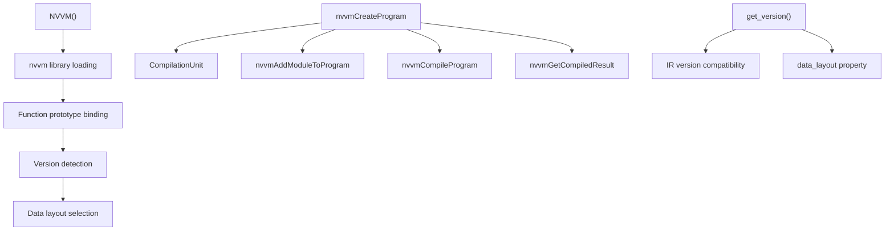
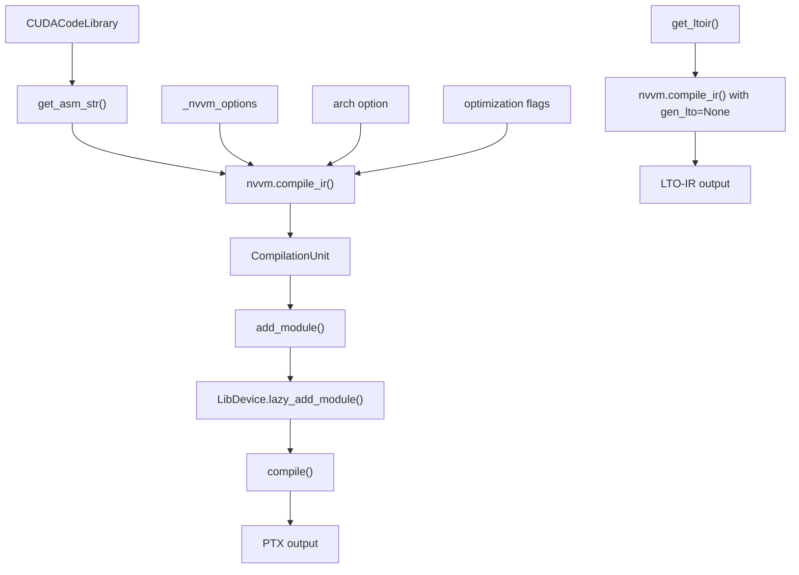
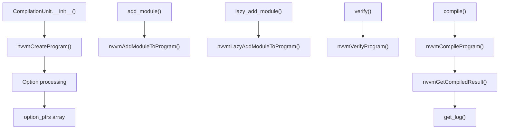
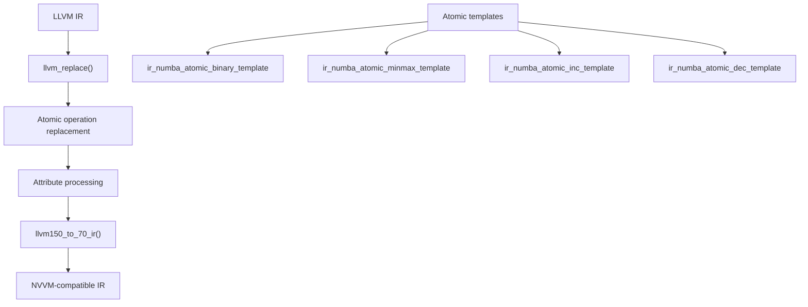
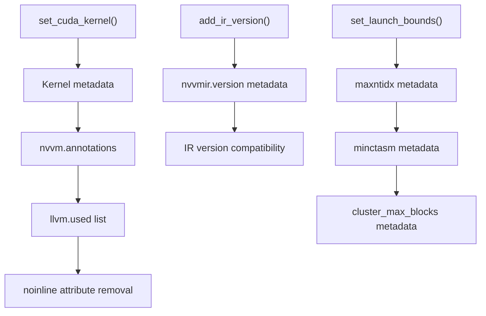
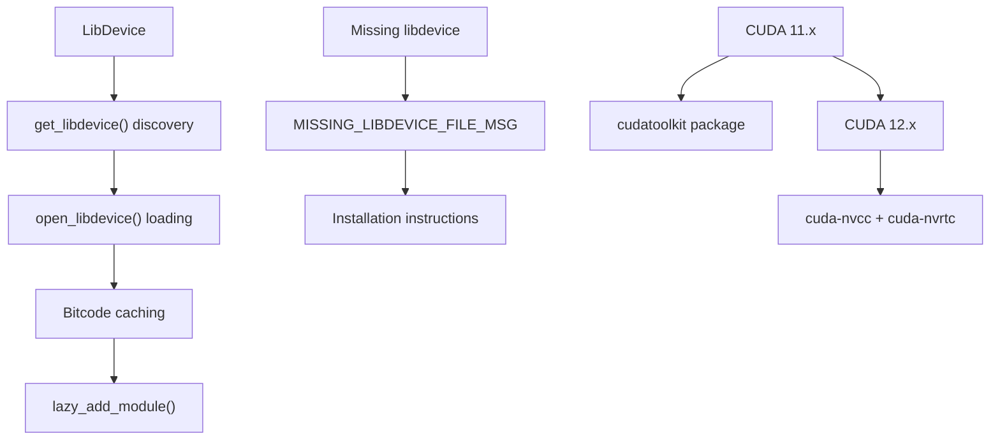
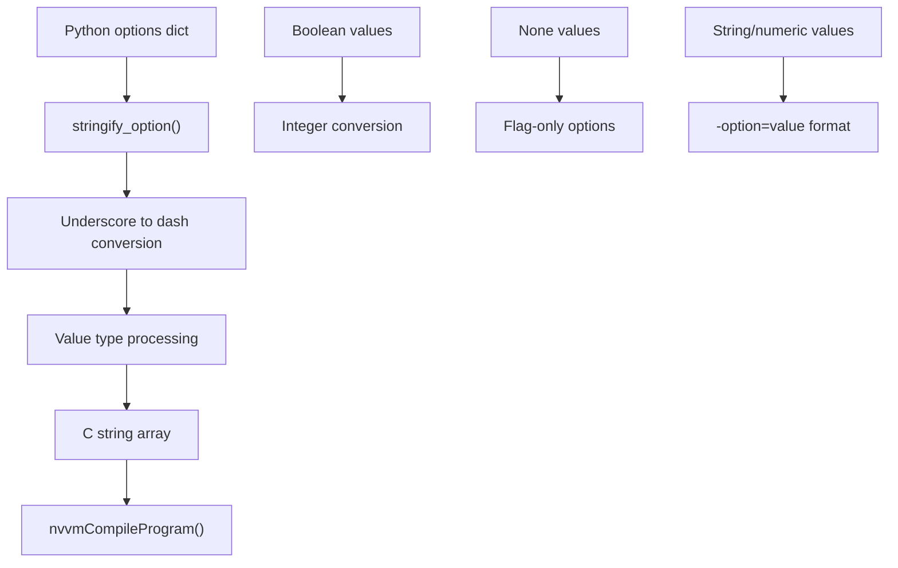
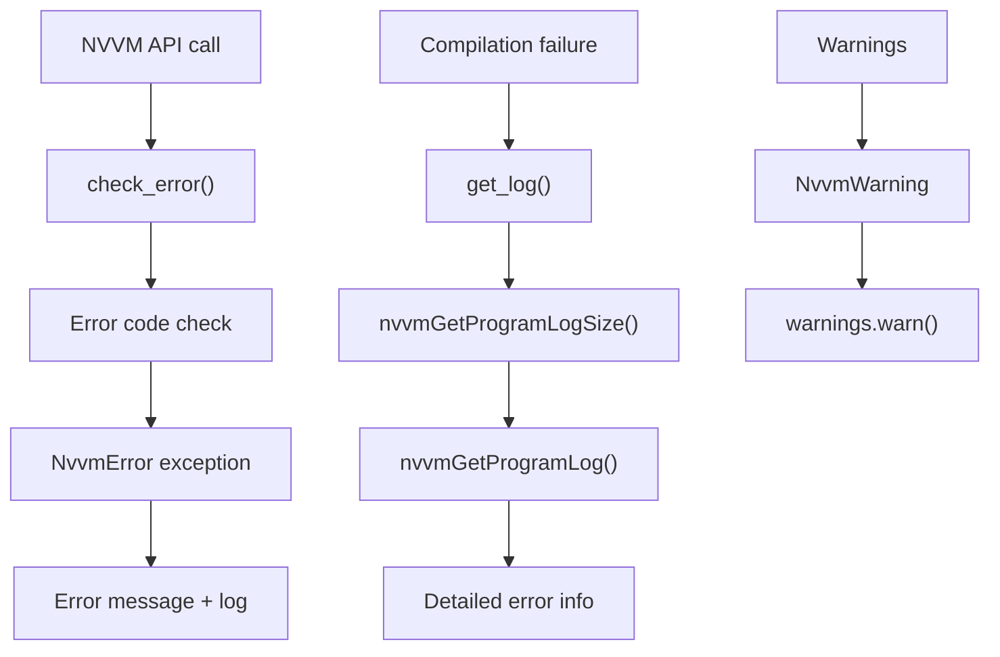

<!-- source: DeepWiki mcp.deepwiki.com · repo NVIDIA/numba-cuda · page 3.1 NVVM Integration · fetched 2026-10-26 -->

# NVVM Integration

<details>
<summary>Relevant source files</summary>

The following files were used as context for generating this wiki page:

- [numba_cuda/numba/cuda/codegen.py](numba_cuda/numba/cuda/codegen.py)
- [numba_cuda/numba/cuda/cuda_paths.py](numba_cuda/numba/cuda/cuda_paths.py)
- [numba_cuda/numba/cuda/cudadrv/libs.py](numba_cuda/numba/cuda/cudadrv/libs.py)
- [numba_cuda/numba/cuda/cudadrv/linkable_code.py](numba_cuda/numba/cuda/cudadrv/linkable_code.py)
- [numba_cuda/numba/cuda/cudadrv/nvrtc.py](numba_cuda/numba/cuda/cudadrv/nvrtc.py)
- [numba_cuda/numba/cuda/cudadrv/nvvm.py](numba_cuda/numba/cuda/cudadrv/nvvm.py)
- [numba_cuda/numba/cuda/misc/findlib.py](numba_cuda/numba/cuda/misc/findlib.py)
- [numba_cuda/numba/cuda/tests/cudadrv/test_nvvm_driver.py](numba_cuda/numba/cuda/tests/cudadrv/test_nvvm_driver.py)
- [numba_cuda/numba/cuda/tests/cudapy/test_atomics.py](numba_cuda/numba/cuda/tests/cudapy/test_atomics.py)
- [numba_cuda/numba/cuda/tests/nocuda/test_library_lookup.py](numba_cuda/numba/cuda/tests/nocuda/test_library_lookup.py)

</details>


This document describes how numba-cuda integrates with NVIDIA's NVVM (NVIDIA Virtual Machine) library to compile LLVM IR to PTX assembly code. NVVM serves as the critical bridge between Numba's LLVM IR generation and the final PTX code that executes on CUDA devices.

For information about the broader compilation pipeline, see [Core Architecture](#2). For details about runtime compilation using NVRTC, see [Runtime Compilation](#3.2).

## Overview

NVVM is NVIDIA's library for compiling LLVM IR to PTX (Parallel Thread Execution) assembly. In numba-cuda, NVVM integration enables the transformation of Numba-generated LLVM IR into GPU-executable PTX code. The integration handles:

- LLVM IR compilation to PTX and LTO-IR
- CUDA device library linking
- Compilation options and optimization settings
- Error handling and diagnostics

## NVVM Library Interface

The core NVVM integration is implemented through the `NVVM` singleton class, which provides a Python interface to the native NVVM library.

### NVVM Singleton



The `NVVM` class is implemented as a process-wide singleton that:
- Loads the native NVVM library on first access
- Binds function prototypes for all NVVM API calls
- Detects IR version capabilities for data layout selection
- Provides thread-safe access through `_nvvm_lock`

Sources: [numba_cuda/numba/cuda/cudadrv/nvvm.py:79-217]()

### Data Layout Management

NVVM supports different data layouts based on the IR version:

| IR Version | Data Layout | Features |
|------------|-------------|----------|
| < 1.8 | `_datalayout_original` | Standard integer types |
| ≥ 1.8 | `_datalayout_i128` | 128-bit integer support |

The data layout is automatically selected based on the NVVM library version and affects how LLVM IR is generated.

Sources: [numba_cuda/numba/cuda/cudadrv/nvvm.py:50-61](), [numba_cuda/numba/cuda/cudadrv/nvvm.py:184-188]()

## Compilation Pipeline Integration

NVVM integrates into the numba-cuda compilation pipeline through the `CUDACodeLibrary` class, which manages the compilation of LLVM IR to PTX.

### Compilation Flow



The compilation process involves:

1. **IR Preparation**: LLVM IR strings are collected from all modules
2. **Option Configuration**: Architecture and optimization options are set
3. **NVVM Compilation**: IR is compiled via `nvvm.compile_ir()`
4. **LibDevice Linking**: CUDA device libraries are added
5. **Result Processing**: PTX output is decoded and cached

Sources: [numba_cuda/numba/cuda/codegen.py:207-234](), [numba_cuda/numba/cuda/codegen.py:236-252]()

### CompilationUnit Class

The `CompilationUnit` class manages individual NVVM compilation sessions:



Key methods:
- `add_module()`: Adds IR module to compilation unit
- `lazy_add_module()`: Adds module for lazy linking (used for LibDevice)
- `verify()`: Runs NVVM verifier on all modules
- `compile()`: Compiles all modules and returns PTX or LTO-IR

Sources: [numba_cuda/numba/cuda/cudadrv/nvvm.py:218-346]()

## IR Processing and Transformations

Before compilation, LLVM IR undergoes several transformations to ensure compatibility with NVVM.

### IR Compatibility Processing



The `llvm_replace()` function performs critical IR transformations:

1. **Atomic Operation Replacement**: Replaces Numba atomic declarations with NVVM-compatible implementations
2. **Attribute Stripping**: Removes unsupported function attributes like `willreturn`
3. **Version Compatibility**: Converts LLVM 15.0 IR to LLVM 7.0 compatible format

Sources: [numba_cuda/numba/cuda/cudadrv/nvvm.py:507-625](), [numba_cuda/numba/cuda/cudadrv/nvvm.py:660-675]()

### Kernel and Module Metadata

Special metadata is added to mark CUDA kernels and specify IR versions:



Functions for metadata management:
- `set_cuda_kernel()`: Marks function as CUDA kernel with proper metadata
- `add_ir_version()`: Adds NVVM IR version metadata
- `set_launch_bounds()`: Sets kernel launch configuration metadata

Sources: [numba_cuda/numba/cuda/cudadrv/nvvm.py:678-715](), [numba_cuda/numba/cuda/cudadrv/nvvm.py:717-763](), [numba_cuda/numba/cuda/cudadrv/nvvm.py:765-771]()

## LibDevice Integration

LibDevice provides CUDA device library functions that are automatically linked during compilation.

### LibDevice Management



The `LibDevice` class:
- Discovers and loads CUDA device library bitcode
- Caches the bitcode for reuse across compilations
- Provides clear error messages for missing libraries
- Supports both CUDA 11.x and 12.x library locations

Sources: [numba_cuda/numba/cuda/cudadrv/nvvm.py:360-373](), [numba_cuda/numba/cuda/cudadrv/nvvm.py:348-357]()

## Compilation Options and Configuration

NVVM compilation behavior is controlled through various options that map to NVVM's native option system.

### Option Processing



Common compilation options:

| Option | Purpose | Example |
|--------|---------|---------|
| `arch` | Target architecture | `"compute_75"` |
| `opt` | Optimization level | `3` |
| `ftz` | Flush-to-zero | `True` |
| `fma` | Fused multiply-add | `True` |
| `gen_lto` | Generate LTO-IR | `None` (flag) |
| `fastmath` | Fast math optimizations | `True` |

Sources: [numba_cuda/numba/cuda/cudadrv/nvvm.py:245-263](), [numba_cuda/numba/cuda/cudadrv/nvvm.py:628-654]()

### FastMath Option Expansion

The `fastmath` option is automatically expanded to multiple NVVM options:

```python
if options.pop("fastmath", False):
    options.update({
        "ftz": True,
        "fma": True, 
        "prec_div": False,
        "prec_sqrt": False,
    })
```

Sources: [numba_cuda/numba/cuda/cudadrv/nvvm.py:632-640]()

## Error Handling and Diagnostics

NVVM integration includes comprehensive error handling for compilation failures and diagnostics.

### Error Management



Error handling features:
- **Automatic Error Checking**: All NVVM API calls are wrapped with error checking
- **Detailed Logging**: Compilation logs are retrieved and included in error messages
- **Warning Support**: NVVM warnings are converted to Python warnings
- **Result Code Mapping**: NVVM result codes are mapped to meaningful names

Sources: [numba_cuda/numba/cuda/cudadrv/nvvm.py:208-216](), [numba_cuda/numba/cuda/cudadrv/nvvm.py:330-331](), [numba_cuda/numba/cuda/cudadrv/nvvm.py:333-345]()

### Supported Error Codes

The integration handles all NVVM error codes:

```python
RESULT_CODE_NAMES = """
NVVM_SUCCESS
NVVM_ERROR_OUT_OF_MEMORY
NVVM_ERROR_PROGRAM_CREATION_FAILURE
NVVM_ERROR_IR_VERSION_MISMATCH
NVVM_ERROR_INVALID_INPUT
NVVM_ERROR_INVALID_PROGRAM
NVVM_ERROR_INVALID_IR
NVVM_ERROR_INVALID_OPTION
NVVM_ERROR_NO_MODULE_IN_PROGRAM
NVVM_ERROR_COMPILATION
""".split()
```

Sources: [numba_cuda/numba/cuda/cudadrv/nvvm.py:34-45]()

## Usage Examples

### Basic PTX Compilation

```python
# Called from CUDACodeLibrary.get_asm_str()
ptx = nvvm.compile_ir(llvm_ir_strings, arch="compute_75", opt=3)
```

### LTO-IR Generation

```python
# Called from CUDACodeLibrary.get_ltoir()
ltoir = nvvm.compile_ir(llvm_ir_strings, arch="compute_75", gen_lto=None)
```

### Manual Compilation Unit

```python
cu = nvvm.CompilationUnit({"arch": "compute_75", "opt": 3})
cu.add_module(llvm_ir.encode("utf8"))
cu.verify()
ptx = cu.compile()
```

Sources: [numba_cuda/numba/cuda/codegen.py:220](), [numba_cuda/numba/cuda/codegen.py:249](), [numba_cuda/numba/cuda/cudadrv/nvvm.py:628-654]()

---

