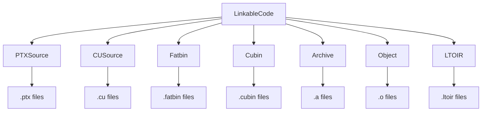
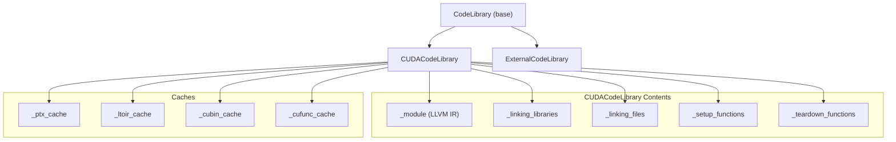
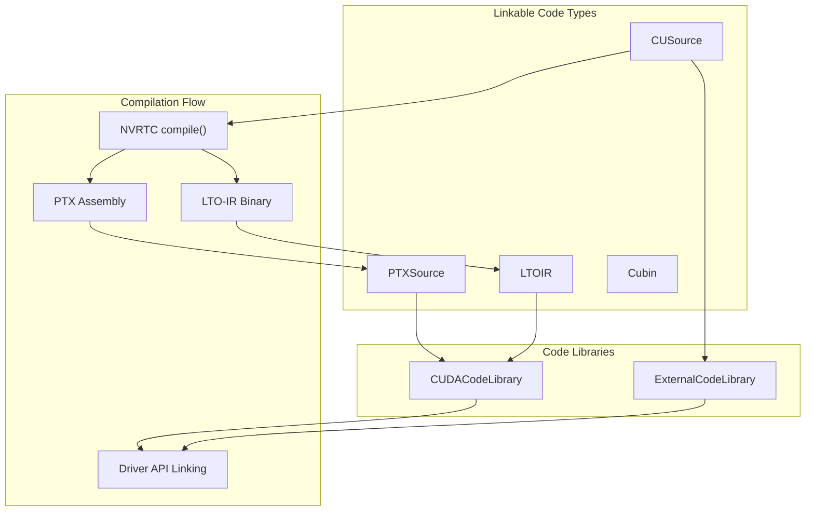
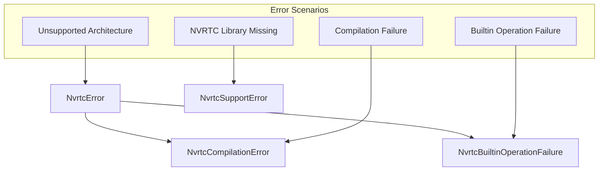
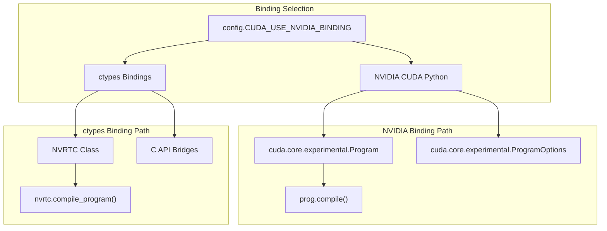
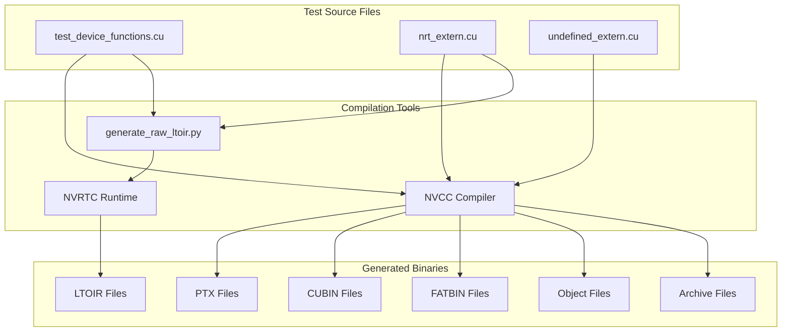

<!-- source: DeepWiki mcp.deepwiki.com · repo NVIDIA/numba-cuda · page 3.2 Linking and Module Loading · fetched 2026-10-26 -->

# Linking and Module Loading

<details>
<summary>Relevant source files</summary>

The following files were used as context for generating this wiki page:

- [numba_cuda/numba/cuda/codegen.py](numba_cuda/numba/cuda/codegen.py)
- [numba_cuda/numba/cuda/cudadrv/linkable_code.py](numba_cuda/numba/cuda/cudadrv/linkable_code.py)
- [numba_cuda/numba/cuda/cudadrv/mappings.py](numba_cuda/numba/cuda/cudadrv/mappings.py)
- [numba_cuda/numba/cuda/cudadrv/nvrtc.py](numba_cuda/numba/cuda/cudadrv/nvrtc.py)
- [numba_cuda/numba/cuda/decorators.py](numba_cuda/numba/cuda/decorators.py)
- [numba_cuda/numba/cuda/tests/cudadrv/test_linker.py](numba_cuda/numba/cuda/tests/cudadrv/test_linker.py)
- [numba_cuda/numba/cuda/tests/cudadrv/test_module_callbacks.py](numba_cuda/numba/cuda/tests/cudadrv/test_module_callbacks.py)
- [numba_cuda/numba/cuda/tests/cudadrv/test_nvjitlink.py](numba_cuda/numba/cuda/tests/cudadrv/test_nvjitlink.py)
- [numba_cuda/numba/cuda/tests/cudapy/test_debug.py](numba_cuda/numba/cuda/tests/cudapy/test_debug.py)
- [numba_cuda/numba/cuda/tests/cudapy/test_errors.py](numba_cuda/numba/cuda/tests/cudapy/test_errors.py)
- [numba_cuda/numba/cuda/tests/cudapy/test_inline.py](numba_cuda/numba/cuda/tests/cudapy/test_inline.py)

</details>


This page explains the linking process that combines Numba-generated code with external libraries, PTX files, and cubins. The linking system supports both standard Driver API linking and Link-Time Optimization (LTO) via nvjitlink. Module loading manages the lifecycle of compiled code on the device, including setup and teardown callbacks.

For information about the preceding compilation steps that generate LLVM IR and PTX, see [NVVM Integration](#3.1). For the broader JIT compilation pipeline, see [JIT Compilation Pipeline](#2.1).

## Linkable Code Formats

The linking system accepts multiple input formats through the `LinkableCode` abstraction [numba_cuda/numba/cuda/cudadrv/linkable_code.py:11-117](). Each format corresponds to a specific file type that can be linked into a CUDA module.

### LinkableCode Class Hierarchy



**LinkableCode Format Support**

Sources: [numba_cuda/numba/cuda/cudadrv/linkable_code.py:11-185]()

The `LinkableCode` base class provides the core interface for code that can be linked into a module. Each subclass represents a specific format:

| Class | File Extension | CUjitInputType | Description |
|-------|---------------|----------------|-------------|
| `PTXSource` | `.ptx` | `CU_JIT_INPUT_PTX` | PTX assembly source |
| `CUSource` | `.cu` | N/A (compiled via NVRTC) | CUDA C/C++ source |
| `Fatbin` | `.fatbin` | `CU_JIT_INPUT_FATBINARY` | Fat binary with multiple architectures |
| `Cubin` | `.cubin` | `CU_JIT_INPUT_CUBIN` | ELF cubin for specific architecture |
| `Archive` | `.a` | `CU_JIT_INPUT_LIBRARY` | Static archive of objects |
| `Object` | `.o` | `CU_JIT_INPUT_OBJECT` | Relocatable object file |
| `LTOIR` | `.ltoir` | `CU_JIT_INPUT_NVVM` | LTO intermediate representation |

Sources: [numba_cuda/numba/cuda/cudadrv/linkable_code.py:119-185](), [numba_cuda/numba/cuda/cudadrv/mappings.py:6-14]()

### Loading Linkable Code

The `LinkableCode.from_path()` method [numba_cuda/numba/cuda/cudadrv/linkable_code.py:58-89]() loads code from a file path, automatically determining the correct subclass based on file extension. The `from_path_or_obj()` method [numba_cuda/numba/cuda/cudadrv/linkable_code.py:91-116]() accepts either a file path or an existing `LinkableCode` object.

```python
# Loading different formats
ptx_code = PTXSource.from_path("kernel.ptx")
cu_code = CUSource.from_path("device_func.cu")
archive = Archive.from_path("libdevice.a")
```

Sources: [numba_cuda/numba/cuda/cudadrv/linkable_code.py:58-116]()

## Code Library Management

The linking system uses two code library classes to manage collections of linkable code: `CUDACodeLibrary` for Numba-generated code and `ExternalCodeLibrary` for external code.

### Code Library Architecture



**CUDACodeLibrary Components**

Sources: [numba_cuda/numba/cuda/codegen.py:118-438]()

### CUDACodeLibrary

The `CUDACodeLibrary` class [numba_cuda/numba/cuda/codegen.py:118-512]() manages the complete code generation and linking pipeline. It maintains:

- **LLVM Module**: The primary module containing Numba-generated LLVM IR [numba_cuda/numba/cuda/codegen.py:152]()
- **Linking Libraries**: Other `CodeLibrary` instances whose modules are compiled together [numba_cuda/numba/cuda/codegen.py:157]()
- **Linking Files**: External files (PTX, cubins, archives) to link at link time [numba_cuda/numba/cuda/codegen.py:160]()
- **Caches**: PTX, LTO-IR, cubin, and function caches indexed by compute capability [numba_cuda/numba/cuda/codegen.py:172-181]()

Key methods:

| Method | Purpose | Source |
|--------|---------|--------|
| `add_ir_module()` | Add LLVM IR module | [numba_cuda/numba/cuda/codegen.py:361-365]() |
| `add_linking_library()` | Add another CodeLibrary | [numba_cuda/numba/cuda/codegen.py:367-380]() |
| `add_linking_file()` | Add external file/LinkableCode | [numba_cuda/numba/cuda/codegen.py:381-388]() |
| `get_asm_str()` | Generate PTX for compute capability | [numba_cuda/numba/cuda/codegen.py:208-235]() |
| `get_ltoir()` | Generate LTO-IR | [numba_cuda/numba/cuda/codegen.py:264-280]() |
| `get_cubin()` | Link and generate cubin | [numba_cuda/numba/cuda/codegen.py:297-320]() |
| `get_cufunc()` | Load module and get function handle | [numba_cuda/numba/cuda/codegen.py:322-347]() |

Sources: [numba_cuda/numba/cuda/codegen.py:118-512]()

### ExternalCodeLibrary

The `ExternalCodeLibrary` class [numba_cuda/numba/cuda/codegen.py:65-116]() holds pre-compiled external code that does not contain LLVM IR modules. It maintains only linking files and setup/teardown callbacks:

```python
class ExternalCodeLibrary(CodeLibrary):
    def __init__(self, codegen, name):
        super().__init__(codegen, name)
        self._linking_files = set()
        self._setup_functions = []
        self._teardown_functions = []
```

Sources: [numba_cuda/numba/cuda/codegen.py:65-116]()

## Integration with Code Generation

Runtime compilation integrates with the broader numba-cuda code generation system through the linkable code framework.

### Linkable Code Integration



Sources: [numba_cuda/numba/cuda/cudadrv/linkable_code.py:60-64](), [numba_cuda/numba/cuda/codegen.py:117-491]()

The `CUSource` class [numba_cuda/numba/cuda/cudadrv/linkable_code.py:60-64]() represents CUDA C/C++ source code that can be linked into a module. When the `CUDACodeLibrary` processes linking files, it can automatically invoke NVRTC to compile CUDA source code through the driver API linking process.

### Integration with CUDACodeLibrary

The `CUDACodeLibrary` class [numba_cuda/numba/cuda/codegen.py:117-491]() handles the integration of runtime-compiled code with the main compilation pipeline. It manages linking files through `add_linking_file()` [numba_cuda/numba/cuda/codegen.py:363-370]() and processes them during the `_link_all()` method [numba_cuda/numba/cuda/codegen.py:254-267]().

## Error Handling

The NVRTC interface includes comprehensive error handling through specialized exception classes:

### Error Types



Sources: [numba_cuda/numba/cuda/cudadrv/error.py:26-40]()

The error handling system provides detailed diagnostics through compilation logs [numba_cuda/numba/cuda/cudadrv/nvrtc.py:254-264]() and meaningful error messages that help users diagnose compilation issues.

## Binding Support

The runtime compilation system supports two different binding approaches:

### NVIDIA Bindings vs ctypes



Sources: [numba_cuda/numba/cuda/cudadrv/nvrtc.py:31-32](), [numba_cuda/numba/cuda/cudadrv/nvrtc.py:340-399](), [numba_cuda/numba/cuda/cudadrv/nvrtc.py:401-437]()

When `config.CUDA_USE_NVIDIA_BINDING` is enabled, the system uses the official NVIDIA CUDA Python bindings [numba_cuda/numba/cuda/cudadrv/nvrtc.py:372-399](). Otherwise, it uses the internal ctypes-based implementation [numba_cuda/numba/cuda/cudadrv/nvrtc.py:401-437]().

## Testing Infrastructure

The runtime compilation system includes comprehensive testing infrastructure that generates various binary formats for testing purposes.

### Test Binary Generation

The test system uses both NVCC and NVRTC to generate test binaries:



Sources: [numba_cuda/numba/cuda/tests/test_binary_generation/Makefile:1-70](), [numba_cuda/numba/cuda/tests/test_binary_generation/generate_raw_ltoir.py:1-174]()

The `generate_raw_ltoir.py` script [numba_cuda/numba/cuda/tests/test_binary_generation/generate_raw_ltoir.py:85-137]() demonstrates practical usage of the NVRTC interface, showing how to compile CUDA C/C++ source to LTO-IR format with proper error handling and include path management.

---

