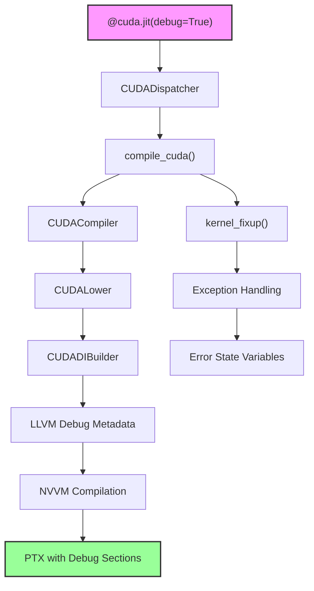
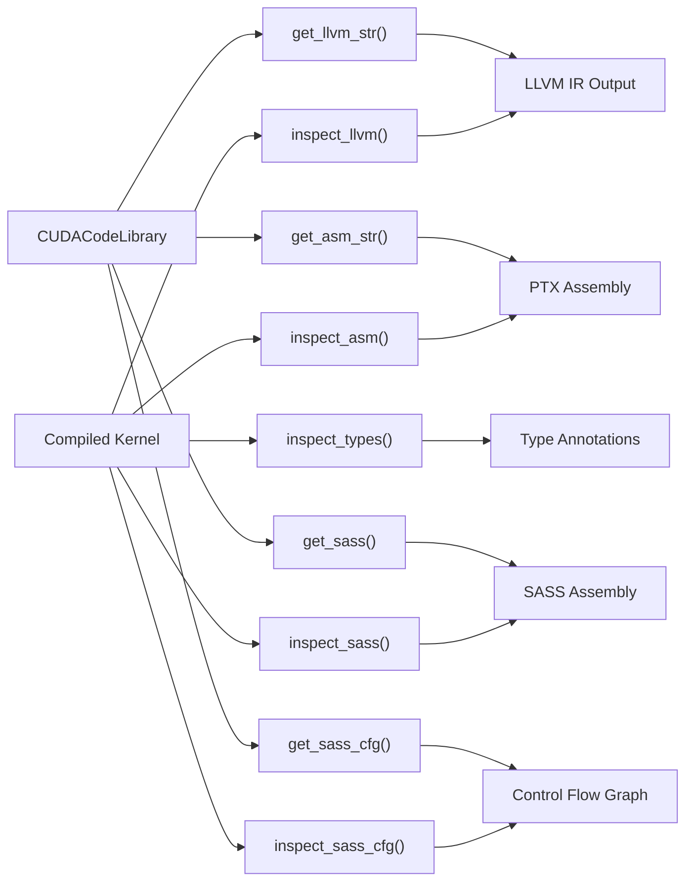
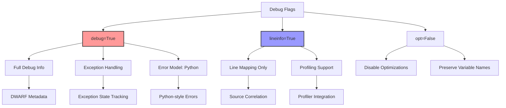
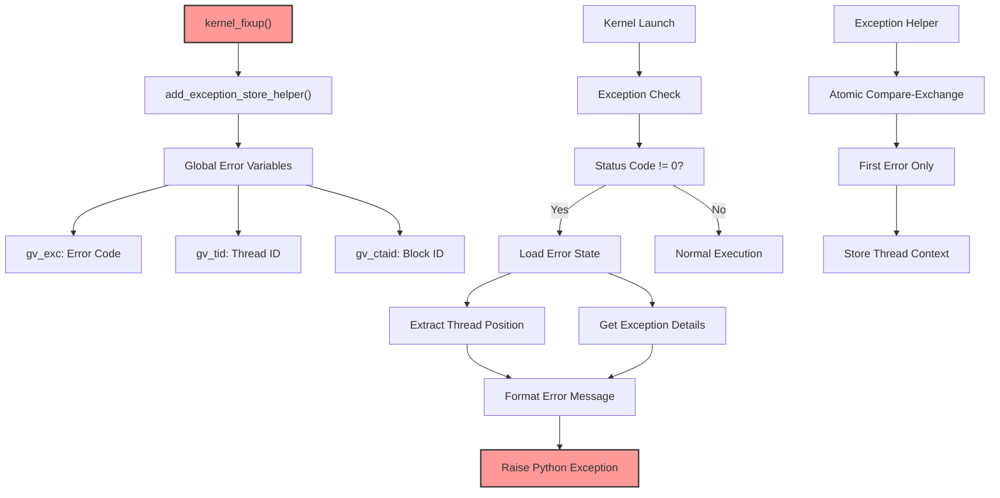
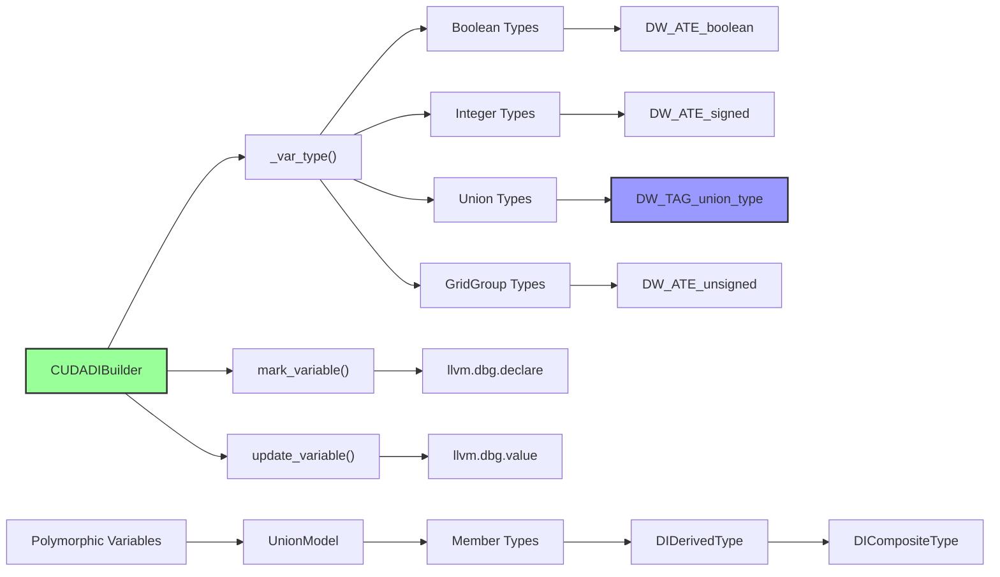
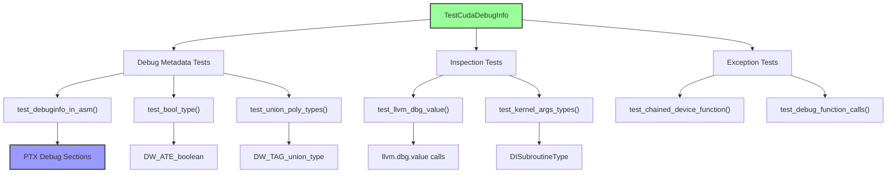

<!-- source: DeepWiki mcp.deepwiki.com · repo NVIDIA/numba-cuda · page 4 Debugging and Inspection · fetched 2026-10-26 -->

# Debugging and Inspection

Relevant source files

The following files were used as context for generating this wiki page:

- [numba_cuda/numba/cuda/debuginfo.py](numba_cuda/numba/cuda/debuginfo.py)
- [numba_cuda/numba/cuda/lowering.py](numba_cuda/numba/cuda/lowering.py)
- [numba_cuda/numba/cuda/testing.py](numba_cuda/numba/cuda/testing.py)
- [numba_cuda/numba/cuda/tests/cudadrv/test_managed_alloc.py](numba_cuda/numba/cuda/tests/cudadrv/test_managed_alloc.py)
- [numba_cuda/numba/cuda/tests/cudapy/test_debuginfo.py](numba_cuda/numba/cuda/tests/cudapy/test_debuginfo.py)
- [numba_cuda/numba/cuda/tests/cudapy/test_debuginfo_types.py](numba_cuda/numba/cuda/tests/cudapy/test_debuginfo_types.py)
- [numba_cuda/numba/cuda/tests/cudapy/test_inspect.py](numba_cuda/numba/cuda/tests/cudapy/test_inspect.py)
- [numba_cuda/numba/cuda/tests/cudapy/test_ipc.py](numba_cuda/numba/cuda/tests/cudapy/test_ipc.py)

This document covers the debugging and inspection capabilities in numba-cuda, including debug information generation, code inspection methods, and error handling mechanisms. These features enable developers to analyze compiled CUDA kernels, debug runtime issues, and understand the generated code at various compilation stages.

For information about the core compilation pipeline, see [Core Architecture](#2). For testing infrastructure, see [Testing Framework](#6.1).

## Debug Information Generation

The debug information system in numba-cuda generates DWARF debug metadata that can be used by profiling tools and debuggers. The system is built around the `CUDADIBuilder` class and integrates with the compilation pipeline.

The `CUDADIBuilder` class extends the core Numba debug info builder to handle CUDA-specific types and metadata generation. It creates debug metadata for variables, function parameters, and supports polymorphic types through union representations.

Sources: [numba_cuda/numba/cuda/debuginfo.py:10-15](), [numba_cuda/numba/cuda/compiler.py:271-282](), [numba_cuda/numba/cuda/lowering.py:49-83]()

## Code Inspection System

The inspection system provides methods to examine compiled kernels at different stages of the compilation pipeline. These methods are available on both `_Kernel` and `CUDADispatcher` objects.

The inspection methods delegate to the underlying `CUDACodeLibrary` to retrieve the requested representation:

| Method | Returns | Purpose |
|--------|---------|---------|
| `inspect_llvm()` | LLVM IR string | View intermediate representation |
| `inspect_asm(cc)` | PTX assembly string | View generated PTX code |
| `inspect_sass()` | SASS assembly string | View native GPU assembly |
| `inspect_sass_cfg()` | Control flow graph | Analyze execution flow |
| `inspect_types()` | Type annotations | Debug type inference |

Sources: [numba_cuda/numba/cuda/dispatcher.py:375-418](), [numba_cuda/numba/cuda/dispatcher.py:890-996]()

## Debug Flag Configuration

The debug system is controlled through several compilation flags that affect code generation and runtime behavior.

The debug flags have specific interactions:
- `debug=True` enables full debug information but requires `opt=False`
- `lineinfo=True` provides line mapping without affecting optimization
- `debug=True` and `lineinfo=True` are mutually exclusive

Sources: [numba_cuda/numba/cuda/compiler.py:271-282](), [numba_cuda/numba/cuda/decorators.py:126-140]()

## Exception Handling in Debug Mode

When `debug=True`, the compilation system adds comprehensive exception handling to CUDA kernels through the `kernel_fixup()` function and exception helper infrastructure.

The exception handling system creates global variables in the kernel module to track error state and thread context. When an exception occurs, it atomically stores the error code and thread position to provide detailed error information.

Sources: [numba_cuda/numba/cuda/compiler.py:365-457](), [numba_cuda/numba/cuda/compiler.py:459-525](), [numba_cuda/numba/cuda/dispatcher.py:446-512]()

## Debug Metadata Generation

The `CUDADIBuilder` generates LLVM debug metadata that describes variables, types, and execution context for debugging and profiling tools.

The debug metadata system handles several CUDA-specific requirements:
- Special encoding for boolean and GridGroup types
- Union types for polymorphic variables
- Scalar variable tracking with `llvm.dbg.value`
- Type deduplication for variables with same name and type

Sources: [numba_cuda/numba/cuda/debuginfo.py:16-111](), [numba_cuda/numba/cuda/debuginfo.py:140-214](), [numba_cuda/numba/cuda/lowering.py:8-47]()

## Testing and Validation

The debug system is thoroughly tested through the `TestCudaDebugInfo` class, which validates debug metadata generation, exception handling, and inspection capabilities.

The test suite covers:
- Debug section presence in PTX output
- Correct DWARF encoding for different types
- Variable tracking and metadata generation
- Multi-module debug compilation
- Exception handling integration

Sources: [numba_cuda/numba/cuda/tests/cudapy/test_debuginfo.py:12-408]()

---

