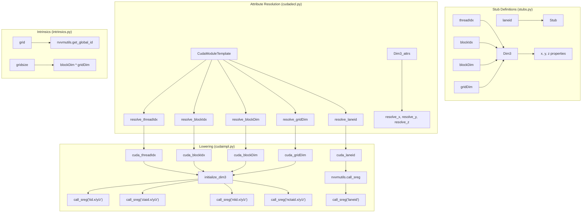
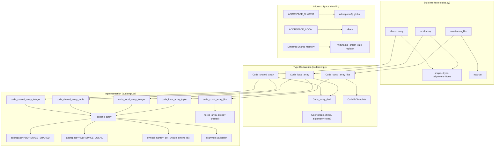
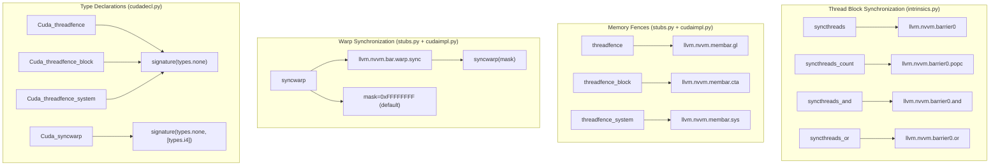
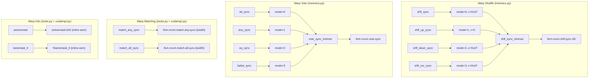

<!-- source: DeepWiki mcp.deepwiki.com · repo NVIDIA/numba-cuda · page 5 Device Functions and Intrinsics · fetched 2026-10-26 -->

# Device Functions and Intrinsics

<details>
<summary>Relevant source files</summary>

The following files were used as context for generating this wiki page:

- [numba_cuda/numba/cuda/cudadecl.py](numba_cuda/numba/cuda/cudadecl.py)
- [numba_cuda/numba/cuda/cudadrv/mappings.py](numba_cuda/numba/cuda/cudadrv/mappings.py)
- [numba_cuda/numba/cuda/cudaimpl.py](numba_cuda/numba/cuda/cudaimpl.py)
- [numba_cuda/numba/cuda/decorators.py](numba_cuda/numba/cuda/decorators.py)
- [numba_cuda/numba/cuda/device_init.py](numba_cuda/numba/cuda/device_init.py)
- [numba_cuda/numba/cuda/intrinsics.py](numba_cuda/numba/cuda/intrinsics.py)
- [numba_cuda/numba/cuda/stubs.py](numba_cuda/numba/cuda/stubs.py)
- [numba_cuda/numba/cuda/tests/cudadrv/test_linker.py](numba_cuda/numba/cuda/tests/cudadrv/test_linker.py)
- [numba_cuda/numba/cuda/tests/cudadrv/test_module_callbacks.py](numba_cuda/numba/cuda/tests/cudadrv/test_module_callbacks.py)
- [numba_cuda/numba/cuda/tests/cudadrv/test_nvjitlink.py](numba_cuda/numba/cuda/tests/cudadrv/test_nvjitlink.py)
- [numba_cuda/numba/cuda/tests/cudapy/test_array_alignment.py](numba_cuda/numba/cuda/tests/cudapy/test_array_alignment.py)
- [numba_cuda/numba/cuda/tests/cudapy/test_debug.py](numba_cuda/numba/cuda/tests/cudapy/test_debug.py)
- [numba_cuda/numba/cuda/tests/cudapy/test_errors.py](numba_cuda/numba/cuda/tests/cudapy/test_errors.py)
- [numba_cuda/numba/cuda/tests/cudapy/test_inline.py](numba_cuda/numba/cuda/tests/cudapy/test_inline.py)
- [numba_cuda/numba/cuda/tests/cudapy/test_warp_ops.py](numba_cuda/numba/cuda/tests/cudapy/test_warp_ops.py)

</details>


## Purpose and Scope

Device functions and intrinsics provide the fundamental building blocks for CUDA kernel programming in Numba CUDA. These include thread and block indexing, memory allocation in different address spaces, synchronization primitives, warp-level operations, atomic operations, and mathematical intrinsics. This page documents how these functions are declared, typed, and lowered to NVVM IR.

Device functions are categorized into:
- **Built-in intrinsics**: Functions directly provided by CUDA (thread indices, synchronization, atomics, warp operations)
- **Stub objects**: Python objects that represent CUDA-specific constructs and are meaningless outside kernel context
- **Foreign functions**: External CUDA device functions declared via `cuda.declare_device()`

For information about the type system, see [Type System and Lowering](#2.4). For details about external code linking, see [Linking and Module Loading](#3.2).

## Architecture Overview

Device functions and intrinsics follow a three-layer architecture: stub definitions, type declarations, and implementation lowering:

```mermaid
graph TB
    subgraph "Stub Layer (stubs.py)"
        A[threadIdx] --> B[Dim3]
        C[shared.array] --> D[stub_function]
        E[cuda.atomic.add] --> F[Stub]
        G[syncwarp] --> D
    end
    
    subgraph "Type Declaration Layer (cudadecl.py)"
        H[Cuda_shared_array] --> I[Cuda_array_decl]
        J[Cuda_threadfence_device] --> K[ConcreteTemplate]
        L[Cuda_atomic_add] --> M[AbstractTemplate]
        N[Cuda_syncwarp] --> K
    end
    
    subgraph "Implementation Layer (cudaimpl.py)"
        O[cuda_shared_array_integer] --> P[_generic_array]
        Q[ptx_threadfence_device] --> R[llvm.nvvm.membar.gl]
        S[ptx_atomic_add_tuple] --> T[nvvmutils.declare_atomic_add_float32]
        U[ptx_syncwarp_mask] --> V[llvm.nvvm.bar.warp.sync]
    end
    
    subgraph "Intrinsics Layer (intrinsics.py)"
        W[grid] --> X[@intrinsic]
        Y[syncthreads] --> X
        Z[shfl_sync] --> X
        AA[all_sync] --> X
    end
    
    A --> H
    C --> H
    E --> L
    G --> N
    H --> O
    J --> Q
    L --> S
    N --> U
    W --> AB[nvvmutils.get_global_id]
    Y --> AC[llvm.nvvm.barrier0]
    Z --> AD[llvm.nvvm.shfl.sync.i32]
    AA --> AE[llvm.nvvm.vote.sync]
```

**Device Functions and Intrinsics Architecture**

Sources: [numba_cuda/numba/cuda/stubs.py:1-625](), [numba_cuda/numba/cuda/cudadecl.py:1-544](), [numba_cuda/numba/cuda/cudaimpl.py:1-984](), [numba_cuda/numba/cuda/intrinsics.py:1-532]()

## Thread and Block Indices

Thread and block indices provide access to thread position within the CUDA execution hierarchy:



**Thread and Block Index Implementation**

| Function | Stub | Type | Lowering | NVVM Register |
|----------|------|------|----------|---------------|
| `cuda.threadIdx` | `threadIdx` (Dim3) | `dim3` | `initialize_dim3("tid")` | `%tid.x/y/z` |
| `cuda.blockIdx` | `blockIdx` (Dim3) | `dim3` | `initialize_dim3("ctaid")` | `%ctaid.x/y/z` |
| `cuda.blockDim` | `blockDim` (Dim3) | `dim3` | `initialize_dim3("ntid")` | `%ntid.x/y/z` |
| `cuda.gridDim` | `gridDim` (Dim3) | `dim3` | `initialize_dim3("nctaid")` | `%nctaid.x/y/z` |
| `cuda.laneid` | `laneid` (Stub) | `int32` | `call_sreg("laneid")` | `%laneid` |
| `cuda.grid(ndim)` | N/A | `int64` or `UniTuple` | `get_global_id(dim)` | Computed |
| `cuda.gridsize(ndim)` | N/A | `int64` or `UniTuple` | `blockDim * gridDim` | Computed |

Sources: [numba_cuda/numba/cuda/stubs.py:48-121](), [numba_cuda/numba/cuda/cudadecl.py:376-387](), [numba_cuda/numba/cuda/cudadecl.py:467-481](), [numba_cuda/numba/cuda/cudaimpl.py:39-84](), [numba_cuda/numba/cuda/intrinsics.py:24-113]()

## Memory Allocation

Device memory allocation functions create arrays in different address spaces:



**Memory Allocation Implementation**

| Function | Address Space | Storage | Dynamic Size | Alignment |
|----------|---------------|---------|--------------|-----------|
| `cuda.shared.array()` | Shared (3) | Global variable | Supported (1D only) | Configurable |
| `cuda.local.array()` | Local (5) | Stack allocation | Not supported | Configurable |
| `cuda.const.array_like()` | Constant (4) | Pre-created by context | N/A | N/A |

The `_generic_array` function [numba_cuda/numba/cuda/cudaimpl.py:832-973]() handles:
- Shape and dtype validation
- Element count computation
- Address space-specific allocation (global variable or alloca)
- Alignment handling (power-of-2, pointer-size multiple)
- Dynamic shared memory sizing via inline assembly
- Array structure population with data pointer, shape, and strides

Sources: [numba_cuda/numba/cuda/stubs.py:127-187](), [numba_cuda/numba/cuda/cudadecl.py:27-80](), [numba_cuda/numba/cuda/cudaimpl.py:89-231](), [numba_cuda/numba/cuda/cudaimpl.py:832-973]()

## Synchronization and Memory Fences

Synchronization primitives ensure memory visibility and thread coordination:



**Synchronization Functions**

| Function | Scope | NVVM Intrinsic | Purpose |
|----------|-------|----------------|---------|
| `cuda.syncthreads()` | Block | `llvm.nvvm.barrier0` | Wait for all threads in block |
| `cuda.syncthreads_count(pred)` | Block | `llvm.nvvm.barrier0.popc` | Count threads with true predicate |
| `cuda.syncthreads_and(pred)` | Block | `llvm.nvvm.barrier0.and` | All threads have true predicate |
| `cuda.syncthreads_or(pred)` | Block | `llvm.nvvm.barrier0.or` | Any thread has true predicate |
| `cuda.syncwarp(mask)` | Warp | `llvm.nvvm.bar.warp.sync` | Synchronize masked warp threads |
| `cuda.threadfence()` | Device | `llvm.nvvm.membar.gl` | Memory fence at device level |
| `cuda.threadfence_block()` | Block | `llvm.nvvm.membar.cta` | Memory fence at block level |
| `cuda.threadfence_system()` | System | `llvm.nvvm.membar.sys` | Memory fence at system level |

Sources: [numba_cuda/numba/cuda/stubs.py:193-280](), [numba_cuda/numba/cuda/cudadecl.py:83-104](), [numba_cuda/numba/cuda/cudaimpl.py:233-281](), [numba_cuda/numba/cuda/intrinsics.py:142-211]()

## Warp-Level Operations

Warp-level operations enable efficient communication and voting within warps:



**Warp-Level Operations Summary**

| Category | Function | NVVM Intrinsic | Description |
|----------|----------|----------------|-------------|
| Shuffle | `shfl_sync(mask, value, src_lane)` | `llvm.nvvm.shfl.sync.i32` | Shuffle from specific lane |
| Shuffle | `shfl_up_sync(mask, value, delta)` | `llvm.nvvm.shfl.sync.i32` | Shuffle from lower lane |
| Shuffle | `shfl_down_sync(mask, value, delta)` | `llvm.nvvm.shfl.sync.i32` | Shuffle from higher lane |
| Shuffle | `shfl_xor_sync(mask, value, lane_mask)` | `llvm.nvvm.shfl.sync.i32` | Shuffle via XOR pattern |
| Vote | `all_sync(mask, predicate)` | `llvm.nvvm.vote.sync` | Test if all threads' predicate is true |
| Vote | `any_sync(mask, predicate)` | `llvm.nvvm.vote.sync` | Test if any thread's predicate is true |
| Vote | `eq_sync(mask, predicate)` | `llvm.nvvm.vote.sync` | Test if all threads agree |
| Vote | `ballot_sync(mask, predicate)` | `llvm.nvvm.vote.sync` | Get mask of threads with true predicate |
| Match | `match_any_sync(mask, value)` | `llvm.nvvm.match.any.sync` | Find threads with same value |
| Match | `match_all_sync(mask, value)` | `llvm.nvvm.match.all.sync` | Check if all have same value |
| Info | `activemask()` | `activemask.b32` | Get mask of active threads |
| Info | `lanemask_lt()` | `%lanemask_lt` | Get mask of lower-ID lanes |

Sources: [numba_cuda/numba/cuda/stubs.py:193-252](), [numba_cuda/numba/cuda/cudadecl.py:101-132](), [numba_cuda/numba/cuda/cudaimpl.py:266-338](), [numba_cuda/numba/cuda/intrinsics.py:219-532]()

## Extension API Reference

The main extension API provides several key functions:

| Function | Purpose | Usage |
|----------|---------|--------|
| `register_model` | Register data model for type | `@register_model(CustomType)` |
| `make_attribute_wrapper` | Create attribute accessor | `make_attribute_wrapper(Type, "attr", "attr")` |
| `intrinsic` | Create intrinsic function | `@intrinsic(target="cuda")` |
| `typeof_impl.register` | Register type inference | `@typeof_impl.register(PythonClass)` |
| `type_callable` | Register constructor typing | `@type_callable(Constructor)` |
| `lower_builtin` | Register function lowering | `@lower_builtin(func, type1, type2)` |

The extension system also supports integration with external code through the `declare_device` function and code object linking capabilities.

Sources: [numba_cuda/numba/cuda/extending.py:1-62](), [numba_cuda/numba/cuda/tests/cudapy/test_extending.py:38-105]()

---

