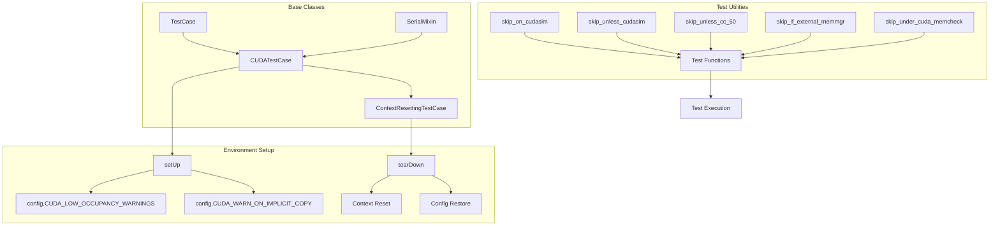
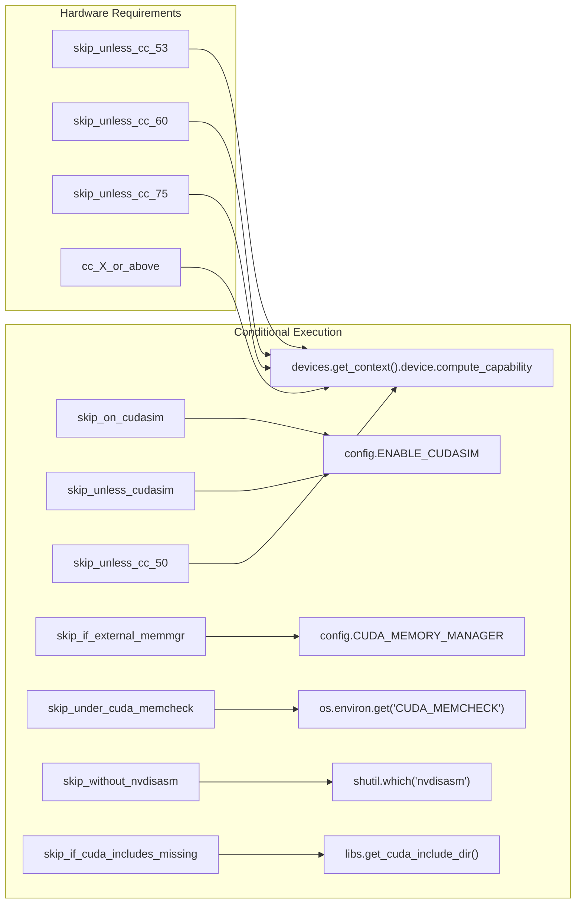
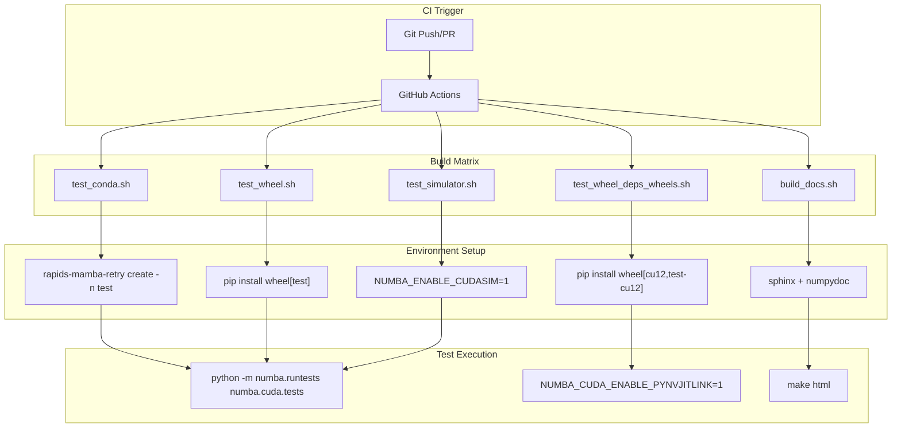
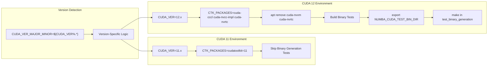
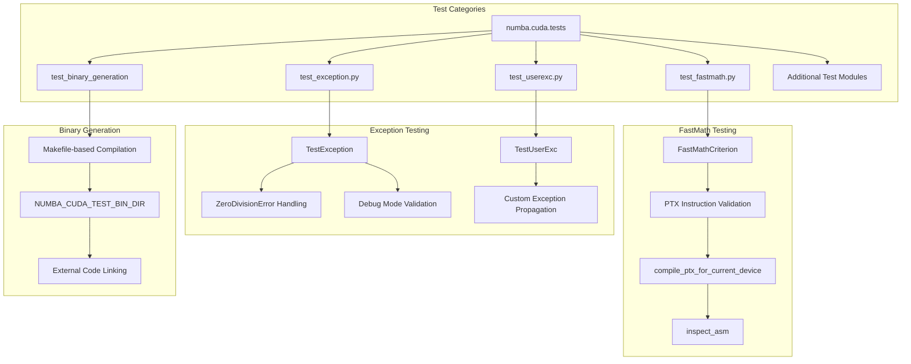
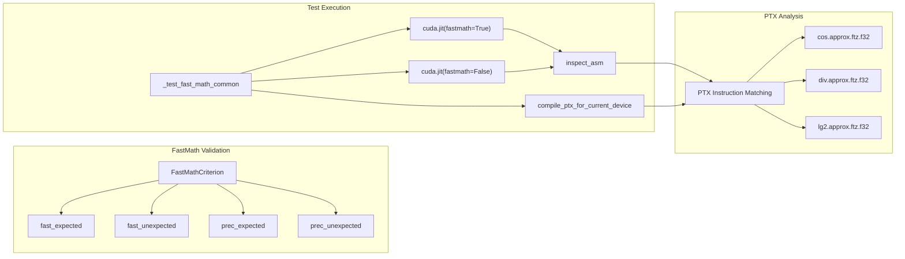
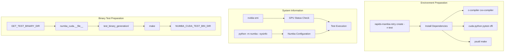
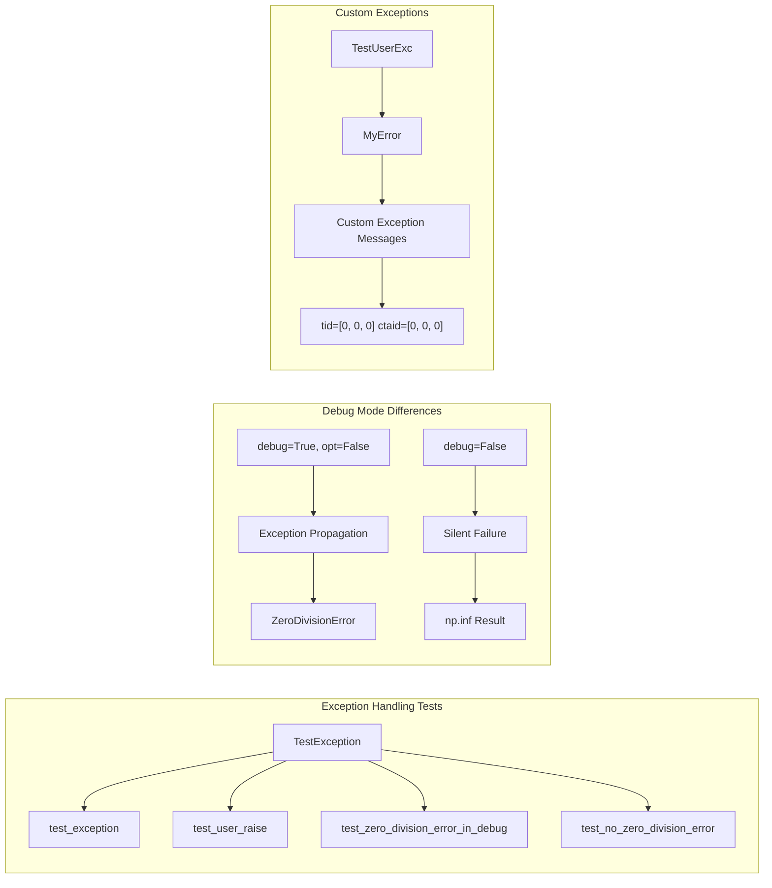
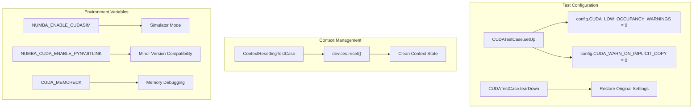

<!-- source: DeepWiki mcp.deepwiki.com · repo NVIDIA/numba-cuda · page 6 Development and Testing · fetched 2026-10-26 -->

# Development and Testing

Relevant source files

The following files were used as context for generating this wiki page:

- [README.md](README.md)
- [ci/test_conda.sh](ci/test_conda.sh)
- [ci/test_wheel.sh](ci/test_wheel.sh)
- [ci/test_wheel_deps_wheels.sh](ci/test_wheel_deps_wheels.sh)
- [conda/recipes/numba-cuda/meta.yaml](conda/recipes/numba-cuda/meta.yaml)
- [numba_cuda/numba/cuda/testing.py](numba_cuda/numba/cuda/testing.py)
- [numba_cuda/numba/cuda/tests/benchmarks/test_kernel_launch.py](numba_cuda/numba/cuda/tests/benchmarks/test_kernel_launch.py)
- [numba_cuda/numba/cuda/tests/cudadrv/test_managed_alloc.py](numba_cuda/numba/cuda/tests/cudadrv/test_managed_alloc.py)
- [numba_cuda/numba/cuda/tests/cudapy/test_inspect.py](numba_cuda/numba/cuda/tests/cudapy/test_inspect.py)
- [numba_cuda/numba/cuda/tests/cudapy/test_ipc.py](numba_cuda/numba/cuda/tests/cudapy/test_ipc.py)
- [pixi.lock](pixi.lock)
- [pixi.toml](pixi.toml)
- [pyproject.toml](pyproject.toml)
- [scripts/bench-against.py](scripts/bench-against.py)
- [testing/Makefile](testing/Makefile)
- [testing/pytest.ini](testing/pytest.ini)

This document covers the development workflow, testing infrastructure, and continuous integration pipeline for the numba-cuda project. It explains how tests are organized, executed, and integrated into the development process to ensure code quality and compatibility across different CUDA environments.

For information about the core compilation and runtime systems being tested, see [Core Architecture](#2). For details about debugging and inspection tools used during development, see [Debugging and Inspection](#4).

## Testing Framework Architecture

The numba-cuda testing framework is built around specialized test base classes and utilities that handle CUDA-specific testing requirements including context management, device availability, and environment configuration.

### Core Testing Classes

**Test Base Classes Architecture**

The `CUDATestCase` class provides the foundation for all CUDA-related tests, handling configuration management and ensuring proper test isolation.

Sources: [numba_cuda/numba/cuda/testing.py:17-37]()

### Skip Decorators System

**Skip Decorators for Conditional Test Execution**

The framework provides extensive skip decorators to handle different execution environments, hardware capabilities, and system configurations.

Sources: [numba_cuda/numba/cuda/testing.py:54-190]()

## CI/CD Pipeline Architecture

The continuous integration pipeline consists of multiple testing strategies covering different package distributions, CUDA versions, and execution environments.

### Test Matrix Execution

**CI/CD Pipeline Test Matrix**

The pipeline executes tests across multiple configurations to ensure compatibility with different installation methods and CUDA versions.

Sources: [ci/test_conda.sh:1-84](), [ci/test_wheel.sh:1-50](), [ci/test_simulator.sh:1-44](), [ci/test_wheel_deps_wheels.sh:1-51](), [ci/build_docs.sh:1-44]()

### CUDA Version Handling

**CUDA Version-Specific Test Configuration**

The testing infrastructure adapts to different CUDA versions, with CUDA 12 requiring additional binary generation tests and package management.

Sources: [ci/test_conda.sh:8-75](), [ci/test_wheel.sh:6-33](), [ci/test_wheel_deps_wheels.sh:6-48]()

## Test Categories and Execution

### Core Test Types

The test suite covers multiple aspects of CUDA functionality through specialized test modules.

**Test Module Organization**

Tests are organized by functionality, with each module focusing on specific aspects of CUDA compilation and execution.

Sources: [numba_cuda/numba/cuda/tests/cudapy/test_fastmath.py:1-239](), [numba_cuda/numba/cuda/tests/cudapy/test_exception.py:1-168](), [numba_cuda/numba/cuda/tests/cudapy/test_userexc.py:1-40]()

### FastMath Test Framework

**FastMath Testing Architecture**

The `FastMathCriterion` class validates that fast math optimizations produce the expected PTX instructions.

Sources: [numba_cuda/numba/cuda/tests/cudapy/test_fastmath.py:12-44]()

## Development Workflow

### Test Environment Setup

**Development Environment Setup Process**

The development workflow includes environment preparation, system validation, and binary test compilation.

Sources: [ci/test_conda.sh:19-84](), [ci/test_wheel.sh:8-50]()

### Exception Testing Framework

**Exception Testing Architecture**

The exception testing framework validates proper error handling in both debug and optimized modes.

Sources: [numba_cuda/numba/cuda/tests/cudapy/test_exception.py:8-164](), [numba_cuda/numba/cuda/tests/cudapy/test_userexc.py:15-36]()

## Test Execution Patterns

### Simulator vs Hardware Testing

The testing framework supports both CUDA simulator and hardware execution with appropriate test selection.

| Test Type | Simulator | Hardware | Configuration |
|-----------|-----------|-----------|---------------|
| Basic Functionality | ✓ | ✓ | `NUMBA_ENABLE_CUDASIM=1` |
| PTX Generation | ✗ | ✓ | Hardware required |
| Exception Handling | ✓ | ✓ | Different exception types |
| Binary Generation | ✗ | ✓ | External compilation |
| FastMath Validation | ✗ | ✓ | PTX inspection required |

### Configuration Management

**Test Configuration Management**

The testing framework manages CUDA-specific configuration settings and context state to ensure test isolation.

Sources: [numba_cuda/numba/cuda/testing.py:25-52]()

This development and testing infrastructure ensures comprehensive validation of numba-cuda functionality across different environments, CUDA versions, and execution modes, providing confidence in the reliability and compatibility of the CUDA compilation pipeline.

---

