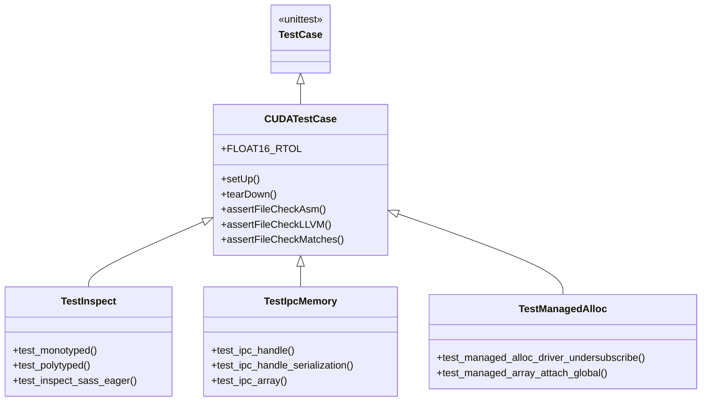
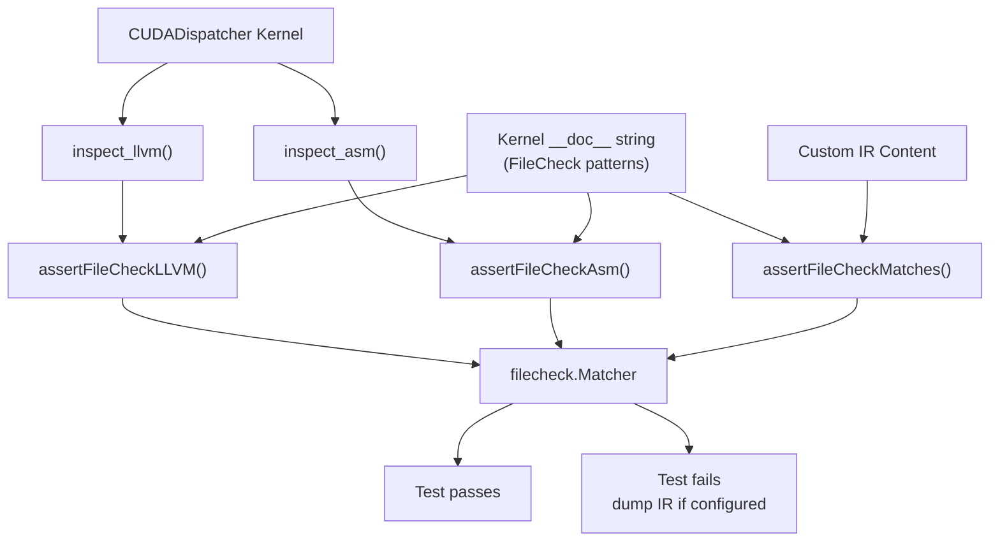
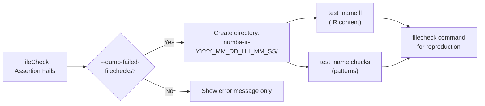
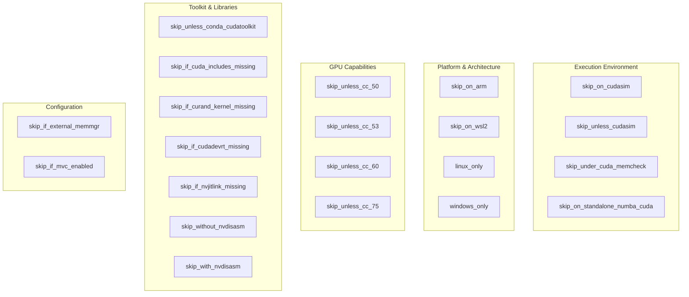
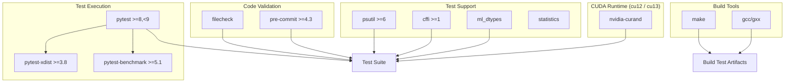
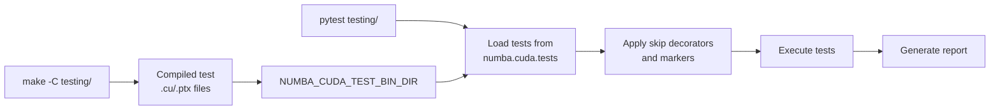
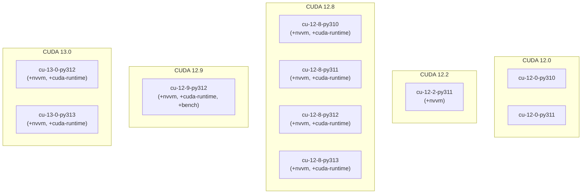
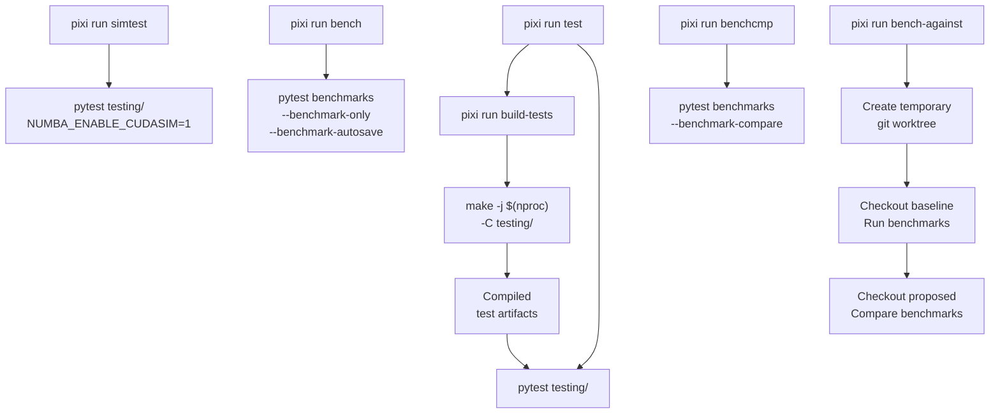
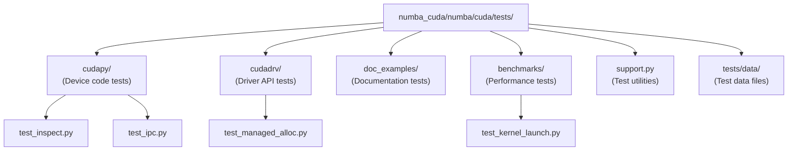

<!-- source: DeepWiki mcp.deepwiki.com · repo NVIDIA/numba-cuda · page 6.1 Testing Framework · fetched 2026-10-26 -->

# Testing Framework

<details>
<summary>Relevant source files</summary>

The following files were used as context for generating this wiki page:

- [conda/recipes/numba-cuda/meta.yaml](conda/recipes/numba-cuda/meta.yaml)
- [numba_cuda/numba/cuda/testing.py](numba_cuda/numba/cuda/testing.py)
- [numba_cuda/numba/cuda/tests/benchmarks/test_kernel_launch.py](numba_cuda/numba/cuda/tests/benchmarks/test_kernel_launch.py)
- [numba_cuda/numba/cuda/tests/cudadrv/test_managed_alloc.py](numba_cuda/numba/cuda/tests/cudadrv/test_managed_alloc.py)
- [numba_cuda/numba/cuda/tests/cudapy/test_inspect.py](numba_cuda/numba/cuda/tests/cudapy/test_inspect.py)
- [numba_cuda/numba/cuda/tests/cudapy/test_ipc.py](numba_cuda/numba/cuda/tests/cudapy/test_ipc.py)
- [pixi.lock](pixi.lock)
- [pixi.toml](pixi.toml)
- [pyproject.toml](pyproject.toml)
- [scripts/bench-against.py](scripts/bench-against.py)
- [testing/pytest.ini](testing/pytest.ini)

</details>


## Purpose and Scope

This document describes the testing infrastructure for numba-cuda, including the base test classes, test decorators, FileCheck integration for validating generated code, and test execution patterns. For information about the CI/CD pipeline that runs these tests, see [CI/CD Pipeline](#6.2).

---

## CUDATestCase Base Class

The `CUDATestCase` class provides the foundation for tests that require a CUDA device. It extends the standard `unittest.TestCase` and adds CUDA-specific functionality.

### Class Definition and Configuration



**Sources:** [numba_cuda/numba/cuda/testing.py:33-186]()

### Setup and Teardown Behavior

The `CUDATestCase.setUp()` method temporarily disables warnings during test execution:
- `CUDA_LOW_OCCUPANCY_WARNINGS` - Suppresses warnings about underutilized GPU resources
- `CUDA_WARN_ON_IMPLICIT_COPY` - Suppresses warnings about host arrays being copied to device

These settings are restored in `tearDown()` to maintain isolation between tests.

**Sources:** [numba_cuda/numba/cuda/testing.py:48-59]()

---

## FileCheck Integration

FileCheck is a pattern matching tool originally from LLVM that validates generated code (LLVM IR, PTX assembly, SASS). The framework provides three assertion methods for different code inspection levels.

### FileCheck Assertion Methods



**Sources:** [numba_cuda/numba/cuda/testing.py:79-185]()

### Method Signatures

| Method | Purpose | IR Source | Pattern Source |
|--------|---------|-----------|----------------|
| `assertFileCheckLLVM(ir_producer, signature, check_prefixes, **opts)` | Validate LLVM IR | `ir_producer.inspect_llvm()` | Kernel docstring |
| `assertFileCheckAsm(ir_producer, signature, check_prefixes, **opts)` | Validate PTX/assembly | `ir_producer.inspect_asm()` | Kernel docstring |
| `assertFileCheckMatches(ir_content, check_patterns, check_prefixes, **opts)` | Validate custom content | Passed as argument | Passed as argument |

**Sources:** [numba_cuda/numba/cuda/testing.py:79-185]()

### FileCheck Pattern Syntax Example

```python
@cuda.jit(sig)
def foo(x, y):
    """
    // LLVM: define void
    // LLVM-SAME: foo
    // LLVM-LABEL: entry:
    // LLVM-NEXT:         br label %"[[VAL_0:.*]]"
    // LLVM-NEXT:       [[VAL_0]]:
    // LLVM-NEXT:         ret void

    // ASM: Generated by NVIDIA NVVM Compiler
    // ASM: foo
    """
    pass

# In test method:
self.assertFileCheckLLVM(foo, sig)
self.assertFileCheckAsm(foo, sig)
```

**Pattern Directives:**
- `CHECK:` - Match this pattern
- `CHECK-SAME:` - Match on same line as previous CHECK
- `CHECK-NEXT:` - Match on immediately following line
- `CHECK-LABEL:` - Define a label for scoped matching
- `[[VAR:.*]]` - Capture pattern into variable
- `[[VAR]]` - Use captured variable

**Sources:** [numba_cuda/numba/cuda/tests/cudapy/test_inspect.py:29-90]()

### Debug Artifacts for Failed FileCheck Tests

When a FileCheck assertion fails and `--dump-failed-filechecks` is passed, the framework writes debugging artifacts:



**Sources:** [numba_cuda/numba/cuda/testing.py:161-185]()

---

## Test Decorators and Skip Functions

The testing framework provides numerous decorators to conditionally skip tests based on environment, hardware capabilities, or configuration.

### Skip Decorator Categories



**Sources:** [numba_cuda/numba/cuda/testing.py:188-336]()

### Complete Decorator Reference

| Decorator | Purpose | Implementation |
|-----------|---------|----------------|
| `skip_on_cudasim(reason)` | Skip when running in simulation mode | Checks `config.ENABLE_CUDASIM` |
| `skip_unless_cudasim(reason)` | Skip when NOT in simulation mode | Inverse of above |
| `skip_on_standalone_numba_cuda` | Skip without base numba install | Checks `HAS_NUMBA` flag |
| `skip_unless_conda_cudatoolkit(reason)` | Require conda-installed CUDA toolkit | Checks `get_conda_ctk_libdir()` |
| `skip_if_external_memmgr(reason)` | Skip if EMM plugin is active | Checks `config.CUDA_MEMORY_MANAGER` |
| `skip_under_cuda_memcheck(reason)` | Skip when running under cuda-memcheck | Checks `CUDA_MEMCHECK` env var |
| `skip_without_nvdisasm(reason)` | Require nvdisasm tool | Uses `shutil.which("nvdisasm")` |
| `skip_with_nvdisasm(reason)` | Skip when nvdisasm is present | Inverse of above |
| `skip_on_arm(reason)` | Skip on ARM architecture | Checks `platform.processor()` |
| `skip_on_wsl2(reason)` | Skip on Windows Subsystem for Linux 2 | Checks kernel release string |
| `skip_if_cuda_includes_missing(fn)` | Require CUDA include files | Checks for `cuda.h` |
| `skip_if_curand_kernel_missing(fn)` | Require curand_kernel.h | Checks for `curand_kernel.h` |
| `skip_if_mvc_enabled(reason)` | Skip if Minor Version Compatibility on | Checks `CUDA_ENABLE_MINOR_VERSION_COMPATIBILITY` |
| `skip_unless_cc_XX(fn)` | Require compute capability >= X.X | Queries `device.compute_capability` |
| `skip_if_cudadevrt_missing(fn)` | Require cudadevrt static library | Calls `libs.get_cudalib("cudadevrt")` |
| `skip_if_nvjitlink_missing(reason)` | Require nvjitlink for LTO | Checks `driver._have_nvjitlink()` |
| `xfail_unless_cudasim(fn)` | Expect failure unless in simulator | Marks test with `expectedFailure` |

**Sources:** [numba_cuda/numba/cuda/testing.py:188-336]()

### Usage Example

```python
@skip_on_cudasim("IPC not available in simulator")
@skip_on_arm("CUDA IPC not supported on ARM")
@skip_on_wsl2("CUDA IPC unreliable on WSL2")
class TestIpcMemory(CUDATestCase):
    def test_ipc_handle(self):
        # Test implementation
        pass
```

**Sources:** [numba_cuda/numba/cuda/tests/cudapy/test_ipc.py:82-105]()

---

## Test Configuration and Dependencies

### Pytest Configuration

The main pytest configuration is in `testing/pytest.ini`:

| Setting | Value | Purpose |
|---------|-------|---------|
| `minversion` | 8.0 | Minimum pytest version required |
| `consider_namespace_packages` | true | Support namespace packages |
| `addopts` | `--benchmark-disable --pyargs numba.cuda.tests` | Default options |

**Warning Filters:**
- Errors are treated as failures by default (`error`)
- Specific warnings are ignored (low occupancy, implicit copies, LTO performance, etc.)

**Sources:** [testing/pytest.ini:1-28]()

### Test Dependencies



**Sources:** [pyproject.toml:49-68](), [pixi.toml:65-78]()

### Test Dependency Groups

The project defines separate dependency groups for different CUDA versions:

**Common Test Dependencies:**
- pytest, pytest-xdist, pytest-benchmark
- filecheck, pre-commit
- psutil, cffi, ml_dtypes

**CUDA 12 Specific (`test-cu12`):**
- nvidia-curand-cu12

**CUDA 13 Specific (`test-cu13`):**
- nvidia-curand==10.4.*

**Sources:** [pyproject.toml:49-68]()

---

## Test Execution Patterns

### Running Tests with Pytest



**Basic Commands:**
```bash
# Run all tests
pytest testing/

# Run specific test file
pytest testing/ -k test_ipc

# Run with multiple workers
pytest testing/ -n auto

# Run only benchmarks
pytest testing/ --benchmark-only --benchmark-enable
```

**Sources:** [pixi.toml:194-243]()

### Test Environments

The project defines multiple test environments using pixi for different CUDA and Python version combinations:



**Environment Features:**
- `cu` - Base CUDA toolkit (nvcc, nvrtc, cccl, etc.)
- `nvvm` - CUDA NVVM compiler (available from CUDA 12.2+)
- `cu-rt` - CUDA runtime library (available from CUDA 12.8+)
- `test` - Test dependencies
- `bench` - Benchmark dependencies (pytorch, cupy)

**Sources:** [pixi.toml:101-192]()

### Pixi Task System



**Available Tasks (Linux):**
- `build-tests` - Compile test artifacts (`.cu`, `.ptx` files)
- `clean-tests` - Clean compiled test artifacts
- `test` - Run full test suite with GPU
- `simtest` - Run tests in simulator mode
- `bench` - Run benchmarks and save results
- `benchcmp` - Compare benchmark results
- `bench-against` - Compare benchmarks between two git commits

**Sources:** [pixi.toml:194-243](), [scripts/bench-against.py:1-91]()

---

## Test Organization and Conventions

### Test Directory Structure



**Test Categories:**
- `cudapy/` - Tests for device functions, kernels, and high-level APIs
- `cudadrv/` - Tests for CUDA driver interface and low-level APIs
- `doc_examples/` - Tests that validate documentation examples
- `benchmarks/` - Performance benchmarks using pytest-benchmark

**Sources:** [numba_cuda/numba/cuda/testing.py:29-30]()

### Helper Classes and Utilities

**ForeignArray Class:**

A utility class for testing the CUDA Array Interface with arrays from other libraries:

```python
class ForeignArray(object):
    """
    Emulates an array from another library through CUDA Array Interface.
    Wraps a DeviceNDArray to hide its type.
    """
    def __init__(self, arr):
        self._arr = arr
        self.__cuda_array_interface__ = arr.__cuda_array_interface__
```

Used to test that numba-cuda correctly handles arrays from PyTorch, CuPy, etc.

**Sources:** [numba_cuda/numba/cuda/testing.py:338-348]()

### Test Naming Conventions

**Class Names:**
- `Test<Feature>` - Standard test class (e.g., `TestInspect`, `TestIpcMemory`)
- `<Feature>TestCase` - Base class for related tests (e.g., `CUDAIpcTestCase`)

**Method Names:**
- `test_<feature>_<scenario>` - Standard test method
- `check_<feature>` - Helper method called by multiple tests
- `setUp` / `tearDown` - Test fixture methods
- `setUpClass` / `tearDownClass` - Class-level fixtures

**Sources:** [numba_cuda/numba/cuda/tests/cudapy/test_ipc.py:67-248](), [numba_cuda/numba/cuda/tests/cudapy/test_inspect.py:24-255]()

### Benchmark Test Patterns

Benchmarks use `pytest.mark.parametrize` for testing multiple configurations:

```python
@pytest.mark.parametrize("array_func", [
    param(lambda: cuda.device_array(...), id="device_array"),
    param(lambda: torch.empty(...), id="torch"),
    param(lambda: cupy.empty(...), id="cupy"),
])
def test_one_arg(benchmark, array_func):
    @cuda.jit("void(float32[:])")
    def one_arg(arr1):
        return
    
    def bench(func, arr):
        for _ in range(100):
            func(arr)
    
    benchmark(bench, one_arg[128, 128], array_func())
```

**Benchmark Conventions:**
- Use `pytest.mark.skipif` to skip in simulator mode
- Test with arrays from multiple libraries (numba, torch, cupy)
- Run operations in tight loops for accurate timing
- Use descriptive parameter IDs

**Sources:** [numba_cuda/numba/cuda/tests/benchmarks/test_kernel_launch.py:1-120]()

---

## Summary

The numba-cuda testing framework provides:

1. **CUDATestCase** - Base class with CUDA-specific test utilities
2. **FileCheck Integration** - Validate generated LLVM IR, PTX, and SASS
3. **Extensive Skip Decorators** - Conditional test execution based on environment
4. **Pytest Configuration** - Centralized test configuration and warning filters
5. **Multiple Test Environments** - Support for CUDA 12.0-13.0 and Python 3.10-3.13
6. **Pixi Task System** - Convenient commands for building and running tests
7. **Benchmark Support** - Performance testing with pytest-benchmark
8. **Test Organization** - Clear directory structure and naming conventions

**Key Files:**
- [numba_cuda/numba/cuda/testing.py:1-348]() - Main testing framework
- [testing/pytest.ini:1-28]() - Pytest configuration
- [pyproject.toml:49-68]() - Test dependencies
- [pixi.toml:65-243]() - Test environments and tasks

---

