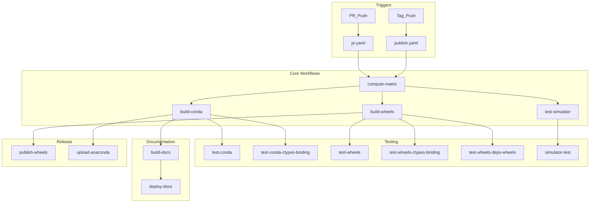
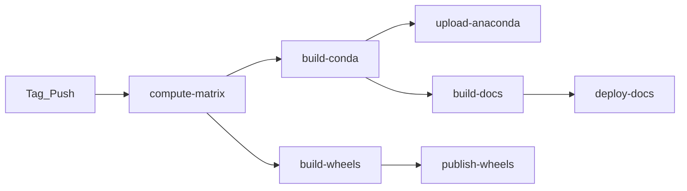
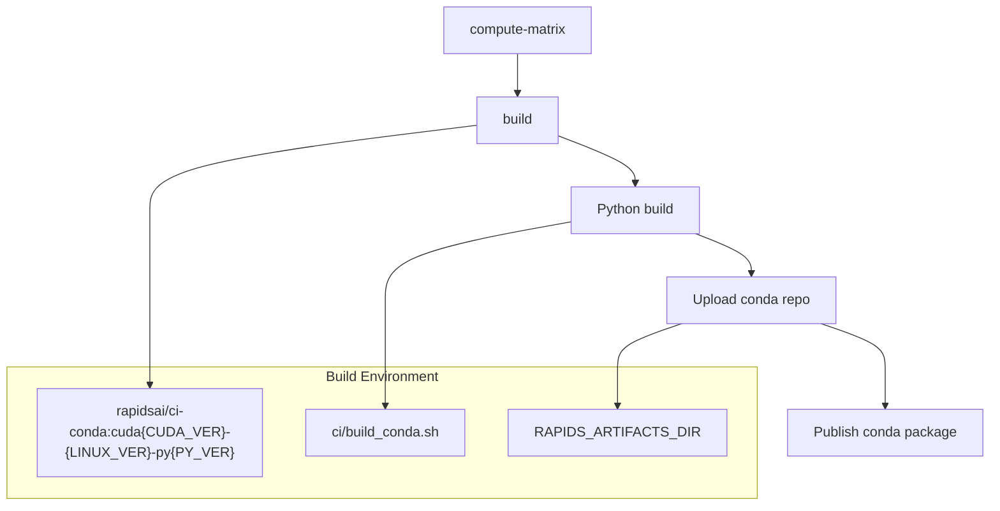
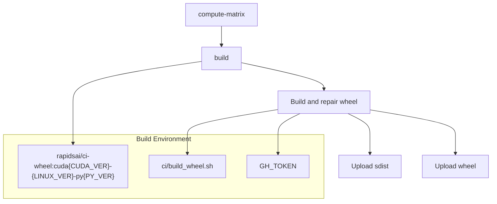
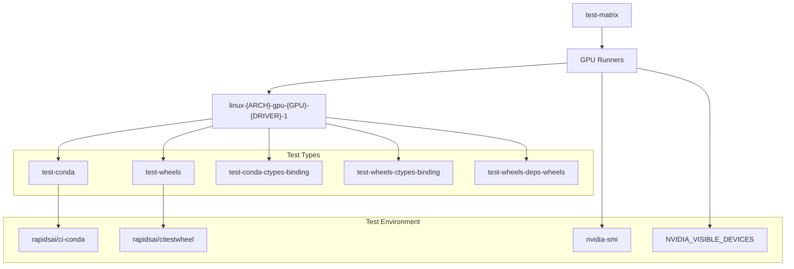
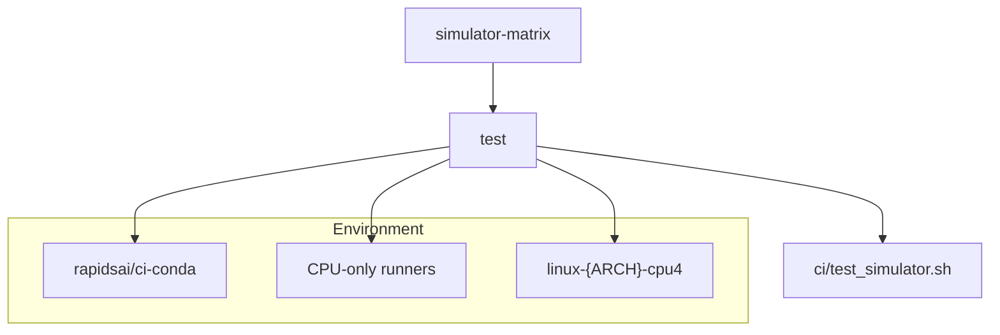
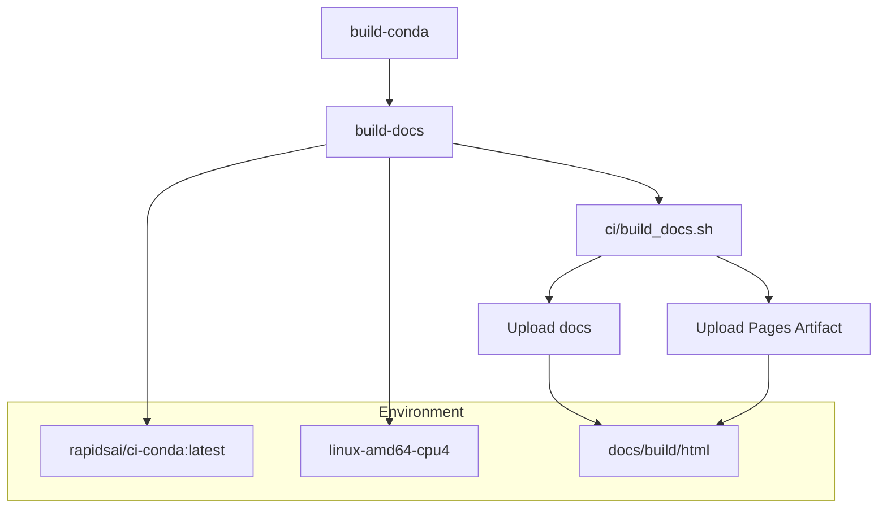
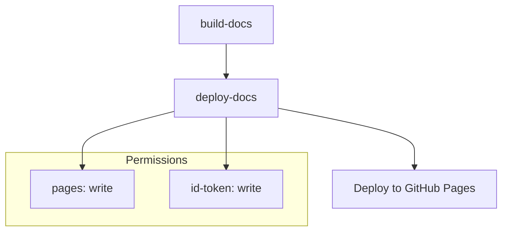
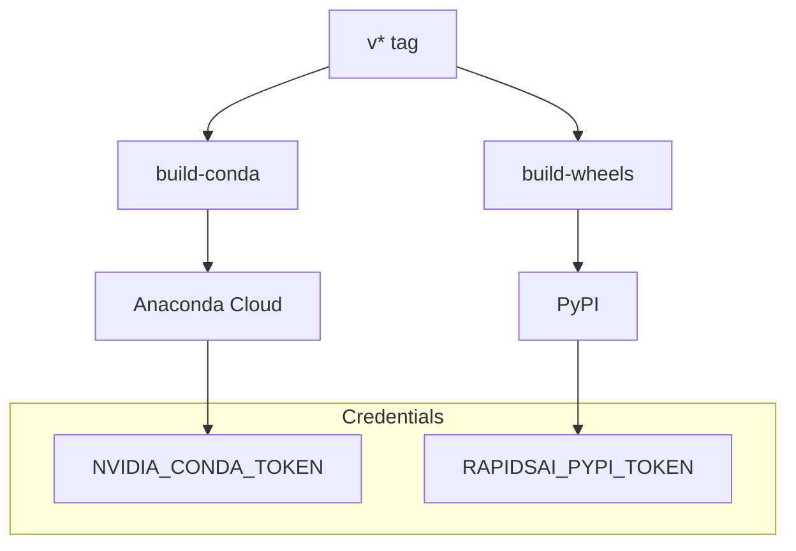

<!-- source: DeepWiki mcp.deepwiki.com · repo NVIDIA/numba-cuda · page 6.2 CI/CD Pipeline · fetched 2026-10-26 -->

# CI/CD Pipeline

<details>
<summary>Relevant source files</summary>

The following files were used as context for generating this wiki page:

- [.github/workflows/conda-python-build.yaml](.github/workflows/conda-python-build.yaml)
- [.github/workflows/conda-python-tests.yaml](.github/workflows/conda-python-tests.yaml)
- [.github/workflows/docs-build.yaml](.github/workflows/docs-build.yaml)
- [.github/workflows/pr.yaml](.github/workflows/pr.yaml)
- [.github/workflows/publish.yaml](.github/workflows/publish.yaml)
- [.github/workflows/simulator-test.yaml](.github/workflows/simulator-test.yaml)
- [.github/workflows/wheels-build.yaml](.github/workflows/wheels-build.yaml)
- [.github/workflows/wheels-test.yaml](.github/workflows/wheels-test.yaml)
- [README.md](README.md)
- [ci/build_conda.sh](ci/build_conda.sh)
- [ci/build_wheel.sh](ci/build_wheel.sh)
- [ci/matrix.yml](ci/matrix.yml)
- [ci/test_conda.sh](ci/test_conda.sh)
- [ci/test_wheel.sh](ci/test_wheel.sh)
- [ci/test_wheel_deps_wheels.sh](ci/test_wheel_deps_wheels.sh)
- [numba_cuda/VERSION](numba_cuda/VERSION)
- [numba_cuda/numba/cuda/tests/cudadrv/test_cuda_array_slicing.py](numba_cuda/numba/cuda/tests/cudadrv/test_cuda_array_slicing.py)
- [testing/Makefile](testing/Makefile)

</details>


## Purpose and Scope

This document describes the continuous integration and continuous deployment (CI/CD) infrastructure for the numba-cuda project. It covers the GitHub Actions workflows, build matrices, testing strategies, and release processes. For information about the testing framework and utilities used within the CI/CD pipeline, see [Testing Framework](#6.1).

## Overview

The numba-cuda CI/CD pipeline is built around GitHub Actions and provides comprehensive automation for code validation, package building, testing, and deployment. The pipeline supports multiple Python versions, CUDA versions, and architectures, with both conda and wheel packaging strategies.

### Pipeline Architecture



Sources: [.github/workflows/pr.yaml:1-144](), [.github/workflows/publish.yaml:1-90]()

## Workflow Types

### Pull Request Workflow

The pull request workflow (`pr.yaml`) triggers on pushes to `pull-request/[0-9]+` branches and orchestrates comprehensive testing across multiple environments.

| Job | Purpose | Dependencies |
|-----|---------|--------------|
| `checks` | Code quality and style validation | None |
| `compute-matrix` | Generate build/test matrices | None |
| `build-conda` | Build conda packages | `compute-matrix` |
| `build-wheels` | Build wheel packages | `compute-matrix` |
| `test-conda` | Test conda packages | `build-conda` |
| `test-wheels` | Test wheel packages | `build-wheels` |
| `test-simulator` | Test on CUDA simulator | `build-conda` |
| `build-docs` | Build documentation | `build-conda` |

Sources: [.github/workflows/pr.yaml:15-30](), [.github/workflows/pr.yaml:31-144]()

### Release Workflow

The release workflow (`publish.yaml`) triggers on version tags (`v*`) and handles package publishing and documentation deployment.



Sources: [.github/workflows/publish.yaml:6-10](), [.github/workflows/publish.yaml:16-90]()

## Build Matrices

The build matrices are defined in `ci/matrix.yml` and specify the combinations of Python versions, CUDA versions, architectures, and Linux distributions for building and testing.

### Matrix Structure

```yaml
# Build matrix - minimal set for building packages
build-matrix:
  - { ARCH: 'amd64', PY_VER: '3.13', CUDA_VER: '12.8.0', LINUX_VER: 'rockylinux8' }

# Test matrix - comprehensive set for testing
test-matrix:
  - { CUDA_VER: '11.8.0', ARCH: 'amd64', PY_VER: '3.9', LINUX_VER: 'rockylinux8', GPU: 'l4', DRIVER: 'earliest' }
  - { CUDA_VER: '12.8.0', ARCH: 'amd64', PY_VER: '3.13', LINUX_VER: 'ubuntu24.04', GPU: 'l4', DRIVER: 'latest' }
  # ... additional combinations
```

The matrix includes:
- **CUDA versions**: 11.8.0, 12.0.1, 12.2.2, 12.8.0
- **Python versions**: 3.9, 3.10, 3.11, 3.12, 3.13
- **Architectures**: amd64, arm64
- **GPU types**: l4, a100
- **Driver versions**: earliest, latest

Sources: [ci/matrix.yml:1-16]()

### Matrix Filtering

The workflows use jq filters to select specific matrix combinations for different test scenarios:

```bash
# ctypes binding tests - CUDA 12+ only
matrix_filter: map(select(.ARCH == "amd64" and (.CUDA_VER | split(".") | .[0] | tonumber >= 12)))
```

Sources: [.github/workflows/pr.yaml:88-90](), [.github/workflows/pr.yaml:125-127]()

## Package Building

### Conda Package Building

The conda build workflow (`conda-python-build.yaml`) creates conda packages using the `rapidsai/ci-conda` containers.



Key environment variables:
- `RAPIDS_BUILD_TYPE`: pull-request, branch, or release
- `RAPIDS_ARTIFACTS_DIR`: artifact storage location
- `CUDA_VER`, `PY_VER`, `LINUX_VER`: matrix values

Sources: [.github/workflows/conda-python-build.yaml:69-111]()

### Wheel Package Building

The wheel build workflow (`wheels-build.yaml`) creates Python wheels using the `rapidsai/ci-wheel` containers.



The workflow supports:
- Source distribution (sdist) generation
- Wheel building with CUDA toolkit linking
- Artifact uploading for downstream jobs

Sources: [.github/workflows/wheels-build.yaml:90-160]()

## Testing Strategy

### Hardware Testing

Hardware testing runs on GPU-enabled runners with actual CUDA devices:



Sources: [.github/workflows/conda-python-tests.yaml:78-84](), [.github/workflows/wheels-test.yaml:96-102]()

### Simulator Testing

The simulator testing workflow (`simulator-test.yaml`) tests numba-cuda functionality without requiring physical GPU hardware:



Sources: [.github/workflows/simulator-test.yaml:66-109]()

### Test Reporting

All test workflows include comprehensive reporting:

- **JUnit XML**: Test results in `RAPIDS_TESTS_DIR`
- **Coverage**: Codecov integration with `codecovcli`
- **Artifacts**: Test artifacts uploaded with `rapids-upload-artifacts-dir`
- **Test Summary**: GitHub Actions test summary integration

Sources: [.github/workflows/conda-python-tests.yaml:113-131](), [.github/workflows/wheels-test.yaml:130-138]()

## Documentation Pipeline

### Documentation Building

Documentation builds use the `build-docs` workflow:



Sources: [.github/workflows/docs-build.yaml:41-85]()

### Documentation Deployment

For release builds, documentation is deployed to GitHub Pages:



Sources: [.github/workflows/publish.yaml:75-89]()

## Release Process

### Version Management

Releases are triggered by pushing version tags matching the pattern `v*`. The version is stored in `numba_cuda/VERSION`.

### Package Publishing

The release workflow publishes packages to multiple channels:



**Conda Publishing**: Uses `ci/upload_conda.sh` with `NVIDIA_CONDA_TOKEN`
**PyPI Publishing**: Uses `pypa/gh-action-pypi-publish` with `RAPIDSAI_PYPI_TOKEN`

Sources: [.github/workflows/publish.yaml:40-68](), [.github/workflows/conda-python-build.yaml:106-111]()

### Concurrency Control

All workflows implement concurrency control to prevent resource conflicts:

```yaml
concurrency:
  group: ${{ github.workflow }}-${{ github.ref }}-${{ github.event_name }}
  cancel-in-progress: true
```

This ensures that concurrent runs of the same workflow on the same ref are cancelled in favor of the latest run.

Sources: [.github/workflows/pr.yaml:11-13](), [.github/workflows/publish.yaml:11-13]()

---

