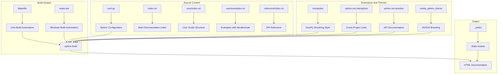
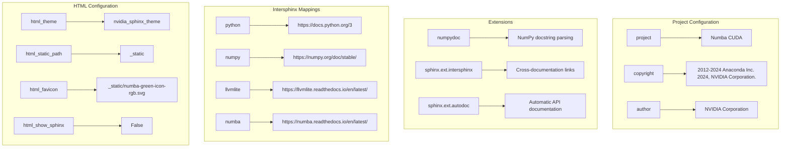
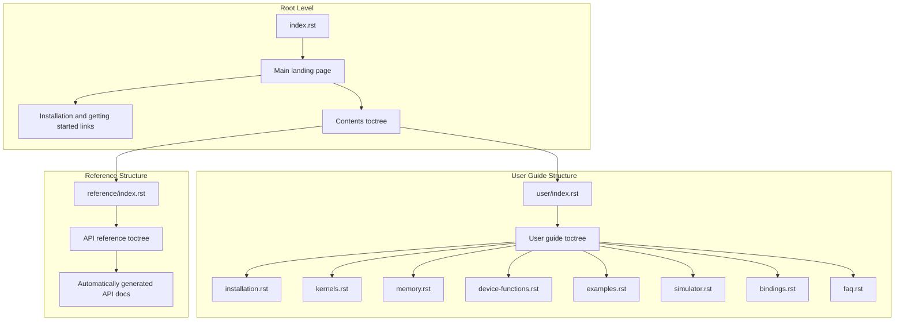
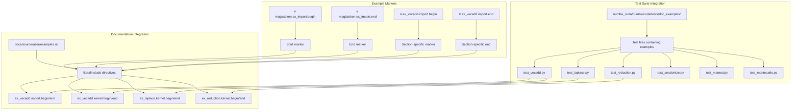
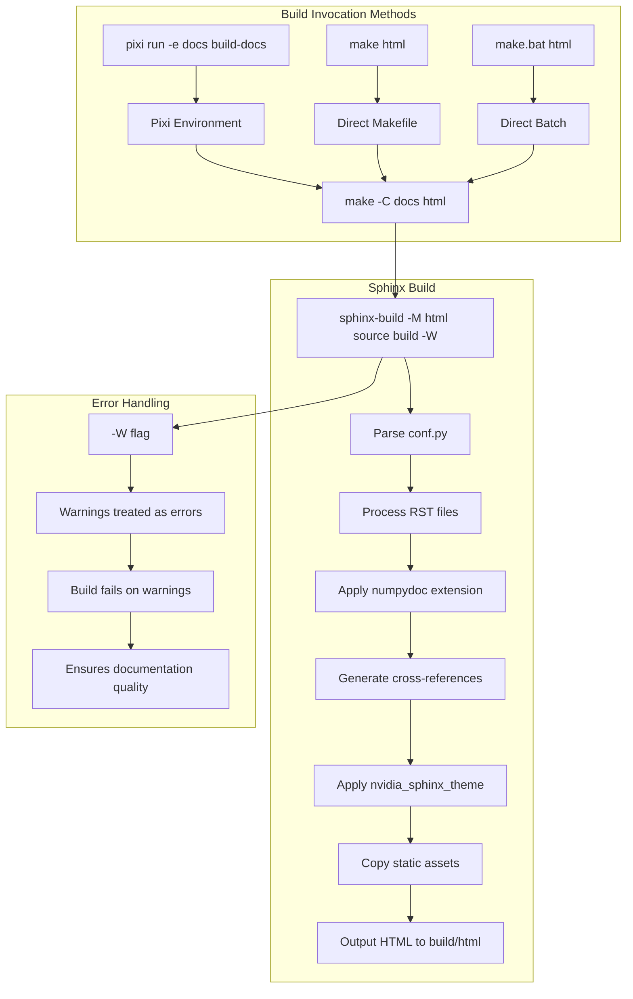

<!-- source: DeepWiki mcp.deepwiki.com · repo NVIDIA/numba-cuda · page 7 Documentation System · fetched 2026-10-26 -->

# Documentation System

<details>
<summary>Relevant source files</summary>

The following files were used as context for generating this wiki page:

- [ci/build_docs.sh](ci/build_docs.sh)
- [ci/test_simulator.sh](ci/test_simulator.sh)
- [conda/recipes/numba-cuda/meta.yaml](conda/recipes/numba-cuda/meta.yaml)
- [numba_cuda/numba/cuda/tests/benchmarks/test_kernel_launch.py](numba_cuda/numba/cuda/tests/benchmarks/test_kernel_launch.py)
- [pixi.lock](pixi.lock)
- [pixi.toml](pixi.toml)
- [pyproject.toml](pyproject.toml)
- [scripts/bench-against.py](scripts/bench-against.py)
- [testing/pytest.ini](testing/pytest.ini)

</details>


This document describes the documentation system for the numba-cuda project, which is built using Sphinx and provides comprehensive user guides, API references, and examples. The system automatically generates documentation from source code and maintains synchronized examples through direct integration with the test suite.

For information about the overall development workflow, see [Development and Testing](#6). For details about the CI/CD pipeline that builds and publishes documentation, see [CI/CD Pipeline](#6.2).

## Architecture Overview

The documentation system is structured as a Sphinx-based static site generator with several key components:



Sources: [docs/source/conf.py:1-40](), [docs/source/index.rst:1-27](), [docs/source/user/index.rst:1-32](), [docs/Makefile:1-21](), [docs/make.bat:1-40]()

## Configuration System

The documentation system is configured through `conf.py`, which defines the core Sphinx settings and extensions:



Sources: [docs/source/conf.py:9-11](), [docs/source/conf.py:16-16](), [docs/source/conf.py:21-26](), [docs/source/conf.py:36-39]()

### Key Configuration Options

| Setting | Value | Purpose |
|---------|-------|---------|
| `project` | `"Numba CUDA"` | Project name displayed in docs |
| `copyright` | `"2012-2024 Anaconda Inc. 2024, NVIDIA Corporation."` | Copyright notice |
| `author` | `"NVIDIA Corporation"` | Primary author |
| `numpydoc_show_class_members` | `False` | Prevents autosummary warnings |
| `autodoc_typehints` | `"none"` | Disables type hint display |
| `templates_path` | `["_templates"]` | Custom template location |
| `exclude_patterns` | `[]` | Files to exclude from build |
| `html_theme` | `"nvidia_sphinx_theme"` | NVIDIA corporate theme |
| `html_show_sphinx` | `False` | Hides Sphinx branding |

Sources: [docs/source/conf.py:9-11](), [docs/source/conf.py:18-19](), [docs/source/conf.py:29-31](), [docs/source/conf.py:36-39]()

## Content Organization

The documentation follows a hierarchical structure with clear separation between user-facing and reference content:



Sources: [docs/source/index.rst:22-27](), [docs/source/user/index.rst:7-32]()

The main documentation entry point provides direct links to key user actions:

- Installation guide: `:ref:`numba-cuda-installation``
- Kernel writing tutorial: `:ref:`writing-cuda-kernels``
- Examples collection: `:ref:`numba-cuda-examples``

Sources: [docs/source/index.rst:14-17]()

## Example System

The documentation employs a sophisticated example system that maintains synchronization between documentation and working code through the `literalinclude` directive:



Sources: [docs/source/user/examples.rst:16-20](), [docs/source/user/examples.rst:34-40](), [docs/source/user/examples.rst:420-423]()

### Example Structure Pattern

Each example follows a consistent pattern with magic tokens for precise code extraction:

```
.. literalinclude:: ../../../numba_cuda/numba/cuda/tests/doc_examples/test_vecadd.py
   :language: python
   :caption: from ``test_ex_vecadd`` in ``numba/cuda/tests/doc_examples/test_vecadd.py``
   :start-after: ex_vecadd.import.begin
   :end-before: ex_vecadd.import.end
   :dedent: 8
   :linenos:
```

This approach ensures that:
- Examples are always tested and functional
- Documentation stays synchronized with code changes
- Examples can be run as part of the test suite
- Code changes automatically propagate to documentation

Sources: [docs/source/user/examples.rst:16-23]()

## Build System

The documentation build system supports multiple build methods: direct Makefile/batch script invocation and pixi-based environment management.

### Pixi Environment Configuration

The `docs` environment provides an isolated build environment with all required dependencies:

| Dependency | Purpose |
|------------|---------|
| `sphinx` | Documentation generation framework |
| `sphinx-rtd-theme` | ReadTheDocs theme for styling |
| `numpydoc` | NumPy-style docstring parsing |
| `nvidia-sphinx-theme` | NVIDIA corporate branding |
| `psutil` | System information utilities |
| `make` | Build automation |

Sources: [pixi.toml:91-99]()

### Build Methods

#### Method 1: Pixi Build (Recommended)

```bash
pixi run -e docs build-docs
```

This invokes the `build-docs` task which executes `make -C $PIXI_PROJECT_ROOT/docs html` in the docs environment.

Sources: [pixi.toml:234-235]()

#### Method 2: Direct Makefile (Unix)

The Makefile provides traditional build automation:

| Variable | Default Value | Purpose |
|----------|---------------|---------|
| `SPHINXOPTS` | `-W` | Treats warnings as errors |
| `SPHINXBUILD` | `sphinx-build` | Sphinx build command |
| `SOURCEDIR` | `source` | Source directory location |
| `BUILDDIR` | `build` | Build output directory |

```bash
make -C docs html
```

Sources: [docs/Makefile:6-9]()

#### Method 3: Direct Batch Script (Windows)

The Windows batch file provides equivalent functionality with the same default options:

- `SPHINXOPTS` defaults to `-W` for strict warning handling
- Automatic detection of `sphinx-build` command
- Same source and build directory structure

```cmd
docs\make.bat html
```

Sources: [docs/make.bat:28-30]()

### Build Process Flow



Sources: [pixi.toml:234-235](), [docs/Makefile:20](), [docs/make.bat:32]()

## Static Assets

The documentation includes static assets for branding and visual elements:

### Icon System

The primary brand icon is defined as an SVG file with specific styling:

- **File**: `_static/numba-green-icon-rgb.svg`
- **Usage**: Set as `html_favicon` in configuration
- **Format**: SVG with viewBox `0 0 500 500`
- **Colors**: Numba green (`#76B900`) with gradient effects

Sources: [docs/source/conf.py:38-38](), [docs/source/_static/numba-green-icon-rgb.svg:1-28]()

### Asset Configuration

| Asset Type | Path | Configuration |
|------------|------|---------------|
| Static files | `_static/` | `html_static_path` |
| Favicon | `_static/numba-green-icon-rgb.svg` | `html_favicon` |
| Templates | `_templates/` | `templates_path` |

Sources: [docs/source/conf.py:18-18](), [docs/source/conf.py:37-38]()

The documentation system provides a robust, maintainable foundation for the numba-cuda project's documentation needs, with automated synchronization between code examples and documentation content, comprehensive cross-referencing, and professional presentation through the NVIDIA theme.