# Page: Overview

# Overview

<details>
<summary>Relevant source files</summary>

The following files were used as context for generating this wiki page:

- [conda/recipes/numba-cuda/meta.yaml](conda/recipes/numba-cuda/meta.yaml)
- [numba_cuda/numba/cuda/compiler.py](numba_cuda/numba/cuda/compiler.py)
- [numba_cuda/numba/cuda/cudadrv/mappings.py](numba_cuda/numba/cuda/cudadrv/mappings.py)
- [numba_cuda/numba/cuda/decorators.py](numba_cuda/numba/cuda/decorators.py)
- [numba_cuda/numba/cuda/dispatcher.py](numba_cuda/numba/cuda/dispatcher.py)
- [numba_cuda/numba/cuda/tests/benchmarks/test_kernel_launch.py](numba_cuda/numba/cuda/tests/benchmarks/test_kernel_launch.py)
- [numba_cuda/numba/cuda/tests/cudadrv/test_linker.py](numba_cuda/numba/cuda/tests/cudadrv/test_linker.py)
- [numba_cuda/numba/cuda/tests/cudadrv/test_module_callbacks.py](numba_cuda/numba/cuda/tests/cudadrv/test_module_callbacks.py)
- [numba_cuda/numba/cuda/tests/cudadrv/test_nvjitlink.py](numba_cuda/numba/cuda/tests/cudadrv/test_nvjitlink.py)
- [numba_cuda/numba/cuda/tests/cudapy/test_debug.py](numba_cuda/numba/cuda/tests/cudapy/test_debug.py)
- [numba_cuda/numba/cuda/tests/cudapy/test_errors.py](numba_cuda/numba/cuda/tests/cudapy/test_errors.py)
- [numba_cuda/numba/cuda/tests/cudapy/test_inline.py](numba_cuda/numba/cuda/tests/cudapy/test_inline.py)
- [pixi.lock](pixi.lock)
- [pixi.toml](pixi.toml)
- [pyproject.toml](pyproject.toml)
- [scripts/bench-against.py](scripts/bench-against.py)
- [testing/pytest.ini](testing/pytest.ini)

</details>


This document provides an overview of the numba-cuda repository, which implements a CUDA target for Numba's JIT compiler. The system enables Python developers to write GPU kernels using a restricted subset of Python syntax and execute them on NVIDIA CUDA devices.

For information about specific installation procedures and configuration options, see [Installation and Configuration](#1.1). For details about the core compilation pipeline, see [JIT Compilation Pipeline](#2.1). For CUDA driver interaction specifics, see [CUDA Driver Interface](#2.2).

## Purpose and Scope

Numba-CUDA is a JIT compiler that transforms Python functions into executable CUDA GPU code. The system provides:

- **JIT Compilation**: Compiles Python functions decorated with `@cuda.jit` into CUDA kernels via LLVM and NVVM
- **Type Inference**: Automatically infers types from Python code to generate typed intermediate representations
- **Code Generation**: Produces PTX or LTO-IR that is linked and loaded onto CUDA devices
- **Memory Management**: Provides `DeviceNDArray` and configurable memory allocators including NRT (Numba Runtime)
- **Device Management**: Interfaces with CUDA Driver API for context, device, and stream management
- **Debugging Support**: Generates debug information and provides kernel inspection methods

The package requires Python ≥3.9, Numba ≥0.60.0, and supports CUDA Toolkit versions 12.x and 13.x through `cuda-bindings` and `cuda-python` packages.

Sources: [pyproject.toml:23-24](), [numba_cuda/numba/cuda/dispatcher.py:78-228](), [numba_cuda/numba/cuda/decorators.py:21-96]()

## High-Level Architecture

Numba-CUDA implements a four-layer architecture that transforms Python code into executable GPU kernels:

### Compilation Flow: Python to GPU Executable

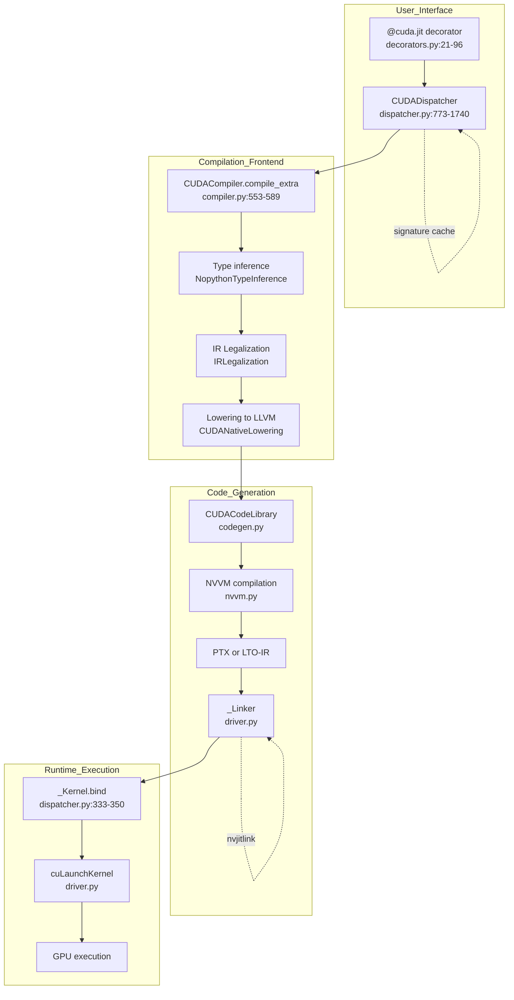

The dispatcher maintains a cache of compiled kernels indexed by argument type signatures. Each compilation produces a `_Kernel` instance that encapsulates the compiled code and launch configuration.

Sources: [numba_cuda/numba/cuda/dispatcher.py:773-1051](), [numba_cuda/numba/cuda/compiler.py:505-759](), [numba_cuda/numba/cuda/decorators.py:21-265]()

### Core Compilation Classes

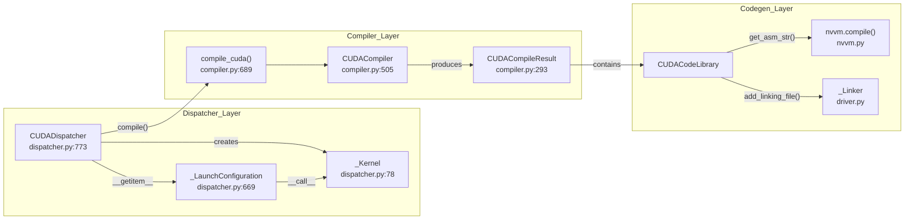

The `CUDADispatcher` serves as the primary user-facing interface, managing compilation and kernel invocation. It creates `_Kernel` instances for each unique type signature and coordinates with `CUDACompiler` for code generation.

Sources: [numba_cuda/numba/cuda/dispatcher.py:773-1051](), [numba_cuda/numba/cuda/compiler.py:505-759]()

## Core Subsystems

### JIT Compilation Pipeline

The compilation pipeline consists of multiple compiler passes organized in `DefaultPassBuilder`:

| Pass Stage | Implementation | Purpose |
|------------|---------------|---------|
| **Bytecode Translation** | `CUDATranslateBytecode` | Converts Python bytecode to Numba IR |
| **Type Inference** | `NopythonTypeInference` | Infers types for all IR variables |
| **IR Optimization** | `InlineOverloads`, `NopythonRewrites` | Optimizes typed IR |
| **IR Legalization** | `IRLegalization` | Ensures IR is valid for lowering |
| **Lowering** | `CUDANativeLowering` | Generates LLVM IR |
| **Backend** | `CUDABackend` | Packages result as `CUDACompileResult` |

The pipeline is defined in [numba_cuda/numba/cuda/compiler.py:505-550]() and executed by `CUDACompiler.compile_extra()`.

Sources: [numba_cuda/numba/cuda/compiler.py:120-254](), [numba_cuda/numba/cuda/compiler.py:505-550]()

### Kernel Launch and Configuration

Kernel launches use Python's `__getitem__` syntax for configuration:

```python
# Example from test files
kernel[griddim, blockdim](args)
kernel[griddim, blockdim, stream, sharedmem](args)
```

The `CUDADispatcher.__getitem__()` method creates a `_LaunchConfiguration` object that validates grid and block dimensions, then invokes `_Kernel.launch()` to prepare arguments and call the CUDA driver.

Sources: [numba_cuda/numba/cuda/dispatcher.py:1307-1344](), [numba_cuda/numba/cuda/dispatcher.py:460-530]()

### Memory Management

The memory subsystem provides several allocation strategies:

- **`DeviceNDArray`**: GPU arrays with NumPy-like interface for device memory
- **`ManagedNDArray`**: Unified memory accessible from both CPU and GPU
- **NRT System**: Reference-counted memory management when `enable_nrt=True`
- **External Memory Managers**: Pluggable EMM architecture for custom allocators

Sources: [numba_cuda/numba/cuda/dispatcher.py:532-618]()

### Driver Interface and Context Management

The driver layer provides:

- **`Driver` class**: Singleton interface to CUDA driver API
- **`Device` class**: Represents individual GPU devices with properties
- **`Context` class**: Manages CUDA context lifecycle and memory
- **`_Linker` class**: Links PTX, cubin, CUDA C++ and other object files

The system automatically selects between `cuda-python` bindings (default) or legacy ctypes bindings based on configuration.

Sources: [numba_cuda/numba/cuda/dispatcher.py:1-54]()

### Configuration System

Key configuration options control compilation and runtime behavior:

| Configuration Option | Default | Purpose |
|---------------------|---------|---------|
| `debug` | `False` | Enables exception checking in kernels (degrades performance) |
| `opt` | `True` | Enables NVVM optimizations (level 3) |
| `lineinfo` | `False` | Generates line mapping for profiling tools |
| `fastmath` | `False` | Enables fast math optimizations |
| `max_registers` | `None` | Limits register usage per thread |
| `lto` | auto | Enables Link-Time Optimization via nvjitlink |
| `cache` | `False` | Enables file-based caching of compiled kernels |

LTO is automatically enabled when `nvjitlink` is available (requires CUDA ≥12.3) unless `debug=True`. The `lto` option generates LTO-IR that can be optimized across compilation units during linking.

Sources: [numba_cuda/numba/cuda/decorators.py:21-158](), [numba_cuda/numba/cuda/dispatcher.py:100-163]()

## Code Generation and Linking

### NVVM Compilation

The `CUDACodeLibrary` class manages code generation:

1. **LLVM IR Generation**: The lowering pass produces LLVM IR with NVVM intrinsics
2. **NVVM Compilation**: Converts LLVM IR to PTX or LTO-IR via `libNVVM`
3. **Assembly Options**: Controlled by `nvvm_options` dict (e.g., `{"opt": 3, "fastmath": True}`)

When `lto=True`, the library generates LTO-IR that is optimized during linking rather than at compile time.

Sources: [numba_cuda/numba/cuda/compiler.py:144-163]()

### Linking External Code

The `_Linker` class supports linking various file types:

| File Extension | Input Type | Notes |
|----------------|-----------|-------|
| `.ptx` | PTX assembly | Intermediate text representation |
| `.cu` | CUDA C++ | Compiled via NVRTC at link time |
| `.cubin` | Cubin binary | Architecture-specific binary |
| `.a`, `.lib` | Static library | Archive of object files |
| `.ltoir` | LTO-IR | Link-Time Optimization IR |
| `.fatbin` | Fat binary | Multi-architecture binary |

External code is linked using `cuda.jit(link=[files])` or `cuda.declare_device(sig, link=[files])`. The `LinkableCode` class can attach setup/teardown callbacks for module initialization.

Sources: [numba_cuda/numba/cuda/cudadrv/mappings.py:6-14](), [numba_cuda/numba/cuda/tests/cudadrv/test_nvjitlink.py:79-100](), [numba_cuda/numba/cuda/tests/cudadrv/test_module_callbacks.py:40-68]()

## Package Structure and Dependencies

### Runtime Dependencies

Core dependencies from [pyproject.toml:24]():

| Package | Version Constraint | Purpose |
|---------|-------------------|---------|
| `numba` | `>=0.60.0` | Base JIT compiler infrastructure |
| `cuda-bindings` | `>=12.9.1, <14.0.0` | Low-level CUDA driver bindings |
| `cuda-core` | `>=0.3.2, <1.0.0` | CUDA core utilities |

### Optional Dependencies

Optional extras for different CUDA versions:

- **`cu12`**: CUDA 12.x packages including `nvidia-cuda-nvcc-cu12`, `nvidia-nvjitlink-cu12`, `nvidia-cuda-cccl-cu12`
- **`cu13`**: CUDA 13.x packages with `nvidia-nvvm==13.*`, `nvidia-nvjitlink==13.*`

Testing dependencies include `pytest>=8`, `filecheck`, `cffi`, and `ml_dtypes`.

Sources: [pyproject.toml:26-68]()

### Module Organization

```
numba_cuda/
├── numba/cuda/
│   ├── __init__.py          # Main entry point
│   ├── decorators.py        # @cuda.jit decorator
│   ├── dispatcher.py        # CUDADispatcher, _Kernel
│   ├── compiler.py          # CUDACompiler pipeline
│   ├── cudadrv/             # Driver interface layer
│   │   ├── driver.py        # Driver, Device, Context
│   │   ├── devices.py       # Device enumeration
│   │   └── nvvm.py          # NVVM compilation
│   ├── typing/              # Type system
│   ├── lowering/            # LLVM IR lowering
│   └── tests/               # Test suite
└── VERSION                  # Version file
```

Sources: [pyproject.toml:80-84]()

## Development and Testing Infrastructure

The project includes comprehensive CI/CD infrastructure:

### Testing Framework

- **Hardware Testing**: Real GPU device testing
- **Simulation Testing**: CUDA simulator for development
- **Context Management**: Specialized test utilities for CUDA contexts

### Release Pipeline

Automated release process triggered by git tags:
- **Multi-platform Builds**: Conda and wheel package generation
- **Documentation Building**: Sphinx-based documentation
- **Artifact Distribution**: Package upload to PyPI and conda-forge

Sources: [numba_cuda/numba/cuda/tests/cudadrv/test_context_stack.py:1-171](), [CONTRIBUTING.md:38-60]()

---

# Page: Installation and Configuration

# Installation and Configuration

<details>
<summary>Relevant source files</summary>

The following files were used as context for generating this wiki page:

- [.github/workflows/conda-python-build.yaml](.github/workflows/conda-python-build.yaml)
- [.github/workflows/publish.yaml](.github/workflows/publish.yaml)
- [.github/workflows/wheels-build.yaml](.github/workflows/wheels-build.yaml)
- [.github/workflows/wheels-test.yaml](.github/workflows/wheels-test.yaml)
- [README.md](README.md)
- [ci/build_conda.sh](ci/build_conda.sh)
- [ci/build_wheel.sh](ci/build_wheel.sh)
- [ci/test_conda.sh](ci/test_conda.sh)
- [ci/test_wheel.sh](ci/test_wheel.sh)
- [ci/test_wheel_deps_wheels.sh](ci/test_wheel_deps_wheels.sh)
- [conda/recipes/numba-cuda/meta.yaml](conda/recipes/numba-cuda/meta.yaml)
- [numba_cuda/VERSION](numba_cuda/VERSION)
- [numba_cuda/numba/cuda/tests/benchmarks/test_kernel_launch.py](numba_cuda/numba/cuda/tests/benchmarks/test_kernel_launch.py)
- [pixi.lock](pixi.lock)
- [pixi.toml](pixi.toml)
- [pyproject.toml](pyproject.toml)
- [scripts/bench-against.py](scripts/bench-against.py)
- [testing/Makefile](testing/Makefile)
- [testing/pytest.ini](testing/pytest.ini)

</details>


This document covers the installation processes and configuration options for numba-cuda. It explains how to install the package using different methods, configure CUDA bindings, set up environment variables, and understand the toolkit discovery process. For information about minor version compatibility features, see [Minor Version Compatibility](#3.1).

## Installation Methods

### Package Installation Options

Numba-cuda can be installed through multiple package managers with different CUDA toolkit configurations:

| Installation Method | Command | CUDA Version | Dependencies |
|-------------------|---------|-------------|-------------|
| Conda (CUDA 12) | `conda install -c conda-forge numba-cuda "cuda-version>=12.0"` | 12.x | Auto-resolved |
| Pip (CUDA 12) | `pip install numba-cuda[cu12]` | 12.x | From PyPI |
| Conda (CUDA 11) | `conda install -c conda-forge numba-cuda "cuda-version>=11.2,<12.0"` | 11.2+ | Auto-resolved |
| Pip (CUDA 11) | `pip install numba-cuda[cu11]` | 11.x | From PyPI |

The core dependencies are defined in [`pyproject.toml:21`]() with `numba>=0.59.1` as the base requirement. Optional dependencies are specified for different CUDA versions:

- **CUDA 11 extras** ([`pyproject.toml:24-31`]()): Includes `cuda-bindings==11.8.*`, `cuda-python==11.8.*`, and NVIDIA packages
- **CUDA 12 extras** ([`pyproject.toml:32-40`]()): Includes `cuda-bindings==12.9.*`, `cuda-python==12.9.*`, and `nvidia-nvjitlink-cu12`

### Conda Package Configuration

The conda package is configured through [`conda/recipes/numba-cuda/meta.yaml`]() with default dependencies:

```yaml
run:
  - python
  - numba >=0.59.1
  - cuda-bindings
  - cuda-core ==0.3.*
```

Sources: [`pyproject.toml:10-54`](), [`conda/recipes/numba-cuda/meta.yaml:23-33`](), [`docs/source/user/installation.rst:30-53`]()

## CUDA Bindings Configuration

### Binding Selection Process

Numba-cuda supports two types of CUDA driver bindings, controlled by the `NUMBA_CUDA_USE_NVIDIA_BINDING` environment variable:

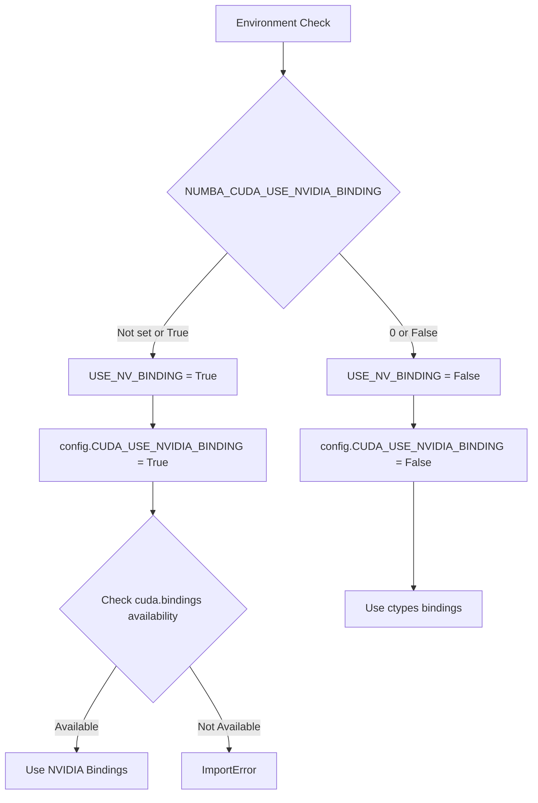

**CUDA Bindings Configuration Flow**

The binding selection is implemented in [`numba_cuda/numba/cuda/__init__.py:30-51`]():

1. **Environment Variable Check**: `_readenv("NUMBA_CUDA_USE_NVIDIA_BINDING", bool, None)`
2. **Default Behavior**: If not explicitly set to `False`, NVIDIA bindings are preferred
3. **Availability Check**: Validates presence of `cuda` and `cuda.bindings` modules
4. **Fallback**: Raises `ImportError` if NVIDIA bindings are requested but unavailable

### Binding Impact on File Extensions

The binding choice affects how file extensions are mapped for linking, as shown in [`numba_cuda/numba/cuda/cudadrv/mappings.py:4-25`]():

```python
if config.CUDA_USE_NVIDIA_BINDING:
    from cuda.bindings.driver import CUjitInputType
    FILE_EXTENSION_MAP = {
        "ptx": CUjitInputType.CU_JIT_INPUT_PTX,
        "cubin": CUjitInputType.CU_JIT_INPUT_CUBIN,
        # ... other mappings
    }
else:
    FILE_EXTENSION_MAP = {
        "ptx": enums.CU_JIT_INPUT_PTX,
        "cubin": enums.CU_JIT_INPUT_CUBIN,
        # ... other mappings
    }
```

Sources: [`numba_cuda/numba/cuda/__init__.py:28-51`](), [`numba_cuda/numba/cuda/cudadrv/mappings.py:1-26`](), [`docs/source/user/installation.rst:60-71`]()

## Environment Variables

### Core Configuration Variables

| Variable | Purpose | Default | Example |
|----------|---------|---------|---------|
| `NUMBA_CUDA_USE_NVIDIA_BINDING` | Select CUDA bindings | `1` | `0` (use ctypes) |
| `NUMBA_CUDA_ENABLE_PYNVJITLINK` | Enable pynvjitlink | Auto-detected | `1` |
| `NUMBA_CUDA_DEFAULT_PTX_CC` | Default compute capability | `"7.5"` | `"8.0"` |
| `NUMBA_DISABLE_CUDA` | Disable CUDA support | `0` | `1` |
| `NUMBA_FORCE_CUDA_CC` | Force compute capability | Not set | `"7.5"` |

### Runtime Configuration Variables

| Variable | Purpose | Default | Values |
|----------|---------|---------|---------|
| `NUMBA_CUDA_LOG_LEVEL` | API call logging | `CRITICAL` | `DEBUG`, `INFO`, `WARNING` |
| `NUMBA_CUDA_LOG_API_ARGS` | Include API arguments | `0` | `1` |
| `NUMBA_CUDA_PER_THREAD_DEFAULT_STREAM` | Stream behavior | `0` | `1` |
| `NUMBA_CUDA_LOW_OCCUPANCY_WARNINGS` | Grid size warnings | `1` | `0` |
| `NUMBA_CUDA_WARN_ON_IMPLICIT_COPY` | Memory copy warnings | `1` | `0` |

### Advanced Configuration Variables

| Variable | Purpose | Default |
|----------|---------|---------|
| `NUMBA_CUDA_DRIVER` | CUDA driver library path | Auto-detected |
| `NUMBA_CUDA_INCLUDE_PATH` | CUDA include files path | `/usr/local/cuda/include` |
| `NUMBA_CUDA_NVRTC_EXTRA_SEARCH_PATHS` | NVRTC search paths | Not set |
| `NUMBA_CUDA_LOG_SIZE` | Log buffer size | `1024` |
| `NUMBA_CUDA_VERBOSE_JIT_LOG` | JIT log verbosity | `1` |

Sources: [`docs/source/reference/envvars.rst:1-139`](), [`numba_cuda/numba/cuda/__init__.py:8-96`]()

## PyNVJitLink Configuration

### Automatic Detection and Configuration

The pynvjitlink configuration follows a three-tier precedence system implemented in [`numba_cuda/numba/cuda/__init__.py:8-26`]():

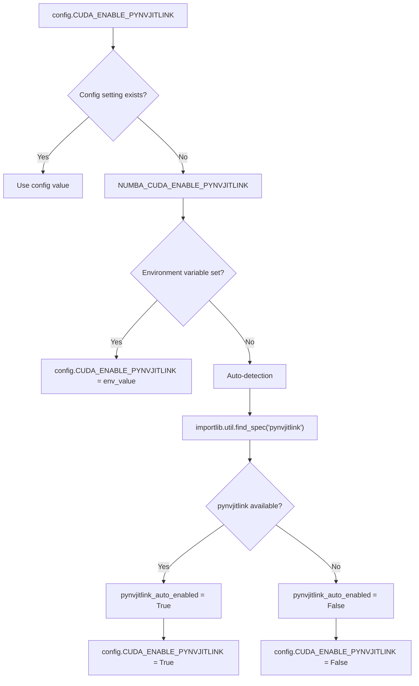

**PyNVJitLink Configuration Decision Tree**

### Validation Logic

The configuration includes validation logic in [`numba_cuda/numba/cuda/__init__.py:53-66`]():

- **NVIDIA Bindings + pynvjitlink**: Issues deprecation warning, uses `cuda.core` instead
- **ctypes + pynvjitlink (auto-enabled)**: Silently ignores pynvjitlink
- **ctypes + pynvjitlink (explicit)**: Raises `RuntimeError`

Sources: [`numba_cuda/numba/cuda/__init__.py:8-66`](), [`docs/source/user/minor_version_compatibility.rst:52-89`]()

## CUDA Toolkit Discovery

### Discovery Process Flow

The toolkit discovery process varies based on the selected bindings:

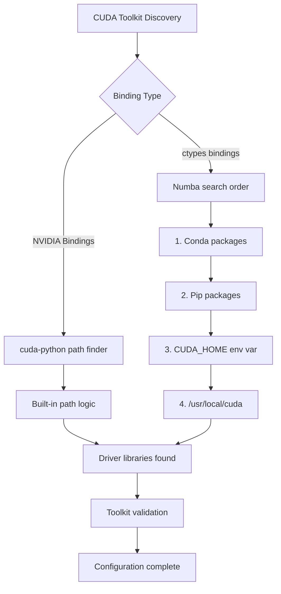

**CUDA Toolkit Discovery Process**

### Search Order for ctypes Bindings

When using ctypes bindings, the search follows this order ([`docs/source/user/installation.rst:87-96`]()):

1. **Conda-installed packages**: Highest priority for conda environments
2. **Pip-installed packages**: Second priority for pip environments  
3. **`CUDA_HOME` environment variable**: User-specified toolkit location
4. **System installation**: Fixed path at `/usr/local/cuda` on Linux

### Driver Library Location

The CUDA driver library (`libcuda`) discovery can be overridden using `NUMBA_CUDA_DRIVER` environment variable, which should point to the full file path (not directory) of the shared library.

Sources: [`docs/source/user/installation.rst:75-105`](), [`docs/source/reference/envvars.rst:52-56`]()

## Default Compute Capability Configuration

### Version Override Logic

Numba-cuda overrides the upstream Numba default compute capability through [`numba_cuda/numba/cuda/__init__.py:86-96`]():

```python
# The default compute capability as set by the upstream Numba implementation.
config_default_cc = config.CUDA_DEFAULT_PTX_CC

# The default compute capability for Numba-CUDA. This will usually override the
# upstream Numba built-in default of 5.0, unless the user has set it even
# higher, in which case we should use the user-specified value.
numba_cuda_default_ptx_cc = (7, 5)

if numba_cuda_default_ptx_cc > config_default_cc:
    config.CUDA_DEFAULT_PTX_CC = numba_cuda_default_ptx_cc
```

This ensures that numba-cuda uses a more recent default compute capability (7.5) compared to upstream Numba's default (5.0), while respecting any user-specified higher values.

Sources: [`numba_cuda/numba/cuda/__init__.py:86-96`]()

## Configuration Summary

The complete configuration system integrates multiple components:

- **Package Installation**: Via conda or pip with version-specific dependencies
- **Binding Selection**: NVIDIA bindings (default) or ctypes bindings (deprecated)
- **Environment Variables**: Extensive configuration options for runtime behavior
- **Toolkit Discovery**: Automated search with fallback mechanisms
- **Compute Capability**: Sensible defaults with user override capability

This configuration system ensures numba-cuda can adapt to different deployment scenarios while maintaining backward compatibility and providing clear upgrade paths.

Sources: [`pyproject.toml:1-137`](), [`numba_cuda/numba/cuda/__init__.py:1-104`](), [`docs/source/reference/envvars.rst:1-139`](), [`docs/source/user/installation.rst:1-106`]()

---

# Page: Core Architecture

# Core Architecture

<details>
<summary>Relevant source files</summary>

The following files were used as context for generating this wiki page:

- [numba_cuda/numba/cuda/api.py](numba_cuda/numba/cuda/api.py)
- [numba_cuda/numba/cuda/compiler.py](numba_cuda/numba/cuda/compiler.py)
- [numba_cuda/numba/cuda/core/inline_closurecall.py](numba_cuda/numba/cuda/core/inline_closurecall.py)
- [numba_cuda/numba/cuda/cudadrv/devicearray.py](numba_cuda/numba/cuda/cudadrv/devicearray.py)
- [numba_cuda/numba/cuda/cudadrv/driver.py](numba_cuda/numba/cuda/cudadrv/driver.py)
- [numba_cuda/numba/cuda/dispatcher.py](numba_cuda/numba/cuda/dispatcher.py)
- [numba_cuda/numba/cuda/target.py](numba_cuda/numba/cuda/target.py)
- [numba_cuda/numba/cuda/tests/cudadrv/test_cuda_memory.py](numba_cuda/numba/cuda/tests/cudadrv/test_cuda_memory.py)
- [numba_cuda/numba/cuda/tests/cudadrv/test_emm_plugins.py](numba_cuda/numba/cuda/tests/cudadrv/test_emm_plugins.py)
- [numba_cuda/numba/cuda/tests/nocuda/test_import.py](numba_cuda/numba/cuda/tests/nocuda/test_import.py)

</details>


## Purpose and Scope

This document provides an architectural overview of the Numba CUDA system, explaining how the major components interact to enable JIT compilation of Python functions to CUDA GPU code. It covers the high-level organization of the system's four main layers: the user interface, compilation frontend, code generation backend, and runtime system.

For detailed information about specific subsystems, see:
- [JIT Compilation Pipeline](#2.1) for the end-to-end compilation process
- [CUDA Driver Interface](#2.2) for driver abstractions and device management
- [Memory Management System](#2.3) for memory allocation strategies
- [Type System and Lowering](#2.4) for type inference and IR lowering

---

## System Overview

The Numba CUDA architecture consists of four primary layers that transform Python functions into executable GPU code:

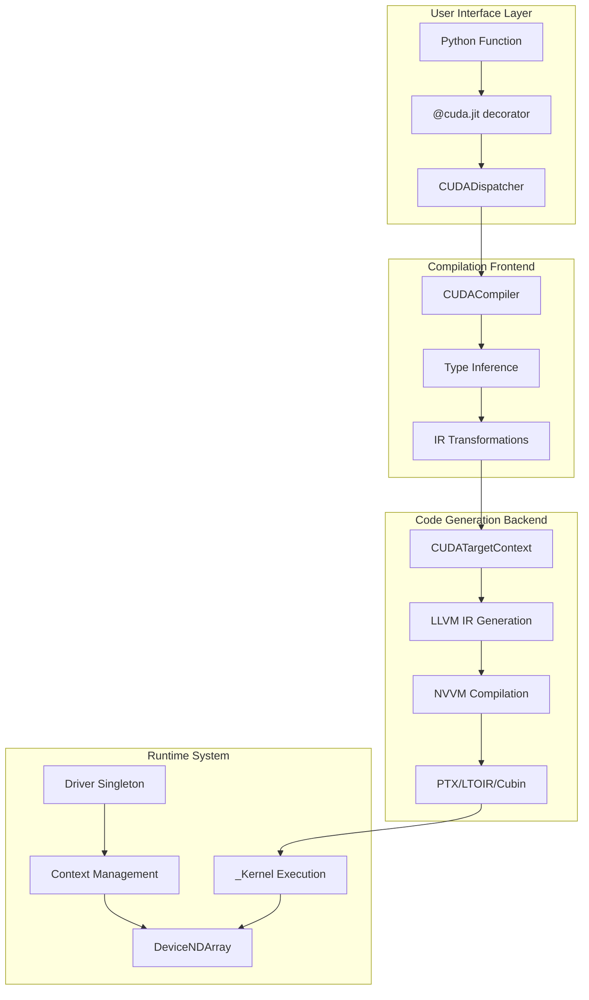

**Figure 1: Four-Layer System Architecture**

Sources: [numba_cuda/numba/cuda/dispatcher.py:1-1500](), [numba_cuda/numba/cuda/compiler.py:1-900](), [numba_cuda/numba/cuda/target.py:1-506]()

| Layer | Primary Classes | Responsibilities |
|-------|----------------|------------------|
| User Interface | `CUDADispatcher`, `_LaunchConfiguration` | Decorator implementation, launch configuration, argument processing |
| Compilation Frontend | `CUDACompiler`, `CUDATypingContext` | Type inference, IR generation, optimization passes |
| Code Generation | `CUDATargetContext`, `CUDACodeLibrary` | LLVM IR generation, NVVM compilation, code caching |
| Runtime System | `Driver`, `Context`, `Device`, `_Kernel` | Driver API wrapping, context management, kernel launch |

---

## Core Components

### Dispatcher Layer

The dispatcher is the entry point for user code, implemented by the `CUDADispatcher` class. It manages kernel specialization for different argument types and handles kernel invocation.

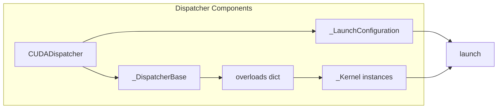

**Figure 2: Dispatcher Component Structure**

**Key Classes:**

- **`CUDADispatcher`** [numba_cuda/numba/cuda/dispatcher.py:1140-1500](): The main dispatcher class that extends `_DispatcherBase`. Handles the `@cuda.jit` decorator and provides the call interface for kernels.

- **`_DispatcherBase`** [numba_cuda/numba/cuda/dispatcher.py:773-945](): Base class managing the compilation of specializations for different type signatures. Maintains the `overloads` dictionary mapping signatures to compiled kernels.

- **`_Kernel`** [numba_cuda/numba/cuda/dispatcher.py:78-619](): Represents a compiled kernel specialized for a specific set of argument types. Handles argument preparation and kernel launch.

- **`_LaunchConfiguration`** [numba_cuda/numba/cuda/dispatcher.py:669-701](): Captures grid and block dimensions, stream, and shared memory settings for kernel launch.

**Dispatcher Workflow:**

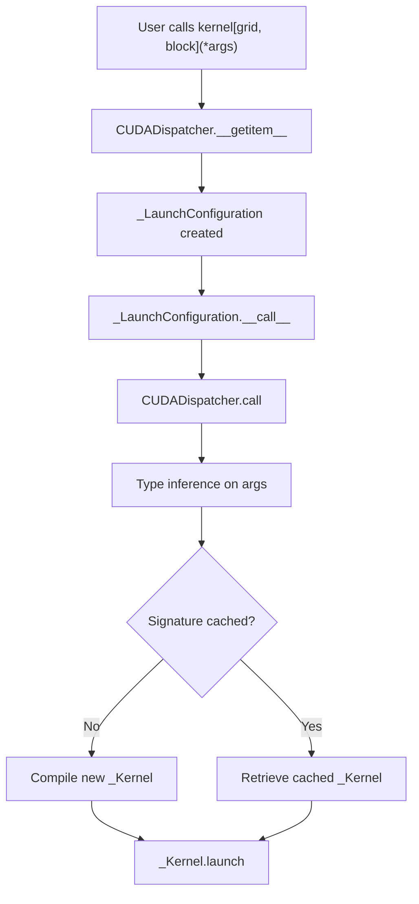

**Figure 3: Kernel Dispatch and Launch Flow**

Sources: [numba_cuda/numba/cuda/dispatcher.py:78-701](), [numba_cuda/numba/cuda/dispatcher.py:1140-1500]()

---

### Compiler Layer

The compiler transforms Python bytecode into GPU-executable code through a series of compilation passes.

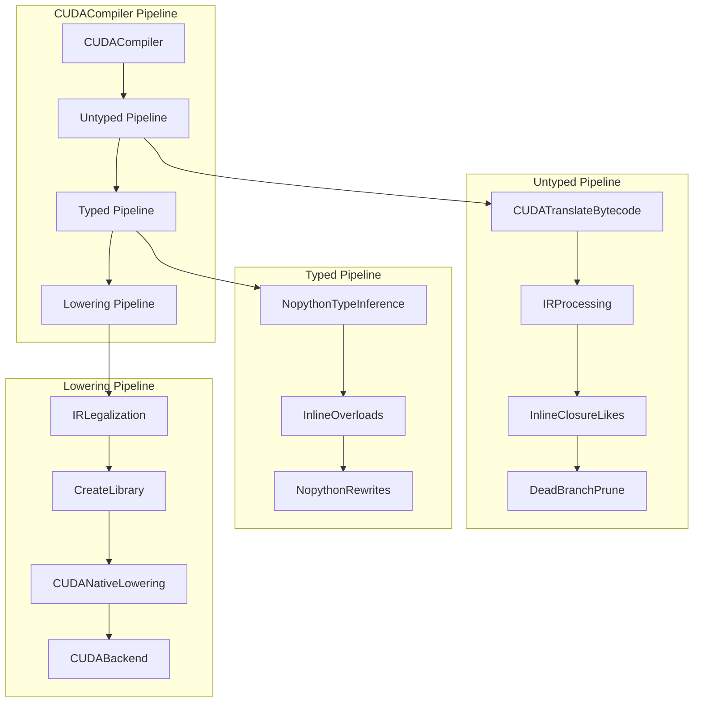

**Figure 4: Compilation Pipeline Stages**

**Key Classes:**

- **`CUDACompiler`** [numba_cuda/numba/cuda/compiler.py:505-551](): Extends `CompilerBase` and defines the complete compilation pipeline including untyped, typed, and lowering passes.

- **`CUDATranslateBytecode`** [numba_cuda/numba/cuda/compiler.py:489-503](): Custom bytecode translation pass that uses `CUDABytecodeInterpreter` to generate Numba IR from Python bytecode.

- **`CreateLibrary`** [numba_cuda/numba/cuda/compiler.py:416-443](): Creates a `CUDACodeLibrary` instance configured with NVVM options from compilation flags.

- **`CUDANativeLowering`** [numba_cuda/numba/cuda/compiler.py:446-456](): Lowering pass that uses `CUDALower` to transform typed IR into LLVM IR.

- **`CUDABackend`** [numba_cuda/numba/cuda/compiler.py:388-413](): Final pass that packages the lowering output into a `CUDACompileResult`.

**Entry Points:**

| Function | Purpose | Location |
|----------|---------|----------|
| `compile_cuda` | Main compilation entry point for kernels | [numba_cuda/numba/cuda/compiler.py:689-759]() |
| `compile_extra` | Generic compiler entry point | [numba_cuda/numba/cuda/compiler.py:553-590]() |
| `compile_ir` | Compile from existing Numba IR | [numba_cuda/numba/cuda/compiler.py:592-675]() |

Sources: [numba_cuda/numba/cuda/compiler.py:1-760]()

---

### Target Contexts

Target contexts manage type inference and code generation for the CUDA target. They provide the infrastructure for type resolution and LLVM IR generation.

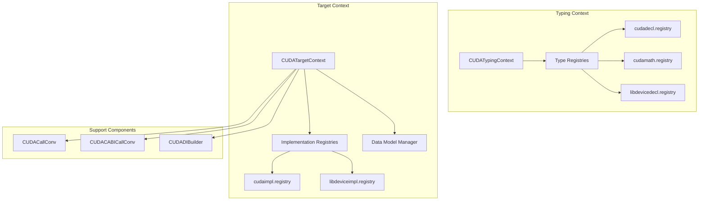

**Figure 5: Target Context Architecture**

**Key Classes:**

- **`CUDATypingContext`** [numba_cuda/numba/cuda/target.py:40-121](): Extends `typing.BaseContext` to provide CUDA-specific type resolution. Loads type declaration registries for CUDA intrinsics, math functions, and device functions.

- **`CUDATargetContext`** [numba_cuda/numba/cuda/target.py:130-425](): Extends `BaseContext` to provide code generation infrastructure. Manages implementation registries, data models, and the internal code generator (`JITCUDACodegen`).

- **`CUDACallConv`** [numba_cuda/numba/cuda/target.py:427-438](): Calling convention for CUDA kernels using Numba's ABI.

- **`CUDACABICallConv`** [numba_cuda/numba/cuda/target.py:440-506](): Calling convention matching the CUDA C/C++ ABI for device functions.

**Context Properties:**

| Property | Context | Description |
|----------|---------|-------------|
| `enable_nrt` | `CUDATargetContext` | Whether the Numba Runtime (NRT) is enabled for reference counting |
| `enable_boundscheck` | `CUDATargetContext` | Always `False` for CUDA (unconditionally disabled) |
| `strict_alignment` | `CUDATargetContext` | Always `True` (CUDA requires strict alignment) |
| `DIBuilder` | `CUDATargetContext` | Returns `CUDADIBuilder` for debug information generation |

Sources: [numba_cuda/numba/cuda/target.py:1-506](), [numba_cuda/numba/cuda/descriptor.py:1-100]()

---

### Driver Layer

The driver layer provides a Python interface to the CUDA Driver API, managing devices, contexts, memory, and kernel execution.

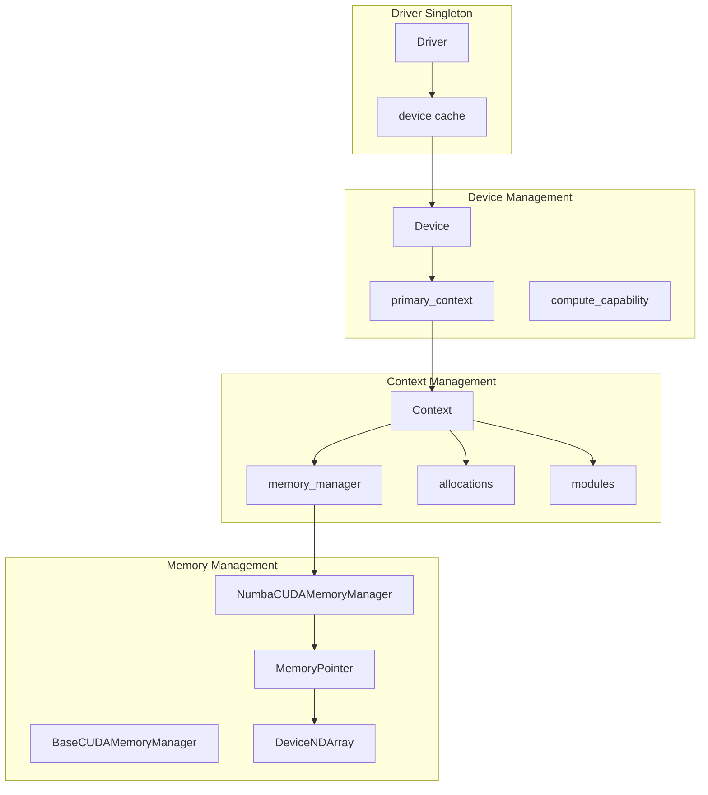

**Figure 6: Driver Component Hierarchy**

**Key Classes:**

- **`Driver`** [numba_cuda/numba/cuda/cudadrv/driver.py:247-465](): Singleton class that wraps the CUDA Driver API. Lazily binds to driver functions and maintains a cache of `Device` objects. Uses `cuda-python` bindings for driver API calls.

- **`Device`** [numba_cuda/numba/cuda/cudadrv/driver.py:530-632](): Represents a CUDA device. Stores device properties like compute capability, name, and UUID. Manages the device's primary context.

- **`Context`** [numba_cuda/numba/cuda/cudadrv/driver.py:1106-1371](): Wraps a CUDA context resource. Owns allocations, modules, and the memory manager. Provides methods for memory info and occupancy calculations.

- **`BaseCUDAMemoryManager`** [numba_cuda/numba/cuda/cudadrv/driver.py:634-748](): Abstract base class for External Memory Management (EMM) plugins. Defines the interface for device memory allocation.

- **`NumbaCUDAMemoryManager`** [numba_cuda/numba/cuda/cudadrv/driver.py:926-956](): Default implementation of the EMM plugin interface using `cuMemAlloc` for device allocations.

**Driver Initialization Flow:**

```mermaid
graph LR
    A["Import numba.cuda"]
    B["Driver.__new__"]
    C["find_driver"]
    D["Driver.ensure_initialized"]
    E["cuInit"]
    F["Driver.get_device"]
    G["Device.__init__"]
    H["Device.get_primary_context"]
    I["Context.__init__"]
    J["Context.memory_manager"]
    
    A --> B
    B --> C
    C --> D
    D --> E
    E --> F
    F --> G
    G --> H
    H --> I
    I --> J
```

**Figure 7: Driver and Context Initialization**

Sources: [numba_cuda/numba/cuda/cudadrv/driver.py:1-2500](), [numba_cuda/numba/cuda/cudadrv/devices.py:1-200]()

---

## Component Interactions

### Compilation Flow

The following diagram shows how components interact during the compilation of a CUDA kernel:

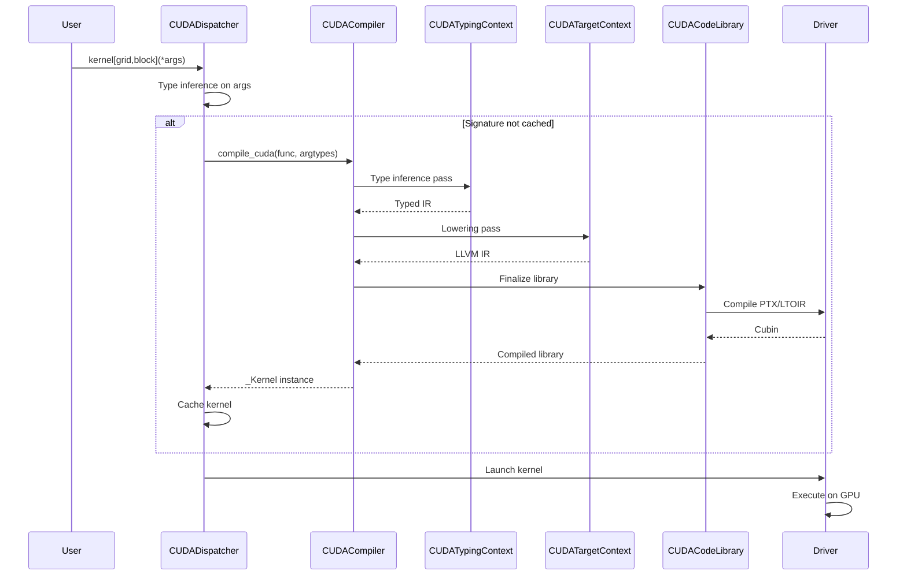

**Figure 8: End-to-End Compilation and Execution Flow**

Sources: [numba_cuda/numba/cuda/dispatcher.py:939-1100](), [numba_cuda/numba/cuda/compiler.py:689-759]()

---

### Memory Management Flow

Memory allocation and transfer operations flow through the driver and memory manager:

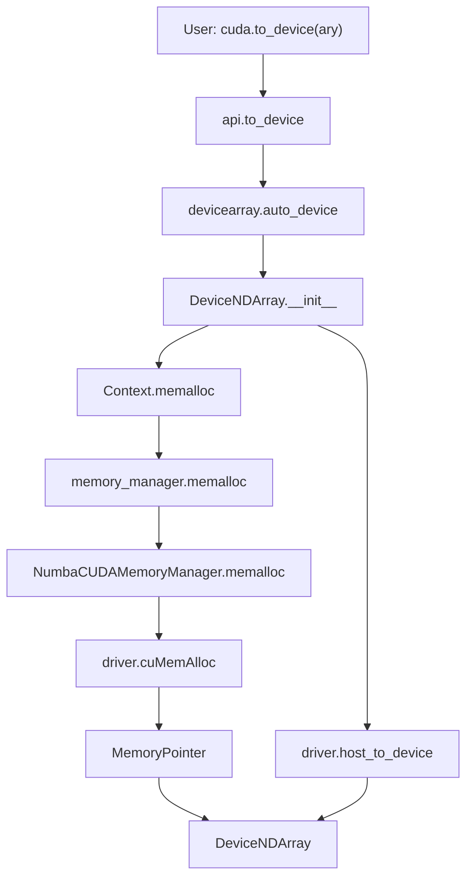

**Figure 9: Device Memory Allocation Flow**

**Memory Manager Interface:**

| Method | Purpose | Implementation |
|--------|---------|----------------|
| `memalloc(size)` | Allocate device memory | [numba_cuda/numba/cuda/cudadrv/driver.py:936-947]() |
| `memhostalloc(size, ...)` | Allocate pinned host memory | [numba_cuda/numba/cuda/cudadrv/driver.py:792-824]() |
| `mempin(owner, ptr, ...)` | Pin existing host memory | [numba_cuda/numba/cuda/cudadrv/driver.py:826-862]() |
| `get_ipc_handle(memory)` | Create IPC handle for memory | [numba_cuda/numba/cuda/cudadrv/driver.py:909-923]() |
| `get_memory_info()` | Query free/total memory | [numba_cuda/numba/cuda/cudadrv/driver.py:949-951]() |

Sources: [numba_cuda/numba/cuda/cudadrv/driver.py:634-1003](), [numba_cuda/numba/cuda/cudadrv/devicearray.py:1-700]()

---

## Key Data Structures

### CUDACompileResult

The `CUDACompileResult` is the output of the compilation process, containing all information about a compiled function:

```python
# Fields of CUDACompileResult namedtuple:
- typing_context      # CUDATypingContext instance
- target_context      # CUDATargetContext instance  
- entry_point         # id(self) - unique identifier
- typing_error        # Any typing error encountered
- type_annotation     # String representation of types
- signature           # Function signature
- objectmode          # Always False for CUDA
- lifted              # Lifted loop information
- fndesc              # Function descriptor
- library             # CUDACodeLibrary with compiled code
- call_helper         # Exception handling helper
- environment         # Compilation environment
- metadata            # Additional metadata
- reload_init         # Cache reload initialization
- referenced_envs     # Referenced environments (empty for CUDA)
```

Sources: [numba_cuda/numba/cuda/compiler.py:272-386]()

### _Kernel Attributes

The `_Kernel` class provides access to compiled kernel properties:

| Property | Type | Description | Access Path |
|----------|------|-------------|-------------|
| `regs_per_thread` | `int` | Registers per thread | [numba_cuda/numba/cuda/dispatcher.py:352-357]() |
| `const_mem_size` | `int` | Constant memory usage | [numba_cuda/numba/cuda/dispatcher.py:359-364]() |
| `shared_mem_per_block` | `int` | Shared memory per block | [numba_cuda/numba/cuda/dispatcher.py:366-371]() |
| `max_threads_per_block` | `int` | Max threads per block | [numba_cuda/numba/cuda/dispatcher.py:373-378]() |
| `local_mem_per_thread` | `int` | Local memory per thread | [numba_cuda/numba/cuda/dispatcher.py:380-385]() |

Sources: [numba_cuda/numba/cuda/dispatcher.py:78-619]()

---

## System Initialization

The initialization sequence for Numba CUDA:

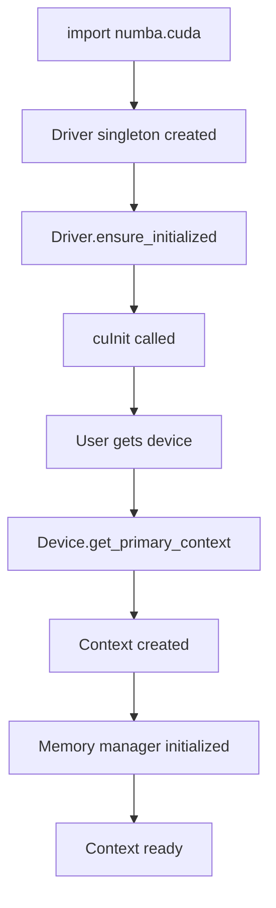

**Figure 10: System Initialization Sequence**

**Initialization Details:**

1. **Driver Singleton**: Created on first access, remains cached [numba_cuda/numba/cuda/cudadrv/driver.py:247-280]()

2. **Lazy Initialization**: Driver API functions are lazily bound on first use [numba_cuda/numba/cuda/cudadrv/driver.py:281-423]()

3. **Primary Context**: Each device has one primary context, retained on first use [numba_cuda/numba/cuda/cudadrv/driver.py:588-606]()

4. **Memory Manager**: Initialized when context is created, uses `NumbaCUDAMemoryManager` by default [numba_cuda/numba/cuda/cudadrv/driver.py:1106-1122]()

Sources: [numba_cuda/numba/cuda/cudadrv/driver.py:1-600](), [numba_cuda/numba/cuda/cudadrv/devices.py:1-200]()

---

## Configuration and Extension

The architecture supports several extension points:

| Extension Point | Interface | Purpose | Location |
|----------------|-----------|---------|----------|
| Memory Manager | `BaseCUDAMemoryManager` | Custom memory allocation | [numba_cuda/numba/cuda/cudadrv/driver.py:634-748]() |
| Typing Registry | `typing.Registry` | Custom type inference | [numba_cuda/numba/cuda/target.py:41-61]() |
| Implementation Registry | `imputils.Registry` | Custom lowering | [numba_cuda/numba/cuda/target.py:161-221]() |
| Code Library | `CodeLibrary` | Custom code generation | [numba_cuda/numba/cuda/codegen.py:1-500]() |

**Configuration Options:**

Configuration is managed through environment variables and the `config` module:

- `CUDA_ENABLE_NRT`: Enable Numba Runtime for reference counting
- `CUDA_MEMORY_MANAGER`: Custom memory manager module
- `CUDA_LOG_LEVEL`: Driver API logging level
- `CUDA_DEALLOCS_COUNT`: Pending deallocation threshold
- `CUDA_DEALLOCS_RATIO`: Memory ratio trigger for deallocation

Sources: [numba_cuda/numba/cuda/core/config.py:1-300](), [numba_cuda/numba/cuda/cudadrv/driver.py:963-1002]()

---

# Page: JIT Compilation Pipeline

# JIT Compilation Pipeline

<details>
<summary>Relevant source files</summary>

The following files were used as context for generating this wiki page:

- [numba_cuda/numba/cuda/compiler.py](numba_cuda/numba/cuda/compiler.py)
- [numba_cuda/numba/cuda/core/ir_utils.py](numba_cuda/numba/cuda/core/ir_utils.py)
- [numba_cuda/numba/cuda/core/typed_passes.py](numba_cuda/numba/cuda/core/typed_passes.py)
- [numba_cuda/numba/cuda/core/untyped_passes.py](numba_cuda/numba/cuda/core/untyped_passes.py)
- [numba_cuda/numba/cuda/cudadrv/mappings.py](numba_cuda/numba/cuda/cudadrv/mappings.py)
- [numba_cuda/numba/cuda/decorators.py](numba_cuda/numba/cuda/decorators.py)
- [numba_cuda/numba/cuda/dispatcher.py](numba_cuda/numba/cuda/dispatcher.py)
- [numba_cuda/numba/cuda/tests/cudadrv/test_linker.py](numba_cuda/numba/cuda/tests/cudadrv/test_linker.py)
- [numba_cuda/numba/cuda/tests/cudadrv/test_module_callbacks.py](numba_cuda/numba/cuda/tests/cudadrv/test_module_callbacks.py)
- [numba_cuda/numba/cuda/tests/cudadrv/test_nvjitlink.py](numba_cuda/numba/cuda/tests/cudadrv/test_nvjitlink.py)
- [numba_cuda/numba/cuda/tests/cudapy/test_debug.py](numba_cuda/numba/cuda/tests/cudapy/test_debug.py)
- [numba_cuda/numba/cuda/tests/cudapy/test_errors.py](numba_cuda/numba/cuda/tests/cudapy/test_errors.py)
- [numba_cuda/numba/cuda/tests/cudapy/test_inline.py](numba_cuda/numba/cuda/tests/cudapy/test_inline.py)
- [numba_cuda/numba/cuda/typing/templates.py](numba_cuda/numba/cuda/typing/templates.py)

</details>


This document covers the core JIT (Just-In-Time) compilation system in numba-cuda, which transforms Python functions into executable CUDA kernels. The compilation pipeline handles the entire process from Python function decoration to GPU kernel execution, including type specialization, caching, and code generation.

For information about CUDA driver interaction and context management, see [CUDA Driver Interface](#2.2). For details about memory management during compilation and execution, see [Memory Management System](#2.3).

## Overview

The JIT compilation pipeline is the heart of numba-cuda, responsible for converting Python functions decorated with `@cuda.jit` into optimized CUDA kernels. The system performs lazy compilation, meaning kernels are compiled only when first invoked with specific argument types, and compiled versions are cached for future use.

## High-Level Compilation Flow

The compilation process follows a multi-stage pipeline that transforms Python source code into executable GPU kernels:

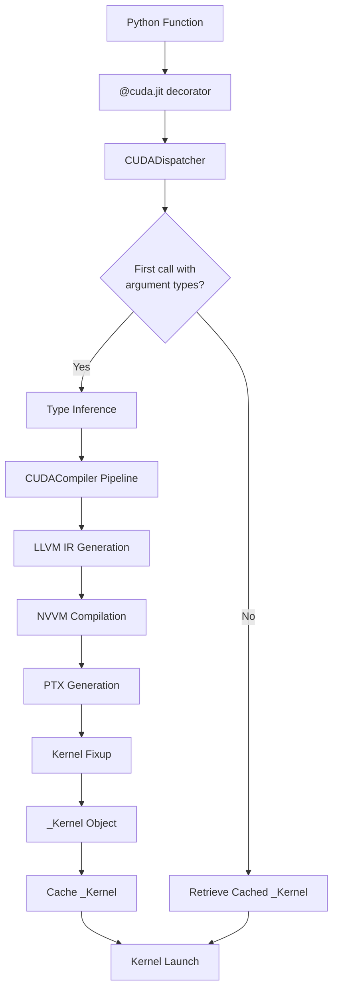

Sources: [numba_cuda/numba/cuda/dispatcher.py:728-888](), [numba_cuda/numba/cuda/compiler.py:190-236](), [numba_cuda/numba/cuda/decorators.py:17-262]()

## Core Components

### CUDADispatcher

The `CUDADispatcher` class serves as the primary interface between user code and the compilation system. It manages kernel compilation, specialization, and caching:

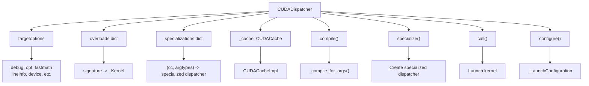

Sources: [numba_cuda/numba/cuda/dispatcher.py:728-888]()

### _Kernel Class

The `_Kernel` class represents a compiled kernel specialized for specific argument types. It encapsulates the compilation result and provides kernel launch capabilities:

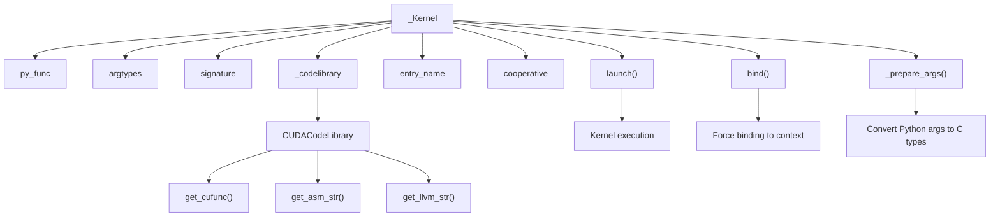

Sources: [numba_cuda/numba/cuda/dispatcher.py:60-608]()

### CUDACompiler Pipeline

The `CUDACompiler` implements the compilation pipeline using Numba's pass manager system:

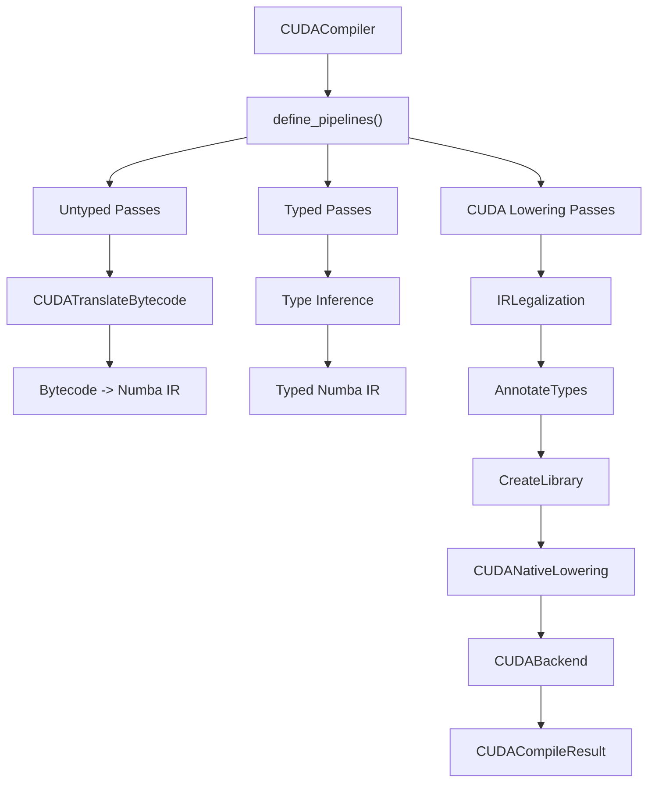

Sources: [numba_cuda/numba/cuda/compiler.py:190-236]()

## Type Specialization and Caching

The compilation system performs type specialization to create efficient kernels for specific argument types:

### Specialization Process

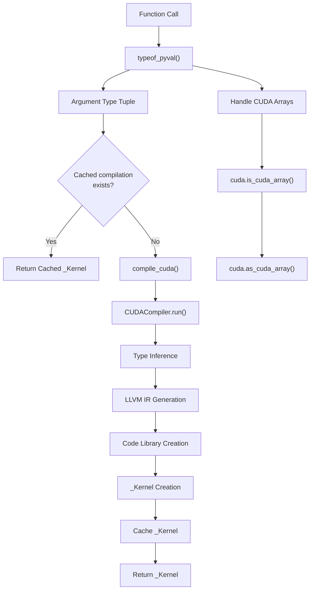

Sources: [numba_cuda/numba/cuda/dispatcher.py:838-857](), [numba_cuda/numba/cuda/compiler.py:238-311]()

### Caching System

The `CUDACache` system provides persistent caching of compiled kernels:

```mermaid
graph TD
    A["CUDACache"] --> B["CUDACacheImpl"]
    B --> C["reduce()"]
    B --> D["rebuild()"]
    B --> E["check_cachable()"]
    
    C --> F["_Kernel._reduce_states()"]
    F --> G["Serialize kernel state"]
    
    D --> H["_Kernel._rebuild()"]
    H --> I["Reconstruct kernel from cache"]
    
    E --> J["Always returns True"]
    J --> K["CUDA kernels are cachable"]
    
    A --> L["load_overload()"]
    L --> M["target_override('cuda')"]
    M --> N["Ensure CUDA target context"]
```

Sources: [numba_cuda/numba/cuda/dispatcher.py:693-726]()

## Code Generation Process

The compilation pipeline transforms Python code through several intermediate representations:

### LLVM IR Generation

```mermaid
graph TD
    A["Typed Numba IR"] --> B["CUDANativeLowering"]
    B --> C["CUDALower"]
    C --> D["Lower to LLVM IR"]
    
    D --> E["Function Signature"]
    D --> F["LLVM Function"]
    D --> G["Basic Blocks"]
    D --> H["Instructions"]
    
    E --> I["Return type + arg types"]
    F --> J["LLVM function definition"]
    G --> K["Control flow structure"]
    H --> L["LLVM instructions"]
    
    A --> M["CreateLibrary"]
    M --> N["CUDACodeLibrary"]
    N --> O["nvvm_options"]
    N --> P["max_registers"]
    N --> Q["lto flag"]
```

Sources: [numba_cuda/numba/cuda/compiler.py:131-141](), [numba_cuda/numba/cuda/compiler.py:100-128]()

### PTX Generation and Kernel Fixup

```mermaid
graph TD
    A["LLVM IR"] --> B["NVVM Compilation"]
    B --> C["PTX Assembly"]
    C --> D["kernel_fixup()"]
    
    D --> E["Remove return value"]
    D --> F["Change signature to void"]
    D --> G["Add exception handling"]
    D --> H["Set CUDA kernel attributes"]
    
    E --> I["Remove 'ret <value>'"]
    I --> J["Add 'ret void'"]
    
    F --> K["Modify function type"]
    K --> L["Remove return arg"]
    
    G --> M["add_exception_store_helper()"]
    M --> N["Debug error handling"]
    
    H --> O["nvvm.set_cuda_kernel()"]
    O --> P["Mark as CUDA kernel"]
    
    D --> Q["Launch bounds setting"]
    Q --> R["nvvm.set_launch_bounds()"]
```

Sources: [numba_cuda/numba/cuda/compiler.py:365-457]()

## Kernel Launch Process

Once compiled, kernels are launched through a structured process that handles argument marshalling and GPU execution:

### Launch Configuration

```mermaid
graph TD
    A["kernel[griddim, blockdim]"] --> B["configure()"]
    B --> C["normalize_kernel_dimensions()"]
    C --> D["_LaunchConfiguration"]
    
    D --> E["griddim tuple"]
    D --> F["blockdim tuple"]
    D --> G["stream"]
    D --> H["sharedmem"]
    
    D --> I["Low occupancy warning"]
    I --> J["Check grid_size < 128"]
    J --> K["NumbaPerformanceWarning"]
    
    A --> L["__call__()"]
    L --> M["dispatcher.call()"]
    
    M --> N["Specialized dispatcher?"]
    N -->|Yes| O["Use cached kernel"]
    N -->|No| P["_cuda_call()"]
    P --> Q["Compile if needed"]
```

Sources: [numba_cuda/numba/cuda/dispatcher.py:658-691](), [numba_cuda/numba/cuda/dispatcher.py:770-778]()

### Argument Preparation

```mermaid
graph TD
    A["Python Arguments"] --> B["_prepare_args()"]
    B --> C["Extension Processing"]
    C --> D["Type-specific Conversion"]
    
    D --> E["Array Types"]
    D --> F["Scalar Types"]
    D --> G["Complex Types"]
    D --> H["Record Types"]
    
    E --> I["wrap_arg().to_device()"]
    I --> J["Device array creation"]
    J --> K["Meminfo, data ptr, shape, strides"]
    
    F --> L["ctypes conversion"]
    L --> M["c_int, c_float, c_double, etc."]
    
    G --> N["Real and imaginary parts"]
    N --> O["Separate ctypes values"]
    
    H --> P["Device record creation"]
    P --> Q["Device pointer"]
    
    B --> R["Extension prepare_args()"]
    R --> S["Custom argument handling"]
```

Sources: [numba_cuda/numba/cuda/dispatcher.py:518-608]()

## Debug and Inspection Support

The compilation pipeline includes comprehensive debugging and inspection capabilities:

### Debug Information Generation

```mermaid
graph TD
    A["debug=True"] --> B["CUDAFlags.debuginfo"]
    B --> C["LLVM Debug Metadata"]
    C --> D["CUDADIBuilder"]
    
    D --> E["DICompileUnit"]
    D --> F["DISubprogram"]
    D --> G["DILocalVariable"]
    
    A --> H["add_exception_store_helper()"]
    H --> I["Exception state globals"]
    I --> J["Thread ID tracking"]
    I --> K["Error code storage"]
    
    A --> L["Python error model"]
    L --> M["Exception propagation"]
    
    N["lineinfo=True"] --> O["DebugDirectivesOnly"]
    O --> P["Line mapping info"]
    P --> Q["Source correlation"]
```

Sources: [numba_cuda/numba/cuda/compiler.py:271-279](), [numba_cuda/numba/cuda/compiler.py:459-525]()

### Code Inspection Methods

```mermaid
graph TD
    A["_Kernel"] --> B["inspect_llvm()"]
    A --> C["inspect_asm()"]
    A --> D["inspect_sass()"]
    A --> E["inspect_sass_cfg()"]
    A --> F["inspect_types()"]
    
    B --> G["LLVM IR output"]
    C --> H["PTX assembly"]
    D --> I["SASS assembly"]
    E --> J["Control flow graph"]
    F --> K["Type annotations"]
    
    G --> L["_codelibrary.get_llvm_str()"]
    H --> M["_codelibrary.get_asm_str()"]
    I --> N["_codelibrary.get_sass()"]
    J --> O["_codelibrary.get_sass_cfg()"]
    K --> P["_type_annotation display"]
```

Sources: [numba_cuda/numba/cuda/dispatcher.py:375-418]()

## Integration Points

The JIT compilation pipeline integrates with several other numba-cuda subsystems:

### Memory Management Integration

The compilation system automatically links with the NRT (Numba Runtime) memory system when needed:

```mermaid
graph TD
    A["_Kernel.__init__()"] --> B["maybe_link_nrt()"]
    B --> C["Check tgt_ctx.enable_nrt"]
    C --> D["Scan ASM for NRT functions"]
    D --> E["Check LinkableCode.nrt"]
    
    E --> F["Link NRT_LIBRARY"]
    F --> G["NRT function support"]
    
    G --> H["NRT_Allocate"]
    G --> I["NRT_MemInfo_*"]
    G --> J["NRT_Free"]
    G --> K["NRT_incref/decref"]
    
    B --> L["NRT_functions list"]
    L --> M["Pattern matching in PTX"]
```

Sources: [numba_cuda/numba/cuda/dispatcher.py:216-246]()

### External Code Linking

The pipeline supports linking external CUDA code during compilation:

```mermaid
graph TD
    A["link parameter"] --> B["Automatic Library Detection"]
    B --> C["CUDA FP16 math functions"]
    B --> D["Reshape helper functions"]
    B --> E["User-provided files"]
    
    C --> F["link_to_library_functions()"]
    F --> G["__numba_wrapper_ prefix"]
    G --> H["cpp_function_wrappers.cu"]
    
    D --> I["nocopy_empty_reshape"]
    I --> J["reshape_funcs.cu"]
    
    E --> K["PTX or CUDA C++ files"]
    K --> L["lib.add_linking_file()"]
    
    A --> M["Cooperative launch detection"]
    M --> N["lib.use_cooperative"]
    N --> O["cudadevrt linking"]
```

Sources: [numba_cuda/numba/cuda/dispatcher.py:164-197]()

This comprehensive JIT compilation pipeline enables numba-cuda to efficiently transform Python functions into high-performance CUDA kernels while providing extensive debugging and inspection capabilities.

---

# Page: CUDA Driver Interface

# CUDA Driver Interface

<details>
<summary>Relevant source files</summary>

The following files were used as context for generating this wiki page:

- [numba_cuda/numba/cuda/api.py](numba_cuda/numba/cuda/api.py)
- [numba_cuda/numba/cuda/cudadrv/devicearray.py](numba_cuda/numba/cuda/cudadrv/devicearray.py)
- [numba_cuda/numba/cuda/cudadrv/driver.py](numba_cuda/numba/cuda/cudadrv/driver.py)
- [numba_cuda/numba/cuda/cudadrv/mappings.py](numba_cuda/numba/cuda/cudadrv/mappings.py)
- [numba_cuda/numba/cuda/decorators.py](numba_cuda/numba/cuda/decorators.py)
- [numba_cuda/numba/cuda/tests/cudadrv/test_cuda_memory.py](numba_cuda/numba/cuda/tests/cudadrv/test_cuda_memory.py)
- [numba_cuda/numba/cuda/tests/cudadrv/test_emm_plugins.py](numba_cuda/numba/cuda/tests/cudadrv/test_emm_plugins.py)
- [numba_cuda/numba/cuda/tests/cudadrv/test_linker.py](numba_cuda/numba/cuda/tests/cudadrv/test_linker.py)
- [numba_cuda/numba/cuda/tests/cudadrv/test_module_callbacks.py](numba_cuda/numba/cuda/tests/cudadrv/test_module_callbacks.py)
- [numba_cuda/numba/cuda/tests/cudadrv/test_nvjitlink.py](numba_cuda/numba/cuda/tests/cudadrv/test_nvjitlink.py)
- [numba_cuda/numba/cuda/tests/cudapy/test_debug.py](numba_cuda/numba/cuda/tests/cudapy/test_debug.py)
- [numba_cuda/numba/cuda/tests/cudapy/test_errors.py](numba_cuda/numba/cuda/tests/cudapy/test_errors.py)
- [numba_cuda/numba/cuda/tests/cudapy/test_inline.py](numba_cuda/numba/cuda/tests/cudapy/test_inline.py)

</details>


## Purpose and Scope

The CUDA Driver Interface is the abstraction layer that bridges Numba's high-level Python API with the low-level CUDA driver functions. It provides Python-friendly wrappers around CUDA driver operations including device management, context lifecycle, memory allocation, stream/event synchronization, and module loading. This interface is the foundation of the runtime system that executes compiled kernels.

For information about memory allocation strategies and the NRT system, see [Memory Management System](#2.3). For kernel compilation and code generation, see [JIT Compilation Pipeline](#2.1).

---

## Architecture Overview

The driver interface is organized into several key components that work together to manage GPU resources:

```mermaid
graph TB
    subgraph "Driver Layer"
        Driver["Driver (Singleton)"]
        Driver --> |"lazy binds"| DriverAPI["CUDA Driver API<br/>(cuda-python bindings)"]
    end
    
    subgraph "Device & Context Layer"
        Device["Device"]
        Context["Context"]
        Driver --> |"creates"| Device
        Device --> |"owns"| Context
        Context --> |"manages"| Resources["GPU Resources"]
    end
    
    subgraph "Resource Management"
        Resources --> MemoryMgr["Memory Manager<br/>(EMM Plugin)"]
        Resources --> Modules["Module Cache"]
        Resources --> Streams["Stream Pool"]
        MemoryMgr --> PendingDeallocs["_PendingDeallocs"]
    end
    
    subgraph "Memory Types"
        MemoryMgr --> DevMem["Device Memory<br/>(AutoFreePointer)"]
        MemoryMgr --> PinnedMem["Pinned Memory<br/>(PinnedMemory)"]
        MemoryMgr --> MappedMem["Mapped Memory<br/>(MappedMemory)"]
        MemoryMgr --> ManagedMem["Managed Memory<br/>(ManagedMemory)"]
    end
    
    subgraph "Synchronization"
        Resources --> Events["Event Objects"]
        Streams --> StreamSync["Stream Synchronization"]
    end
```

**Diagram: CUDA Driver Interface Architecture**

The `Driver` singleton provides lazy-bound access to CUDA driver functions, `Device` objects represent individual GPUs, `Context` objects wrap CUDA contexts and manage resources, and the memory manager handles all memory allocations through a pluggable EMM (External Memory Management) interface.

Sources: [numba_cuda/numba/cuda/cudadrv/driver.py:247-515]()

---

## Driver Singleton

### Driver Class Overview

The `Driver` class is implemented as a singleton that manages the CUDA driver library and provides access to all driver API functions:

```mermaid
graph LR
    App["Application Code"] --> Driver
    Driver --> |"first access"| Init["ensure_initialized()"]
    Init --> |"calls"| cuInit["cuInit(0)"]
    Driver --> |"lazy binding"| WrapFn["_cuda_python_wrap_fn()"]
    WrapFn --> |"wraps"| Bindings["cuda.bindings.driver"]
    Driver --> |"caches"| Devices["Device Registry<br/>(self.devices)"]
```

**Diagram: Driver Initialization and Function Binding**

The driver performs lazy initialization on first API access and caches device objects in a registry.

Sources: [numba_cuda/numba/cuda/cudadrv/driver.py:247-465]()

### Key Responsibilities

| Responsibility | Implementation | File Reference |
|---------------|----------------|----------------|
| **Initialization** | Calls `cuInit(0)` on first use, stores PID to detect forks | [driver.py:281-298]() |
| **Function Binding** | Wraps cuda-python bindings with error checking | [driver.py:351-370]() |
| **Error Handling** | Converts CUDA error codes to Python exceptions | [driver.py:409-422]() |
| **Device Management** | Maintains registry of `Device` objects | [driver.py:424-429]() |
| **Fork Detection** | Raises error if CUDA initialized before fork | [driver.py:394-398]() |

### Lazy Function Binding

The `Driver` uses the `__getattr__` mechanism to lazily bind CUDA driver functions:

```mermaid
sequenceDiagram
    participant User
    participant Driver
    participant BindingLib as cuda.bindings.driver
    participant ErrorCheck as Error Checking
    
    User->>Driver: driver.cuMemAlloc(size)
    Driver->>Driver: __getattr__("cuMemAlloc")
    Driver->>Driver: ensure_initialized()
    Driver->>Driver: _cuda_python_wrap_fn("cuMemAlloc")
    Driver->>BindingLib: getattr(binding, "cuMemAlloc")
    Driver->>Driver: wrap with error checking
    Driver->>Driver: cache wrapped function
    Driver->>BindingLib: cuMemAlloc(size)
    BindingLib-->>Driver: (status, result)
    Driver->>ErrorCheck: _check_cuda_python_error()
    ErrorCheck-->>User: return result or raise CudaAPIError
```

**Diagram: Lazy Function Binding Sequence**

Functions are bound on first access and cached for subsequent calls. All calls include automatic error checking.

Sources: [numba_cuda/numba/cuda/cudadrv/driver.py:305-370]()

---

## Device Management

### Device Class

The `Device` class represents a physical GPU device and provides access to device attributes:

```mermaid
classDiagram
    class Device {
        +ExperimentalDevice _dev
        +int id
        +tuple compute_capability
        +str name
        +str uuid
        +Context primary_context
        +get_device_identity() dict
        +get_primary_context() Context
        +release_primary_context()
        +reset()
        +bool supports_float16
        +bool supports_bfloat16
        +__getattr__(attr) int
    }
    
    class ExperimentalDevice {
        <<from cuda.core.experimental>>
        +int device_id
        +tuple compute_capability
        +str name
        +str uuid
        +set_current()
    }
    
    Device --> ExperimentalDevice: wraps
    Device --> Context: owns primary_context
```

**Diagram: Device Class Structure**

The `Device` class wraps `cuda.core.experimental.Device` and manages the primary context for the device.

Sources: [numba_cuda/numba/cuda/cudadrv/driver.py:530-633]()

### Device Attributes

Device attributes are accessed lazily through `__getattr__`:

```mermaid
graph LR
    DevAttr["Device Attribute Access<br/>device.PCI_BUS_ID"] --> GetAttr["__getattr__('PCI_BUS_ID')"]
    GetAttr --> Code["CUdevice_attribute.CU_DEVICE_ATTRIBUTE_PCI_BUS_ID"]
    Code --> Query["driver.cuDeviceGetAttribute(code, device.id)"]
    Query --> Cache["setattr(self, 'PCI_BUS_ID', value)"]
    Cache --> Return["Return cached value"]
```

**Diagram: Lazy Device Attribute Loading**

Attributes are queried from the driver once and cached on the device instance.

Sources: [numba_cuda/numba/cuda/cudadrv/driver.py:569-577]()

### Device Selection and Enumeration

The driver maintains a registry of devices:

| Method | Purpose | Returns |
|--------|---------|---------|
| `driver.get_device(devnum)` | Get or create device by ID | `Device` proxy |
| `driver.get_device_count()` | Query total device count | `int` |
| `driver.list_devices()` | List active devices | `list[Device]` |
| `Device.from_identity(identity)` | Find device by PCI identity | `Device` |

Sources: [numba_cuda/numba/cuda/cudadrv/driver.py:424-436](), [numba_cuda/numba/cuda/cudadrv/driver.py:536-549]()

---

## Context Management

### Context Class

The `Context` class wraps a CUDA context and manages all resources within it:

```mermaid
classDiagram
    class Context {
        +Device device
        +c_void_p handle
        +UniqueDict allocations
        +_PendingDeallocs deallocations
        +BaseCUDAMemoryManager memory_manager
        +UniqueDict modules
        +dict extras
        +reset()
        +get_memory_info() MemoryInfo
        +memalloc(size) MemoryPointer
        +memhostalloc(size, ...) PinnedMemory/MappedMemory
        +mempin(owner, ptr, size, mapped) MemoryPointer
        +memallocmanaged(size, attach_global) ManagedMemory
        +create_stream() Stream
        +create_event(timing) Event
        +synchronize()
    }
    
    class Device {
        +Context primary_context
        +get_primary_context() Context
    }
    
    class BaseCUDAMemoryManager {
        <<abstract>>
        +Context context
        +memalloc(size)*
        +initialize()*
        +reset()*
    }
    
    Device --> Context: owns
    Context --> BaseCUDAMemoryManager: delegates memory ops
    Context --> UniqueDict: manages modules
```

**Diagram: Context Class Relationships**

The context delegates memory operations to a pluggable memory manager and maintains caches for modules and allocations.

Sources: [numba_cuda/numba/cuda/cudadrv/driver.py:1106-1292]()

### Primary Context Model

Numba uses CUDA's primary context for each device:

```mermaid
sequenceDiagram
    participant App
    participant Device
    participant ExpDevice as ExperimentalDevice
    participant Context
    
    App->>Device: get_primary_context()
    Device->>Device: check if primary_context exists
    alt Context not created
        Device->>Device: check compute_capability >= 3.5
        Device->>ExpDevice: set_current()
        Device->>Context: new Context(device, handle)
        Device->>Device: store as primary_context
    end
    Device-->>App: return cached Context
```

**Diagram: Primary Context Creation**

Each device creates its primary context on first access, which is then cached and reused.

Sources: [numba_cuda/numba/cuda/cudadrv/driver.py:588-606]()

### Active Context Tracking

The `_ActiveContext` class caches the active context in thread-local storage to reduce driver API queries:

```mermaid
graph TB
    GetActive["driver.get_active_context()"] --> TLS["Thread-Local Storage<br/>_ActiveContext._tls_cache"]
    TLS --> |"cache miss"| Query["cuCtxGetCurrent()"]
    Query --> Store["Store (hctx, devnum)"]
    TLS --> |"cache hit"| Return["Return cached context"]
    Store --> Return
    
    Exit["__exit__()"] --> Clear["Clear cache if top-level"]
```

**Diagram: Active Context Caching**

The active context is cached per-thread to minimize expensive driver queries during nested calls.

Sources: [numba_cuda/numba/cuda/cudadrv/driver.py:467-512]()

---

## Memory Management Architecture

### Memory Pointer Hierarchy

The driver provides several memory pointer types for different allocation strategies:

```mermaid
classDiagram
    class MemoryPointer {
        +Context context
        +CUdeviceptr handle
        +int size
        +MemoryPointer owner
        +finalizer
        +int refct
        +view(start, stop) MemoryPointer
        +own() MemoryPointer
        +free()
    }
    
    class AutoFreePointer {
        <<device memory>>
    }
    
    class PinnedMemory {
        <<pinned host memory>>
        +device_pointer
    }
    
    class MappedMemory {
        <<mapped host memory>>
        +device_pointer
    }
    
    class ManagedMemory {
        <<unified memory>>
    }
    
    MemoryPointer <|-- AutoFreePointer
    MemoryPointer <|-- PinnedMemory
    MemoryPointer <|-- MappedMemory
    MemoryPointer <|-- ManagedMemory
```

**Diagram: Memory Pointer Class Hierarchy**

Each memory type extends `MemoryPointer` with specific allocation and access semantics.

Sources: [numba_cuda/numba/cuda/cudadrv/driver.py:1344-1648]()

### Pending Deallocations System

The `_PendingDeallocs` class defers memory deallocations to prevent driver corruption during context errors:

```mermaid
graph TB
    Finalize["Memory Object Finalized"] --> AddPending["deallocations.add_item(dtor, handle, size)"]
    AddPending --> CheckLimits{"Size > threshold<br/>OR<br/>Count > limit?"}
    CheckLimits --> |"Yes"| Flush["deallocations.clear()"]
    CheckLimits --> |"No"| Queue["Add to deque"]
    Flush --> Dealloc["Execute all dtors"]
    Queue --> Store["Store in pending queue"]
    
    UserDefer["with defer_cleanup()"] --> Disable["_disable_count += 1"]
    Disable --> Skip["Skip clear() while disabled"]
```

**Diagram: Pending Deallocations Flow**

Deallocations are batched and flushed when thresholds are exceeded, unless explicitly disabled via `defer_cleanup()`.

Sources: [numba_cuda/numba/cuda/cudadrv/driver.py:1020-1091]()

### Deallocation Thresholds

| Configuration | Default | Purpose |
|--------------|---------|---------|
| `CUDA_DEALLOCS_COUNT` | 10 | Max pending deallocations before flush |
| `CUDA_DEALLOCS_RATIO` | 0.2 | Max pending bytes as fraction of total memory |

Sources: [numba_cuda/numba/cuda/cudadrv/driver.py:1035-1054]()

---

## External Memory Management (EMM) Plugins

### EMM Plugin Interface

The driver supports pluggable memory managers through the `BaseCUDAMemoryManager` abstract class:

```mermaid
classDiagram
    class BaseCUDAMemoryManager {
        <<abstract>>
        +Context context
        +memalloc(size)* MemoryPointer
        +memhostalloc(size, mapped, portable, wc)* MemoryPointer
        +mempin(owner, ptr, size, mapped)* MemoryPointer
        +initialize()*
        +get_ipc_handle(memory)* IpcHandle
        +get_memory_info()* MemoryInfo
        +reset()*
        +defer_cleanup()* contextmanager
        +interface_version* int
    }
    
    class HostOnlyCUDAMemoryManager {
        +UniqueDict allocations
        +_PendingDeallocs deallocations
        +_attempt_allocation(allocator)
        +memhostalloc(size, ...)
        +mempin(owner, ptr, size, mapped)
        +memallocmanaged(size, attach_global)
        +reset()
        +defer_cleanup()
    }
    
    class NumbaCUDAMemoryManager {
        +memalloc(size) AutoFreePointer
        +get_memory_info() MemoryInfo
        +interface_version = 1
    }
    
    class GetIpcHandleMixin {
        +get_ipc_handle(memory) IpcHandle
    }
    
    BaseCUDAMemoryManager <|-- HostOnlyCUDAMemoryManager
    HostOnlyCUDAMemoryManager <|-- NumbaCUDAMemoryManager
    GetIpcHandleMixin <|-- NumbaCUDAMemoryManager
```

**Diagram: EMM Plugin Class Hierarchy**

The EMM interface allows custom memory managers. `NumbaCUDAMemoryManager` is the default implementation.

Sources: [numba_cuda/numba/cuda/cudadrv/driver.py:634-957]()

### Memory Manager Registration

```mermaid
sequenceDiagram
    participant Config
    participant Ensure as _ensure_memory_manager()
    participant Set as set_memory_manager()
    participant Context
    
    Config->>Ensure: CUDA_MEMORY_MANAGER env var
    Ensure->>Ensure: importlib.import_module(config)
    Ensure->>Set: set_memory_manager(plugin_class)
    Set->>Set: Check interface_version == 1
    Set->>Set: Store as global _memory_manager
    
    Context->>Context: __init__()
    Context->>Ensure: _ensure_memory_manager()
    Context->>Context: memory_manager = _memory_manager(context=self)
    Context->>Context: memory_manager.initialize()
```

**Diagram: Memory Manager Registration and Initialization**

Custom memory managers are registered via `set_memory_manager()` or the `CUDA_MEMORY_MANAGER` environment variable.

Sources: [numba_cuda/numba/cuda/cudadrv/driver.py:963-1003]()

### Memory Allocation Flow

```mermaid
sequenceDiagram
    participant App
    participant Context
    participant MemMgr as Memory Manager
    participant PendingDeallocs
    participant Driver as CUDA Driver
    
    App->>Context: memalloc(1024)
    Context->>MemMgr: memalloc(1024)
    MemMgr->>MemMgr: _attempt_allocation(allocator)
    MemMgr->>Driver: cuMemAlloc(1024)
    alt Out of Memory
        Driver-->>MemMgr: CUDA_ERROR_OUT_OF_MEMORY
        MemMgr->>PendingDeallocs: clear()
        PendingDeallocs->>Driver: Execute pending dtors
        MemMgr->>Driver: cuMemAlloc(1024) retry
    end
    Driver-->>MemMgr: pointer
    MemMgr->>MemMgr: Create AutoFreePointer with finalizer
    MemMgr->>MemMgr: allocations[ptr] = memory
    MemMgr-->>App: AutoFreePointer
```

**Diagram: Memory Allocation with OOM Recovery**

The memory manager attempts to recover from out-of-memory errors by flushing pending deallocations and retrying.

Sources: [numba_cuda/numba/cuda/cudadrv/driver.py:773-948]()

---

## Stream and Event Management

### Stream Operations

The `Stream` class wraps CUDA streams for asynchronous operations:

```mermaid
classDiagram
    class Stream {
        +Context context
        +CUstream handle
        +bool external
        +synchronize()
        +add_callback(callback, arg)
        +async_done() Event
    }
    
    class ExperimentalStream {
        <<from cuda.core.experimental>>
        +CUstream _handle
        +synchronize()
    }
    
    class Context {
        +create_stream() Stream
        +create_external_stream(ptr) Stream
        +get_default_stream() Stream
        +get_legacy_default_stream() Stream
        +get_per_thread_default_stream() Stream
    }
    
    Stream --> ExperimentalStream: wraps
    Context --> Stream: creates
```

**Diagram: Stream Class Relationships**

Streams are created through the context and can be either managed by Numba or external.

Sources: [numba_cuda/numba/cuda/cudadrv/driver.py:1650-1761]()

### Event Synchronization

```mermaid
graph LR
    CreateEvent["context.create_event(timing=True)"] --> Event["Event Object"]
    Stream["Stream"] --> Record["stream.add_callback(callback)"]
    Event --> RecordEvent["event.record(stream)"]
    Event --> Wait["event.wait(stream)"]
    Event --> Sync["event.synchronize()"]
    Event --> Query["event.query()"]
    Event1["Event 1"] --> Elapsed["event_elapsed_time(evt1, evt2)"]
    Event2["Event 2"] --> Elapsed
```

**Diagram: Event Operations**

Events provide synchronization points and timing measurements between streams.

Sources: [numba_cuda/numba/cuda/cudadrv/driver.py:1763-1852]()

---

## Module Loading and Linking

### Module Class

The `Module` class manages loaded GPU code modules:

```mermaid
classDiagram
    class Module {
        +Context context
        +CUmodule handle
        +dict info
        +weakref.WeakValueDictionary finalizers
        +get_function(name) Function
        +get_global_symbol(name) MemoryPointer
        +unload()
    }
    
    class Function {
        +Module module
        +CUfunction handle
        +str name
    }
    
    class Context {
        +UniqueDict modules
        +load_module_image(image, options) Module
    }
    
    Module --> Function: contains
    Context --> Module: manages
```

**Diagram: Module and Function Classes**

Modules contain compiled GPU code and provide access to kernel functions and global symbols.

Sources: [numba_cuda/numba/cuda/cudadrv/driver.py:1854-2005]()

### Linker Class

The `_Linker` class combines multiple code objects into a single module:

```mermaid
graph TB
    Linker["_Linker(cc, max_registers, lto)"] --> Init["Initialize Linker or nvjitlink"]
    
    AddCode["Add Code Objects"] --> PTX["add_ptx(ptx, name)"]
    AddCode --> CU["add_cu(cu, name)"]
    AddCode --> LTOIR["add_ltoir(ltoir, name)"]
    AddCode --> File["add_file_guess_ext(path)"]
    
    PTX --> LinkBuffer["Internal Buffer"]
    CU --> NVRTCCompile["nvrtc.compile_cu()"]
    NVRTCCompile --> LinkBuffer
    LTOIR --> LinkBuffer
    File --> GuessType["FILE_EXTENSION_MAP"]
    GuessType --> LinkBuffer
    
    LinkBuffer --> Link["Link All Objects"]
    Link --> |"nvjitlink available"| NVJitLink["nvjitlink.complete()"]
    Link --> |"standard"| CULink["cuLinkComplete()"]
    
    NVJitLink --> Cubin["Final Cubin"]
    CULink --> Cubin
```

**Diagram: Linker Code Addition and Linking Flow**

The linker accepts various code formats, compiles CUDA C++ sources with NVRTC, and links everything into a cubin.

Sources: [numba_cuda/numba/cuda/cudadrv/driver.py:2184-2678]()

### Supported Input Formats

| Format | Extension | Description | Added Via |
|--------|-----------|-------------|-----------|
| PTX | `.ptx` | Assembly code | `add_ptx()` |
| CUDA C++ | `.cu` | Source code (compiled via NVRTC) | `add_cu()` |
| LTO-IR | `.ltoir` | LLVM bitcode for LTO | `add_ltoir()` |
| Object | `.o` | Compiled object file | `add_file_guess_ext()` |
| Library | `.a`, `.lib` | Archive of objects | `add_file_guess_ext()` |
| Cubin | `.cubin` | Binary code | `add_file_guess_ext()` |
| Fatbin | `.fatbin` | Multi-architecture binary | `add_file_guess_ext()` |

Sources: [numba_cuda/numba/cuda/cudadrv/driver.py:2428-2631](), [numba_cuda/numba/cuda/cudadrv/mappings.py:1-15]()

### Link-Time Optimization (LTO)

When nvjitlink is available, the linker supports LTO mode:

```mermaid
graph TB
    LTOCheck{"lto=True AND<br/>nvjitlink available?"}
    LTOCheck --> |"Yes"| NVJitLink["Use nvjitlink Linker"]
    LTOCheck --> |"No"| Standard["Use standard cuLink API"]
    
    NVJitLink --> AddLTO["Add LTO-IR and sources"]
    NVJitLink --> IgnoreNonLTO["Warn about non-LTO inputs"]
    AddLTO --> Complete["nvjitlink.complete()"]
    Complete --> OptimizedPTX["Optimized PTX/Cubin"]
    
    Standard --> AddAll["Add all formats"]
    AddAll --> CULink["cuLinkComplete()"]
    CULink --> UnoptimizedCubin["Standard Cubin"]
```

**Diagram: LTO vs Standard Linking**

LTO linking produces more optimized code but requires LTO-IR inputs for full benefit.

Sources: [numba_cuda/numba/cuda/cudadrv/driver.py:2184-2272](), [numba_cuda/numba/cuda/cudadrv/driver.py:113-136]()

---

## Error Handling

### Error Detection and Reporting

All CUDA driver API calls are wrapped with error checking:

```mermaid
graph TB
    APICall["Driver API Call"] --> CheckReturn{"Return code == CUDA_SUCCESS?"}
    CheckReturn --> |"Yes"| ReturnValue["Return result"]
    CheckReturn --> |"No"| MapError["Map error code to name"]
    MapError --> ForkDetect{"Error == NOT_INITIALIZED?"}
    ForkDetect --> |"Yes"| CheckFork["_detect_fork()"]
    CheckFork --> |"PID changed"| ForkError["Raise: CUDA initialized before forking"]
    ForkDetect --> |"No"| RaiseError["Raise CudaAPIError(code, msg)"]
    CheckFork --> |"PID same"| RaiseError
```

**Diagram: Error Handling Flow**

All errors are caught, logged, and converted to `CudaAPIError` exceptions. Fork detection prevents subtle corruption.

Sources: [numba_cuda/numba/cuda/cudadrv/driver.py:394-422]()

### Error Types

| Exception | Purpose | Example |
|-----------|---------|---------|
| `CudaAPIError` | CUDA driver error | Out of memory, invalid value |
| `CudaSupportError` | Driver unavailable | No driver installed |
| `LinkerError` | Linking failure | File not found, incompatible code |
| `DeadMemoryError` | Access after free | Using freed memory |

Sources: [numba_cuda/numba/cuda/cudadrv/driver.py:139-153](), [numba_cuda/numba/cuda/cudadrv/error.py]()

---

## Integration with Higher Layers

### Driver Usage by Dispatcher

The dispatcher uses the driver interface to execute compiled kernels:

```mermaid
sequenceDiagram
    participant Disp as CUDADispatcher
    participant Kernel as _Kernel
    participant Context
    participant Stream
    participant Module
    participant Driver
    
    Disp->>Kernel: configure[grid, block](args)
    Kernel->>Context: Get current context
    Kernel->>Stream: Get stream from config or default
    Kernel->>Module: Get or load module
    Module->>Driver: cuModuleLoadData(cubin)
    Kernel->>Module: get_function(name)
    Kernel->>Driver: cuLaunchKernel(func, grid, block, args, stream)
```

**Diagram: Kernel Launch Sequence**

The dispatcher uses driver primitives to load modules and launch kernels on streams.

Sources: [numba_cuda/numba/cuda/dispatcher.py](), [numba_cuda/numba/cuda/cudadrv/driver.py:2007-2182]()

### Memory Transfer Operations

```mermaid
graph LR
    Host["Host Memory<br/>(numpy array)"] --> H2D["driver.host_to_device()"]
    H2D --> Device["Device Memory<br/>(MemoryPointer)"]
    Device --> D2H["driver.device_to_host()"]
    D2H --> Host
    Device --> D2D["driver.device_to_device()"]
    D2D --> Device
    
    Stream["Stream"] -.-> |"async"| H2D
    Stream -.-> |"async"| D2H
    Stream -.-> |"async"| D2D
```

**Diagram: Memory Transfer Paths**

All transfers can be made asynchronous by passing a stream parameter.

Sources: [numba_cuda/numba/cuda/cudadrv/driver.py:3192-3293]()

---

## Configuration and Tuning

### Environment Variables

| Variable | Purpose | Default |
|----------|---------|---------|
| `NUMBA_CUDA_LOG_LEVEL` | Driver logging level | `CRITICAL` |
| `NUMBA_CUDA_LOG_API_ARGS` | Log API call arguments | `False` |
| `NUMBA_CUDA_DEALLOCS_COUNT` | Pending dealloc threshold (count) | 10 |
| `NUMBA_CUDA_DEALLOCS_RATIO` | Pending dealloc threshold (ratio) | 0.2 |
| `NUMBA_CUDA_MEMORY_MANAGER` | Custom EMM plugin module | `"default"` |

Sources: [numba_cuda/numba/cuda/cudadrv/driver.py:89-110](), [numba_cuda/numba/cuda/core/config.py]()

### Performance Considerations

The driver interface includes several optimizations:

1. **Active Context Caching**: Thread-local cache reduces `cuCtxGetCurrent()` calls
2. **Lazy Function Binding**: Driver functions are bound only when first used
3. **Pending Deallocations**: Batching reduces synchronization overhead
4. **Module Caching**: Compiled modules are reused across calls
5. **Weak References**: Automatic cleanup without explicit memory management

Sources: [numba_cuda/numba/cuda/cudadrv/driver.py:467-512](), [numba_cuda/numba/cuda/cudadrv/driver.py:1020-1091]()

---

# Page: Memory Management System

# Memory Management System

<details>
<summary>Relevant source files</summary>

The following files were used as context for generating this wiki page:

- [numba_cuda/numba/cuda/api.py](numba_cuda/numba/cuda/api.py)
- [numba_cuda/numba/cuda/core/config.py](numba_cuda/numba/cuda/core/config.py)
- [numba_cuda/numba/cuda/cudadrv/devicearray.py](numba_cuda/numba/cuda/cudadrv/devicearray.py)
- [numba_cuda/numba/cuda/cudadrv/driver.py](numba_cuda/numba/cuda/cudadrv/driver.py)
- [numba_cuda/numba/cuda/memory_management/nrt.py](numba_cuda/numba/cuda/memory_management/nrt.py)
- [numba_cuda/numba/cuda/tests/cudadrv/test_cuda_memory.py](numba_cuda/numba/cuda/tests/cudadrv/test_cuda_memory.py)
- [numba_cuda/numba/cuda/tests/cudadrv/test_emm_plugins.py](numba_cuda/numba/cuda/tests/cudadrv/test_emm_plugins.py)
- [numba_cuda/numba/cuda/typeconv/rules.py](numba_cuda/numba/cuda/typeconv/rules.py)

</details>


## Purpose and Scope

This document describes the memory management system in numba-cuda, which handles allocation, deallocation, and transfer of memory between the host (CPU) and device (GPU). The system provides an External Memory Management (EMM) plugin architecture that allows customization of memory allocation strategies, supports multiple memory types (device, managed, pinned, mapped), and implements deferred deallocation to prevent crashes during context corruption. For information about the CUDA Driver API interface, see [2.2](#2.2). For type system details related to array types, see [2.4](#2.4).

---

## Memory Manager Architecture

The memory management system is built around a pluggable architecture that allows users to provide custom memory allocators through the EMM (External Memory Management) plugin interface.

### Memory Manager Class Hierarchy

```mermaid
classDiagram
    class BaseCUDAMemoryManager {
        <<abstract>>
        +context: Context
        +memalloc(size)*
        +memhostalloc(size, mapped, portable, wc)*
        +mempin(owner, pointer, size, mapped)*
        +initialize()*
        +get_ipc_handle(memory)*
        +get_memory_info()*
        +reset()*
        +defer_cleanup()*
        +interface_version*
    }
    
    class HostOnlyCUDAMemoryManager {
        +allocations: UniqueDict
        +deallocations: _PendingDeallocs
        +memhostalloc(size, mapped, portable, wc)
        +mempin(owner, pointer, size, mapped)
        +memallocmanaged(size, attach_global)
        +reset()
        +defer_cleanup()
        -_attempt_allocation(allocator)
    }
    
    class GetIpcHandleMixin {
        +get_ipc_handle(memory)
    }
    
    class NumbaCUDAMemoryManager {
        +memalloc(size)
        +initialize()
        +get_memory_info()
        +interface_version: int
    }
    
    class Context {
        +device: Device
        +handle: void_p
        +allocations: UniqueDict
        +deallocations: _PendingDeallocs
        +memory_manager: BaseCUDAMemoryManager
        +modules: UniqueDict
        +memalloc(size)
        +memhostalloc(size, mapped)
        +mempin(owner, pointer, size, mapped)
        +memallocmanaged(size, attach_global)
        +reset()
        +get_memory_info()
    }
    
    BaseCUDAMemoryManager <|-- HostOnlyCUDAMemoryManager
    HostOnlyCUDAMemoryManager <|-- NumbaCUDAMemoryManager
    GetIpcHandleMixin <|-- NumbaCUDAMemoryManager
    Context o-- BaseCUDAMemoryManager
```

**Memory Manager Class Hierarchy**: Shows the EMM plugin architecture with abstract base classes and the default implementation.

Sources: [numba_cuda/numba/cuda/cudadrv/driver.py:634-956]()

### EMM Plugin Interface

The `BaseCUDAMemoryManager` abstract base class defines the interface that all EMM plugins must implement:

| Method | Purpose | Required |
|--------|---------|----------|
| `memalloc(size)` | Allocate device memory | Yes |
| `memhostalloc(size, mapped, portable, wc)` | Allocate pinned host memory | Yes |
| `mempin(owner, pointer, size, mapped)` | Pin existing host memory | Yes |
| `initialize()` | Initialize the memory manager | Yes |
| `get_ipc_handle(memory)` | Get IPC handle for sharing | Yes |
| `get_memory_info()` | Return free/total memory | Yes |
| `reset()` | Clear all allocations | Yes |
| `defer_cleanup()` | Return context manager for deferred cleanup | Yes |
| `interface_version` | Return EMM interface version (must be 1) | Yes |

The `HostOnlyCUDAMemoryManager` class provides a base implementation that handles host memory allocations (pinned and mapped), allowing EMM plugin authors to focus solely on implementing device memory allocation (`memalloc`). This class implements `memhostalloc`, `mempin`, and `memallocmanaged` methods internally.

Sources: [numba_cuda/numba/cuda/cudadrv/driver.py:634-904]()

### Memory Manager Selection and Configuration

```mermaid
graph TD
    A["Context.__init__"] --> B["_ensure_memory_manager()"]
    B --> C{CUDA_MEMORY_MANAGER config}
    C -->|"'default'"| D["NumbaCUDAMemoryManager"]
    C -->|"module path"| E["importlib.import_module()"]
    E --> F["set_memory_manager()"]
    F --> G{Check interface_version}
    G -->|"== 1"| H["_memory_manager = plugin"]
    G -->|"!= 1"| I["raise RuntimeError"]
    D --> J["Context.memory_manager"]
    H --> J
    
    J --> K["memory_manager.initialize()"]
```

**Memory Manager Initialization Flow**: Shows how the memory manager is selected and initialized when a context is created.

The global `_memory_manager` variable [numba_cuda/numba/cuda/cudadrv/driver.py:960]() holds the memory manager class (not instance). Each `Context` instance creates its own instance of the memory manager class and stores it in `Context.memory_manager` [numba_cuda/numba/cuda/cudadrv/driver.py:1119]().

Configuration is controlled via the `NUMBA_CUDA_MEMORY_MANAGER` environment variable [numba_cuda/numba/cuda/core/config.py:588-590](), which can be either `"default"` for the built-in `NumbaCUDAMemoryManager`, or a module path to a custom EMM plugin.

Sources: [numba_cuda/numba/cuda/cudadrv/driver.py:963-1003](), [numba_cuda/numba/cuda/core/config.py:588-590]()

---

## Memory Types and Allocation

numba-cuda supports four distinct memory types, each with specific characteristics and use cases:

### Memory Type Comparison

| Memory Type | Location | Accessibility | Allocation Function | Use Case |
|-------------|----------|---------------|---------------------|----------|
| Device | GPU | Device only | `memalloc()` | Standard GPU computations |
| Managed | GPU/CPU | Both (automatic migration) | `memallocmanaged()` | Simplified unified memory access |
| Pinned | CPU | Host only | `memhostalloc(mapped=False)` | Fast host-device transfers |
| Mapped | CPU | Both | `memhostalloc(mapped=True)` | Zero-copy access from device |

### Memory Allocation Flow

```mermaid
sequenceDiagram
    participant User
    participant API as "api.py functions"
    participant Context
    participant MemoryManager
    participant Driver as "CUDA Driver"
    participant PendingDeallocs as "_PendingDeallocs"
    
    User->>API: device_array(shape, dtype)
    API->>Context: memalloc(size)
    Context->>MemoryManager: memalloc(size)
    MemoryManager->>Driver: cuMemAlloc(size)
    
    alt Out of Memory
        Driver-->>MemoryManager: CUDA_ERROR_OUT_OF_MEMORY
        MemoryManager->>PendingDeallocs: clear()
        PendingDeallocs->>Driver: cuMemFree() for pending
        MemoryManager->>Driver: cuMemAlloc(size) [retry]
    end
    
    Driver-->>MemoryManager: device_pointer
    MemoryManager-->>Context: MemoryPointer with finalizer
    Context-->>API: MemoryPointer
    API->>API: Create DeviceNDArray
    API-->>User: DeviceNDArray
```

**Memory Allocation with Retry Logic**: Shows how allocation attempts retry after clearing pending deallocations on OOM errors.

The `_attempt_allocation` method [numba_cuda/numba/cuda/cudadrv/driver.py:773-790]() implements a two-phase allocation strategy: first attempt direct allocation, and on out-of-memory error, clear pending deallocations and retry once.

Sources: [numba_cuda/numba/cuda/cudadrv/driver.py:773-790](), [numba_cuda/numba/cuda/cudadrv/driver.py:936-947]()

### Device Memory Allocation

Device memory is allocated on the GPU using `cuMemAlloc`:

```mermaid
graph LR
    A["NumbaCUDAMemoryManager.memalloc()"] --> B["_attempt_allocation(allocator)"]
    B --> C["driver.cuMemAlloc(size)"]
    C --> D["MemoryPointer"]
    D --> E["_alloc_finalizer"]
    E --> F["deallocations.add_item()"]
    D --> G["allocations[alloc_key] = mem"]
    D --> H["AutoFreePointer"]
```

**Device Memory Allocation Process**: Shows the creation of `AutoFreePointer` with finalizer registration.

The `AutoFreePointer` class [numba_cuda/numba/cuda/cudadrv/driver.py:1205-1257]() wraps the device pointer and registers a finalizer that adds the deallocation to the pending queue when the reference count drops to zero.

Sources: [numba_cuda/numba/cuda/cudadrv/driver.py:936-947](), [numba_cuda/numba/cuda/cudadrv/driver.py:1205-1257]()

### Managed Memory Allocation

Managed memory (Unified Memory) is accessible from both CPU and GPU with automatic data migration:

```mermaid
graph LR
    A["api.managed_array()"] --> B["Context.memallocmanaged()"]
    B --> C["MemoryManager.memallocmanaged()"]
    C --> D["driver.cuMemAllocManaged()"]
    D -->|attach_global=True| E["CU_MEM_ATTACH_GLOBAL"]
    D -->|attach_global=False| F["CU_MEM_ATTACH_HOST"]
    E --> G["ManagedMemory pointer"]
    F --> G
    G --> H["np.ndarray with buffer"]
    H --> I["ManagedNDArray view"]
```

**Managed Memory Creation Flow**: Shows the creation of managed arrays with host/global attachment flags.

The `attach_global` parameter [numba_cuda/numba/cuda/api.py:181-186]() controls whether the memory is accessible from any stream on any device (`True`) or only from devices with compute capability 6.0+ (`False`).

Sources: [numba_cuda/numba/cuda/cudadrv/driver.py:864-883](), [numba_cuda/numba/cuda/api.py:164-199]()

### Pinned and Mapped Memory Allocation

Pinned (page-locked) memory enables faster host-device transfers, while mapped memory provides zero-copy access:

```mermaid
graph TD
    A["memhostalloc(mapped=True/False)"] --> B{mapped?}
    B -->|True| C["flags |= CU_MEMHOSTALLOC_DEVICEMAP"]
    B -->|False| D["flags = 0"]
    C --> E["driver.cuMemHostAlloc()"]
    D --> E
    E --> F{mapped?}
    F -->|True| G["MappedMemory"]
    F -->|False| H["PinnedMemory"]
    G --> I["Has device_pointer"]
    H --> J["No device_pointer"]
    I --> K["allocations[key] = mem"]
    J --> L["Return directly"]
```

**Pinned vs Mapped Memory Allocation**: Shows the difference in handling for mapped and non-mapped pinned allocations.

Mapped memory is tracked in the `allocations` dictionary [numba_cuda/numba/cuda/cudadrv/driver.py:821]() because it has device-side resources that need cleanup, while plain pinned memory is returned directly without tracking.

Sources: [numba_cuda/numba/cuda/cudadrv/driver.py:792-824]()

---

## Device Array Types

Device arrays are the primary data structures for working with GPU memory in numba-cuda.

### Device Array Class Hierarchy

```mermaid
classDiagram
    class DeviceNDArrayBase {
        +shape: tuple
        +strides: tuple
        +dtype: np.dtype
        +size: int
        +gpu_data: MemoryPointer
        +stream: int
        +alloc_size: int
        +__cuda_memory__: bool
        +__cuda_ndarray__: bool
        +copy_to_device(ary, stream)
        +copy_to_host(ary, stream)
        +bind(stream)
        +as_cuda_arg()
        +get_ipc_handle()
        +__cuda_array_interface__
    }
    
    class DeviceNDArray {
        +is_c_contiguous()
        +is_f_contiguous()
        +reshape(*newshape)
        +ravel(order)
        +__getitem__(item)
        +__setitem__(key, value)
        +transpose(axes)
        +squeeze(axis)
        +view(dtype)
        +split(section)
    }
    
    class DeviceRecord {
        +__getitem__(item)
        +__setitem__(key, value)
    }
    
    class MappedNDArray {
        +device_setup(gpu_data, stream)
    }
    
    class ManagedNDArray {
        +device_setup(gpu_data, stream)
    }
    
    DeviceNDArrayBase <|-- DeviceNDArray
    DeviceNDArrayBase <|-- DeviceRecord
    DeviceNDArrayBase <|-- MappedNDArray
    DeviceNDArrayBase <|-- ManagedNDArray
    np_ndarray <|-- MappedNDArray
    np_ndarray <|-- ManagedNDArray
```

**Device Array Type Hierarchy**: Shows the inheritance structure of device array types and their numpy integration.

Sources: [numba_cuda/numba/cuda/cudadrv/devicearray.py:58-831]()

### CUDA Array Interface

All device array types implement the `__cuda_array_interface__` protocol [numba_cuda/numba/cuda/cudadrv/devicearray.py:120-133]():

| Field | Description | Type |
|-------|-------------|------|
| `shape` | Array dimensions | `tuple[int, ...]` |
| `strides` | Byte strides (None if C-contiguous) | `tuple[int, ...] \| None` |
| `data` | `(pointer, read_only)` tuple | `tuple[int, bool]` |
| `typestr` | Data type string | `str` |
| `version` | Interface version (3) | `int` |
| `stream` | CUDA stream pointer (optional) | `int \| None` |

This interface enables interoperability with other GPU libraries like CuPy, PyTorch, and JAX.

Sources: [numba_cuda/numba/cuda/cudadrv/devicearray.py:120-133]()

### Device Array Creation and Initialization

```mermaid
sequenceDiagram
    participant User
    participant API as "to_device() / device_array()"
    participant DeviceNDArray
    participant Context
    participant MemoryManager
    
    User->>API: Create device array
    API->>Context: memalloc(alloc_size)
    Context->>MemoryManager: memalloc(alloc_size)
    MemoryManager-->>Context: MemoryPointer
    Context-->>API: MemoryPointer
    API->>DeviceNDArray: __init__(shape, strides, dtype, gpu_data)
    DeviceNDArray->>DeviceNDArray: Calculate alloc_size from shape/strides
    
    alt Empty array (size=0)
        DeviceNDArray->>DeviceNDArray: Create NULL pointer
    end
    
    DeviceNDArray-->>API: DeviceNDArray instance
    
    opt If copying from host
        API->>DeviceNDArray: copy_to_device(host_array)
        DeviceNDArray->>Context: host_to_device(dst, src, size)
    end
    
    API-->>User: DeviceNDArray
```

**Device Array Creation and Initialization**: Shows the initialization sequence including memory allocation and optional host-to-device copy.

The `alloc_size` calculation [numba_cuda/numba/cuda/cudadrv/devicearray.py:103-105]() uses `memory_size_from_info()` to determine the actual memory needed based on shape, strides, and item size, which may differ from `size * itemsize` for non-contiguous arrays.

Sources: [numba_cuda/numba/cuda/cudadrv/devicearray.py:64-117](), [numba_cuda/numba/cuda/api.py:109-146]()

---

## Memory Transfer Operations

Memory transfers between host and device are fundamental operations in GPU computing.

### Transfer Operation Types

```mermaid
graph LR
    subgraph "Host Memory"
        H1["numpy array"]
        H2["ctypes buffer"]
    end
    
    subgraph "Device Memory"
        D1["DeviceNDArray"]
        D2["MemoryPointer"]
    end
    
    H1 -->|"host_to_device()"| D1
    H2 -->|"host_to_device()"| D2
    D1 -->|"copy_to_host()"| H1
    D2 -->|"device_to_host()"| H2
    D1 -->|"device_to_device()"| D2
    D2 -->|"device_to_device()"| D1
```

**Memory Transfer Operations**: Shows the three types of memory transfers supported by the system.

Sources: [numba_cuda/numba/cuda/cudadrv/driver.py:1649-1753]()

### Host-to-Device Transfer

```mermaid
sequenceDiagram
    participant User
    participant DeviceArray
    participant Driver
    participant Stream
    
    User->>DeviceArray: copy_to_device(host_ary, stream)
    DeviceArray->>DeviceArray: Check contiguity
    DeviceArray->>DeviceArray: array_core() to handle broadcast
    DeviceArray->>DeviceArray: Ensure same contiguity
    DeviceArray->>Driver: host_to_device(dst, src, size, stream)
    Driver->>Driver: host_memory_extents(src)
    
    alt Asynchronous (stream != 0)
        Driver->>Stream: cuMemcpyHtoDAsync()
    else Synchronous (stream == 0)
        Driver->>Stream: cuMemcpyHtoD()
    end
    
    Stream-->>Driver: Transfer complete
    Driver-->>DeviceArray: Success
    DeviceArray-->>User: Done
```

**Host-to-Device Transfer Flow**: Shows the transfer process with stream-based synchronization control.

The `array_core()` function [numba_cuda/numba/cuda/cudadrv/devicearray.py:845-860]() extracts the repeated core of broadcast arrays by creating a view without repeated (stride-0) dimensions, ensuring memory contiguity for transfer operations.

Sources: [numba_cuda/numba/cuda/cudadrv/devicearray.py:205-237](), [numba_cuda/numba/cuda/cudadrv/driver.py:1649-1705]()

### Device-to-Host Transfer

The `copy_to_host()` method [numba_cuda/numba/cuda/cudadrv/devicearray.py:240-290]() transfers data from device to host:

1. Check for negative strides (not supported) [numba_cuda/numba/cuda/cudadrv/devicearray.py:262-264]()
2. Allocate host buffer if not provided [numba_cuda/numba/cuda/cudadrv/devicearray.py:267-268]()
3. Validate array compatibility if buffer provided [numba_cuda/numba/cuda/cudadrv/devicearray.py:270]()
4. Execute asynchronous or synchronous transfer [numba_cuda/numba/cuda/cudadrv/devicearray.py:273-276]()
5. Reconstruct ndarray with proper shape/strides [numba_cuda/numba/cuda/cudadrv/devicearray.py:278-289]()

Sources: [numba_cuda/numba/cuda/cudadrv/devicearray.py:240-290]()

### Device-to-Device Transfer

Device-to-device transfers [numba_cuda/numba/cuda/cudadrv/driver.py:1707-1753]() copy data between GPU memory locations:

```mermaid
graph TD
    A["device_to_device(dst, src, size, stream)"] --> B{Stream specified?}
    B -->|Yes| C["cuMemcpyDtoDAsync()"]
    B -->|No| D["cuMemcpyDtoD()"]
    C --> E["Asynchronous transfer"]
    D --> F["Synchronous transfer"]
    E --> G["Returns immediately"]
    F --> H["Blocks until complete"]
```

**Device-to-Device Transfer Modes**: Shows synchronous vs asynchronous transfer paths.

Device-to-device transfers can occur between allocations within the same device or across different devices (peer-to-peer), depending on GPU capabilities.

Sources: [numba_cuda/numba/cuda/cudadrv/driver.py:1707-1753]()

---

## Pending Deallocation System

The pending deallocation system prevents crashes during context corruption by deferring memory cleanup operations.

### Deallocation Mechanism

```mermaid
graph TD
    A["MemoryPointer refcount → 0"] --> B["Finalizer called"]
    B --> C["deallocations.add_item(dtor, handle, size)"]
    C --> D{Check thresholds}
    D -->|"count > CUDA_DEALLOCS_COUNT"| E["deallocations.clear()"]
    D -->|"size > CUDA_DEALLOCS_RATIO * total"| E
    D -->|"Below thresholds"| F["Queue deallocation"]
    E --> G["Execute all pending dtors"]
    G --> H["dtor(handle) for each"]
    H --> I["cuMemFree() / etc"]
    F --> J["Wait for threshold"]
```

**Pending Deallocation Threshold System**: Shows how deallocations are queued and flushed based on count and memory thresholds.

Sources: [numba_cuda/numba/cuda/cudadrv/driver.py:1020-1091]()

### _PendingDeallocs Class

The `_PendingDeallocs` class [numba_cuda/numba/cuda/cudadrv/driver.py:1020-1091]() manages a queue of pending deallocations:

| Attribute | Type | Purpose |
|-----------|------|---------|
| `_cons` | `deque` | Queue of `(dtor, handle, size)` tuples |
| `_disable_count` | `int` | Nesting level for cleanup deferral |
| `_size` | `int` | Total bytes in pending deallocations |
| `memory_capacity` | `int` | Total device memory capacity |

Configuration parameters control when pending deallocations are flushed:

- `CUDA_DEALLOCS_COUNT` [numba_cuda/numba/cuda/core/config.py:469-471](): Maximum number of pending deallocations (default: 10)
- `CUDA_DEALLOCS_RATIO` [numba_cuda/numba/cuda/core/config.py:473-476](): Maximum ratio of pending bytes to total memory (default: 0.2)

When either threshold is exceeded, `clear()` [numba_cuda/numba/cuda/cudadrv/driver.py:1056-1067]() is called to flush all pending deallocations.

Sources: [numba_cuda/numba/cuda/cudadrv/driver.py:1020-1091](), [numba_cuda/numba/cuda/core/config.py:469-476]()

### Deferred Cleanup Context Manager

The `defer_cleanup()` context manager [numba_cuda/numba/cuda/cudadrv/driver.py:894-903]() temporarily disables deallocation flushing:

```mermaid
sequenceDiagram
    participant User
    participant Context
    participant MemoryManager
    participant PendingDeallocs
    
    User->>Context: defer_cleanup().__enter__()
    Context->>MemoryManager: defer_cleanup().__enter__()
    MemoryManager->>PendingDeallocs: disable().__enter__()
    PendingDeallocs->>PendingDeallocs: _disable_count += 1
    
    Note over User,PendingDeallocs: Critical section - no cleanup
    User->>User: Perform GPU operations
    User->>User: Create/destroy many arrays
    
    User->>Context: defer_cleanup().__exit__()
    Context->>MemoryManager: defer_cleanup().__exit__()
    MemoryManager->>PendingDeallocs: disable().__exit__()
    PendingDeallocs->>PendingDeallocs: _disable_count -= 1
    
    opt _disable_count == 0
        PendingDeallocs->>PendingDeallocs: clear() if needed
    end
```

**Deferred Cleanup Context Manager Flow**: Shows how cleanup deferral is nested and controlled during critical operations.

This is essential for asynchronous execution where immediate deallocation could break stream-dependent operations. The context manager can be nested [numba_cuda/numba/cuda/cudadrv/driver.py:1080](), with cleanup only resuming when the outermost context exits.

Sources: [numba_cuda/numba/cuda/cudadrv/driver.py:894-903](), [numba_cuda/numba/cuda/cudadrv/driver.py:1069-1084](), [numba_cuda/numba/cuda/api.py:559-575]()

---

## NRT (Non-Reference-Counted) Memory System

The NRT system provides device-side memory management for dynamically allocated arrays within CUDA kernels.

### NRT Architecture

```mermaid
graph TB
    subgraph "Host Side"
        A["_Runtime singleton (rtsys)"]
        B["memsys.cu compilation"]
        C["_memsys: DeviceNDArray"]
        D["NRT_MemSys structure on device"]
    end
    
    subgraph "Device Side"
        E["NRT_MemSys_init()"]
        F["NRT_MemSys"]
        G["NRT_Allocate()"]
        H["NRT_Free()"]
        I["NRT_MemInfo"]
    end
    
    A --> B
    B --> C
    C --> D
    D --> E
    E --> F
    F --> G
    F --> H
    G --> I
    H --> I
    
    J["CUDA kernel with Array allocation"] --> G
    G --> K["Device memory"]
```

**NRT System Architecture**: Shows the host-side runtime and device-side memory system integration.

Sources: [numba_cuda/numba/cuda/memory_management/nrt.py:94-382]()

### NRT Initialization and Allocation

```mermaid
sequenceDiagram
    participant Kernel as "CUDA Kernel"
    participant NRT as "NRT System"
    participant Runtime as "_Runtime (rtsys)"
    participant Module as "memsys_module"
    participant Device as "Device Memory"
    
    Note over Runtime: First kernel launch triggers init
    
    Runtime->>Runtime: _compile_memsys_module()
    Runtime->>Module: Compile memsys.cu
    Module-->>Runtime: CUDA module
    
    Runtime->>Device: device_array(memsys_size)
    Device-->>Runtime: _memsys allocation
    
    Runtime->>Module: NRT_MemSys_set(memsys_ptr)
    Runtime->>Module: NRT_MemSys_init()
    Module->>Device: Initialize NRT_MemSys
    
    opt Statistics enabled
        Runtime->>Module: NRT_MemSys_enable_stats()
    end
    
    Note over Runtime: NRT ready
    
    Kernel->>NRT: Array._allocate(size, align)
    NRT->>NRT: intrin_alloc(size, align)
    NRT->>NRT: NRT_Allocate(size, align)
    NRT->>Device: cuMemAlloc()
    Device-->>NRT: device_pointer
    NRT-->>Kernel: MemInfo
```

**NRT Initialization and Memory Allocation**: Shows the initialization sequence and how kernels allocate arrays through NRT.

The NRT system is initialized lazily on first use [numba_cuda/numba/cuda/memory_management/nrt.py:140-148](). The `memsys.cu` file is compiled into a module [numba_cuda/numba/cuda/memory_management/nrt.py:118-138](), and the `NRT_MemSys` structure is allocated on the device [numba_cuda/numba/cuda/memory_management/nrt.py:150-172]().

Sources: [numba_cuda/numba/cuda/memory_management/nrt.py:94-215]()

### Array Allocation in Device Code

The intrinsic function `intrin_alloc()` [numba_cuda/numba/cuda/memory_management/nrt.py:55-66]() provides the low-level interface for array allocation:

```python
@intrinsic
def intrin_alloc(typingctx, allocsize, align):
    """Intrinsic to call into the allocator for Array"""
    
    def codegen(context, builder, signature, args):
        allocsize, align = args
        meminfo = context.nrt.meminfo_alloc_aligned(builder, allocsize, align)
        return meminfo
    
    mip = types.MemInfoPointer(types.voidptr)
    sig = signature(mip, allocsize, align)
    return sig, codegen
```

This intrinsic is registered as the implementation of `Array._allocate()` for the CUDA target [numba_cuda/numba/cuda/memory_management/nrt.py:69-76](), allowing kernels to create arrays dynamically:

```python
from numba.cuda.types import Array, int64

@cuda.jit
def kernel():
    # Creates array via NRT allocation
    arr = Array.empty((10,), dtype=int64)
```

Sources: [numba_cuda/numba/cuda/memory_management/nrt.py:55-76]()

### NRT Statistics

The NRT system provides optional statistics tracking [numba_cuda/numba/cuda/memory_management/nrt.py:220-354](). When enabled via `NUMBA_CUDA_NRT_STATS` [numba_cuda/numba/cuda/memory_management/nrt.py:31-35](), the system tracks:

| Statistic | Description |
|-----------|-------------|
| `alloc` | Total number of allocations |
| `free` | Total number of frees |
| `mi_alloc` | Total MemInfo allocations |
| `mi_free` | Total MemInfo frees |

Statistics can be queried via `rtsys.get_allocation_stats()` [numba_cuda/numba/cuda/memory_management/nrt.py:282-295]() or individual methods like `memsys_get_stats_alloc()` [numba_cuda/numba/cuda/memory_management/nrt.py:313-321]().

Sources: [numba_cuda/numba/cuda/memory_management/nrt.py:220-354]()

---

## IPC Memory Sharing

Inter-Process Communication (IPC) enables sharing GPU memory allocations between processes on the same machine.

### IPC Handle Architecture

```mermaid
graph TD
    subgraph "Process A"
        A1["DeviceNDArray"]
        A2["get_ipc_handle()"]
        A3["IpcArrayHandle"]
        A4["Serialize ipc_mem_handle"]
    end
    
    subgraph "Shared Memory / Network"
        B["Serialized IPC Handle"]
    end
    
    subgraph "Process B"
        C1["Deserialize"]
        C2["open_ipc_array()"]
        C3["IpcHandle.open()"]
        C4["cuIpcOpenMemHandle()"]
        C5["DeviceNDArray (shared)"]
    end
    
    A1 --> A2
    A2 --> A3
    A3 --> A4
    A4 --> B
    B --> C1
    C1 --> C2
    C2 --> C3
    C3 --> C4
    C4 --> C5
```

**IPC Memory Sharing Architecture**: Shows the process of sharing device memory between processes using IPC handles.

Sources: [numba_cuda/numba/cuda/cudadrv/devicearray.py:322-331](), [numba_cuda/numba/cuda/cudadrv/driver.py:1303-1373]()

### Creating and Opening IPC Handles

The `IpcHandle` class [numba_cuda/numba/cuda/cudadrv/driver.py:1303-1373]() wraps CUDA IPC memory handles:

```mermaid
sequenceDiagram
    participant SrcProc as "Source Process"
    participant SrcArray as "DeviceNDArray"
    participant Context as "Context"
    participant MemMgr as "Memory Manager"
    participant DstProc as "Destination Process"
    participant DstContext as "Destination Context"
    
    SrcProc->>SrcArray: get_ipc_handle()
    SrcArray->>Context: get_ipc_handle(gpu_data)
    Context->>MemMgr: get_ipc_handle(memory)
    MemMgr->>MemMgr: device_extents(memory)
    MemMgr->>MemMgr: cuIpcGetMemHandle(base)
    MemMgr-->>Context: IpcHandle(ipc_mem_handle, offset)
    Context-->>SrcArray: IpcHandle
    SrcArray-->>SrcProc: IpcArrayHandle
    
    SrcProc->>SrcProc: Serialize IpcArrayHandle
    SrcProc->>DstProc: Send serialized handle
    
    DstProc->>DstProc: Deserialize IpcArrayHandle
    DstProc->>DstProc: open_ipc_array(handle, shape, dtype)
    DstProc->>DstContext: IpcHandle.open(context)
    DstContext->>DstContext: cuIpcOpenMemHandle()
    DstContext-->>DstProc: DeviceNDArray (shared)
```

**IPC Handle Creation and Opening**: Shows the complete flow of sharing memory between processes.

The `IpcArrayHandle` class [numba_cuda/numba/cuda/cudadrv/devicearray.py:768-810]() provides a serializable wrapper that includes array metadata (shape, strides, dtype) along with the IPC memory handle.

Important notes on IPC memory:
- Only supported on Linux [numba_cuda/numba/cuda/cudadrv/driver.py:80]()
- Source info includes device identity for validation [numba_cuda/numba/cuda/cudadrv/driver.py:919-922]()
- Handles must be closed when done [numba_cuda/numba/cuda/cudadrv/driver.py:1365-1367]()
- Uses base pointer via `cuMemGetAddressRange` [numba_cuda/numba/cuda/cudadrv/driver.py:916]()

Sources: [numba_cuda/numba/cuda/cudadrv/driver.py:906-924](), [numba_cuda/numba/cuda/cudadrv/driver.py:1303-1373](), [numba_cuda/numba/cuda/cudadrv/devicearray.py:768-810](), [numba_cuda/numba/cuda/api.py:254-279]()

---

## Memory Pointer Types

The memory management system uses several pointer wrapper classes to represent different types of memory allocations.

### Memory Pointer Class Hierarchy

```mermaid
classDiagram
    class MemoryPointer {
        +context: Context
        +handle: CUdeviceptr
        +size: int
        +finalizer: callable
        +owner: MemoryPointer
        +refct: int
        +device_pointer: property
        +device_ctypes_pointer: property
        +view(start, stop)
        +own()
        +free()
    }
    
    class AutoFreePointer {
        +__init__(context, pointer, size, finalizer)
    }
    
    class MappedMemory {
        +device_pointer: CUdeviceptr
        +__init__(context, pointer, size, owner, finalizer)
    }
    
    class PinnedMemory {
        +__init__(context, pointer, size, owner, finalizer)
    }
    
    class ManagedMemory {
        +__init__(context, pointer, size, finalizer)
    }
    
    MemoryPointer <|-- AutoFreePointer
    MemoryPointer <|-- MappedMemory
    MemoryPointer <|-- PinnedMemory
    MemoryPointer <|-- ManagedMemory
```

**Memory Pointer Type Hierarchy**: Shows the specialized pointer types for different memory allocations.

Sources: [numba_cuda/numba/cuda/cudadrv/driver.py:1175-1301]()

### MemoryPointer Base Class

The `MemoryPointer` class [numba_cuda/numba/cuda/cudadrv/driver.py:1175-1264]() provides:

- Reference counting via `own()` [numba_cuda/numba/cuda/cudadrv/driver.py:1249-1253]() method
- View creation via `view(start, stop)` [numba_cuda/numba/cuda/cudadrv/driver.py:1221-1238]()
- Finalizer execution on reference drop to zero [numba_cuda/numba/cuda/cudadrv/driver.py:1240-1246]()
- Device pointer properties for accessing the raw pointer

Key properties:
- `device_pointer`: Returns raw integer pointer value [numba_cuda/numba/cuda/cudadrv/driver.py:1206-1208]()
- `device_ctypes_pointer`: Returns ctypes-compatible pointer [numba_cuda/numba/cuda/cudadrv/driver.py:1210-1219]()

Sources: [numba_cuda/numba/cuda/cudadrv/driver.py:1175-1264]()

### Specialized Pointer Types

| Class | Purpose | Unique Behavior |
|-------|---------|-----------------|
| `AutoFreePointer` | Standard device memory | Registers deallocation in pending queue |
| `MappedMemory` | Mapped pinned memory | Has both host and device pointers |
| `PinnedMemory` | Pinned host memory | Only host pointer, fast transfers |
| `ManagedMemory` | Unified memory | Accessible from both host and device |

The `MappedMemory` class [numba_cuda/numba/cuda/cudadrv/driver.py:1266-1282]() is unique in providing a `device_pointer` property that queries the device pointer via `cuMemHostGetDevicePointer()` [numba_cuda/numba/cuda/cudadrv/driver.py:1277-1280]().

Sources: [numba_cuda/numba/cuda/cudadrv/driver.py:1205-1301]()

---

## Memory Manager Testing

The codebase includes comprehensive tests for EMM plugins and memory operations.

### EMM Plugin Test Coverage

The test suite [numba_cuda/numba/cuda/tests/cudadrv/test_emm_plugins.py]() validates:

```mermaid
graph TD
    A["DeviceOnlyEMMPlugin"] --> B["Dummy allocator for testing"]
    B --> C["test_memalloc()"]
    B --> D["test_initialized_in_context()"]
    B --> E["test_reset()"]
    B --> F["test_get_memory_info()"]
    B --> G["test_get_ipc_handle()"]
    
    H["BadVersionEMMPlugin"] --> I["test_bad_plugin_version()"]
    
    C --> J["Verify finalizers called"]
    D --> K["Check initialization timing"]
    E --> L["Validate cleanup on reset"]
    F --> M["Return dummy memory info"]
    G --> N["Create IPC handle string"]
    I --> O["Reject incompatible version"]
```

**EMM Plugin Test Coverage**: Shows the testing approach for validating EMM plugin implementations.

The `DeviceOnlyEMMPlugin` class [numba_cuda/numba/cuda/tests/cudadrv/test_emm_plugins.py:15-95]() provides a reference implementation that tracks method calls and allocation lifecycles, enabling verification that Numba correctly uses the plugin interface.

Sources: [numba_cuda/numba/cuda/tests/cudadrv/test_emm_plugins.py:1-200]()

### Memory Operation Tests

Basic memory operation tests [numba_cuda/numba/cuda/tests/cudadrv/test_cuda_memory.py]() cover:

| Test | Validates |
|------|-----------|
| `test_device_memory()` | Basic device allocation and pointer access |
| `test_device_view()` | Memory view creation |
| `test_host_alloc()` | Mapped memory allocation |
| `test_pinned_memory()` | Pinning existing arrays |
| `test_managed_memory()` | Unified memory allocation |
| `test_derived_pointer()` | Reference counting in views |
| `test_memcpy()` | Host-device transfers |
| `test_memset()` | Device memory initialization |
| `test_d2d()` | Device-to-device transfers |

Sources: [numba_cuda/numba/cuda/tests/cudadrv/test_cuda_memory.py:14-191]()

---

# Page: Type System and Lowering

# Type System and Declarations

<details>
<summary>Relevant source files</summary>

The following files were used as context for generating this wiki page:

- [numba_cuda/numba/cuda/core/inline_closurecall.py](numba_cuda/numba/cuda/core/inline_closurecall.py)
- [numba_cuda/numba/cuda/core/ir_utils.py](numba_cuda/numba/cuda/core/ir_utils.py)
- [numba_cuda/numba/cuda/core/typed_passes.py](numba_cuda/numba/cuda/core/typed_passes.py)
- [numba_cuda/numba/cuda/core/untyped_passes.py](numba_cuda/numba/cuda/core/untyped_passes.py)
- [numba_cuda/numba/cuda/cudadecl.py](numba_cuda/numba/cuda/cudadecl.py)
- [numba_cuda/numba/cuda/cudaimpl.py](numba_cuda/numba/cuda/cudaimpl.py)
- [numba_cuda/numba/cuda/debuginfo.py](numba_cuda/numba/cuda/debuginfo.py)
- [numba_cuda/numba/cuda/device_init.py](numba_cuda/numba/cuda/device_init.py)
- [numba_cuda/numba/cuda/intrinsics.py](numba_cuda/numba/cuda/intrinsics.py)
- [numba_cuda/numba/cuda/lowering.py](numba_cuda/numba/cuda/lowering.py)
- [numba_cuda/numba/cuda/stubs.py](numba_cuda/numba/cuda/stubs.py)
- [numba_cuda/numba/cuda/target.py](numba_cuda/numba/cuda/target.py)
- [numba_cuda/numba/cuda/tests/cudapy/test_array_alignment.py](numba_cuda/numba/cuda/tests/cudapy/test_array_alignment.py)
- [numba_cuda/numba/cuda/tests/cudapy/test_debuginfo.py](numba_cuda/numba/cuda/tests/cudapy/test_debuginfo.py)
- [numba_cuda/numba/cuda/tests/cudapy/test_debuginfo_types.py](numba_cuda/numba/cuda/tests/cudapy/test_debuginfo_types.py)
- [numba_cuda/numba/cuda/tests/cudapy/test_warp_ops.py](numba_cuda/numba/cuda/tests/cudapy/test_warp_ops.py)
- [numba_cuda/numba/cuda/tests/nocuda/test_import.py](numba_cuda/numba/cuda/tests/nocuda/test_import.py)
- [numba_cuda/numba/cuda/typing/templates.py](numba_cuda/numba/cuda/typing/templates.py)

</details>


This document covers the type system and type declarations in numba-cuda, explaining how CUDA-specific types are defined, declared, and resolved during compilation. The type system enables Python functions to interact with CUDA hardware features like special registers, memory spaces, and atomic operations.

For information about the compilation pipeline that uses these type declarations, see [JIT Compilation Pipeline](#2.1). For details about code generation and lowering, see [Code Generation and Compilation](#3).

## Type System Architecture

The numba-cuda type system consists of three main components that work together to provide type information for CUDA kernels:

```mermaid
graph TB
    subgraph "Type Declaration Layer"
        A["CUDATypingContext"] --> B["cudadecl.registry"]
        B --> C["Template Classes"]
        C --> D["ConcreteTemplate"]
        C --> E["AbstractTemplate"]
        C --> F["AttributeTemplate"]
    end
    
    subgraph "Stub Objects Layer"
        G["stubs.py"] --> H["Stub Classes"]
        H --> I["threadIdx"]
        H --> J["shared"]
        H --> K["atomic"]
        H --> L["fp16"]
    end
    
    subgraph "Target Implementation Layer"
        M["CUDATargetContext"] --> N["cudaimpl.registry"]
        N --> O["Lowering Functions"]
        O --> P["@lower decorators"]
        O --> Q["@lower_attr decorators"]
    end
    
    A --> G
    M --> A
    
    style A fill:#e1f5fe
    style G fill:#fff3e0
    style M fill:#c8e6c9
```

Sources: [numba_cuda/numba/cuda/target.py:34-46](), [numba_cuda/numba/cuda/cudadecl.py:26-29](), [numba_cuda/numba/cuda/stubs.py:12-26]()

## Intrinsic Types and Special Objects

CUDA provides special objects that represent hardware features accessible only within kernels. These are implemented as stub objects that raise errors when used outside CUDA contexts:

```mermaid
graph TB
    subgraph "Thread/Block Indices"
        A["threadIdx"] --> B["dim3 type"]
        C["blockIdx"] --> B
        D["blockDim"] --> B
        E["gridDim"] --> B
        B --> F["x, y, z attributes"]
    end
    
    subgraph "Warp Operations"
        G["laneid"] --> H["int32 type"]
        I["warpsize"] --> H
        J["activemask"] --> K["uint32 type"]
        L["syncwarp"] --> M["void type"]
    end
    
    subgraph "Memory Fences"
        N["threadfence"] --> O["void type"]
        P["threadfence_block"] --> O
        Q["threadfence_system"] --> O
    end
    
    style A fill:#e1f5fe
    style G fill:#fff3e0
    style N fill:#c8e6c9
```

The `dim3` type represents 3D indices and dimensions:

| Attribute | Type | Description |
|-----------|------|-------------|
| `x` | `int32` | X-dimension value |
| `y` | `int32` | Y-dimension value |
| `z` | `int32` | Z-dimension value |

Sources: [numba_cuda/numba/cuda/stubs.py:45-117](), [numba_cuda/numba/cuda/cudadecl.py:559-571](), [numba_cuda/numba/cuda/cudadecl.py:740-757]()

## Array Types and Memory Spaces

CUDA kernels can create arrays in different memory spaces, each with specific characteristics and access patterns:

```mermaid
graph TB
    subgraph "Memory Spaces"
        A["cuda.shared.array"] --> B["ADDRSPACE_SHARED"]
        C["cuda.local.array"] --> D["ADDRSPACE_LOCAL"]
        E["cuda.const.array_like"] --> F["ADDRSPACE_CONSTANT"]
    end
    
    subgraph "Array Declaration Templates"
        G["Cuda_shared_array"] --> H["CallableTemplate"]
        I["Cuda_local_array"] --> H
        J["Cuda_const_array_like"] --> H
    end
    
    subgraph "Type Resolution"
        K["shape parameter"] --> L["IntegerLiteral or Tuple"]
        M["dtype parameter"] --> N["parse_dtype()"]
        O["alignment parameter"] --> P["IntegerLiteral or None"]
        L --> Q["types.Array"]
        N --> Q
        P --> Q
    end
    
    A --> G
    C --> I
    E --> J
    
    style A fill:#e1f5fe
    style G fill:#fff3e0
    style K fill:#c8e6c9
```

### Array Declaration Requirements

Arrays must be declared with compile-time constant parameters:

| Parameter | Type | Constraints |
|-----------|------|-------------|
| `shape` | `IntegerLiteral` or `Tuple[IntegerLiteral]` | Must be known at compile time |
| `dtype` | Type object | Standard NumPy dtypes |
| `alignment` | `IntegerLiteral` or `None` | Power of 2, multiple of pointer size |

Sources: [numba_cuda/numba/cuda/cudadecl.py:34-86](), [numba_cuda/numba/cuda/cudaimpl.py:144-217](), [numba_cuda/numba/cuda/stubs.py:124-184]()

## Atomic Operations Type System

Atomic operations provide thread-safe memory access with specific type constraints:

```mermaid
graph TB
    subgraph "Atomic Operation Categories"
        A["cuda.atomic.add"] --> B["all_numba_types"]
        C["cuda.atomic.sub"] --> B
        D["cuda.atomic.max"] --> B
        E["cuda.atomic.min"] --> B
        F["cuda.atomic.and_"] --> G["integer_numba_types"]
        H["cuda.atomic.or_"] --> G
        I["cuda.atomic.xor"] --> G
        J["cuda.atomic.inc"] --> K["unsigned_int_numba_types"]
        L["cuda.atomic.dec"] --> K
    end
    
    subgraph "Type Constraints"
        B --> M["float64, float32, int32, uint32, int64, uint64"]
        G --> N["int32, uint32, int64, uint64"]
        K --> O["uint32, uint64"]
    end
    
    subgraph "Signature Generation"
        P["_gen function"] --> Q["AbstractTemplate"]
        Q --> R["signature(dtype, array, index, value)"]
    end
    
    A --> P
    
    style A fill:#e1f5fe
    style B fill:#fff3e0
    style P fill:#c8e6c9
```

### Atomic Operation Signatures

Each atomic operation follows a consistent signature pattern:

```python
# General form: atomic_op(array, index, value) -> old_value
signature(array.dtype, array_type, index_type, array.dtype)
```

Sources: [numba_cuda/numba/cuda/cudadecl.py:468-544](), [numba_cuda/numba/cuda/stubs.py:365-528]()

## Float16 Operations

Float16 operations require special handling due to hardware constraints:

```mermaid
graph TB
    subgraph "Float16 Binary Operations"
        A["cuda.fp16.hadd"] --> B["ConcreteTemplate"]
        C["cuda.fp16.hsub"] --> B
        D["cuda.fp16.hmul"] --> B
        E["cuda.fp16.hdiv"] --> F["DeviceFunction"]
        B --> G["signature(float16, float16, float16)"]
    end
    
    subgraph "Float16 Unary Operations"
        H["cuda.fp16.hneg"] --> I["ConcreteTemplate"]
        J["cuda.fp16.habs"] --> I
        K["cuda.fp16.hsin"] --> L["DeviceFunction"]
        I --> M["signature(float16, float16)"]
    end
    
    subgraph "Float16 Comparisons"
        N["cuda.fp16.heq"] --> O["ConcreteTemplate"]
        P["cuda.fp16.hne"] --> O
        Q["cuda.fp16.hgt"] --> O
        O --> R["signature(bool, float16, float16)"]
    end
    
    subgraph "Operator Overloads"
        S["operator.add"] --> T["AbstractTemplate"]
        U["operator.eq"] --> T
        V["operator.lt"] --> T
        T --> W["Float16 conversion logic"]
    end
    
    A --> S
    N --> U
    
    style A fill:#e1f5fe
    style H fill:#fff3e0
    style N fill:#c8e6c9
    style S fill:#f3e5f5
```

Sources: [numba_cuda/numba/cuda/cudadecl.py:284-418](), [numba_cuda/numba/cuda/stubs.py:549-851]()

## Vector Types

Vector types provide SIMD-style operations with automatically generated type stubs:

```mermaid
graph TB
    subgraph "Vector Type Generation"
        A["make_vector_type_stubs()"] --> B["Prefix Types"]
        B --> C["int8, int16, int32, int64"]
        B --> D["uint8, uint16, uint32, uint64"]
        B --> E["float32, float64"]
        C --> F["Element Counts: 1,2,3,4"]
        D --> F
        E --> F
        F --> G["Generated Types"]
    end
    
    subgraph "Type Aliases"
        H["map_vector_type_stubs_to_alias()"] --> I["C-style Aliases"]
        I --> J["float32x2 -> float2"]
        I --> K["float64x3 -> double3"]
        I --> L["int32x4 -> int4"]
    end
    
    subgraph "Vector Attributes"
        M["vector_type_attribute_names"] --> N["x, y, z, w"]
        N --> O["Signature Parameters"]
    end
    
    G --> H
    G --> M
    
    style A fill:#e1f5fe
    style H fill:#fff3e0
    style M fill:#c8e6c9
```

### Vector Type Examples

| Type | Aliases | Attributes | Usage |
|------|---------|------------|-------|
| `int32x2` | `int2` | `x, y` | 2D integer vectors |
| `float32x3` | `float3` | `x, y, z` | 3D float vectors |
| `float64x4` | `double4` | `x, y, z, w` | 4D double vectors |

Sources: [numba_cuda/numba/cuda/stubs.py:857-941]()

## Type Resolution Process

The type resolution process involves multiple stages of template matching and signature generation:

```mermaid
graph TB
    subgraph "Resolution Flow"
        A["CUDATypingContext.resolve_value_type()"] --> B["Template Matching"]
        B --> C["ConcreteTemplate.cases"]
        B --> D["AbstractTemplate.generic()"]
        B --> E["AttributeTemplate.resolve_*()"]
        C --> F["Direct Signature Match"]
        D --> G["Dynamic Signature Generation"]
        E --> H["Attribute Type Resolution"]
    end
    
    subgraph "Template Registry"
        I["cudadecl.registry"] --> J["@register decorator"]
        J --> K["Template Registration"]
        K --> L["Template Classes"]
    end
    
    subgraph "Type Conversion"
        M["can_convert()"] --> N["Conversion Rules"]
        N --> O["exact, promote, safe"]
        O --> P["Type Compatibility"]
    end
    
    A --> I
    F --> M
    G --> M
    H --> M
    
    style A fill:#e1f5fe
    style I fill:#fff3e0
    style M fill:#c8e6c9
```

### Template Types and Their Purposes

| Template Type | Purpose | Example |
|---------------|---------|---------|
| `ConcreteTemplate` | Fixed signatures | `cuda.threadfence` |
| `AbstractTemplate` | Dynamic signatures | `cuda.selp` |
| `AttributeTemplate` | Module attributes | `cuda.threadIdx` |
| `CallableTemplate` | Function calls | `cuda.shared.array` |

Sources: [numba_cuda/numba/cuda/target.py:34-101](), [numba_cuda/numba/cuda/cudadecl.py:13-29]()

## Implementation and Lowering

Type declarations are paired with implementation functions that generate LLVM IR:

```mermaid
graph TB
    subgraph "Implementation Registry"
        A["cudaimpl.registry"] --> B["@lower decorators"]
        B --> C["Function Lowering"]
        C --> D["LLVM IR Generation"]
    end
    
    subgraph "Lowering Categories"
        E["@lower(function_key)"] --> F["Function Implementation"]
        G["@lower_attr(type, attr)"] --> H["Attribute Access"]
        I["@lower_cast(from_type, to_type)"] --> J["Type Conversion"]
    end
    
    subgraph "Code Generation"
        K["CUDATargetContext"] --> L["NVVM Intrinsics"]
        L --> M["PTX Assembly"]
        M --> N["Binary Code"]
    end
    
    A --> E
    A --> G
    A --> I
    F --> K
    H --> K
    J --> K
    
    style A fill:#e1f5fe
    style E fill:#fff3e0
    style K fill:#c8e6c9
```

### Lowering Function Examples

| Type Declaration | Lowering Function | Implementation |
|------------------|-------------------|----------------|
| `cuda.threadIdx` | `@lower_attr(Module(cuda), "threadIdx")` | `initialize_dim3(builder, "tid")` |
| `cuda.syncwarp` | `@lower(stubs.syncwarp)` | `llvm.nvvm.bar.warp.sync` |
| `cuda.shared.array` | `@lower(cuda.shared.array, ...)` | `_generic_array(...)` |

Sources: [numba_cuda/numba/cuda/cudaimpl.py:20-24](), [numba_cuda/numba/cuda/cudaimpl.py:33-71](), [numba_cuda/numba/cuda/cudaimpl.py:144-217]()

---

# Page: Code Generation and Compilation

# Code Generation and Compilation

<details>
<summary>Relevant source files</summary>

The following files were used as context for generating this wiki page:

- [numba_cuda/numba/cuda/codegen.py](numba_cuda/numba/cuda/codegen.py)
- [numba_cuda/numba/cuda/cudadrv/linkable_code.py](numba_cuda/numba/cuda/cudadrv/linkable_code.py)
- [numba_cuda/numba/cuda/cudadrv/nvrtc.py](numba_cuda/numba/cuda/cudadrv/nvrtc.py)
- [numba_cuda/numba/cuda/debuginfo.py](numba_cuda/numba/cuda/debuginfo.py)
- [numba_cuda/numba/cuda/lowering.py](numba_cuda/numba/cuda/lowering.py)
- [numba_cuda/numba/cuda/tests/cudapy/test_debuginfo.py](numba_cuda/numba/cuda/tests/cudapy/test_debuginfo.py)
- [numba_cuda/numba/cuda/tests/cudapy/test_debuginfo_types.py](numba_cuda/numba/cuda/tests/cudapy/test_debuginfo_types.py)

</details>


## Purpose and Scope

This page explains how LLVM IR is managed, cached, and transformed through the code generation backend to produce GPU-executable code. The code generation system takes lowered Numba IR and produces LLVM IR modules, which are then compiled into PTX, LTOIR, and ultimately cubins that can be loaded onto GPU devices.

For information about the lowering process from Numba IR to LLVM IR, see [Type System and Lowering](#2.4). For details about NVVM compilation to PTX/LTOIR, see [NVVM Integration](#3.1). For information about linking external code and module loading, see [Linking and Module Loading](#3.2).

## Code Generation Architecture Overview

The code generation system consists of several key components that work together to transform LLVM IR into executable GPU code:

**Architecture Diagram: Code Generation Components**

```mermaid
graph TB
    subgraph "LLVM IR Generation"
        A["BaseLower<br/>(lowering.py:42)"]
        B["Lower<br/>(lowering.py:396)"]
        C["LLVM Module<br/>(ir.Module)"]
        A --> B
        B --> C
    end
    
    subgraph "Code Library Management"
        D["JITCUDACodegen<br/>(codegen.py:514)"]
        E["CUDACodeLibrary<br/>(codegen.py:118)"]
        F["ExternalCodeLibrary<br/>(codegen.py:65)"]
        D --> E
        D --> F
        C --> E
    end
    
    subgraph "Caching System"
        G["_llvm_strs<br/>cached LLVM IR"]
        H["_ptx_cache<br/>Map CC -> PTX"]
        I["_ltoir_cache<br/>Map CC -> LTOIR"]
        J["_cubin_cache<br/>Map CC -> cubin"]
        E --> G
        E --> H
        E --> I
        E --> J
    end
    
    subgraph "Debug Information"
        K["DIBuilder<br/>(debuginfo.py:168)"]
        L["CUDADIBuilder<br/>(debuginfo.py:644)"]
        K --> L
        L --> C
    end
    
    E --> M["get_asm_str()<br/>PTX Generation"]
    E --> N["get_ltoir()<br/>LTOIR Generation"]
    E --> O["get_cubin()<br/>Cubin Generation"]
    
    style E fill:#f9f9f9
    style C fill:#f9f9f9
    style B fill:#f9f9f9
```

Sources: [numba_cuda/numba/cuda/lowering.py:42-394](), [numba_cuda/numba/cuda/codegen.py:118-542](), [numba_cuda/numba/cuda/debuginfo.py:168-810]()

## LLVM IR Generation and Management

### The Lowering Classes

The transformation from Numba IR to LLVM IR is performed by the `BaseLower` and `Lower` classes.

**BaseLower** [numba_cuda/numba/cuda/lowering.py:42-394]() is the base class that provides the core lowering infrastructure:

- Initializes the LLVM module via `library.create_ir_module()` [numba_cuda/numba/cuda/lowering.py:57]()
- Manages the `Environment` object for Python execution state [numba_cuda/numba/cuda/lowering.py:61]()
- Creates the function structure and basic blocks [numba_cuda/numba/cuda/lowering.py:279-281]()
- Provides the `lower_inst()` method for lowering individual instructions [numba_cuda/numba/cuda/lowering.py:504-651]()
- Coordinates debug information generation through `DIBuilder` [numba_cuda/numba/cuda/lowering.py:78-93]()

**Lower** [numba_cuda/numba/cuda/lowering.py:396-1551]() extends `BaseLower` with CUDA-specific lowering logic:

- Performs singly-assigned variable analysis [numba_cuda/numba/cuda/lowering.py:415-455]()
- Handles variable allocation strategies based on debug mode [numba_cuda/numba/cuda/lowering.py:405-413]()
- Implements lowering for various instruction types including assignments, branches, returns, and calls [numba_cuda/numba/cuda/lowering.py:509-651]()

**Lowering Flow Diagram**

```mermaid
graph LR
    A["Numba IR<br/>(func_ir.blocks)"]
    B["BaseLower.lower()"]
    C["setup_function()"]
    D["lower_function_body()"]
    E["lower_block()"]
    F["lower_inst()"]
    G["LLVM Module"]
    
    A --> B
    B --> C
    C --> D
    D --> E
    E --> F
    F --> G
    
    H["pre_lower()"]
    I["post_lower()"]
    D --> H
    D --> I
    
    J["DIBuilder<br/>mark_subprogram()"]
    K["DIBuilder<br/>mark_location()"]
    L["DIBuilder<br/>mark_variable()"]
    
    H --> J
    F --> K
    F --> L
```

Sources: [numba_cuda/numba/cuda/lowering.py:221-298](), [numba_cuda/numba/cuda/lowering.py:300-315]()

### Module Creation

LLVM modules are created by `JITCUDACodegen._create_empty_module()` [numba_cuda/numba/cuda/codegen.py:525-530]():

```python
def _create_empty_module(self, name):
    ir_module = ir.Module(name)
    ir_module.triple = CUDA_TRIPLE  # "nvptx64-nvidia-cuda"
    ir_module.data_layout = nvvm.NVVM().data_layout
    nvvm.add_ir_version(ir_module)
    return ir_module
```

Key characteristics:
- Target triple is set to `"nvptx64-nvidia-cuda"` [numba_cuda/numba/cuda/codegen.py:18]()
- Data layout matches NVVM's requirements [numba_cuda/numba/cuda/codegen.py:528]()
- IR version metadata is added for NVVM compatibility [numba_cuda/numba/cuda/codegen.py:529]()

Sources: [numba_cuda/numba/cuda/codegen.py:525-530]()

## Code Library System

### CUDACodeLibrary

`CUDACodeLibrary` [numba_cuda/numba/cuda/codegen.py:118-511]() is the primary code management class that:

**Manages Multiple Representations:**

| Property | Description | Cache Location |
|----------|-------------|----------------|
| LLVM IR Strings | Cached string representations of LLVM modules | `_llvm_strs` [numba_cuda/numba/cuda/codegen.py:171]() |
| PTX per CC | PTX assembly for each compute capability | `_ptx_cache` [numba_cuda/numba/cuda/codegen.py:173]() |
| LTOIR per CC | LTO-IR for each compute capability | `_ltoir_cache` [numba_cuda/numba/cuda/codegen.py:175]() |
| Cubin per CC | Compiled cubins for each compute capability | `_cubin_cache` [numba_cuda/numba/cuda/codegen.py:177]() |
| CuFuncs per Device | Loaded kernel functions per device | `_cufunc_cache` [numba_cuda/numba/cuda/codegen.py:181]() |

**Key Methods:**

- `add_ir_module()` [numba_cuda/numba/cuda/codegen.py:361-365]() - Adds the main LLVM IR module
- `add_linking_library()` [numba_cuda/numba/cuda/codegen.py:367-380]() - Links other code libraries
- `add_linking_file()` [numba_cuda/numba/cuda/codegen.py:381-388]() - Adds external files for linking
- `get_asm_str()` [numba_cuda/numba/cuda/codegen.py:208-235]() - Generates PTX for a compute capability
- `get_ltoir()` [numba_cuda/numba/cuda/codegen.py:264-280]() - Generates LTOIR for a compute capability
- `get_cubin()` [numba_cuda/numba/cuda/codegen.py:297-320]() - Links and generates final cubin
- `get_cufunc()` [numba_cuda/numba/cuda/codegen.py:322-347]() - Loads kernel function on device

Sources: [numba_cuda/numba/cuda/codegen.py:118-511]()

### ExternalCodeLibrary

`ExternalCodeLibrary` [numba_cuda/numba/cuda/codegen.py:65-116]() holds code produced externally for linking:

- Stores files to link via `_linking_files` set [numba_cuda/numba/cuda/codegen.py:71]()
- Manages setup/teardown callbacks [numba_cuda/numba/cuda/codegen.py:73-75]()
- Does not contain LLVM IR modules [numba_cuda/numba/cuda/codegen.py:80-82]()
- Used for pre-compiled PTX, cubins, archives, etc.

**External Code Integration Diagram**

```mermaid
graph TB
    subgraph "External Sources"
        A["PTX Files"]
        B["Cubin Files"]
        C["Archive Files"]
        D["LTOIR Files"]
        E["LinkableCode Objects"]
    end
    
    subgraph "ExternalCodeLibrary"
        F["_linking_files"]
        G["_setup_functions"]
        H["_teardown_functions"]
        A --> F
        B --> F
        C --> F
        D --> F
        E --> F
        E --> G
        E --> H
    end
    
    subgraph "CUDACodeLibrary"
        I["add_linking_library()"]
        J["_linking_files"]
        K["_setup_functions"]
        L["_teardown_functions"]
        F --> I
        I --> J
        G --> K
        H --> L
    end
    
    M["Linker"]
    J --> M
    K --> M
    L --> M
```

Sources: [numba_cuda/numba/cuda/codegen.py:65-116](), [numba_cuda/numba/cuda/codegen.py:367-388]()

### Library Linking and Finalization

When a `CUDACodeLibrary` is finalized [numba_cuda/numba/cuda/codegen.py:413-437]():

1. Linking libraries are collected recursively via `linking_libraries` property [numba_cuda/numba/cuda/codegen.py:403-411]()
2. Device functions in linked modules have their linkage set to `"linkonce_odr"` [numba_cuda/numba/cuda/codegen.py:431-435]()
3. The library is marked as finalized [numba_cuda/numba/cuda/codegen.py:437]()
4. Global kernel functions retain `external` linkage

This linkage adjustment ensures device functions don't appear in the PTX output but are available for linking.

Sources: [numba_cuda/numba/cuda/codegen.py:413-437]()

## Caching Mechanisms

The caching system in `CUDACodeLibrary` operates at multiple levels to avoid redundant compilation:

**Cache Hierarchy Diagram**

```mermaid
graph TD
    A["Request for Executable"]
    B{"_cufunc_cache<br/>has device ID?"}
    C["Return cached cufunc"]
    D{"_cubin_cache<br/>has CC?"}
    E["Return cached cubin"]
    F{"_ptx_cache or<br/>_ltoir_cache<br/>has CC?"}
    G["Return cached code"]
    H{"_llvm_strs<br/>cached?"}
    I["Return cached IR"]
    J["Regenerate LLVM IR<br/>from modules"]
    K["Compile to PTX/LTOIR<br/>via NVVM"]
    L["Link to cubin"]
    M["Load to device"]
    
    A --> B
    B -->|Yes| C
    B -->|No| D
    D -->|Yes| E
    D -->|No| F
    F -->|Yes| G
    F -->|No| H
    H -->|Yes| I
    H -->|No| J
    J --> K
    I --> K
    G --> L
    K --> L
    E --> M
    L --> M
    M --> C
```

Sources: [numba_cuda/numba/cuda/codegen.py:193-235](), [numba_cuda/numba/cuda/codegen.py:264-280](), [numba_cuda/numba/cuda/codegen.py:297-320](), [numba_cuda/numba/cuda/codegen.py:322-347]()

### Cache Invalidation

Caches are preserved during serialization for pickling [numba_cuda/numba/cuda/codegen.py:439-472]():

- LLVM IR strings are serialized as `llvm_strs` [numba_cuda/numba/cuda/codegen.py:462]()
- PTX, cubin, and linkerinfo caches are preserved [numba_cuda/numba/cuda/codegen.py:463-465]()
- Loaded functions (`_cufunc_cache`) are **not** serialized and are recreated on demand after deserialization [numba_cuda/numba/cuda/codegen.py:181]()

Sources: [numba_cuda/numba/cuda/codegen.py:439-472]()

## Debug Information Generation

Debug information is generated alongside LLVM IR to enable source-level debugging of CUDA kernels.

### DIBuilder Classes

The debug info generation system has two main classes:

**DIBuilder** [numba_cuda/numba/cuda/debuginfo.py:168-642]() - Base debug info builder:
- Creates DWARF debug metadata nodes [numba_cuda/numba/cuda/debuginfo.py:555-641]()
- Marks subprograms, locations, and variables [numba_cuda/numba/cuda/debuginfo.py:478-488]()
- Generates type information for scalars, structs, arrays, and pointers [numba_cuda/numba/cuda/debuginfo.py:206-440]()

**CUDADIBuilder** [numba_cuda/numba/cuda/debuginfo.py:644-810]() - CUDA-specific extensions:
- Handles CUDA-specific types like `GridGroup` [numba_cuda/numba/cuda/debuginfo.py:677-678]()
- Implements polymorphic variable debug info with `DW_TAG_variant_part` [numba_cuda/numba/cuda/debuginfo.py:699-807]()
- Maps NVVM address spaces to DWARF address classes [numba_cuda/numba/cuda/debuginfo.py:193-204]()

### Debug Info Workflow

**Debug Information Generation Flow**

```mermaid
graph TB
    A["BaseLower initialization"]
    B["DIBuilder creation"]
    C["pre_lower()"]
    D["mark_subprogram()"]
    E["lower_inst()"]
    F["mark_location()"]
    G["storevar()"]
    H["mark_variable()"]
    I["post_lower()"]
    J["finalize()"]
    
    A --> B
    B --> C
    C --> D
    D --> E
    E --> F
    E --> G
    G --> H
    E --> I
    I --> J
    
    K["DICompileUnit"]
    L["DISubprogram"]
    M["DILocation"]
    N["DILocalVariable"]
    
    D --> L
    F --> M
    H --> N
    B --> K
    
    O["llvm.dbg.declare<br/>intrinsic"]
    H --> O
    
    P["builder.debug_metadata"]
    M --> P
```

Sources: [numba_cuda/numba/cuda/lowering.py:78-93](), [numba_cuda/numba/cuda/lowering.py:143-157](), [numba_cuda/numba/cuda/debuginfo.py:478-488]()

### Debug Metadata Types

The debug info system generates DWARF metadata for various Numba types:

| Numba Type | DWARF Representation | Code Reference |
|------------|---------------------|----------------|
| Scalars (int, float) | `DIBasicType` with appropriate encoding | [numba_cuda/numba/cuda/debuginfo.py:218-247]() |
| Complex numbers | `DICompositeType` with `DW_TAG_structure_type` containing real/imag members | [numba_cuda/numba/cuda/debuginfo.py:248-298]() |
| Tuples | `DICompositeType` with `DW_TAG_array_type` | [numba_cuda/numba/cuda/debuginfo.py:299-321]() |
| Pointers | `DIDerivedType` with `DW_TAG_pointer_type` | [numba_cuda/numba/cuda/debuginfo.py:322-334]() |
| Structs | `DICompositeType` with `DW_TAG_structure_type` and member fields | [numba_cuda/numba/cuda/debuginfo.py:335-388]() |
| Polymorphic variables | `DW_TAG_variant_part` with discriminator (when enabled) | [numba_cuda/numba/cuda/debuginfo.py:699-807]() |

Sources: [numba_cuda/numba/cuda/debuginfo.py:206-440](), [numba_cuda/numba/cuda/debuginfo.py:699-807]()

### Debug Mode Impact

When debug mode is enabled (`debug=True` or `DEBUGINFO_DEFAULT=1`):

1. SROA-like optimizations are disabled [numba_cuda/numba/cuda/lowering.py:405-413]()
2. Variables use `alloca` instructions instead of SSA form [numba_cuda/numba/cuda/lowering.py:477]()
3. Functions are marked with `noinline` attribute [numba_cuda/numba/cuda/lowering.py:162-165]()
4. `llvm.dbg.declare` intrinsics are inserted for each variable [numba_cuda/numba/cuda/debuginfo.py:456-473]()

Sources: [numba_cuda/numba/cuda/lowering.py:405-413](), [numba_cuda/numba/cuda/lowering.py:457-477]()

## Complete Code Generation Flow

The following diagram shows the complete flow from lowered IR to executable cubin:

**End-to-End Code Generation Pipeline**

```mermaid
graph TB
    subgraph "Input"
        A["Function Descriptor<br/>(fndesc)"]
        B["Typed Numba IR<br/>(func_ir)"]
        C["Target Context"]
    end
    
    subgraph "Lowering Phase"
        D["BaseLower.__init__()"]
        E["create_ir_module()"]
        F["setup_function()"]
        G["lower_function_body()"]
        H["for each block:<br/>lower_block()"]
        I["for each inst:<br/>lower_inst()"]
        J["LLVM Module"]
    end
    
    subgraph "Library Management"
        K["CUDACodeLibrary"]
        L["add_ir_module()"]
        M["finalize()"]
        N["modules property"]
    end
    
    subgraph "Compilation"
        O["get_asm_str(cc)"]
        P{"Check<br/>_ptx_cache"}
        Q["nvvm.compile_ir()"]
        R["PTX String"]
    end
    
    subgraph "LTO Path (Optional)"
        S["get_ltoir(cc)"]
        T{"Check<br/>_ltoir_cache"}
        U["nvvm.compile_ir()<br/>with gen-lto"]
        V["LTOIR Binary"]
    end
    
    subgraph "Linking"
        W["get_cubin(cc)"]
        X{"Check<br/>_cubin_cache"}
        Y["_Linker.new()"]
        Z["_link_all()"]
        AA["linker.complete()"]
        AB["Cubin"]
    end
    
    subgraph "Loading"
        AC["get_cufunc()"]
        AD{"Check<br/>_cufunc_cache"}
        AE["ctx.create_module_image()"]
        AF["module.get_function()"]
        AG["Loaded Kernel"]
    end
    
    A --> D
    B --> D
    C --> D
    D --> E
    E --> F
    F --> G
    G --> H
    H --> I
    I --> J
    J --> K
    K --> L
    L --> M
    M --> N
    N --> O
    O --> P
    P -->|Miss| Q
    P -->|Hit| R
    Q --> R
    N --> S
    S --> T
    T -->|Miss| U
    T -->|Hit| V
    U --> V
    R --> W
    V --> W
    W --> X
    X -->|Miss| Y
    Y --> Z
    Z --> AA
    AA --> AB
    X -->|Hit| AB
    AB --> AC
    AC --> AD
    AD -->|Miss| AE
    AE --> AF
    AF --> AG
    AD -->|Hit| AG
```

Sources: [numba_cuda/numba/cuda/lowering.py:221-249](), [numba_cuda/numba/cuda/codegen.py:208-320](), [numba_cuda/numba/cuda/codegen.py:322-347]()

## Configuration and Optimization

### NVVM Compilation Options

The `CUDACodeLibrary` accepts NVVM options via the `nvvm_options` parameter [numba_cuda/numba/cuda/codegen.py:132-133]():

```python
def __init__(self, codegen, name, entry_name=None, max_registers=None, 
             lto=False, nvvm_options=None):
    if nvvm_options is None:
        nvvm_options = {}
    self._nvvm_options = nvvm_options
```

These options are passed to `nvvm.compile_ir()` [numba_cuda/numba/cuda/codegen.py:221]() and control:
- Architecture target (`arch` option) [numba_cuda/numba/cuda/codegen.py:217]()
- LTO generation (`gen-lto` option for LTOIR) [numba_cuda/numba/cuda/codegen.py:274]()

### Link-Time Optimization (LTO)

When LTO is enabled (`lto=True`):

1. LTOIR is generated instead of PTX via `get_ltoir()` [numba_cuda/numba/cuda/codegen.py:264-280]()
2. The NVVM compiler is invoked with `gen-lto` option [numba_cuda/numba/cuda/codegen.py:274]()
3. Linking is performed via `nvJitLink` if available [numba_cuda/numba/cuda/codegen.py:282-295]()
4. PTX after LTO can be inspected via `get_lto_ptx()` [numba_cuda/numba/cuda/codegen.py:237-262]()

Sources: [numba_cuda/numba/cuda/codegen.py:131](), [numba_cuda/numba/cuda/codegen.py:237-280]()

### Compute Capability Handling

The code generation system generates and caches code for multiple compute capabilities:

- `_ensure_cc()` method determines the target CC from context if not specified [numba_cuda/numba/cuda/codegen.py:201-206]()
- Each cache is keyed by CC tuple `(major, minor)` [numba_cuda/numba/cuda/codegen.py:173-181]()
- Separate compilations are performed for each CC as needed [numba_cuda/numba/cuda/codegen.py:208-235]()

Sources: [numba_cuda/numba/cuda/codegen.py:201-206]()

## Inspection and Debugging

`CUDACodeLibrary` provides several methods for inspecting generated code:

| Method | Returns | Purpose |
|--------|---------|---------|
| `get_llvm_str()` | String | Combined LLVM IR of all modules [numba_cuda/numba/cuda/codegen.py:198-199]() |
| `get_asm_str(cc)` | String | PTX assembly for compute capability [numba_cuda/numba/cuda/codegen.py:208-235]() |
| `get_lto_ptx(cc)` | String | PTX after LTO (if enabled) [numba_cuda/numba/cuda/codegen.py:237-262]() |
| `get_sass(cc)` | String | Disassembled SASS from cubin [numba_cuda/numba/cuda/codegen.py:355-356]() |
| `get_sass_cfg(cc)` | String | Control flow graph of SASS [numba_cuda/numba/cuda/codegen.py:358-359]() |
| `get_linkerinfo(cc)` | String | Linker info log [numba_cuda/numba/cuda/codegen.py:349-353]() |

The `disassemble_cubin()` and `disassemble_cubin_for_cfg()` functions use `nvdisasm` to extract SASS from compiled cubins [numba_cuda/numba/cuda/codegen.py:53-62]().

Sources: [numba_cuda/numba/cuda/codegen.py:198-199](), [numba_cuda/numba/cuda/codegen.py:208-262](), [numba_cuda/numba/cuda/codegen.py:349-359]()

---

# Page: NVVM Integration

# NVVM Integration

<details>
<summary>Relevant source files</summary>

The following files were used as context for generating this wiki page:

- [numba_cuda/numba/cuda/codegen.py](numba_cuda/numba/cuda/codegen.py)
- [numba_cuda/numba/cuda/cuda_paths.py](numba_cuda/numba/cuda/cuda_paths.py)
- [numba_cuda/numba/cuda/cudadrv/libs.py](numba_cuda/numba/cuda/cudadrv/libs.py)
- [numba_cuda/numba/cuda/cudadrv/linkable_code.py](numba_cuda/numba/cuda/cudadrv/linkable_code.py)
- [numba_cuda/numba/cuda/cudadrv/nvrtc.py](numba_cuda/numba/cuda/cudadrv/nvrtc.py)
- [numba_cuda/numba/cuda/cudadrv/nvvm.py](numba_cuda/numba/cuda/cudadrv/nvvm.py)
- [numba_cuda/numba/cuda/misc/findlib.py](numba_cuda/numba/cuda/misc/findlib.py)
- [numba_cuda/numba/cuda/tests/cudadrv/test_nvvm_driver.py](numba_cuda/numba/cuda/tests/cudadrv/test_nvvm_driver.py)
- [numba_cuda/numba/cuda/tests/cudapy/test_atomics.py](numba_cuda/numba/cuda/tests/cudapy/test_atomics.py)
- [numba_cuda/numba/cuda/tests/nocuda/test_library_lookup.py](numba_cuda/numba/cuda/tests/nocuda/test_library_lookup.py)

</details>


This document describes how numba-cuda integrates with NVIDIA's NVVM (NVIDIA Virtual Machine) library to compile LLVM IR to PTX assembly code. NVVM serves as the critical bridge between Numba's LLVM IR generation and the final PTX code that executes on CUDA devices.

For information about the broader compilation pipeline, see [Core Architecture](#2). For details about runtime compilation using NVRTC, see [Runtime Compilation](#3.2).

## Overview

NVVM is NVIDIA's library for compiling LLVM IR to PTX (Parallel Thread Execution) assembly. In numba-cuda, NVVM integration enables the transformation of Numba-generated LLVM IR into GPU-executable PTX code. The integration handles:

- LLVM IR compilation to PTX and LTO-IR
- CUDA device library linking
- Compilation options and optimization settings
- Error handling and diagnostics

## NVVM Library Interface

The core NVVM integration is implemented through the `NVVM` singleton class, which provides a Python interface to the native NVVM library.

### NVVM Singleton

```mermaid
graph TD
    A["NVVM()"] --> B["nvvm library loading"]
    B --> C["Function prototype binding"]
    C --> D["Version detection"]
    D --> E["Data layout selection"]
    
    F["nvvmCreateProgram"] --> G["CompilationUnit"]
    F --> H["nvvmAddModuleToProgram"]
    F --> I["nvvmCompileProgram"]
    F --> J["nvvmGetCompiledResult"]
    
    K["get_version()"] --> L["IR version compatibility"]
    K --> M["data_layout property"]
```

The `NVVM` class is implemented as a process-wide singleton that:
- Loads the native NVVM library on first access
- Binds function prototypes for all NVVM API calls
- Detects IR version capabilities for data layout selection
- Provides thread-safe access through `_nvvm_lock`

Sources: [numba_cuda/numba/cuda/cudadrv/nvvm.py:79-217]()

### Data Layout Management

NVVM supports different data layouts based on the IR version:

| IR Version | Data Layout | Features |
|------------|-------------|----------|
| < 1.8 | `_datalayout_original` | Standard integer types |
| ≥ 1.8 | `_datalayout_i128` | 128-bit integer support |

The data layout is automatically selected based on the NVVM library version and affects how LLVM IR is generated.

Sources: [numba_cuda/numba/cuda/cudadrv/nvvm.py:50-61](), [numba_cuda/numba/cuda/cudadrv/nvvm.py:184-188]()

## Compilation Pipeline Integration

NVVM integrates into the numba-cuda compilation pipeline through the `CUDACodeLibrary` class, which manages the compilation of LLVM IR to PTX.

### Compilation Flow

```mermaid
graph TD
    A["CUDACodeLibrary"] --> B["get_asm_str()"]
    B --> C["nvvm.compile_ir()"]
    C --> D["CompilationUnit"]
    D --> E["add_module()"]
    E --> F["LibDevice.lazy_add_module()"]
    F --> G["compile()"]
    G --> H["PTX output"]
    
    I["get_ltoir()"] --> J["nvvm.compile_ir() with gen_lto=None"]
    J --> K["LTO-IR output"]
    
    L["_nvvm_options"] --> C
    M["arch option"] --> C
    N["optimization flags"] --> C
```

The compilation process involves:

1. **IR Preparation**: LLVM IR strings are collected from all modules
2. **Option Configuration**: Architecture and optimization options are set
3. **NVVM Compilation**: IR is compiled via `nvvm.compile_ir()`
4. **LibDevice Linking**: CUDA device libraries are added
5. **Result Processing**: PTX output is decoded and cached

Sources: [numba_cuda/numba/cuda/codegen.py:207-234](), [numba_cuda/numba/cuda/codegen.py:236-252]()

### CompilationUnit Class

The `CompilationUnit` class manages individual NVVM compilation sessions:

```mermaid
graph TD
    A["CompilationUnit.__init__()"] --> B["nvvmCreateProgram()"]
    B --> C["Option processing"]
    C --> D["option_ptrs array"]
    
    E["add_module()"] --> F["nvvmAddModuleToProgram()"]
    G["lazy_add_module()"] --> H["nvvmLazyAddModuleToProgram()"]
    I["verify()"] --> J["nvvmVerifyProgram()"]
    K["compile()"] --> L["nvvmCompileProgram()"]
    L --> M["nvvmGetCompiledResult()"]
    M --> N["get_log()"]
```

Key methods:
- `add_module()`: Adds IR module to compilation unit
- `lazy_add_module()`: Adds module for lazy linking (used for LibDevice)
- `verify()`: Runs NVVM verifier on all modules
- `compile()`: Compiles all modules and returns PTX or LTO-IR

Sources: [numba_cuda/numba/cuda/cudadrv/nvvm.py:218-346]()

## IR Processing and Transformations

Before compilation, LLVM IR undergoes several transformations to ensure compatibility with NVVM.

### IR Compatibility Processing

```mermaid
graph TD
    A["LLVM IR"] --> B["llvm_replace()"]
    B --> C["Atomic operation replacement"]
    C --> D["Attribute processing"]
    D --> E["llvm150_to_70_ir()"]
    E --> F["NVVM-compatible IR"]
    
    G["Atomic templates"] --> H["ir_numba_atomic_binary_template"]
    G --> I["ir_numba_atomic_minmax_template"]
    G --> J["ir_numba_atomic_inc_template"]
    G --> K["ir_numba_atomic_dec_template"]
```

The `llvm_replace()` function performs critical IR transformations:

1. **Atomic Operation Replacement**: Replaces Numba atomic declarations with NVVM-compatible implementations
2. **Attribute Stripping**: Removes unsupported function attributes like `willreturn`
3. **Version Compatibility**: Converts LLVM 15.0 IR to LLVM 7.0 compatible format

Sources: [numba_cuda/numba/cuda/cudadrv/nvvm.py:507-625](), [numba_cuda/numba/cuda/cudadrv/nvvm.py:660-675]()

### Kernel and Module Metadata

Special metadata is added to mark CUDA kernels and specify IR versions:

```mermaid
graph TD
    A["set_cuda_kernel()"] --> B["Kernel metadata"]
    B --> C["nvvm.annotations"]
    C --> D["llvm.used list"]
    D --> E["noinline attribute removal"]
    
    F["add_ir_version()"] --> G["nvvmir.version metadata"]
    G --> H["IR version compatibility"]
    
    I["set_launch_bounds()"] --> J["maxntidx metadata"]
    J --> K["minctasm metadata"]
    K --> L["cluster_max_blocks metadata"]
```

Functions for metadata management:
- `set_cuda_kernel()`: Marks function as CUDA kernel with proper metadata
- `add_ir_version()`: Adds NVVM IR version metadata
- `set_launch_bounds()`: Sets kernel launch configuration metadata

Sources: [numba_cuda/numba/cuda/cudadrv/nvvm.py:678-715](), [numba_cuda/numba/cuda/cudadrv/nvvm.py:717-763](), [numba_cuda/numba/cuda/cudadrv/nvvm.py:765-771]()

## LibDevice Integration

LibDevice provides CUDA device library functions that are automatically linked during compilation.

### LibDevice Management

```mermaid
graph TD
    A["LibDevice"] --> B["get_libdevice() discovery"]
    B --> C["open_libdevice() loading"]
    C --> D["Bitcode caching"]
    D --> E["lazy_add_module()"]
    
    F["Missing libdevice"] --> G["MISSING_LIBDEVICE_FILE_MSG"]
    G --> H["Installation instructions"]
    
    I["CUDA 11.x"] --> J["cudatoolkit package"]
    I --> K["CUDA 12.x"] --> L["cuda-nvcc + cuda-nvrtc"]
```

The `LibDevice` class:
- Discovers and loads CUDA device library bitcode
- Caches the bitcode for reuse across compilations
- Provides clear error messages for missing libraries
- Supports both CUDA 11.x and 12.x library locations

Sources: [numba_cuda/numba/cuda/cudadrv/nvvm.py:360-373](), [numba_cuda/numba/cuda/cudadrv/nvvm.py:348-357]()

## Compilation Options and Configuration

NVVM compilation behavior is controlled through various options that map to NVVM's native option system.

### Option Processing

```mermaid
graph TD
    A["Python options dict"] --> B["stringify_option()"]
    B --> C["Underscore to dash conversion"]
    C --> D["Value type processing"]
    D --> E["C string array"]
    E --> F["nvvmCompileProgram()"]
    
    G["Boolean values"] --> H["Integer conversion"]
    I["None values"] --> J["Flag-only options"]
    K["String/numeric values"] --> L["-option=value format"]
```

Common compilation options:

| Option | Purpose | Example |
|--------|---------|---------|
| `arch` | Target architecture | `"compute_75"` |
| `opt` | Optimization level | `3` |
| `ftz` | Flush-to-zero | `True` |
| `fma` | Fused multiply-add | `True` |
| `gen_lto` | Generate LTO-IR | `None` (flag) |
| `fastmath` | Fast math optimizations | `True` |

Sources: [numba_cuda/numba/cuda/cudadrv/nvvm.py:245-263](), [numba_cuda/numba/cuda/cudadrv/nvvm.py:628-654]()

### FastMath Option Expansion

The `fastmath` option is automatically expanded to multiple NVVM options:

```python
if options.pop("fastmath", False):
    options.update({
        "ftz": True,
        "fma": True, 
        "prec_div": False,
        "prec_sqrt": False,
    })
```

Sources: [numba_cuda/numba/cuda/cudadrv/nvvm.py:632-640]()

## Error Handling and Diagnostics

NVVM integration includes comprehensive error handling for compilation failures and diagnostics.

### Error Management

```mermaid
graph TD
    A["NVVM API call"] --> B["check_error()"]
    B --> C["Error code check"]
    C --> D["NvvmError exception"]
    D --> E["Error message + log"]
    
    F["Compilation failure"] --> G["get_log()"]
    G --> H["nvvmGetProgramLogSize()"]
    H --> I["nvvmGetProgramLog()"]
    I --> J["Detailed error info"]
    
    K["Warnings"] --> L["NvvmWarning"]
    L --> M["warnings.warn()"]
```

Error handling features:
- **Automatic Error Checking**: All NVVM API calls are wrapped with error checking
- **Detailed Logging**: Compilation logs are retrieved and included in error messages
- **Warning Support**: NVVM warnings are converted to Python warnings
- **Result Code Mapping**: NVVM result codes are mapped to meaningful names

Sources: [numba_cuda/numba/cuda/cudadrv/nvvm.py:208-216](), [numba_cuda/numba/cuda/cudadrv/nvvm.py:330-331](), [numba_cuda/numba/cuda/cudadrv/nvvm.py:333-345]()

### Supported Error Codes

The integration handles all NVVM error codes:

```python
RESULT_CODE_NAMES = """
NVVM_SUCCESS
NVVM_ERROR_OUT_OF_MEMORY
NVVM_ERROR_PROGRAM_CREATION_FAILURE
NVVM_ERROR_IR_VERSION_MISMATCH
NVVM_ERROR_INVALID_INPUT
NVVM_ERROR_INVALID_PROGRAM
NVVM_ERROR_INVALID_IR
NVVM_ERROR_INVALID_OPTION
NVVM_ERROR_NO_MODULE_IN_PROGRAM
NVVM_ERROR_COMPILATION
""".split()
```

Sources: [numba_cuda/numba/cuda/cudadrv/nvvm.py:34-45]()

## Usage Examples

### Basic PTX Compilation

```python
# Called from CUDACodeLibrary.get_asm_str()
ptx = nvvm.compile_ir(llvm_ir_strings, arch="compute_75", opt=3)
```

### LTO-IR Generation

```python
# Called from CUDACodeLibrary.get_ltoir()
ltoir = nvvm.compile_ir(llvm_ir_strings, arch="compute_75", gen_lto=None)
```

### Manual Compilation Unit

```python
cu = nvvm.CompilationUnit({"arch": "compute_75", "opt": 3})
cu.add_module(llvm_ir.encode("utf8"))
cu.verify()
ptx = cu.compile()
```

Sources: [numba_cuda/numba/cuda/codegen.py:220](), [numba_cuda/numba/cuda/codegen.py:249](), [numba_cuda/numba/cuda/cudadrv/nvvm.py:628-654]()

---

# Page: Linking and Module Loading

# Linking and Module Loading

<details>
<summary>Relevant source files</summary>

The following files were used as context for generating this wiki page:

- [numba_cuda/numba/cuda/codegen.py](numba_cuda/numba/cuda/codegen.py)
- [numba_cuda/numba/cuda/cudadrv/linkable_code.py](numba_cuda/numba/cuda/cudadrv/linkable_code.py)
- [numba_cuda/numba/cuda/cudadrv/mappings.py](numba_cuda/numba/cuda/cudadrv/mappings.py)
- [numba_cuda/numba/cuda/cudadrv/nvrtc.py](numba_cuda/numba/cuda/cudadrv/nvrtc.py)
- [numba_cuda/numba/cuda/decorators.py](numba_cuda/numba/cuda/decorators.py)
- [numba_cuda/numba/cuda/tests/cudadrv/test_linker.py](numba_cuda/numba/cuda/tests/cudadrv/test_linker.py)
- [numba_cuda/numba/cuda/tests/cudadrv/test_module_callbacks.py](numba_cuda/numba/cuda/tests/cudadrv/test_module_callbacks.py)
- [numba_cuda/numba/cuda/tests/cudadrv/test_nvjitlink.py](numba_cuda/numba/cuda/tests/cudadrv/test_nvjitlink.py)
- [numba_cuda/numba/cuda/tests/cudapy/test_debug.py](numba_cuda/numba/cuda/tests/cudapy/test_debug.py)
- [numba_cuda/numba/cuda/tests/cudapy/test_errors.py](numba_cuda/numba/cuda/tests/cudapy/test_errors.py)
- [numba_cuda/numba/cuda/tests/cudapy/test_inline.py](numba_cuda/numba/cuda/tests/cudapy/test_inline.py)

</details>


This page explains the linking process that combines Numba-generated code with external libraries, PTX files, and cubins. The linking system supports both standard Driver API linking and Link-Time Optimization (LTO) via nvjitlink. Module loading manages the lifecycle of compiled code on the device, including setup and teardown callbacks.

For information about the preceding compilation steps that generate LLVM IR and PTX, see [NVVM Integration](#3.1). For the broader JIT compilation pipeline, see [JIT Compilation Pipeline](#2.1).

## Linkable Code Formats

The linking system accepts multiple input formats through the `LinkableCode` abstraction [numba_cuda/numba/cuda/cudadrv/linkable_code.py:11-117](). Each format corresponds to a specific file type that can be linked into a CUDA module.

### LinkableCode Class Hierarchy

```mermaid
graph TB
    LinkableCode["LinkableCode"]
    PTXSource["PTXSource"]
    CUSource["CUSource"]
    Fatbin["Fatbin"]
    Cubin["Cubin"]
    Archive["Archive"]
    Object["Object"]
    LTOIR["LTOIR"]
    
    LinkableCode --> PTXSource
    LinkableCode --> CUSource
    LinkableCode --> Fatbin
    LinkableCode --> Cubin
    LinkableCode --> Archive
    LinkableCode --> Object
    LinkableCode --> LTOIR
    
    PTXSource --> PTXFile[".ptx files"]
    CUSource --> CUFile[".cu files"]
    Fatbin --> FatbinFile[".fatbin files"]
    Cubin --> CubinFile[".cubin files"]
    Archive --> ArchiveFile[".a files"]
    Object --> ObjectFile[".o files"]
    LTOIR --> LTOIRFile[".ltoir files"]
```

**LinkableCode Format Support**

Sources: [numba_cuda/numba/cuda/cudadrv/linkable_code.py:11-185]()

The `LinkableCode` base class provides the core interface for code that can be linked into a module. Each subclass represents a specific format:

| Class | File Extension | CUjitInputType | Description |
|-------|---------------|----------------|-------------|
| `PTXSource` | `.ptx` | `CU_JIT_INPUT_PTX` | PTX assembly source |
| `CUSource` | `.cu` | N/A (compiled via NVRTC) | CUDA C/C++ source |
| `Fatbin` | `.fatbin` | `CU_JIT_INPUT_FATBINARY` | Fat binary with multiple architectures |
| `Cubin` | `.cubin` | `CU_JIT_INPUT_CUBIN` | ELF cubin for specific architecture |
| `Archive` | `.a` | `CU_JIT_INPUT_LIBRARY` | Static archive of objects |
| `Object` | `.o` | `CU_JIT_INPUT_OBJECT` | Relocatable object file |
| `LTOIR` | `.ltoir` | `CU_JIT_INPUT_NVVM` | LTO intermediate representation |

Sources: [numba_cuda/numba/cuda/cudadrv/linkable_code.py:119-185](), [numba_cuda/numba/cuda/cudadrv/mappings.py:6-14]()

### Loading Linkable Code

The `LinkableCode.from_path()` method [numba_cuda/numba/cuda/cudadrv/linkable_code.py:58-89]() loads code from a file path, automatically determining the correct subclass based on file extension. The `from_path_or_obj()` method [numba_cuda/numba/cuda/cudadrv/linkable_code.py:91-116]() accepts either a file path or an existing `LinkableCode` object.

```python
# Loading different formats
ptx_code = PTXSource.from_path("kernel.ptx")
cu_code = CUSource.from_path("device_func.cu")
archive = Archive.from_path("libdevice.a")
```

Sources: [numba_cuda/numba/cuda/cudadrv/linkable_code.py:58-116]()

## Code Library Management

The linking system uses two code library classes to manage collections of linkable code: `CUDACodeLibrary` for Numba-generated code and `ExternalCodeLibrary` for external code.

### Code Library Architecture

```mermaid
graph TB
    CodeLibrary["CodeLibrary (base)"]
    CUDACodeLibrary["CUDACodeLibrary"]
    ExternalCodeLibrary["ExternalCodeLibrary"]
    
    CodeLibrary --> CUDACodeLibrary
    CodeLibrary --> ExternalCodeLibrary
    
    subgraph "CUDACodeLibrary Contents"
        LLVMModule["_module (LLVM IR)"]
        LinkingLibraries["_linking_libraries"]
        LinkingFiles["_linking_files"]
        SetupFunctions["_setup_functions"]
        TeardownFunctions["_teardown_functions"]
    end
    
    subgraph "Caches"
        PTXCache["_ptx_cache"]
        LTOIRCache["_ltoir_cache"]
        CubinCache["_cubin_cache"]
        CufuncCache["_cufunc_cache"]
    end
    
    CUDACodeLibrary --> LLVMModule
    CUDACodeLibrary --> LinkingLibraries
    CUDACodeLibrary --> LinkingFiles
    CUDACodeLibrary --> SetupFunctions
    CUDACodeLibrary --> TeardownFunctions
    CUDACodeLibrary --> PTXCache
    CUDACodeLibrary --> LTOIRCache
    CUDACodeLibrary --> CubinCache
    CUDACodeLibrary --> CufuncCache
```

**CUDACodeLibrary Components**

Sources: [numba_cuda/numba/cuda/codegen.py:118-438]()

### CUDACodeLibrary

The `CUDACodeLibrary` class [numba_cuda/numba/cuda/codegen.py:118-512]() manages the complete code generation and linking pipeline. It maintains:

- **LLVM Module**: The primary module containing Numba-generated LLVM IR [numba_cuda/numba/cuda/codegen.py:152]()
- **Linking Libraries**: Other `CodeLibrary` instances whose modules are compiled together [numba_cuda/numba/cuda/codegen.py:157]()
- **Linking Files**: External files (PTX, cubins, archives) to link at link time [numba_cuda/numba/cuda/codegen.py:160]()
- **Caches**: PTX, LTO-IR, cubin, and function caches indexed by compute capability [numba_cuda/numba/cuda/codegen.py:172-181]()

Key methods:

| Method | Purpose | Source |
|--------|---------|--------|
| `add_ir_module()` | Add LLVM IR module | [numba_cuda/numba/cuda/codegen.py:361-365]() |
| `add_linking_library()` | Add another CodeLibrary | [numba_cuda/numba/cuda/codegen.py:367-380]() |
| `add_linking_file()` | Add external file/LinkableCode | [numba_cuda/numba/cuda/codegen.py:381-388]() |
| `get_asm_str()` | Generate PTX for compute capability | [numba_cuda/numba/cuda/codegen.py:208-235]() |
| `get_ltoir()` | Generate LTO-IR | [numba_cuda/numba/cuda/codegen.py:264-280]() |
| `get_cubin()` | Link and generate cubin | [numba_cuda/numba/cuda/codegen.py:297-320]() |
| `get_cufunc()` | Load module and get function handle | [numba_cuda/numba/cuda/codegen.py:322-347]() |

Sources: [numba_cuda/numba/cuda/codegen.py:118-512]()

### ExternalCodeLibrary

The `ExternalCodeLibrary` class [numba_cuda/numba/cuda/codegen.py:65-116]() holds pre-compiled external code that does not contain LLVM IR modules. It maintains only linking files and setup/teardown callbacks:

```python
class ExternalCodeLibrary(CodeLibrary):
    def __init__(self, codegen, name):
        super().__init__(codegen, name)
        self._linking_files = set()
        self._setup_functions = []
        self._teardown_functions = []
```

Sources: [numba_cuda/numba/cuda/codegen.py:65-116]()

## Integration with Code Generation

Runtime compilation integrates with the broader numba-cuda code generation system through the linkable code framework.

### Linkable Code Integration

```mermaid
graph TB
    subgraph "Linkable Code Types"
        CUSource["CUSource"]
        PTXSource["PTXSource"] 
        LTOIR["LTOIR"]
        Cubin["Cubin"]
    end
    
    subgraph "Code Libraries"
        CUDACodeLibrary["CUDACodeLibrary"]
        ExternalCodeLibrary["ExternalCodeLibrary"]
    end
    
    subgraph "Compilation Flow"
        RuntimeCompile["NVRTC compile()"]
        PTXOutput["PTX Assembly"]
        LTOIROutput["LTO-IR Binary"]
        Linking["Driver API Linking"]
    end
    
    CUSource --> RuntimeCompile
    RuntimeCompile --> PTXOutput
    RuntimeCompile --> LTOIROutput
    
    PTXOutput --> PTXSource
    LTOIROutput --> LTOIR
    
    PTXSource --> CUDACodeLibrary
    LTOIR --> CUDACodeLibrary
    CUSource --> ExternalCodeLibrary
    
    CUDACodeLibrary --> Linking
    ExternalCodeLibrary --> Linking
```

Sources: [numba_cuda/numba/cuda/cudadrv/linkable_code.py:60-64](), [numba_cuda/numba/cuda/codegen.py:117-491]()

The `CUSource` class [numba_cuda/numba/cuda/cudadrv/linkable_code.py:60-64]() represents CUDA C/C++ source code that can be linked into a module. When the `CUDACodeLibrary` processes linking files, it can automatically invoke NVRTC to compile CUDA source code through the driver API linking process.

### Integration with CUDACodeLibrary

The `CUDACodeLibrary` class [numba_cuda/numba/cuda/codegen.py:117-491]() handles the integration of runtime-compiled code with the main compilation pipeline. It manages linking files through `add_linking_file()` [numba_cuda/numba/cuda/codegen.py:363-370]() and processes them during the `_link_all()` method [numba_cuda/numba/cuda/codegen.py:254-267]().

## Error Handling

The NVRTC interface includes comprehensive error handling through specialized exception classes:

### Error Types

```mermaid
graph TB
    NvrtcError["NvrtcError"]
    NvrtcCompilationError["NvrtcCompilationError"]
    NvrtcBuiltinOperationFailure["NvrtcBuiltinOperationFailure"]
    NvrtcSupportError["NvrtcSupportError"]
    
    NvrtcError --> NvrtcCompilationError
    NvrtcError --> NvrtcBuiltinOperationFailure
    
    subgraph "Error Scenarios"
        CompileFailure["Compilation Failure"]
        BuiltinFailure["Builtin Operation Failure"]
        UnsupportedArch["Unsupported Architecture"]
        LibraryMissing["NVRTC Library Missing"]
    end
    
    CompileFailure --> NvrtcCompilationError
    BuiltinFailure --> NvrtcBuiltinOperationFailure
    UnsupportedArch --> NvrtcError
    LibraryMissing --> NvrtcSupportError
```

Sources: [numba_cuda/numba/cuda/cudadrv/error.py:26-40]()

The error handling system provides detailed diagnostics through compilation logs [numba_cuda/numba/cuda/cudadrv/nvrtc.py:254-264]() and meaningful error messages that help users diagnose compilation issues.

## Binding Support

The runtime compilation system supports two different binding approaches:

### NVIDIA Bindings vs ctypes

```mermaid
graph TB
    subgraph "Binding Selection"
        ConfigCheck["config.CUDA_USE_NVIDIA_BINDING"]
        NVIDIAPath["NVIDIA CUDA Python"]
        ctypesPath["ctypes Bindings"]
    end
    
    subgraph "NVIDIA Binding Path"
        Program["cuda.core.experimental.Program"]
        ProgramOptions["cuda.core.experimental.ProgramOptions"]
        NVIDIACompile["prog.compile()"]
    end
    
    subgraph "ctypes Binding Path"
        NVRTCClass["NVRTC Class"]
        CAPIBridges["C API Bridges"]
        ctypesCompile["nvrtc.compile_program()"]
    end
    
    ConfigCheck --> NVIDIAPath
    ConfigCheck --> ctypesPath
    
    NVIDIAPath --> Program
    NVIDIAPath --> ProgramOptions
    Program --> NVIDIACompile
    
    ctypesPath --> NVRTCClass
    ctypesPath --> CAPIBridges
    NVRTCClass --> ctypesCompile
```

Sources: [numba_cuda/numba/cuda/cudadrv/nvrtc.py:31-32](), [numba_cuda/numba/cuda/cudadrv/nvrtc.py:340-399](), [numba_cuda/numba/cuda/cudadrv/nvrtc.py:401-437]()

When `config.CUDA_USE_NVIDIA_BINDING` is enabled, the system uses the official NVIDIA CUDA Python bindings [numba_cuda/numba/cuda/cudadrv/nvrtc.py:372-399](). Otherwise, it uses the internal ctypes-based implementation [numba_cuda/numba/cuda/cudadrv/nvrtc.py:401-437]().

## Testing Infrastructure

The runtime compilation system includes comprehensive testing infrastructure that generates various binary formats for testing purposes.

### Test Binary Generation

The test system uses both NVCC and NVRTC to generate test binaries:

```mermaid
graph TB
    subgraph "Test Source Files"
        TestDeviceFunctions["test_device_functions.cu"]
        NRTExtern["nrt_extern.cu"]
        UndefinedExtern["undefined_extern.cu"]
    end
    
    subgraph "Compilation Tools"
        NVCC["NVCC Compiler"]
        NVRTC["NVRTC Runtime"]
        GenerateScript["generate_raw_ltoir.py"]
    end
    
    subgraph "Generated Binaries"
        PTX["PTX Files"]
        CUBIN["CUBIN Files"]
        FATBIN["FATBIN Files"]
        LTOIR["LTOIR Files"]
        Objects["Object Files"]
        Archives["Archive Files"]
    end
    
    TestDeviceFunctions --> NVCC
    TestDeviceFunctions --> GenerateScript
    NRTExtern --> NVCC
    NRTExtern --> GenerateScript
    UndefinedExtern --> NVCC
    
    GenerateScript --> NVRTC
    
    NVCC --> PTX
    NVCC --> CUBIN
    NVCC --> FATBIN
    NVCC --> Objects
    NVCC --> Archives
    
    NVRTC --> LTOIR
```

Sources: [numba_cuda/numba/cuda/tests/test_binary_generation/Makefile:1-70](), [numba_cuda/numba/cuda/tests/test_binary_generation/generate_raw_ltoir.py:1-174]()

The `generate_raw_ltoir.py` script [numba_cuda/numba/cuda/tests/test_binary_generation/generate_raw_ltoir.py:85-137]() demonstrates practical usage of the NVRTC interface, showing how to compile CUDA C/C++ source to LTO-IR format with proper error handling and include path management.

---

# Page: Debugging and Inspection

# Debugging and Inspection

<details>
<summary>Relevant source files</summary>

The following files were used as context for generating this wiki page:

- [numba_cuda/numba/cuda/debuginfo.py](numba_cuda/numba/cuda/debuginfo.py)
- [numba_cuda/numba/cuda/lowering.py](numba_cuda/numba/cuda/lowering.py)
- [numba_cuda/numba/cuda/testing.py](numba_cuda/numba/cuda/testing.py)
- [numba_cuda/numba/cuda/tests/cudadrv/test_managed_alloc.py](numba_cuda/numba/cuda/tests/cudadrv/test_managed_alloc.py)
- [numba_cuda/numba/cuda/tests/cudapy/test_debuginfo.py](numba_cuda/numba/cuda/tests/cudapy/test_debuginfo.py)
- [numba_cuda/numba/cuda/tests/cudapy/test_debuginfo_types.py](numba_cuda/numba/cuda/tests/cudapy/test_debuginfo_types.py)
- [numba_cuda/numba/cuda/tests/cudapy/test_inspect.py](numba_cuda/numba/cuda/tests/cudapy/test_inspect.py)
- [numba_cuda/numba/cuda/tests/cudapy/test_ipc.py](numba_cuda/numba/cuda/tests/cudapy/test_ipc.py)

</details>


This document covers the debugging and inspection capabilities in numba-cuda, including debug information generation, code inspection methods, and error handling mechanisms. These features enable developers to analyze compiled CUDA kernels, debug runtime issues, and understand the generated code at various compilation stages.

For information about the core compilation pipeline, see [Core Architecture](#2). For testing infrastructure, see [Testing Framework](#6.1).

## Debug Information Generation

The debug information system in numba-cuda generates DWARF debug metadata that can be used by profiling tools and debuggers. The system is built around the `CUDADIBuilder` class and integrates with the compilation pipeline.

```mermaid
graph TD
    A["@cuda.jit(debug=True)"] --> B["CUDADispatcher"]
    B --> C["compile_cuda()"]
    C --> D["CUDACompiler"]
    D --> E["CUDALower"]
    E --> F["CUDADIBuilder"]
    F --> G["LLVM Debug Metadata"]
    G --> H["NVVM Compilation"]
    H --> I["PTX with Debug Sections"]
    
    J["kernel_fixup()"] --> K["Exception Handling"]
    K --> L["Error State Variables"]
    
    C --> J
    
    style A fill:#f9f,stroke:#333,stroke-width:2px
    style I fill:#9f9,stroke:#333,stroke-width:2px
```

The `CUDADIBuilder` class extends the core Numba debug info builder to handle CUDA-specific types and metadata generation. It creates debug metadata for variables, function parameters, and supports polymorphic types through union representations.

Sources: [numba_cuda/numba/cuda/debuginfo.py:10-15](), [numba_cuda/numba/cuda/compiler.py:271-282](), [numba_cuda/numba/cuda/lowering.py:49-83]()

## Code Inspection System

The inspection system provides methods to examine compiled kernels at different stages of the compilation pipeline. These methods are available on both `_Kernel` and `CUDADispatcher` objects.

```mermaid
graph LR
    A["Compiled Kernel"] --> B["inspect_llvm()"]
    A --> C["inspect_asm()"]
    A --> D["inspect_sass()"]
    A --> E["inspect_sass_cfg()"]
    A --> F["inspect_types()"]
    
    B --> G["LLVM IR Output"]
    C --> H["PTX Assembly"]
    D --> I["SASS Assembly"]
    E --> J["Control Flow Graph"]
    F --> K["Type Annotations"]
    
    L["CUDACodeLibrary"] --> M["get_llvm_str()"]
    L --> N["get_asm_str()"]
    L --> O["get_sass()"]
    L --> P["get_sass_cfg()"]
    
    M --> G
    N --> H
    O --> I
    P --> J
```

The inspection methods delegate to the underlying `CUDACodeLibrary` to retrieve the requested representation:

| Method | Returns | Purpose |
|--------|---------|---------|
| `inspect_llvm()` | LLVM IR string | View intermediate representation |
| `inspect_asm(cc)` | PTX assembly string | View generated PTX code |
| `inspect_sass()` | SASS assembly string | View native GPU assembly |
| `inspect_sass_cfg()` | Control flow graph | Analyze execution flow |
| `inspect_types()` | Type annotations | Debug type inference |

Sources: [numba_cuda/numba/cuda/dispatcher.py:375-418](), [numba_cuda/numba/cuda/dispatcher.py:890-996]()

## Debug Flag Configuration

The debug system is controlled through several compilation flags that affect code generation and runtime behavior.

```mermaid
graph TD
    A["Debug Flags"] --> B["debug=True"]
    A --> C["lineinfo=True"]
    A --> D["opt=False"]
    
    B --> E["Full Debug Info"]
    B --> F["Exception Handling"]
    B --> G["Error Model: Python"]
    
    C --> H["Line Mapping Only"]
    C --> I["Profiling Support"]
    
    D --> J["Disable Optimizations"]
    D --> K["Preserve Variable Names"]
    
    E --> L["DWARF Metadata"]
    F --> M["Exception State Tracking"]
    G --> N["Python-style Errors"]
    
    H --> O["Source Correlation"]
    I --> P["Profiler Integration"]
    
    style B fill:#f99,stroke:#333,stroke-width:2px
    style C fill:#99f,stroke:#333,stroke-width:2px
```

The debug flags have specific interactions:
- `debug=True` enables full debug information but requires `opt=False`
- `lineinfo=True` provides line mapping without affecting optimization
- `debug=True` and `lineinfo=True` are mutually exclusive

Sources: [numba_cuda/numba/cuda/compiler.py:271-282](), [numba_cuda/numba/cuda/decorators.py:126-140]()

## Exception Handling in Debug Mode

When `debug=True`, the compilation system adds comprehensive exception handling to CUDA kernels through the `kernel_fixup()` function and exception helper infrastructure.

```mermaid
graph TD
    A["kernel_fixup()"] --> B["add_exception_store_helper()"]
    B --> C["Global Error Variables"]
    C --> D["gv_exc: Error Code"]
    C --> E["gv_tid: Thread ID"]
    C --> F["gv_ctaid: Block ID"]
    
    G["Kernel Launch"] --> H["Exception Check"]
    H --> I["Status Code != 0?"]
    I -->|Yes| J["Load Error State"]
    I -->|No| K["Normal Execution"]
    
    J --> L["Extract Thread Position"]
    J --> M["Get Exception Details"]
    L --> N["Format Error Message"]
    M --> N
    N --> O["Raise Python Exception"]
    
    P["Exception Helper"] --> Q["Atomic Compare-Exchange"]
    Q --> R["First Error Only"]
    R --> S["Store Thread Context"]
    
    style A fill:#f99,stroke:#333,stroke-width:2px
    style O fill:#f99,stroke:#333,stroke-width:2px
```

The exception handling system creates global variables in the kernel module to track error state and thread context. When an exception occurs, it atomically stores the error code and thread position to provide detailed error information.

Sources: [numba_cuda/numba/cuda/compiler.py:365-457](), [numba_cuda/numba/cuda/compiler.py:459-525](), [numba_cuda/numba/cuda/dispatcher.py:446-512]()

## Debug Metadata Generation

The `CUDADIBuilder` generates LLVM debug metadata that describes variables, types, and execution context for debugging and profiling tools.

```mermaid
graph LR
    A["CUDADIBuilder"] --> B["_var_type()"]
    A --> C["mark_variable()"]
    A --> D["update_variable()"]
    
    B --> E["Boolean Types"]
    B --> F["Integer Types"]
    B --> G["Union Types"]
    B --> H["GridGroup Types"]
    
    C --> I["llvm.dbg.declare"]
    D --> J["llvm.dbg.value"]
    
    E --> K["DW_ATE_boolean"]
    F --> L["DW_ATE_signed"]
    G --> M["DW_TAG_union_type"]
    H --> N["DW_ATE_unsigned"]
    
    O["Polymorphic Variables"] --> P["UnionModel"]
    P --> Q["Member Types"]
    Q --> R["DIDerivedType"]
    R --> S["DICompositeType"]
    
    style A fill:#9f9,stroke:#333,stroke-width:2px
    style M fill:#99f,stroke:#333,stroke-width:2px
```

The debug metadata system handles several CUDA-specific requirements:
- Special encoding for boolean and GridGroup types
- Union types for polymorphic variables
- Scalar variable tracking with `llvm.dbg.value`
- Type deduplication for variables with same name and type

Sources: [numba_cuda/numba/cuda/debuginfo.py:16-111](), [numba_cuda/numba/cuda/debuginfo.py:140-214](), [numba_cuda/numba/cuda/lowering.py:8-47]()

## Testing and Validation

The debug system is thoroughly tested through the `TestCudaDebugInfo` class, which validates debug metadata generation, exception handling, and inspection capabilities.

```mermaid
graph TD
    A["TestCudaDebugInfo"] --> B["Debug Metadata Tests"]
    A --> C["Inspection Tests"]
    A --> D["Exception Tests"]
    
    B --> E["test_debuginfo_in_asm()"]
    B --> F["test_bool_type()"]
    B --> G["test_union_poly_types()"]
    
    C --> H["test_llvm_dbg_value()"]
    C --> I["test_kernel_args_types()"]
    
    D --> J["test_chained_device_function()"]
    D --> K["test_debug_function_calls()"]
    
    E --> L["PTX Debug Sections"]
    F --> M["DW_ATE_boolean"]
    G --> N["DW_TAG_union_type"]
    
    H --> O["llvm.dbg.value calls"]
    I --> P["DISubroutineType"]
    
    style A fill:#9f9,stroke:#333,stroke-width:2px
    style L fill:#99f,stroke:#333,stroke-width:2px
```

The test suite covers:
- Debug section presence in PTX output
- Correct DWARF encoding for different types
- Variable tracking and metadata generation
- Multi-module debug compilation
- Exception handling integration

Sources: [numba_cuda/numba/cuda/tests/cudapy/test_debuginfo.py:12-408]()

---

# Page: Device Functions and Intrinsics

# Device Functions and Intrinsics

<details>
<summary>Relevant source files</summary>

The following files were used as context for generating this wiki page:

- [numba_cuda/numba/cuda/cudadecl.py](numba_cuda/numba/cuda/cudadecl.py)
- [numba_cuda/numba/cuda/cudadrv/mappings.py](numba_cuda/numba/cuda/cudadrv/mappings.py)
- [numba_cuda/numba/cuda/cudaimpl.py](numba_cuda/numba/cuda/cudaimpl.py)
- [numba_cuda/numba/cuda/decorators.py](numba_cuda/numba/cuda/decorators.py)
- [numba_cuda/numba/cuda/device_init.py](numba_cuda/numba/cuda/device_init.py)
- [numba_cuda/numba/cuda/intrinsics.py](numba_cuda/numba/cuda/intrinsics.py)
- [numba_cuda/numba/cuda/stubs.py](numba_cuda/numba/cuda/stubs.py)
- [numba_cuda/numba/cuda/tests/cudadrv/test_linker.py](numba_cuda/numba/cuda/tests/cudadrv/test_linker.py)
- [numba_cuda/numba/cuda/tests/cudadrv/test_module_callbacks.py](numba_cuda/numba/cuda/tests/cudadrv/test_module_callbacks.py)
- [numba_cuda/numba/cuda/tests/cudadrv/test_nvjitlink.py](numba_cuda/numba/cuda/tests/cudadrv/test_nvjitlink.py)
- [numba_cuda/numba/cuda/tests/cudapy/test_array_alignment.py](numba_cuda/numba/cuda/tests/cudapy/test_array_alignment.py)
- [numba_cuda/numba/cuda/tests/cudapy/test_debug.py](numba_cuda/numba/cuda/tests/cudapy/test_debug.py)
- [numba_cuda/numba/cuda/tests/cudapy/test_errors.py](numba_cuda/numba/cuda/tests/cudapy/test_errors.py)
- [numba_cuda/numba/cuda/tests/cudapy/test_inline.py](numba_cuda/numba/cuda/tests/cudapy/test_inline.py)
- [numba_cuda/numba/cuda/tests/cudapy/test_warp_ops.py](numba_cuda/numba/cuda/tests/cudapy/test_warp_ops.py)

</details>


## Purpose and Scope

Device functions and intrinsics provide the fundamental building blocks for CUDA kernel programming in Numba CUDA. These include thread and block indexing, memory allocation in different address spaces, synchronization primitives, warp-level operations, atomic operations, and mathematical intrinsics. This page documents how these functions are declared, typed, and lowered to NVVM IR.

Device functions are categorized into:
- **Built-in intrinsics**: Functions directly provided by CUDA (thread indices, synchronization, atomics, warp operations)
- **Stub objects**: Python objects that represent CUDA-specific constructs and are meaningless outside kernel context
- **Foreign functions**: External CUDA device functions declared via `cuda.declare_device()`

For information about the type system, see [Type System and Lowering](#2.4). For details about external code linking, see [Linking and Module Loading](#3.2).

## Architecture Overview

Device functions and intrinsics follow a three-layer architecture: stub definitions, type declarations, and implementation lowering:

```mermaid
graph TB
    subgraph "Stub Layer (stubs.py)"
        A[threadIdx] --> B[Dim3]
        C[shared.array] --> D[stub_function]
        E[cuda.atomic.add] --> F[Stub]
        G[syncwarp] --> D
    end
    
    subgraph "Type Declaration Layer (cudadecl.py)"
        H[Cuda_shared_array] --> I[Cuda_array_decl]
        J[Cuda_threadfence_device] --> K[ConcreteTemplate]
        L[Cuda_atomic_add] --> M[AbstractTemplate]
        N[Cuda_syncwarp] --> K
    end
    
    subgraph "Implementation Layer (cudaimpl.py)"
        O[cuda_shared_array_integer] --> P[_generic_array]
        Q[ptx_threadfence_device] --> R[llvm.nvvm.membar.gl]
        S[ptx_atomic_add_tuple] --> T[nvvmutils.declare_atomic_add_float32]
        U[ptx_syncwarp_mask] --> V[llvm.nvvm.bar.warp.sync]
    end
    
    subgraph "Intrinsics Layer (intrinsics.py)"
        W[grid] --> X[@intrinsic]
        Y[syncthreads] --> X
        Z[shfl_sync] --> X
        AA[all_sync] --> X
    end
    
    A --> H
    C --> H
    E --> L
    G --> N
    H --> O
    J --> Q
    L --> S
    N --> U
    W --> AB[nvvmutils.get_global_id]
    Y --> AC[llvm.nvvm.barrier0]
    Z --> AD[llvm.nvvm.shfl.sync.i32]
    AA --> AE[llvm.nvvm.vote.sync]
```

**Device Functions and Intrinsics Architecture**

Sources: [numba_cuda/numba/cuda/stubs.py:1-625](), [numba_cuda/numba/cuda/cudadecl.py:1-544](), [numba_cuda/numba/cuda/cudaimpl.py:1-984](), [numba_cuda/numba/cuda/intrinsics.py:1-532]()

## Thread and Block Indices

Thread and block indices provide access to thread position within the CUDA execution hierarchy:

```mermaid
graph TB
    subgraph "Stub Definitions (stubs.py)"
        A[threadIdx] --> B[Dim3]
        C[blockIdx] --> B
        D[blockDim] --> B
        E[gridDim] --> B
        F[laneid] --> G[Stub]
        B --> H["x, y, z properties"]
    end
    
    subgraph "Attribute Resolution (cudadecl.py)"
        I[CudaModuleTemplate] --> J[resolve_threadIdx]
        I --> K[resolve_blockIdx]
        I --> L[resolve_blockDim]
        I --> M[resolve_gridDim]
        I --> N[resolve_laneid]
        O[Dim3_attrs] --> P["resolve_x, resolve_y, resolve_z"]
    end
    
    subgraph "Lowering (cudaimpl.py)"
        Q[cuda_threadIdx] --> R[initialize_dim3]
        S[cuda_blockIdx] --> R
        T[cuda_blockDim] --> R
        U[cuda_gridDim] --> R
        V[cuda_laneid] --> W[nvvmutils.call_sreg]
        R --> X["call_sreg('tid.x/y/z')"]
        R --> Y["call_sreg('ctaid.x/y/z')"]
        R --> Z["call_sreg('ntid.x/y/z')"]
        R --> AA["call_sreg('nctaid.x/y/z')"]
        W --> AB["call_sreg('laneid')"]
    end
    
    subgraph "Intrinsics (intrinsics.py)"
        AC[grid] --> AD[nvvmutils.get_global_id]
        AE[gridsize] --> AF["blockDim * gridDim"]
    end
    
    J --> Q
    K --> S
    L --> T
    M --> U
    N --> V
```

**Thread and Block Index Implementation**

| Function | Stub | Type | Lowering | NVVM Register |
|----------|------|------|----------|---------------|
| `cuda.threadIdx` | `threadIdx` (Dim3) | `dim3` | `initialize_dim3("tid")` | `%tid.x/y/z` |
| `cuda.blockIdx` | `blockIdx` (Dim3) | `dim3` | `initialize_dim3("ctaid")` | `%ctaid.x/y/z` |
| `cuda.blockDim` | `blockDim` (Dim3) | `dim3` | `initialize_dim3("ntid")` | `%ntid.x/y/z` |
| `cuda.gridDim` | `gridDim` (Dim3) | `dim3` | `initialize_dim3("nctaid")` | `%nctaid.x/y/z` |
| `cuda.laneid` | `laneid` (Stub) | `int32` | `call_sreg("laneid")` | `%laneid` |
| `cuda.grid(ndim)` | N/A | `int64` or `UniTuple` | `get_global_id(dim)` | Computed |
| `cuda.gridsize(ndim)` | N/A | `int64` or `UniTuple` | `blockDim * gridDim` | Computed |

Sources: [numba_cuda/numba/cuda/stubs.py:48-121](), [numba_cuda/numba/cuda/cudadecl.py:376-387](), [numba_cuda/numba/cuda/cudadecl.py:467-481](), [numba_cuda/numba/cuda/cudaimpl.py:39-84](), [numba_cuda/numba/cuda/intrinsics.py:24-113]()

## Memory Allocation

Device memory allocation functions create arrays in different address spaces:

```mermaid
graph TB
    subgraph "Stub Interface (stubs.py)"
        A[shared.array] --> B["shape, dtype, alignment=None"]
        C[local.array] --> B
        D[const.array_like] --> E["ndarray"]
    end
    
    subgraph "Type Declaration (cudadecl.py)"
        F[Cuda_shared_array] --> G[Cuda_array_decl]
        H[Cuda_local_array] --> G
        I[Cuda_const_array_like] --> J[CallableTemplate]
        G --> K["typer(shape, dtype, alignment=None)"]
    end
    
    subgraph "Implementation (cudaimpl.py)"
        L[cuda_shared_array_integer] --> M[_generic_array]
        N[cuda_shared_array_tuple] --> M
        O[cuda_local_array_integer] --> M
        P[cuda_local_array_tuple] --> M
        Q[cuda_const_array_like] --> R["no-op (array already created)"]
        M --> S["addrspace=ADDRSPACE_SHARED"]
        M --> T["addrspace=ADDRSPACE_LOCAL"]
        M --> U["symbol_name=_get_unique_smem_id()"]
        M --> V["alignment validation"]
    end
    
    subgraph "Address Space Handling"
        W[ADDRSPACE_SHARED] --> X["addrspace(3) global"]
        Y[ADDRSPACE_LOCAL] --> Z["alloca"]
        AA[Dynamic Shared Memory] --> AB["%dynamic_smem_size register"]
    end
    
    A --> F
    C --> H
    D --> I
    F --> L
    F --> N
    H --> O
    H --> P
    I --> Q
```

**Memory Allocation Implementation**

| Function | Address Space | Storage | Dynamic Size | Alignment |
|----------|---------------|---------|--------------|-----------|
| `cuda.shared.array()` | Shared (3) | Global variable | Supported (1D only) | Configurable |
| `cuda.local.array()` | Local (5) | Stack allocation | Not supported | Configurable |
| `cuda.const.array_like()` | Constant (4) | Pre-created by context | N/A | N/A |

The `_generic_array` function [numba_cuda/numba/cuda/cudaimpl.py:832-973]() handles:
- Shape and dtype validation
- Element count computation
- Address space-specific allocation (global variable or alloca)
- Alignment handling (power-of-2, pointer-size multiple)
- Dynamic shared memory sizing via inline assembly
- Array structure population with data pointer, shape, and strides

Sources: [numba_cuda/numba/cuda/stubs.py:127-187](), [numba_cuda/numba/cuda/cudadecl.py:27-80](), [numba_cuda/numba/cuda/cudaimpl.py:89-231](), [numba_cuda/numba/cuda/cudaimpl.py:832-973]()

## Synchronization and Memory Fences

Synchronization primitives ensure memory visibility and thread coordination:

```mermaid
graph TB
    subgraph "Thread Block Synchronization (intrinsics.py)"
        A[syncthreads] --> B["llvm.nvvm.barrier0"]
        C[syncthreads_count] --> D["llvm.nvvm.barrier0.popc"]
        E[syncthreads_and] --> F["llvm.nvvm.barrier0.and"]
        G[syncthreads_or] --> H["llvm.nvvm.barrier0.or"]
    end
    
    subgraph "Memory Fences (stubs.py + cudaimpl.py)"
        I[threadfence] --> J["llvm.nvvm.membar.gl"]
        K[threadfence_block] --> L["llvm.nvvm.membar.cta"]
        M[threadfence_system] --> N["llvm.nvvm.membar.sys"]
    end
    
    subgraph "Warp Synchronization (stubs.py + cudaimpl.py)"
        O[syncwarp] --> P["llvm.nvvm.bar.warp.sync"]
        O --> Q["mask=0xFFFFFFFF (default)"]
        P --> R["syncwarp(mask)"]
    end
    
    subgraph "Type Declarations (cudadecl.py)"
        S[Cuda_threadfence] --> T["signature(types.none)"]
        U[Cuda_threadfence_block] --> T
        V[Cuda_threadfence_system] --> T
        W[Cuda_syncwarp] --> X["signature(types.none, [types.i4])"]
    end
```

**Synchronization Functions**

| Function | Scope | NVVM Intrinsic | Purpose |
|----------|-------|----------------|---------|
| `cuda.syncthreads()` | Block | `llvm.nvvm.barrier0` | Wait for all threads in block |
| `cuda.syncthreads_count(pred)` | Block | `llvm.nvvm.barrier0.popc` | Count threads with true predicate |
| `cuda.syncthreads_and(pred)` | Block | `llvm.nvvm.barrier0.and` | All threads have true predicate |
| `cuda.syncthreads_or(pred)` | Block | `llvm.nvvm.barrier0.or` | Any thread has true predicate |
| `cuda.syncwarp(mask)` | Warp | `llvm.nvvm.bar.warp.sync` | Synchronize masked warp threads |
| `cuda.threadfence()` | Device | `llvm.nvvm.membar.gl` | Memory fence at device level |
| `cuda.threadfence_block()` | Block | `llvm.nvvm.membar.cta` | Memory fence at block level |
| `cuda.threadfence_system()` | System | `llvm.nvvm.membar.sys` | Memory fence at system level |

Sources: [numba_cuda/numba/cuda/stubs.py:193-280](), [numba_cuda/numba/cuda/cudadecl.py:83-104](), [numba_cuda/numba/cuda/cudaimpl.py:233-281](), [numba_cuda/numba/cuda/intrinsics.py:142-211]()

## Warp-Level Operations

Warp-level operations enable efficient communication and voting within warps:

```mermaid
graph TB
    subgraph "Warp Shuffle (intrinsics.py)"
        A[shfl_sync] --> B["mode=0, c=0x1F"]
        C[shfl_up_sync] --> D["mode=1, c=0"]
        E[shfl_down_sync] --> F["mode=2, c=0x1F"]
        G[shfl_xor_sync] --> H["mode=3, c=0x1F"]
        B --> I[shfl_sync_intrinsic]
        D --> I
        F --> I
        H --> I
        I --> J["llvm.nvvm.shfl.sync.i32"]
    end
    
    subgraph "Warp Vote (intrinsics.py)"
        K[all_sync] --> L["mode=0"]
        M[any_sync] --> N["mode=1"]
        O[eq_sync] --> P["mode=2"]
        Q[ballot_sync] --> R["mode=3"]
        L --> S[vote_sync_intrinsic]
        N --> S
        P --> S
        R --> S
        S --> T["llvm.nvvm.vote.sync"]
    end
    
    subgraph "Warp Matching (stubs.py + cudaimpl.py)"
        U[match_any_sync] --> V["llvm.nvvm.match.any.sync.i{width}"]
        W[match_all_sync] --> X["llvm.nvvm.match.all.sync.i{width}"]
    end
    
    subgraph "Warp Info (stubs.py + cudaimpl.py)"
        Y[activemask] --> Z["activemask.b32 (inline asm)"]
        AA[lanemask_lt] --> AB["%lanemask_lt (inline asm)"]
    end
```

**Warp-Level Operations Summary**

| Category | Function | NVVM Intrinsic | Description |
|----------|----------|----------------|-------------|
| Shuffle | `shfl_sync(mask, value, src_lane)` | `llvm.nvvm.shfl.sync.i32` | Shuffle from specific lane |
| Shuffle | `shfl_up_sync(mask, value, delta)` | `llvm.nvvm.shfl.sync.i32` | Shuffle from lower lane |
| Shuffle | `shfl_down_sync(mask, value, delta)` | `llvm.nvvm.shfl.sync.i32` | Shuffle from higher lane |
| Shuffle | `shfl_xor_sync(mask, value, lane_mask)` | `llvm.nvvm.shfl.sync.i32` | Shuffle via XOR pattern |
| Vote | `all_sync(mask, predicate)` | `llvm.nvvm.vote.sync` | Test if all threads' predicate is true |
| Vote | `any_sync(mask, predicate)` | `llvm.nvvm.vote.sync` | Test if any thread's predicate is true |
| Vote | `eq_sync(mask, predicate)` | `llvm.nvvm.vote.sync` | Test if all threads agree |
| Vote | `ballot_sync(mask, predicate)` | `llvm.nvvm.vote.sync` | Get mask of threads with true predicate |
| Match | `match_any_sync(mask, value)` | `llvm.nvvm.match.any.sync` | Find threads with same value |
| Match | `match_all_sync(mask, value)` | `llvm.nvvm.match.all.sync` | Check if all have same value |
| Info | `activemask()` | `activemask.b32` | Get mask of active threads |
| Info | `lanemask_lt()` | `%lanemask_lt` | Get mask of lower-ID lanes |

Sources: [numba_cuda/numba/cuda/stubs.py:193-252](), [numba_cuda/numba/cuda/cudadecl.py:101-132](), [numba_cuda/numba/cuda/cudaimpl.py:266-338](), [numba_cuda/numba/cuda/intrinsics.py:219-532]()

## Extension API Reference

The main extension API provides several key functions:

| Function | Purpose | Usage |
|----------|---------|--------|
| `register_model` | Register data model for type | `@register_model(CustomType)` |
| `make_attribute_wrapper` | Create attribute accessor | `make_attribute_wrapper(Type, "attr", "attr")` |
| `intrinsic` | Create intrinsic function | `@intrinsic(target="cuda")` |
| `typeof_impl.register` | Register type inference | `@typeof_impl.register(PythonClass)` |
| `type_callable` | Register constructor typing | `@type_callable(Constructor)` |
| `lower_builtin` | Register function lowering | `@lower_builtin(func, type1, type2)` |

The extension system also supports integration with external code through the `declare_device` function and code object linking capabilities.

Sources: [numba_cuda/numba/cuda/extending.py:1-62](), [numba_cuda/numba/cuda/tests/cudapy/test_extending.py:38-105]()

---

# Page: Development and Testing

# Development and Testing

<details>
<summary>Relevant source files</summary>

The following files were used as context for generating this wiki page:

- [README.md](README.md)
- [ci/test_conda.sh](ci/test_conda.sh)
- [ci/test_wheel.sh](ci/test_wheel.sh)
- [ci/test_wheel_deps_wheels.sh](ci/test_wheel_deps_wheels.sh)
- [conda/recipes/numba-cuda/meta.yaml](conda/recipes/numba-cuda/meta.yaml)
- [numba_cuda/numba/cuda/testing.py](numba_cuda/numba/cuda/testing.py)
- [numba_cuda/numba/cuda/tests/benchmarks/test_kernel_launch.py](numba_cuda/numba/cuda/tests/benchmarks/test_kernel_launch.py)
- [numba_cuda/numba/cuda/tests/cudadrv/test_managed_alloc.py](numba_cuda/numba/cuda/tests/cudadrv/test_managed_alloc.py)
- [numba_cuda/numba/cuda/tests/cudapy/test_inspect.py](numba_cuda/numba/cuda/tests/cudapy/test_inspect.py)
- [numba_cuda/numba/cuda/tests/cudapy/test_ipc.py](numba_cuda/numba/cuda/tests/cudapy/test_ipc.py)
- [pixi.lock](pixi.lock)
- [pixi.toml](pixi.toml)
- [pyproject.toml](pyproject.toml)
- [scripts/bench-against.py](scripts/bench-against.py)
- [testing/Makefile](testing/Makefile)
- [testing/pytest.ini](testing/pytest.ini)

</details>


This document covers the development workflow, testing infrastructure, and continuous integration pipeline for the numba-cuda project. It explains how tests are organized, executed, and integrated into the development process to ensure code quality and compatibility across different CUDA environments.

For information about the core compilation and runtime systems being tested, see [Core Architecture](#2). For details about debugging and inspection tools used during development, see [Debugging and Inspection](#4).

## Testing Framework Architecture

The numba-cuda testing framework is built around specialized test base classes and utilities that handle CUDA-specific testing requirements including context management, device availability, and environment configuration.

### Core Testing Classes

```mermaid
graph TB
    subgraph "Base Classes"
        A[TestCase] --> B[CUDATestCase]
        B --> C[ContextResettingTestCase]
        D[SerialMixin] --> B
    end
    
    subgraph "Test Utilities"
        E[skip_on_cudasim] --> F["Test Functions"]
        G[skip_unless_cudasim] --> F
        H[skip_unless_cc_50] --> F
        I[skip_if_external_memmgr] --> F
        J[skip_under_cuda_memcheck] --> F
    end
    
    subgraph "Environment Setup"
        K[setUp] --> L["config.CUDA_LOW_OCCUPANCY_WARNINGS"]
        K --> M["config.CUDA_WARN_ON_IMPLICIT_COPY"]
        N[tearDown] --> O["Context Reset"]
        N --> P["Config Restore"]
    end
    
    B --> K
    C --> N
    F --> Q["Test Execution"]
```

**Test Base Classes Architecture**

The `CUDATestCase` class provides the foundation for all CUDA-related tests, handling configuration management and ensuring proper test isolation.

Sources: [numba_cuda/numba/cuda/testing.py:17-37]()

### Skip Decorators System

```mermaid
graph LR
    subgraph "Conditional Execution"
        A[skip_on_cudasim] --> B["config.ENABLE_CUDASIM"]
        C[skip_unless_cudasim] --> B
        D[skip_unless_cc_50] --> E["devices.get_context().device.compute_capability"]
        F[skip_if_external_memmgr] --> G["config.CUDA_MEMORY_MANAGER"]
        H[skip_under_cuda_memcheck] --> I["os.environ.get('CUDA_MEMCHECK')"]
        J[skip_without_nvdisasm] --> K["shutil.which('nvdisasm')"]
        L[skip_if_cuda_includes_missing] --> M["libs.get_cuda_include_dir()"]
    end
    
    subgraph "Hardware Requirements"
        N[skip_unless_cc_53] --> E
        O[skip_unless_cc_60] --> E
        P[skip_unless_cc_75] --> E
        Q[cc_X_or_above] --> E
    end
```

**Skip Decorators for Conditional Test Execution**

The framework provides extensive skip decorators to handle different execution environments, hardware capabilities, and system configurations.

Sources: [numba_cuda/numba/cuda/testing.py:54-190]()

## CI/CD Pipeline Architecture

The continuous integration pipeline consists of multiple testing strategies covering different package distributions, CUDA versions, and execution environments.

### Test Matrix Execution

```mermaid
graph TB
    subgraph "CI Trigger"
        A["Git Push/PR"] --> B["GitHub Actions"]
    end
    
    subgraph "Build Matrix"
        B --> C["test_conda.sh"]
        B --> D["test_wheel.sh"] 
        B --> E["test_simulator.sh"]
        B --> F["test_wheel_deps_wheels.sh"]
        B --> G["build_docs.sh"]
    end
    
    subgraph "Environment Setup"
        C --> H["rapids-mamba-retry create -n test"]
        D --> I["pip install wheel[test]"]
        E --> J["NUMBA_ENABLE_CUDASIM=1"]
        F --> K["pip install wheel[cu12,test-cu12]"]
        G --> L["sphinx + numpydoc"]
    end
    
    subgraph "Test Execution"
        H --> M["python -m numba.runtests numba.cuda.tests"]
        I --> M
        J --> M
        K --> N["NUMBA_CUDA_ENABLE_PYNVJITLINK=1"]
        L --> O["make html"]
    end
```

**CI/CD Pipeline Test Matrix**

The pipeline executes tests across multiple configurations to ensure compatibility with different installation methods and CUDA versions.

Sources: [ci/test_conda.sh:1-84](), [ci/test_wheel.sh:1-50](), [ci/test_simulator.sh:1-44](), [ci/test_wheel_deps_wheels.sh:1-51](), [ci/build_docs.sh:1-44]()

### CUDA Version Handling

```mermaid
graph LR
    subgraph "CUDA 11 Environment"
        A["CUDA_VER=11.x"] --> B["CTK_PACKAGES=cudatoolkit=11"]
        B --> C["Skip Binary Generation Tests"]
    end
    
    subgraph "CUDA 12 Environment"
        D["CUDA_VER=12.x"] --> E["CTK_PACKAGES=cuda-cccl cuda-nvcc-impl cuda-nvrtc"]
        E --> F["apt remove cuda-nvvm cuda-nvrtc"]
        F --> G["Build Binary Tests"]
        G --> H["export NUMBA_CUDA_TEST_BIN_DIR"]
        H --> I["make in test_binary_generation"]
    end
    
    subgraph "Version Detection"
        J["CUDA_VER_MAJOR_MINOR=${CUDA_VER%.*}"] --> K["Version-Specific Logic"]
        K --> A
        K --> D
    end
```

**CUDA Version-Specific Test Configuration**

The testing infrastructure adapts to different CUDA versions, with CUDA 12 requiring additional binary generation tests and package management.

Sources: [ci/test_conda.sh:8-75](), [ci/test_wheel.sh:6-33](), [ci/test_wheel_deps_wheels.sh:6-48]()

## Test Categories and Execution

### Core Test Types

The test suite covers multiple aspects of CUDA functionality through specialized test modules.

```mermaid
graph TB
    subgraph "Test Categories"
        A["numba.cuda.tests"] --> B["test_fastmath.py"]
        A --> C["test_exception.py"]
        A --> D["test_userexc.py"]
        A --> E["test_binary_generation"]
        A --> F["Additional Test Modules"]
    end
    
    subgraph "FastMath Testing"
        B --> G["FastMathCriterion"]
        G --> H["PTX Instruction Validation"]
        H --> I["compile_ptx_for_current_device"]
        I --> J["inspect_asm"]
    end
    
    subgraph "Exception Testing"
        C --> K["TestException"]
        K --> L["ZeroDivisionError Handling"]
        K --> M["Debug Mode Validation"]
        D --> N["TestUserExc"]
        N --> O["Custom Exception Propagation"]
    end
    
    subgraph "Binary Generation"
        E --> P["Makefile-based Compilation"]
        P --> Q["NUMBA_CUDA_TEST_BIN_DIR"]
        Q --> R["External Code Linking"]
    end
```

**Test Module Organization**

Tests are organized by functionality, with each module focusing on specific aspects of CUDA compilation and execution.

Sources: [numba_cuda/numba/cuda/tests/cudapy/test_fastmath.py:1-239](), [numba_cuda/numba/cuda/tests/cudapy/test_exception.py:1-168](), [numba_cuda/numba/cuda/tests/cudapy/test_userexc.py:1-40]()

### FastMath Test Framework

```mermaid
graph LR
    subgraph "FastMath Validation"
        A["FastMathCriterion"] --> B["fast_expected"]
        A --> C["fast_unexpected"]
        A --> D["prec_expected"]
        A --> E["prec_unexpected"]
    end
    
    subgraph "Test Execution"
        F["_test_fast_math_common"] --> G["cuda.jit(fastmath=True)"]
        F --> H["cuda.jit(fastmath=False)"]
        G --> I["inspect_asm"]
        H --> I
        F --> J["compile_ptx_for_current_device"]
    end
    
    subgraph "PTX Analysis"
        I --> K["PTX Instruction Matching"]
        J --> K
        K --> L["cos.approx.ftz.f32"]
        K --> M["div.approx.ftz.f32"]
        K --> N["lg2.approx.ftz.f32"]
    end
```

**FastMath Testing Architecture**

The `FastMathCriterion` class validates that fast math optimizations produce the expected PTX instructions.

Sources: [numba_cuda/numba/cuda/tests/cudapy/test_fastmath.py:12-44]()

## Development Workflow

### Test Environment Setup

```mermaid
graph TB
    subgraph "Environment Preparation"
        A["rapids-mamba-retry create -n test"] --> B["Install Dependencies"]
        B --> C["c-compiler cxx-compiler"]
        B --> D["cuda-python pytest cffi"]
        B --> E["psutil make"]
    end
    
    subgraph "System Information"
        F["nvidia-smi"] --> G["GPU Status Check"]
        H["python -m numba --sysinfo"] --> I["Numba Configuration"]
        G --> J["Test Execution"]
        I --> J
    end
    
    subgraph "Binary Test Preparation"
        K["GET_TEST_BINARY_DIR"] --> L["numba_cuda.__file__"]
        L --> M["test_binary_generation/"]
        M --> N["make"]
        N --> O["NUMBA_CUDA_TEST_BIN_DIR"]
    end
```

**Development Environment Setup Process**

The development workflow includes environment preparation, system validation, and binary test compilation.

Sources: [ci/test_conda.sh:19-84](), [ci/test_wheel.sh:8-50]()

### Exception Testing Framework

```mermaid
graph LR
    subgraph "Exception Handling Tests"
        A["TestException"] --> B["test_exception"]
        A --> C["test_user_raise"]
        A --> D["test_zero_division_error_in_debug"]
        A --> E["test_no_zero_division_error"]
    end
    
    subgraph "Debug Mode Differences"
        F["debug=True, opt=False"] --> G["Exception Propagation"]
        H["debug=False"] --> I["Silent Failure"]
        G --> J["ZeroDivisionError"]
        I --> K["np.inf Result"]
    end
    
    subgraph "Custom Exceptions"
        L["TestUserExc"] --> M["MyError"]
        M --> N["Custom Exception Messages"]
        N --> O["tid=[0, 0, 0] ctaid=[0, 0, 0]"]
    end
```

**Exception Testing Architecture**

The exception testing framework validates proper error handling in both debug and optimized modes.

Sources: [numba_cuda/numba/cuda/tests/cudapy/test_exception.py:8-164](), [numba_cuda/numba/cuda/tests/cudapy/test_userexc.py:15-36]()

## Test Execution Patterns

### Simulator vs Hardware Testing

The testing framework supports both CUDA simulator and hardware execution with appropriate test selection.

| Test Type | Simulator | Hardware | Configuration |
|-----------|-----------|-----------|---------------|
| Basic Functionality | ✓ | ✓ | `NUMBA_ENABLE_CUDASIM=1` |
| PTX Generation | ✗ | ✓ | Hardware required |
| Exception Handling | ✓ | ✓ | Different exception types |
| Binary Generation | ✗ | ✓ | External compilation |
| FastMath Validation | ✗ | ✓ | PTX inspection required |

### Configuration Management

```mermaid
graph TB
    subgraph "Test Configuration"
        A["CUDATestCase.setUp"] --> B["config.CUDA_LOW_OCCUPANCY_WARNINGS = 0"]
        A --> C["config.CUDA_WARN_ON_IMPLICIT_COPY = 0"]
        D["CUDATestCase.tearDown"] --> E["Restore Original Settings"]
    end
    
    subgraph "Context Management"
        F["ContextResettingTestCase"] --> G["devices.reset()"]
        G --> H["Clean Context State"]
    end
    
    subgraph "Environment Variables"
        I["NUMBA_ENABLE_CUDASIM"] --> J["Simulator Mode"]
        K["NUMBA_CUDA_ENABLE_PYNVJITLINK"] --> L["Minor Version Compatibility"]
        M["CUDA_MEMCHECK"] --> N["Memory Debugging"]
    end
```

**Test Configuration Management**

The testing framework manages CUDA-specific configuration settings and context state to ensure test isolation.

Sources: [numba_cuda/numba/cuda/testing.py:25-52]()

This development and testing infrastructure ensures comprehensive validation of numba-cuda functionality across different environments, CUDA versions, and execution modes, providing confidence in the reliability and compatibility of the CUDA compilation pipeline.

---

# Page: Testing Framework

# Testing Framework

<details>
<summary>Relevant source files</summary>

The following files were used as context for generating this wiki page:

- [conda/recipes/numba-cuda/meta.yaml](conda/recipes/numba-cuda/meta.yaml)
- [numba_cuda/numba/cuda/testing.py](numba_cuda/numba/cuda/testing.py)
- [numba_cuda/numba/cuda/tests/benchmarks/test_kernel_launch.py](numba_cuda/numba/cuda/tests/benchmarks/test_kernel_launch.py)
- [numba_cuda/numba/cuda/tests/cudadrv/test_managed_alloc.py](numba_cuda/numba/cuda/tests/cudadrv/test_managed_alloc.py)
- [numba_cuda/numba/cuda/tests/cudapy/test_inspect.py](numba_cuda/numba/cuda/tests/cudapy/test_inspect.py)
- [numba_cuda/numba/cuda/tests/cudapy/test_ipc.py](numba_cuda/numba/cuda/tests/cudapy/test_ipc.py)
- [pixi.lock](pixi.lock)
- [pixi.toml](pixi.toml)
- [pyproject.toml](pyproject.toml)
- [scripts/bench-against.py](scripts/bench-against.py)
- [testing/pytest.ini](testing/pytest.ini)

</details>


## Purpose and Scope

This document describes the testing infrastructure for numba-cuda, including the base test classes, test decorators, FileCheck integration for validating generated code, and test execution patterns. For information about the CI/CD pipeline that runs these tests, see [CI/CD Pipeline](#6.2).

---

## CUDATestCase Base Class

The `CUDATestCase` class provides the foundation for tests that require a CUDA device. It extends the standard `unittest.TestCase` and adds CUDA-specific functionality.

### Class Definition and Configuration

```mermaid
classDiagram
    class TestCase {
        <<unittest>>
    }
    class CUDATestCase {
        +FLOAT16_RTOL
        +setUp()
        +tearDown()
        +assertFileCheckAsm()
        +assertFileCheckLLVM()
        +assertFileCheckMatches()
    }
    class TestInspect {
        +test_monotyped()
        +test_polytyped()
        +test_inspect_sass_eager()
    }
    class TestIpcMemory {
        +test_ipc_handle()
        +test_ipc_handle_serialization()
        +test_ipc_array()
    }
    class TestManagedAlloc {
        +test_managed_alloc_driver_undersubscribe()
        +test_managed_array_attach_global()
    }
    
    TestCase <|-- CUDATestCase
    CUDATestCase <|-- TestInspect
    CUDATestCase <|-- TestIpcMemory
    CUDATestCase <|-- TestManagedAlloc
```

**Sources:** [numba_cuda/numba/cuda/testing.py:33-186]()

### Setup and Teardown Behavior

The `CUDATestCase.setUp()` method temporarily disables warnings during test execution:
- `CUDA_LOW_OCCUPANCY_WARNINGS` - Suppresses warnings about underutilized GPU resources
- `CUDA_WARN_ON_IMPLICIT_COPY` - Suppresses warnings about host arrays being copied to device

These settings are restored in `tearDown()` to maintain isolation between tests.

**Sources:** [numba_cuda/numba/cuda/testing.py:48-59]()

---

## FileCheck Integration

FileCheck is a pattern matching tool originally from LLVM that validates generated code (LLVM IR, PTX assembly, SASS). The framework provides three assertion methods for different code inspection levels.

### FileCheck Assertion Methods

```mermaid
graph TB
    Kernel["CUDADispatcher Kernel"]
    DocString["Kernel __doc__ string<br/>(FileCheck patterns)"]
    
    Kernel --> InspectLLVM["inspect_llvm()"]
    Kernel --> InspectAsm["inspect_asm()"]
    
    InspectLLVM --> AssertLLVM["assertFileCheckLLVM()"]
    InspectAsm --> AssertAsm["assertFileCheckAsm()"]
    
    DocString --> AssertLLVM
    DocString --> AssertAsm
    DocString --> AssertMatches["assertFileCheckMatches()"]
    
    CustomIR["Custom IR Content"] --> AssertMatches
    
    AssertLLVM --> Matcher["filecheck.Matcher"]
    AssertAsm --> Matcher
    AssertMatches --> Matcher
    
    Matcher --> Pass["Test passes"]
    Matcher --> Fail["Test fails<br/>dump IR if configured"]
```

**Sources:** [numba_cuda/numba/cuda/testing.py:79-185]()

### Method Signatures

| Method | Purpose | IR Source | Pattern Source |
|--------|---------|-----------|----------------|
| `assertFileCheckLLVM(ir_producer, signature, check_prefixes, **opts)` | Validate LLVM IR | `ir_producer.inspect_llvm()` | Kernel docstring |
| `assertFileCheckAsm(ir_producer, signature, check_prefixes, **opts)` | Validate PTX/assembly | `ir_producer.inspect_asm()` | Kernel docstring |
| `assertFileCheckMatches(ir_content, check_patterns, check_prefixes, **opts)` | Validate custom content | Passed as argument | Passed as argument |

**Sources:** [numba_cuda/numba/cuda/testing.py:79-185]()

### FileCheck Pattern Syntax Example

```python
@cuda.jit(sig)
def foo(x, y):
    """
    // LLVM: define void
    // LLVM-SAME: foo
    // LLVM-LABEL: entry:
    // LLVM-NEXT:         br label %"[[VAL_0:.*]]"
    // LLVM-NEXT:       [[VAL_0]]:
    // LLVM-NEXT:         ret void

    // ASM: Generated by NVIDIA NVVM Compiler
    // ASM: foo
    """
    pass

# In test method:
self.assertFileCheckLLVM(foo, sig)
self.assertFileCheckAsm(foo, sig)
```

**Pattern Directives:**
- `CHECK:` - Match this pattern
- `CHECK-SAME:` - Match on same line as previous CHECK
- `CHECK-NEXT:` - Match on immediately following line
- `CHECK-LABEL:` - Define a label for scoped matching
- `[[VAR:.*]]` - Capture pattern into variable
- `[[VAR]]` - Use captured variable

**Sources:** [numba_cuda/numba/cuda/tests/cudapy/test_inspect.py:29-90]()

### Debug Artifacts for Failed FileCheck Tests

When a FileCheck assertion fails and `--dump-failed-filechecks` is passed, the framework writes debugging artifacts:

```mermaid
graph LR
    Failure["FileCheck<br/>Assertion Fails"] --> CheckConfig{"--dump-failed-<br/>filechecks?"}
    CheckConfig -->|Yes| DumpDir["Create directory:<br/>numba-ir-YYYY_MM_DD_HH_MM_SS/"]
    DumpDir --> IRFile["test_name.ll<br/>(IR content)"]
    DumpDir --> CheckFile["test_name.checks<br/>(patterns)"]
    CheckConfig -->|No| Message["Show error message only"]
    IRFile --> Reproduce["filecheck command<br/>for reproduction"]
    CheckFile --> Reproduce
```

**Sources:** [numba_cuda/numba/cuda/testing.py:161-185]()

---

## Test Decorators and Skip Functions

The testing framework provides numerous decorators to conditionally skip tests based on environment, hardware capabilities, or configuration.

### Skip Decorator Categories

```mermaid
graph TB
    subgraph "Execution Environment"
        skip_on_cudasim["skip_on_cudasim"]
        skip_unless_cudasim["skip_unless_cudasim"]
        skip_under_cuda_memcheck["skip_under_cuda_memcheck"]
        skip_on_standalone_numba_cuda["skip_on_standalone_numba_cuda"]
    end
    
    subgraph "Platform & Architecture"
        skip_on_arm["skip_on_arm"]
        skip_on_wsl2["skip_on_wsl2"]
        linux_only["linux_only"]
        windows_only["windows_only"]
    end
    
    subgraph "GPU Capabilities"
        skip_unless_cc_50["skip_unless_cc_50"]
        skip_unless_cc_53["skip_unless_cc_53"]
        skip_unless_cc_60["skip_unless_cc_60"]
        skip_unless_cc_75["skip_unless_cc_75"]
    end
    
    subgraph "Toolkit & Libraries"
        skip_unless_conda_cudatoolkit["skip_unless_conda_cudatoolkit"]
        skip_if_cuda_includes_missing["skip_if_cuda_includes_missing"]
        skip_if_curand_kernel_missing["skip_if_curand_kernel_missing"]
        skip_if_cudadevrt_missing["skip_if_cudadevrt_missing"]
        skip_if_nvjitlink_missing["skip_if_nvjitlink_missing"]
        skip_without_nvdisasm["skip_without_nvdisasm"]
        skip_with_nvdisasm["skip_with_nvdisasm"]
    end
    
    subgraph "Configuration"
        skip_if_external_memmgr["skip_if_external_memmgr"]
        skip_if_mvc_enabled["skip_if_mvc_enabled"]
    end
```

**Sources:** [numba_cuda/numba/cuda/testing.py:188-336]()

### Complete Decorator Reference

| Decorator | Purpose | Implementation |
|-----------|---------|----------------|
| `skip_on_cudasim(reason)` | Skip when running in simulation mode | Checks `config.ENABLE_CUDASIM` |
| `skip_unless_cudasim(reason)` | Skip when NOT in simulation mode | Inverse of above |
| `skip_on_standalone_numba_cuda` | Skip without base numba install | Checks `HAS_NUMBA` flag |
| `skip_unless_conda_cudatoolkit(reason)` | Require conda-installed CUDA toolkit | Checks `get_conda_ctk_libdir()` |
| `skip_if_external_memmgr(reason)` | Skip if EMM plugin is active | Checks `config.CUDA_MEMORY_MANAGER` |
| `skip_under_cuda_memcheck(reason)` | Skip when running under cuda-memcheck | Checks `CUDA_MEMCHECK` env var |
| `skip_without_nvdisasm(reason)` | Require nvdisasm tool | Uses `shutil.which("nvdisasm")` |
| `skip_with_nvdisasm(reason)` | Skip when nvdisasm is present | Inverse of above |
| `skip_on_arm(reason)` | Skip on ARM architecture | Checks `platform.processor()` |
| `skip_on_wsl2(reason)` | Skip on Windows Subsystem for Linux 2 | Checks kernel release string |
| `skip_if_cuda_includes_missing(fn)` | Require CUDA include files | Checks for `cuda.h` |
| `skip_if_curand_kernel_missing(fn)` | Require curand_kernel.h | Checks for `curand_kernel.h` |
| `skip_if_mvc_enabled(reason)` | Skip if Minor Version Compatibility on | Checks `CUDA_ENABLE_MINOR_VERSION_COMPATIBILITY` |
| `skip_unless_cc_XX(fn)` | Require compute capability >= X.X | Queries `device.compute_capability` |
| `skip_if_cudadevrt_missing(fn)` | Require cudadevrt static library | Calls `libs.get_cudalib("cudadevrt")` |
| `skip_if_nvjitlink_missing(reason)` | Require nvjitlink for LTO | Checks `driver._have_nvjitlink()` |
| `xfail_unless_cudasim(fn)` | Expect failure unless in simulator | Marks test with `expectedFailure` |

**Sources:** [numba_cuda/numba/cuda/testing.py:188-336]()

### Usage Example

```python
@skip_on_cudasim("IPC not available in simulator")
@skip_on_arm("CUDA IPC not supported on ARM")
@skip_on_wsl2("CUDA IPC unreliable on WSL2")
class TestIpcMemory(CUDATestCase):
    def test_ipc_handle(self):
        # Test implementation
        pass
```

**Sources:** [numba_cuda/numba/cuda/tests/cudapy/test_ipc.py:82-105]()

---

## Test Configuration and Dependencies

### Pytest Configuration

The main pytest configuration is in `testing/pytest.ini`:

| Setting | Value | Purpose |
|---------|-------|---------|
| `minversion` | 8.0 | Minimum pytest version required |
| `consider_namespace_packages` | true | Support namespace packages |
| `addopts` | `--benchmark-disable --pyargs numba.cuda.tests` | Default options |

**Warning Filters:**
- Errors are treated as failures by default (`error`)
- Specific warnings are ignored (low occupancy, implicit copies, LTO performance, etc.)

**Sources:** [testing/pytest.ini:1-28]()

### Test Dependencies

```mermaid
graph TB
    subgraph "Test Execution"
        pytest["pytest >=8,<9"]
        pytest_xdist["pytest-xdist >=3.8"]
        pytest_benchmark["pytest-benchmark >=5.1"]
    end
    
    subgraph "Code Validation"
        filecheck["filecheck"]
        pre_commit["pre-commit >=4.3"]
    end
    
    subgraph "Test Support"
        psutil["psutil >=6"]
        cffi["cffi >=1"]
        ml_dtypes["ml_dtypes"]
        statistics["statistics"]
    end
    
    subgraph "Build Tools"
        make["make"]
        gcc["gcc/gxx"]
    end
    
    subgraph "CUDA Runtime (cu12 / cu13)"
        curand["nvidia-curand"]
    end
    
    pytest --> pytest_xdist
    pytest --> pytest_benchmark
    pytest --> Test["Test Suite"]
    filecheck --> Test
    pre_commit --> Test
    psutil --> Test
    cffi --> Test
    ml_dtypes --> Test
    make --> BuildTests["Build Test Artifacts"]
    gcc --> BuildTests
    curand --> Test
```

**Sources:** [pyproject.toml:49-68](), [pixi.toml:65-78]()

### Test Dependency Groups

The project defines separate dependency groups for different CUDA versions:

**Common Test Dependencies:**
- pytest, pytest-xdist, pytest-benchmark
- filecheck, pre-commit
- psutil, cffi, ml_dtypes

**CUDA 12 Specific (`test-cu12`):**
- nvidia-curand-cu12

**CUDA 13 Specific (`test-cu13`):**
- nvidia-curand==10.4.*

**Sources:** [pyproject.toml:49-68]()

---

## Test Execution Patterns

### Running Tests with Pytest

```mermaid
graph LR
    Command["pytest testing/"] --> LoadTests["Load tests from<br/>numba.cuda.tests"]
    LoadTests --> FilterTests["Apply skip decorators<br/>and markers"]
    FilterTests --> RunTests["Execute tests"]
    RunTests --> Report["Generate report"]
    
    BuildArtifacts["make -C testing/"] --> TestBinaries["Compiled test<br/>.cu/.ptx files"]
    TestBinaries --> SetEnv["NUMBA_CUDA_TEST_BIN_DIR"]
    SetEnv --> LoadTests
```

**Basic Commands:**
```bash
# Run all tests
pytest testing/

# Run specific test file
pytest testing/ -k test_ipc

# Run with multiple workers
pytest testing/ -n auto

# Run only benchmarks
pytest testing/ --benchmark-only --benchmark-enable
```

**Sources:** [pixi.toml:194-243]()

### Test Environments

The project defines multiple test environments using pixi for different CUDA and Python version combinations:

```mermaid
graph TB
    subgraph "CUDA 12.0"
        cu120py310["cu-12-0-py310"]
        cu120py311["cu-12-0-py311"]
    end
    
    subgraph "CUDA 12.2"
        cu122py311["cu-12-2-py311<br/>(+nvvm)"]
    end
    
    subgraph "CUDA 12.8"
        cu128py310["cu-12-8-py310<br/>(+nvvm, +cuda-runtime)"]
        cu128py311["cu-12-8-py311<br/>(+nvvm, +cuda-runtime)"]
        cu128py312["cu-12-8-py312<br/>(+nvvm, +cuda-runtime)"]
        cu128py313["cu-12-8-py313<br/>(+nvvm, +cuda-runtime)"]
    end
    
    subgraph "CUDA 12.9"
        cu129py312["cu-12-9-py312<br/>(+nvvm, +cuda-runtime, +bench)"]
    end
    
    subgraph "CUDA 13.0"
        cu130py312["cu-13-0-py312<br/>(+nvvm, +cuda-runtime)"]
        cu130py313["cu-13-0-py313<br/>(+nvvm, +cuda-runtime)"]
    end
```

**Environment Features:**
- `cu` - Base CUDA toolkit (nvcc, nvrtc, cccl, etc.)
- `nvvm` - CUDA NVVM compiler (available from CUDA 12.2+)
- `cu-rt` - CUDA runtime library (available from CUDA 12.8+)
- `test` - Test dependencies
- `bench` - Benchmark dependencies (pytorch, cupy)

**Sources:** [pixi.toml:101-192]()

### Pixi Task System

```mermaid
graph TB
    BuildTests["pixi run build-tests"] --> Make["make -j $(nproc)<br/>-C testing/"]
    Make --> Artifacts["Compiled<br/>test artifacts"]
    
    Test["pixi run test"] --> BuildTests
    Test --> Pytest["pytest testing/"]
    Artifacts --> Pytest
    
    SimTest["pixi run simtest"] --> PytestSim["pytest testing/<br/>NUMBA_ENABLE_CUDASIM=1"]
    
    Bench["pixi run bench"] --> BenchRun["pytest benchmarks<br/>--benchmark-only<br/>--benchmark-autosave"]
    
    BenchCmp["pixi run benchcmp"] --> BenchCompare["pytest benchmarks<br/>--benchmark-compare"]
    
    BenchAgainst["pixi run bench-against"] --> GitWorktree["Create temporary<br/>git worktree"]
    GitWorktree --> BaselineRun["Checkout baseline<br/>Run benchmarks"]
    BaselineRun --> ProposedRun["Checkout proposed<br/>Compare benchmarks"]
```

**Available Tasks (Linux):**
- `build-tests` - Compile test artifacts (`.cu`, `.ptx` files)
- `clean-tests` - Clean compiled test artifacts
- `test` - Run full test suite with GPU
- `simtest` - Run tests in simulator mode
- `bench` - Run benchmarks and save results
- `benchcmp` - Compare benchmark results
- `bench-against` - Compare benchmarks between two git commits

**Sources:** [pixi.toml:194-243](), [scripts/bench-against.py:1-91]()

---

## Test Organization and Conventions

### Test Directory Structure

```mermaid
graph TB
    Root["numba_cuda/numba/cuda/tests/"]
    
    Root --> CudaPy["cudapy/<br/>(Device code tests)"]
    Root --> CudaDrv["cudadrv/<br/>(Driver API tests)"]
    Root --> DocExamples["doc_examples/<br/>(Documentation tests)"]
    Root --> Benchmarks["benchmarks/<br/>(Performance tests)"]
    Root --> Support["support.py<br/>(Test utilities)"]
    
    CudaPy --> TestInspect["test_inspect.py"]
    CudaPy --> TestIPC["test_ipc.py"]
    
    CudaDrv --> TestManagedAlloc["test_managed_alloc.py"]
    
    Benchmarks --> TestKernelLaunch["test_kernel_launch.py"]
    
    TestData["tests/data/<br/>(Test data files)"]
    Root --> TestData
```

**Test Categories:**
- `cudapy/` - Tests for device functions, kernels, and high-level APIs
- `cudadrv/` - Tests for CUDA driver interface and low-level APIs
- `doc_examples/` - Tests that validate documentation examples
- `benchmarks/` - Performance benchmarks using pytest-benchmark

**Sources:** [numba_cuda/numba/cuda/testing.py:29-30]()

### Helper Classes and Utilities

**ForeignArray Class:**

A utility class for testing the CUDA Array Interface with arrays from other libraries:

```python
class ForeignArray(object):
    """
    Emulates an array from another library through CUDA Array Interface.
    Wraps a DeviceNDArray to hide its type.
    """
    def __init__(self, arr):
        self._arr = arr
        self.__cuda_array_interface__ = arr.__cuda_array_interface__
```

Used to test that numba-cuda correctly handles arrays from PyTorch, CuPy, etc.

**Sources:** [numba_cuda/numba/cuda/testing.py:338-348]()

### Test Naming Conventions

**Class Names:**
- `Test<Feature>` - Standard test class (e.g., `TestInspect`, `TestIpcMemory`)
- `<Feature>TestCase` - Base class for related tests (e.g., `CUDAIpcTestCase`)

**Method Names:**
- `test_<feature>_<scenario>` - Standard test method
- `check_<feature>` - Helper method called by multiple tests
- `setUp` / `tearDown` - Test fixture methods
- `setUpClass` / `tearDownClass` - Class-level fixtures

**Sources:** [numba_cuda/numba/cuda/tests/cudapy/test_ipc.py:67-248](), [numba_cuda/numba/cuda/tests/cudapy/test_inspect.py:24-255]()

### Benchmark Test Patterns

Benchmarks use `pytest.mark.parametrize` for testing multiple configurations:

```python
@pytest.mark.parametrize("array_func", [
    param(lambda: cuda.device_array(...), id="device_array"),
    param(lambda: torch.empty(...), id="torch"),
    param(lambda: cupy.empty(...), id="cupy"),
])
def test_one_arg(benchmark, array_func):
    @cuda.jit("void(float32[:])")
    def one_arg(arr1):
        return
    
    def bench(func, arr):
        for _ in range(100):
            func(arr)
    
    benchmark(bench, one_arg[128, 128], array_func())
```

**Benchmark Conventions:**
- Use `pytest.mark.skipif` to skip in simulator mode
- Test with arrays from multiple libraries (numba, torch, cupy)
- Run operations in tight loops for accurate timing
- Use descriptive parameter IDs

**Sources:** [numba_cuda/numba/cuda/tests/benchmarks/test_kernel_launch.py:1-120]()

---

## Summary

The numba-cuda testing framework provides:

1. **CUDATestCase** - Base class with CUDA-specific test utilities
2. **FileCheck Integration** - Validate generated LLVM IR, PTX, and SASS
3. **Extensive Skip Decorators** - Conditional test execution based on environment
4. **Pytest Configuration** - Centralized test configuration and warning filters
5. **Multiple Test Environments** - Support for CUDA 12.0-13.0 and Python 3.10-3.13
6. **Pixi Task System** - Convenient commands for building and running tests
7. **Benchmark Support** - Performance testing with pytest-benchmark
8. **Test Organization** - Clear directory structure and naming conventions

**Key Files:**
- [numba_cuda/numba/cuda/testing.py:1-348]() - Main testing framework
- [testing/pytest.ini:1-28]() - Pytest configuration
- [pyproject.toml:49-68]() - Test dependencies
- [pixi.toml:65-243]() - Test environments and tasks

---

# Page: CI/CD Pipeline

# CI/CD Pipeline

<details>
<summary>Relevant source files</summary>

The following files were used as context for generating this wiki page:

- [.github/workflows/conda-python-build.yaml](.github/workflows/conda-python-build.yaml)
- [.github/workflows/conda-python-tests.yaml](.github/workflows/conda-python-tests.yaml)
- [.github/workflows/docs-build.yaml](.github/workflows/docs-build.yaml)
- [.github/workflows/pr.yaml](.github/workflows/pr.yaml)
- [.github/workflows/publish.yaml](.github/workflows/publish.yaml)
- [.github/workflows/simulator-test.yaml](.github/workflows/simulator-test.yaml)
- [.github/workflows/wheels-build.yaml](.github/workflows/wheels-build.yaml)
- [.github/workflows/wheels-test.yaml](.github/workflows/wheels-test.yaml)
- [README.md](README.md)
- [ci/build_conda.sh](ci/build_conda.sh)
- [ci/build_wheel.sh](ci/build_wheel.sh)
- [ci/matrix.yml](ci/matrix.yml)
- [ci/test_conda.sh](ci/test_conda.sh)
- [ci/test_wheel.sh](ci/test_wheel.sh)
- [ci/test_wheel_deps_wheels.sh](ci/test_wheel_deps_wheels.sh)
- [numba_cuda/VERSION](numba_cuda/VERSION)
- [numba_cuda/numba/cuda/tests/cudadrv/test_cuda_array_slicing.py](numba_cuda/numba/cuda/tests/cudadrv/test_cuda_array_slicing.py)
- [testing/Makefile](testing/Makefile)

</details>


## Purpose and Scope

This document describes the continuous integration and continuous deployment (CI/CD) infrastructure for the numba-cuda project. It covers the GitHub Actions workflows, build matrices, testing strategies, and release processes. For information about the testing framework and utilities used within the CI/CD pipeline, see [Testing Framework](#6.1).

## Overview

The numba-cuda CI/CD pipeline is built around GitHub Actions and provides comprehensive automation for code validation, package building, testing, and deployment. The pipeline supports multiple Python versions, CUDA versions, and architectures, with both conda and wheel packaging strategies.

### Pipeline Architecture

```mermaid
graph TD
    subgraph "Triggers"
        A[PR_Push] --> B["pr.yaml"]
        C[Tag_Push] --> D["publish.yaml"]
    end
    
    subgraph "Core Workflows"
        B --> E["compute-matrix"]
        D --> E
        E --> F["build-conda"]
        E --> G["build-wheels"]
        E --> H["test-simulator"]
    end
    
    subgraph "Testing"
        F --> I["test-conda"]
        F --> J["test-conda-ctypes-binding"]
        G --> K["test-wheels"]
        G --> L["test-wheels-ctypes-binding"]
        G --> M["test-wheels-deps-wheels"]
        H --> N["simulator-test"]
    end
    
    subgraph "Documentation"
        F --> O["build-docs"]
        O --> P["deploy-docs"]
    end
    
    subgraph "Release"
        G --> Q["publish-wheels"]
        F --> R["upload-anaconda"]
    end
```

Sources: [.github/workflows/pr.yaml:1-144](), [.github/workflows/publish.yaml:1-90]()

## Workflow Types

### Pull Request Workflow

The pull request workflow (`pr.yaml`) triggers on pushes to `pull-request/[0-9]+` branches and orchestrates comprehensive testing across multiple environments.

| Job | Purpose | Dependencies |
|-----|---------|--------------|
| `checks` | Code quality and style validation | None |
| `compute-matrix` | Generate build/test matrices | None |
| `build-conda` | Build conda packages | `compute-matrix` |
| `build-wheels` | Build wheel packages | `compute-matrix` |
| `test-conda` | Test conda packages | `build-conda` |
| `test-wheels` | Test wheel packages | `build-wheels` |
| `test-simulator` | Test on CUDA simulator | `build-conda` |
| `build-docs` | Build documentation | `build-conda` |

Sources: [.github/workflows/pr.yaml:15-30](), [.github/workflows/pr.yaml:31-144]()

### Release Workflow

The release workflow (`publish.yaml`) triggers on version tags (`v*`) and handles package publishing and documentation deployment.

```mermaid
graph LR
    A[Tag_Push] --> B["compute-matrix"]
    B --> C["build-conda"]
    B --> D["build-wheels"]
    C --> E["upload-anaconda"]
    D --> F["publish-wheels"]
    C --> G["build-docs"]
    G --> H["deploy-docs"]
```

Sources: [.github/workflows/publish.yaml:6-10](), [.github/workflows/publish.yaml:16-90]()

## Build Matrices

The build matrices are defined in `ci/matrix.yml` and specify the combinations of Python versions, CUDA versions, architectures, and Linux distributions for building and testing.

### Matrix Structure

```yaml
# Build matrix - minimal set for building packages
build-matrix:
  - { ARCH: 'amd64', PY_VER: '3.13', CUDA_VER: '12.8.0', LINUX_VER: 'rockylinux8' }

# Test matrix - comprehensive set for testing
test-matrix:
  - { CUDA_VER: '11.8.0', ARCH: 'amd64', PY_VER: '3.9', LINUX_VER: 'rockylinux8', GPU: 'l4', DRIVER: 'earliest' }
  - { CUDA_VER: '12.8.0', ARCH: 'amd64', PY_VER: '3.13', LINUX_VER: 'ubuntu24.04', GPU: 'l4', DRIVER: 'latest' }
  # ... additional combinations
```

The matrix includes:
- **CUDA versions**: 11.8.0, 12.0.1, 12.2.2, 12.8.0
- **Python versions**: 3.9, 3.10, 3.11, 3.12, 3.13
- **Architectures**: amd64, arm64
- **GPU types**: l4, a100
- **Driver versions**: earliest, latest

Sources: [ci/matrix.yml:1-16]()

### Matrix Filtering

The workflows use jq filters to select specific matrix combinations for different test scenarios:

```bash
# ctypes binding tests - CUDA 12+ only
matrix_filter: map(select(.ARCH == "amd64" and (.CUDA_VER | split(".") | .[0] | tonumber >= 12)))
```

Sources: [.github/workflows/pr.yaml:88-90](), [.github/workflows/pr.yaml:125-127]()

## Package Building

### Conda Package Building

The conda build workflow (`conda-python-build.yaml`) creates conda packages using the `rapidsai/ci-conda` containers.

```mermaid
graph TD
    A["compute-matrix"] --> B["build"]
    B --> C["Python build"]
    C --> D["Upload conda repo"]
    D --> E["Publish conda package"]
    
    subgraph "Build Environment"
        F["rapidsai/ci-conda:cuda{CUDA_VER}-{LINUX_VER}-py{PY_VER}"]
        G["ci/build_conda.sh"]
        H["RAPIDS_ARTIFACTS_DIR"]
    end
    
    B --> F
    C --> G
    D --> H
```

Key environment variables:
- `RAPIDS_BUILD_TYPE`: pull-request, branch, or release
- `RAPIDS_ARTIFACTS_DIR`: artifact storage location
- `CUDA_VER`, `PY_VER`, `LINUX_VER`: matrix values

Sources: [.github/workflows/conda-python-build.yaml:69-111]()

### Wheel Package Building

The wheel build workflow (`wheels-build.yaml`) creates Python wheels using the `rapidsai/ci-wheel` containers.

```mermaid
graph TD
    A["compute-matrix"] --> B["build"]
    B --> C["Build and repair wheel"]
    C --> D["Upload sdist"]
    C --> E["Upload wheel"]
    
    subgraph "Build Environment"
        F["rapidsai/ci-wheel:cuda{CUDA_VER}-{LINUX_VER}-py{PY_VER}"]
        G["ci/build_wheel.sh"]
        H["GH_TOKEN"]
    end
    
    B --> F
    C --> G
    C --> H
```

The workflow supports:
- Source distribution (sdist) generation
- Wheel building with CUDA toolkit linking
- Artifact uploading for downstream jobs

Sources: [.github/workflows/wheels-build.yaml:90-160]()

## Testing Strategy

### Hardware Testing

Hardware testing runs on GPU-enabled runners with actual CUDA devices:

```mermaid
graph TD
    A["test-matrix"] --> B["GPU Runners"]
    B --> C["linux-{ARCH}-gpu-{GPU}-{DRIVER}-1"]
    
    subgraph "Test Types"
        D["test-conda"]
        E["test-wheels"]
        F["test-conda-ctypes-binding"]
        G["test-wheels-ctypes-binding"]
        H["test-wheels-deps-wheels"]
    end
    
    C --> D
    C --> E
    C --> F
    C --> G
    C --> H
    
    subgraph "Test Environment"
        I["rapidsai/ci-conda"]
        J["rapidsai/citestwheel"]
        K["nvidia-smi"]
        L["NVIDIA_VISIBLE_DEVICES"]
    end
    
    D --> I
    E --> J
    B --> K
    B --> L
```

Sources: [.github/workflows/conda-python-tests.yaml:78-84](), [.github/workflows/wheels-test.yaml:96-102]()

### Simulator Testing

The simulator testing workflow (`simulator-test.yaml`) tests numba-cuda functionality without requiring physical GPU hardware:

```mermaid
graph TD
    A["simulator-matrix"] --> B["test"]
    B --> C["ci/test_simulator.sh"]
    
    subgraph "Environment"
        D["rapidsai/ci-conda"]
        E["CPU-only runners"]
        F["linux-{ARCH}-cpu4"]
    end
    
    B --> D
    B --> E
    B --> F
```

Sources: [.github/workflows/simulator-test.yaml:66-109]()

### Test Reporting

All test workflows include comprehensive reporting:

- **JUnit XML**: Test results in `RAPIDS_TESTS_DIR`
- **Coverage**: Codecov integration with `codecovcli`
- **Artifacts**: Test artifacts uploaded with `rapids-upload-artifacts-dir`
- **Test Summary**: GitHub Actions test summary integration

Sources: [.github/workflows/conda-python-tests.yaml:113-131](), [.github/workflows/wheels-test.yaml:130-138]()

## Documentation Pipeline

### Documentation Building

Documentation builds use the `build-docs` workflow:

```mermaid
graph TD
    A["build-conda"] --> B["build-docs"]
    B --> C["ci/build_docs.sh"]
    C --> D["Upload docs"]
    C --> E["Upload Pages Artifact"]
    
    subgraph "Environment"
        F["rapidsai/ci-conda:latest"]
        G["linux-amd64-cpu4"]
        H["docs/build/html"]
    end
    
    B --> F
    B --> G
    D --> H
    E --> H
```

Sources: [.github/workflows/docs-build.yaml:41-85]()

### Documentation Deployment

For release builds, documentation is deployed to GitHub Pages:

```mermaid
graph TD
    A["build-docs"] --> B["deploy-docs"]
    B --> C["Deploy to GitHub Pages"]
    
    subgraph "Permissions"
        D["pages: write"]
        E["id-token: write"]
    end
    
    B --> D
    B --> E
```

Sources: [.github/workflows/publish.yaml:75-89]()

## Release Process

### Version Management

Releases are triggered by pushing version tags matching the pattern `v*`. The version is stored in `numba_cuda/VERSION`.

### Package Publishing

The release workflow publishes packages to multiple channels:

```mermaid
graph TD
    A["v* tag"] --> B["build-conda"]
    A --> C["build-wheels"]
    
    B --> D["Anaconda Cloud"]
    C --> E["PyPI"]
    
    subgraph "Credentials"
        F["NVIDIA_CONDA_TOKEN"]
        G["RAPIDSAI_PYPI_TOKEN"]
    end
    
    D --> F
    E --> G
```

**Conda Publishing**: Uses `ci/upload_conda.sh` with `NVIDIA_CONDA_TOKEN`
**PyPI Publishing**: Uses `pypa/gh-action-pypi-publish` with `RAPIDSAI_PYPI_TOKEN`

Sources: [.github/workflows/publish.yaml:40-68](), [.github/workflows/conda-python-build.yaml:106-111]()

### Concurrency Control

All workflows implement concurrency control to prevent resource conflicts:

```yaml
concurrency:
  group: ${{ github.workflow }}-${{ github.ref }}-${{ github.event_name }}
  cancel-in-progress: true
```

This ensures that concurrent runs of the same workflow on the same ref are cancelled in favor of the latest run.

Sources: [.github/workflows/pr.yaml:11-13](), [.github/workflows/publish.yaml:11-13]()

---

# Page: Documentation System

# Documentation System

<details>
<summary>Relevant source files</summary>

The following files were used as context for generating this wiki page:

- [ci/build_docs.sh](ci/build_docs.sh)
- [ci/test_simulator.sh](ci/test_simulator.sh)
- [conda/recipes/numba-cuda/meta.yaml](conda/recipes/numba-cuda/meta.yaml)
- [numba_cuda/numba/cuda/tests/benchmarks/test_kernel_launch.py](numba_cuda/numba/cuda/tests/benchmarks/test_kernel_launch.py)
- [pixi.lock](pixi.lock)
- [pixi.toml](pixi.toml)
- [pyproject.toml](pyproject.toml)
- [scripts/bench-against.py](scripts/bench-against.py)
- [testing/pytest.ini](testing/pytest.ini)

</details>


This document describes the documentation system for the numba-cuda project, which is built using Sphinx and provides comprehensive user guides, API references, and examples. The system automatically generates documentation from source code and maintains synchronized examples through direct integration with the test suite.

For information about the overall development workflow, see [Development and Testing](#6). For details about the CI/CD pipeline that builds and publishes documentation, see [CI/CD Pipeline](#6.2).

## Architecture Overview

The documentation system is structured as a Sphinx-based static site generator with several key components:

```mermaid
graph TB
    subgraph "Source Content"
        A[conf.py] --> B["Sphinx Configuration"]
        C[index.rst] --> D["Main Documentation Index"]
        E[user/index.rst] --> F["User Guide Structure"]
        G[user/examples.rst] --> H["Examples with literalinclude"]
        I[reference/index.rst] --> J["API Reference"]
    end
    
    subgraph "Build System"
        K[Makefile] --> L["Unix Build Automation"]
        M[make.bat] --> N["Windows Build Automation"]
        L --> O["sphinx-build"]
        N --> O
    end
    
    subgraph "Extensions and Themes"
        P[numpydoc] --> Q["NumPy Docstring Style"]
        R[sphinx.ext.intersphinx] --> S["Cross-Project Links"]
        T[sphinx.ext.autodoc] --> U["API Documentation"]
        V[nvidia_sphinx_theme] --> W["NVIDIA Branding"]
    end
    
    subgraph "Output"
        O --> X["HTML Documentation"]
        Y[_static/] --> Z["Static Assets"]
        Z --> X
    end
    
    B --> O
    Q --> O
    S --> O
    U --> O
    W --> O
```

Sources: [docs/source/conf.py:1-40](), [docs/source/index.rst:1-27](), [docs/source/user/index.rst:1-32](), [docs/Makefile:1-21](), [docs/make.bat:1-40]()

## Configuration System

The documentation system is configured through `conf.py`, which defines the core Sphinx settings and extensions:

```mermaid
graph TB
    subgraph "Project Configuration"
        A[project] --> B["Numba CUDA"]
        C[copyright] --> D["2012-2024 Anaconda Inc. 2024, NVIDIA Corporation."]
        E[author] --> F["NVIDIA Corporation"]
    end
    
    subgraph "Extensions"
        G[numpydoc] --> H["NumPy docstring parsing"]
        I[sphinx.ext.intersphinx] --> J["Cross-documentation links"]
        K[sphinx.ext.autodoc] --> L["Automatic API documentation"]
    end
    
    subgraph "Intersphinx Mappings"
        M[python] --> N["https://docs.python.org/3"]
        O[numpy] --> P["https://numpy.org/doc/stable/"]
        Q[llvmlite] --> R["https://llvmlite.readthedocs.io/en/latest/"]
        S[numba] --> T["https://numba.readthedocs.io/en/latest/"]
    end
    
    subgraph "HTML Configuration"
        U[html_theme] --> V["nvidia_sphinx_theme"]
        W[html_static_path] --> X["_static"]
        Y[html_favicon] --> Z["_static/numba-green-icon-rgb.svg"]
        AA[html_show_sphinx] --> BB["False"]
    end
```

Sources: [docs/source/conf.py:9-11](), [docs/source/conf.py:16-16](), [docs/source/conf.py:21-26](), [docs/source/conf.py:36-39]()

### Key Configuration Options

| Setting | Value | Purpose |
|---------|-------|---------|
| `project` | `"Numba CUDA"` | Project name displayed in docs |
| `copyright` | `"2012-2024 Anaconda Inc. 2024, NVIDIA Corporation."` | Copyright notice |
| `author` | `"NVIDIA Corporation"` | Primary author |
| `numpydoc_show_class_members` | `False` | Prevents autosummary warnings |
| `autodoc_typehints` | `"none"` | Disables type hint display |
| `templates_path` | `["_templates"]` | Custom template location |
| `exclude_patterns` | `[]` | Files to exclude from build |
| `html_theme` | `"nvidia_sphinx_theme"` | NVIDIA corporate theme |
| `html_show_sphinx` | `False` | Hides Sphinx branding |

Sources: [docs/source/conf.py:9-11](), [docs/source/conf.py:18-19](), [docs/source/conf.py:29-31](), [docs/source/conf.py:36-39]()

## Content Organization

The documentation follows a hierarchical structure with clear separation between user-facing and reference content:

```mermaid
graph TB
    subgraph "Root Level"
        A[index.rst] --> B["Main landing page"]
        B --> C["Installation and getting started links"]
        B --> D["Contents toctree"]
    end
    
    subgraph "User Guide Structure"
        E[user/index.rst] --> F["User guide toctree"]
        F --> G[installation.rst]
        F --> H[kernels.rst]
        F --> I[memory.rst]
        F --> J[device-functions.rst]
        F --> K[examples.rst]
        F --> L[simulator.rst]
        F --> M[bindings.rst]
        F --> N[faq.rst]
    end
    
    subgraph "Reference Structure"
        O[reference/index.rst] --> P["API reference toctree"]
        P --> Q["Automatically generated API docs"]
    end
    
    D --> E
    D --> O
```

Sources: [docs/source/index.rst:22-27](), [docs/source/user/index.rst:7-32]()

The main documentation entry point provides direct links to key user actions:

- Installation guide: `:ref:`numba-cuda-installation``
- Kernel writing tutorial: `:ref:`writing-cuda-kernels``
- Examples collection: `:ref:`numba-cuda-examples``

Sources: [docs/source/index.rst:14-17]()

## Example System

The documentation employs a sophisticated example system that maintains synchronization between documentation and working code through the `literalinclude` directive:

```mermaid
graph TB
    subgraph "Test Suite Integration"
        A[numba_cuda/numba/cuda/tests/doc_examples/] --> B["Test files containing examples"]
        B --> C[test_vecadd.py]
        B --> D[test_laplace.py]
        B --> E[test_reduction.py]
        B --> F[test_sessionize.py]
        B --> G[test_matmul.py]
        B --> H[test_montecarlo.py]
    end
    
    subgraph "Documentation Integration"
        I[docs/source/user/examples.rst] --> J["literalinclude directives"]
        J --> K["ex_vecadd.import.begin/end"]
        J --> L["ex_vecadd.kernel.begin/end"]
        J --> M["ex_laplace.kernel.begin/end"]
        J --> N["ex_reduction.kernel.begin/end"]
    end
    
    subgraph "Example Markers"
        O["# magictoken.ex_import.begin"] --> P["Start marker"]
        Q["# magictoken.ex_import.end"] --> R["End marker"]
        S["# ex_vecadd.import.begin"] --> T["Section-specific marker"]
        U["# ex_vecadd.import.end"] --> V["Section-specific end"]
    end
    
    C --> K
    C --> L
    D --> M
    E --> N
    P --> J
    R --> J
    T --> J
    V --> J
```

Sources: [docs/source/user/examples.rst:16-20](), [docs/source/user/examples.rst:34-40](), [docs/source/user/examples.rst:420-423]()

### Example Structure Pattern

Each example follows a consistent pattern with magic tokens for precise code extraction:

```
.. literalinclude:: ../../../numba_cuda/numba/cuda/tests/doc_examples/test_vecadd.py
   :language: python
   :caption: from ``test_ex_vecadd`` in ``numba/cuda/tests/doc_examples/test_vecadd.py``
   :start-after: ex_vecadd.import.begin
   :end-before: ex_vecadd.import.end
   :dedent: 8
   :linenos:
```

This approach ensures that:
- Examples are always tested and functional
- Documentation stays synchronized with code changes
- Examples can be run as part of the test suite
- Code changes automatically propagate to documentation

Sources: [docs/source/user/examples.rst:16-23]()

## Build System

The documentation build system supports multiple build methods: direct Makefile/batch script invocation and pixi-based environment management.

### Pixi Environment Configuration

The `docs` environment provides an isolated build environment with all required dependencies:

| Dependency | Purpose |
|------------|---------|
| `sphinx` | Documentation generation framework |
| `sphinx-rtd-theme` | ReadTheDocs theme for styling |
| `numpydoc` | NumPy-style docstring parsing |
| `nvidia-sphinx-theme` | NVIDIA corporate branding |
| `psutil` | System information utilities |
| `make` | Build automation |

Sources: [pixi.toml:91-99]()

### Build Methods

#### Method 1: Pixi Build (Recommended)

```bash
pixi run -e docs build-docs
```

This invokes the `build-docs` task which executes `make -C $PIXI_PROJECT_ROOT/docs html` in the docs environment.

Sources: [pixi.toml:234-235]()

#### Method 2: Direct Makefile (Unix)

The Makefile provides traditional build automation:

| Variable | Default Value | Purpose |
|----------|---------------|---------|
| `SPHINXOPTS` | `-W` | Treats warnings as errors |
| `SPHINXBUILD` | `sphinx-build` | Sphinx build command |
| `SOURCEDIR` | `source` | Source directory location |
| `BUILDDIR` | `build` | Build output directory |

```bash
make -C docs html
```

Sources: [docs/Makefile:6-9]()

#### Method 3: Direct Batch Script (Windows)

The Windows batch file provides equivalent functionality with the same default options:

- `SPHINXOPTS` defaults to `-W` for strict warning handling
- Automatic detection of `sphinx-build` command
- Same source and build directory structure

```cmd
docs\make.bat html
```

Sources: [docs/make.bat:28-30]()

### Build Process Flow

```mermaid
graph TB
    subgraph "Build Invocation Methods"
        A["pixi run -e docs build-docs"] --> B["Pixi Environment"]
        C["make html"] --> D["Direct Makefile"]
        E["make.bat html"] --> F["Direct Batch"]
        B --> G["make -C docs html"]
        D --> G
        F --> G
    end
    
    subgraph "Sphinx Build"
        G --> H["sphinx-build -M html source build -W"]
        H --> I["Parse conf.py"]
        I --> J["Process RST files"]
        J --> K["Apply numpydoc extension"]
        K --> L["Generate cross-references"]
        L --> M["Apply nvidia_sphinx_theme"]
        M --> N["Copy static assets"]
        N --> O["Output HTML to build/html"]
    end
    
    subgraph "Error Handling"
        P["-W flag"] --> Q["Warnings treated as errors"]
        Q --> R["Build fails on warnings"]
        R --> S["Ensures documentation quality"]
    end
    
    H --> P
```

Sources: [pixi.toml:234-235](), [docs/Makefile:20](), [docs/make.bat:32]()

## Static Assets

The documentation includes static assets for branding and visual elements:

### Icon System

The primary brand icon is defined as an SVG file with specific styling:

- **File**: `_static/numba-green-icon-rgb.svg`
- **Usage**: Set as `html_favicon` in configuration
- **Format**: SVG with viewBox `0 0 500 500`
- **Colors**: Numba green (`#76B900`) with gradient effects

Sources: [docs/source/conf.py:38-38](), [docs/source/_static/numba-green-icon-rgb.svg:1-28]()

### Asset Configuration

| Asset Type | Path | Configuration |
|------------|------|---------------|
| Static files | `_static/` | `html_static_path` |
| Favicon | `_static/numba-green-icon-rgb.svg` | `html_favicon` |
| Templates | `_templates/` | `templates_path` |

Sources: [docs/source/conf.py:18-18](), [docs/source/conf.py:37-38]()

The documentation system provides a robust, maintainable foundation for the numba-cuda project's documentation needs, with automated synchronization between code examples and documentation content, comprehensive cross-referencing, and professional presentation through the NVIDIA theme.