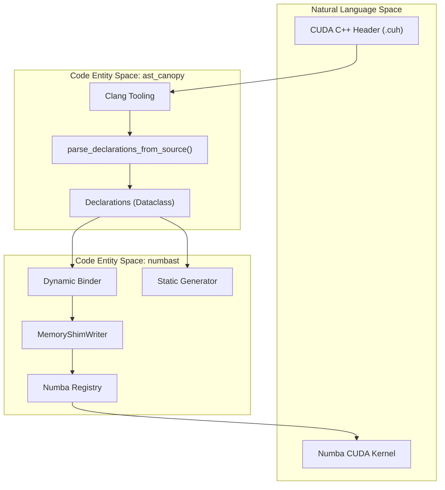
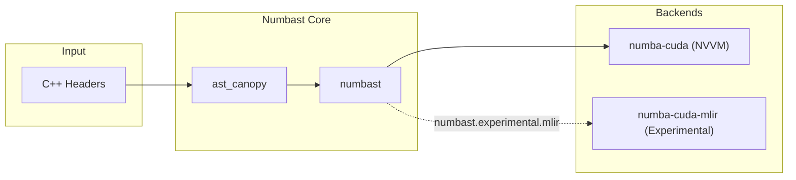

<!-- source: DeepWiki mcp.deepwiki.com · repo NVIDIA/numbast · page 1 Numbast Overview · fetched 2026-10-26 -->

# Numbast Overview

Relevant source files

The following files were used as context for generating this wiki page:

- [AGENTS.md](AGENTS.md)
- [CHANGELOG.md](CHANGELOG.md)
- [README.md](README.md)
- [VERSION](VERSION)
- [ast_canopy/README.md](ast_canopy/README.md)
- [ci/build_conda_python.sh](ci/build_conda_python.sh)
- [ci/test_conda_python.sh](ci/test_conda_python.sh)
- [conda/environment_template.yaml](conda/environment_template.yaml)
- [docs/nv-versions.json](docs/nv-versions.json)
- [docs/source/quickstart.rst](docs/source/quickstart.rst)
- [docs/versions.json](docs/versions.json)
- [numbast/README.md](numbast/README.md)
- [numbast/pyproject.toml](numbast/pyproject.toml)
- [numbast_extensions/pyproject.toml](numbast_extensions/pyproject.toml)

Numbast is an automated pipeline designed to parse CUDA C++ headers and generate Python bindings that are compatible with **Numba CUDA**. It enables CUDA Python projects to expose existing C++ device APIs (such as those in CCCL/CUB) without requiring developers to manually write Numba typing, lowering, or C-shim code for every function or type [numbast/README.md:3-7]().

### Core Purpose
The project bridges the gap between the CUDA C++ ecosystem and Python-based GPU kernels. By leveraging Clang-based AST parsing, it automates the creation of the boilerplate necessary for Numba to understand C++ memory layouts, function signatures, and template specializations [numbast/README.md:8-12]().

## System Architecture

Numbast is structured into two primary packages that separate the concerns of C++ parsing and Numba integration.

### 1. `ast_canopy`
The front-end parsing layer. It uses Clang tooling to traverse C++ Abstract Syntax Trees (AST) and serializes declaration metadata (structs, functions, enums, templates) into structured Python objects [numbast/README.md:8-10]().
*   **Key Function**: `parse_declarations_from_source` [numbast/README.md:42-42]().
*   **Scope**: Handles header discovery, macro expansion, and C++ type resolution.

### 2. `numbast`
The binding generation core. It consumes the metadata from `ast_canopy` to register Numba types or generate standalone Python source code [numbast/README.md:10-12]().
*   **Key Components**: `ShimWriter` classes, type mapping registries, and the static code generator [numbast/README.md:45-45](), [numbast/pyproject.toml:31-31]().

### Logical Data Flow
The following diagram illustrates how a CUDA C++ header is transformed into a usable Numba entity.

**C++ to Numba Transformation Flow**

Sources: [numbast/README.md:42-58](), [numbast/README.md:8-12]()

## Operational Modes

Numbast supports two complementary workflows depending on the deployment environment and performance requirements.

### Dynamic Binding (Runtime)
Bindings are generated and registered in memory during the Python session. This is ideal for development and experimentation [numbast/README.md:37-39]().
*   **Mechanism**: Uses `bind_cxx_struct` and `bind_cxx_function` to update Numba's internal registries on the fly [numbast/README.md:45-51]().
*   **Requirements**: Requires `ast_canopy`, `clangdev`, and the original C++ headers at runtime [numbast/README.md:38-39]().

### Static Binding (Build-time)
A CLI tool generates a standalone `.py` module containing all necessary Numba code.
*   **Mechanism**: Invoked via `python -m numbast` using a YAML configuration file [numbast/README.md:66-67](), [numbast/pyproject.toml:30-31]().
*   **Requirements**: The generated module only depends on `numba-cuda`; `numbast` and Clang are not required by the end user [numbast/README.md:62-64]().

**Comparison of Binding Modes**
| Feature | Dynamic Mode | Static Mode |
| :--- | :--- | :--- |
| **Primary Entry Point** | `bind_cxx_function` | `numbast` CLI |
| **Output** | In-memory Numba types | Standalone `.py` file |
| **Runtime Deps** | `ast_canopy`, `clangdev`, headers | `numba-cuda` only |
| **Best For** | Rapid Prototyping | Production Libraries |

Sources: [numbast/README.md:35-68](), [numbast/pyproject.toml:30-31]()

## Integration with Numba Backends

Numbast primarily targets the standard `numba-cuda` backend but has recently added support for the experimental **MLIR-based** backend [README.md:9-12]().

**Backend Architecture**

Sources: [README.md:9-12](), [numbast/pyproject.toml:42-42]()

## Project Resources

Detailed information on specific subsystems and processes can be found in the child pages:

*   **[Getting Started & Installation](#1.1)**: Setup instructions for Conda/pip and environment requirements like `clangdev` and `cuda-toolkit` [conda/environment_template.yaml:10-25]().
*   **[Changelog & Release Process](#1.2)**: History of changes and the `AGENTS.md` workflow for publishing new versions [AGENTS.md:3-50](), [CHANGELOG.md:1-12]().

Sources: [numbast/README.md:80-88](), [numbast/pyproject.toml:19-25]()

---

