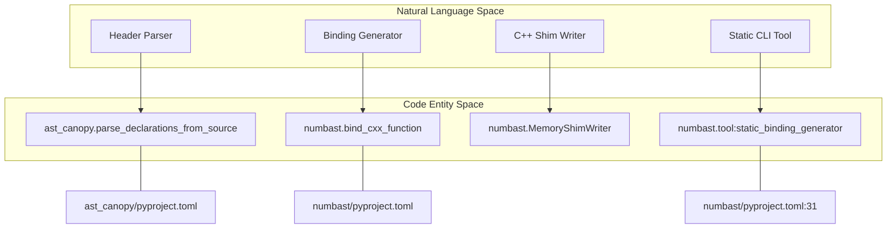
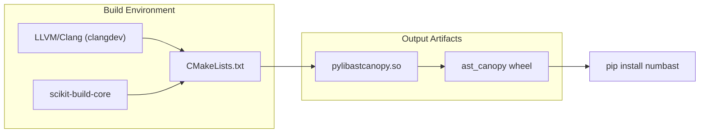

<!-- source: DeepWiki mcp.deepwiki.com · repo NVIDIA/numbast · page 1.1 Getting Started & Installation · fetched 2026-10-26 -->

# Getting Started & Installation

<details>
<summary>Relevant source files</summary>

The following files were used as context for generating this wiki page:

- [README.md](README.md)
- [ast_canopy/README.md](ast_canopy/README.md)
- [ast_canopy/pyproject.toml](ast_canopy/pyproject.toml)
- [ast_canopy/tests/host/cuda_headers/include/cuda.h](ast_canopy/tests/host/cuda_headers/include/cuda.h)
- [ast_canopy/tests/host/data/sample_host_function.cpp](ast_canopy/tests/host/data/sample_host_function.cpp)
- [ast_canopy/tests/host/test_cuda_h.py](ast_canopy/tests/host/test_cuda_h.py)
- [ast_canopy/tests/host/test_function.py](ast_canopy/tests/host/test_function.py)
- [ci/build_conda_python.sh](ci/build_conda_python.sh)
- [ci/build_wheels.sh](ci/build_wheels.sh)
- [ci/test_conda_python.sh](ci/test_conda_python.sh)
- [conda/environment_template.yaml](conda/environment_template.yaml)
- [docs/README.md](docs/README.md)
- [docs/build_docs.sh](docs/build_docs.sh)
- [docs/source/install.rst](docs/source/install.rst)
- [docs/source/quickstart.rst](docs/source/quickstart.rst)
- [numbast/README.md](numbast/README.md)
- [numbast/pyproject.toml](numbast/pyproject.toml)
- [numbast_extensions/pyproject.toml](numbast_extensions/pyproject.toml)
- [pyproject.toml](pyproject.toml)

</details>


This page provides a comprehensive guide to setting up the Numbast ecosystem. Numbast consists of two primary packages: `ast_canopy` (the C++ AST parsing engine) and `numbast` (the Numba binding generator).

## Environment Requirements

Numbast requires a specific set of system and Python dependencies to bridge the gap between CUDA C++ headers and Numba kernels.

### System Dependencies
*   **Clang/LLVM**: `ast_canopy` is built on `libClangTooling`. It specifically requires `clangdev` versions between 18 and 22.0 `[conda/environment_template.yaml:11-11]()`.
*   **CUDA Toolkit**: A working CUDA installation is required for both parsing headers (via `ast_canopy`) and executing kernels (via `numba-cuda`). Supported versions include CUDA 12.x and 13.x `[docs/source/install.rst:29-30]()`.
*   **C++ Compiler**: A standard C++ compiler is required to build the `ast_canopy` shared library `[conda/environment_template.yaml:19-19]()`.

### Python Dependencies
*   **Numba**: `numba-cuda >= 0.25.0` `[numbast/pyproject.toml:20-20]()`.
*   **Python**: Version 3.7 or higher `[numbast/pyproject.toml:13-13]()`.
*   **ast_canopy**: The parsing backend `[numbast/pyproject.toml:21-21]()`.

---

## Installation Methods

### 1. Using pip (Recommended for Users)
The easiest way to install Numbast is via PyPI. This installs the pre-compiled `ast_canopy` wheels and the pure-Python `numbast` package.

```bash
pip install numbast
```
`[docs/source/install.rst:12-12]()`

### 2. Using Conda
Numbast is available via the `numba`, `conda-forge`, and `nvidia` channels `[conda/environment_template.yaml:4-7]()`.

```bash
conda install -c numba -c conda-forge -c nvidia numbast
```
`[docs/source/install.rst:20-20]()`

### 3. From Source (Recommended for Development)
For development, the project uses **Pixi** to manage environments and dependencies. The repository defines specific test groups for different CUDA versions.

```bash
# Install environment for CUDA 12
pixi install -e test-cu12

# Build and install local packages
pixi run -e test-cu12 build-ast-canopy
pixi run -e test-cu12 install-numbast
```
`[docs/source/install.rst:35-42]()`

---

## Data Flow and Architecture

The installation process sets up a pipeline where `ast_canopy` acts as the front-end parser and `numbast` acts as the backend generator.

### System Component Mapping
This diagram maps natural language concepts to the specific code entities and files that implement them.

**Figure 1: Component Entity Mapping**

Sources: `[ast_canopy/pyproject.toml:9-12]()`, `[numbast/pyproject.toml:9-31]()`, `[numbast/README.md:41-48]()`.

### Installation & Build Pipeline
The following diagram illustrates the data flow during the installation and build of `ast_canopy`.

**Figure 2: Build and Linkage Flow**

Sources: `[ast_canopy/pyproject.toml:4-6]()`, `[ci/build_wheels.sh:7-28]()`, `[conda/environment_template.yaml:10-25]()`.

---

## Quickstart Example

Once installed, you can use Numbast in **Dynamic Mode** to bind C++ functions on the fly. This requires `ast_canopy` to parse the source and `numbast` to register the types with Numba.

### Minimal End-to-End Script
This example demonstrates parsing a local header and calling a C++ function from a Numba CUDA kernel.

```python
from ast_canopy import parse_declarations_from_source
from numba import cuda, types
from numba.core.datamodel.models import PrimitiveModel
from numbast import MemoryShimWriter, bind_cxx_function, bind_cxx_struct

# 1. Parse the C++ Header
# [numbast/README.md:47-47]
decls = parse_declarations_from_source("demo.cuh", ["demo.cuh"], "sm_80")

# 2. Initialize Shim Writer to hold generated C++ code
# [numbast/README.md:48-48]
shim_writer = MemoryShimWriter('#include "demo.cuh"')

# 3. Bind C++ Structs and Functions
# [numbast/README.md:50-51]
MyType = bind_cxx_struct(shim_writer, decls.structs[0], types.Number, PrimitiveModel)
my_function = bind_cxx_function(shim_writer, decls.functions[0])

# 4. Use in a Numba CUDA Kernel
# [numbast/README.md:54-57]
@cuda.jit(link=shim_writer.links())
def kernel(out):
    value = MyType(1.0)
    out[0] = my_function(value)
```

### Static Generation CLI
Alternatively, use the CLI to generate standalone Python modules that do not require Clang at runtime.

```bash
python -m numbast --cfg-path config.yml --output-dir ./generated
```
`[numbast/README.md:67-67]()`

Sources: `[numbast/README.md:35-67]()`, `[numbast/pyproject.toml:30-31]()`.

---

