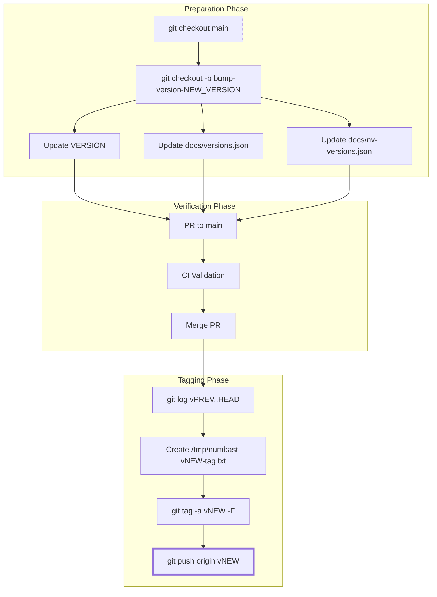
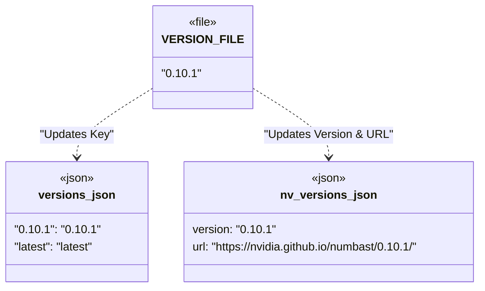

<!-- source: DeepWiki mcp.deepwiki.com · repo NVIDIA/numbast · page 1.2 Changelog & Release Process · fetched 2026-10-26 -->

# Changelog & Release Process

Relevant source files

The following files were used as context for generating this wiki page:

- [AGENTS.md](AGENTS.md)
- [CHANGELOG.md](CHANGELOG.md)
- [VERSION](VERSION)
- [ast_canopy/VERSION](ast_canopy/VERSION)
- [docs/nv-versions.json](docs/nv-versions.json)
- [docs/versions.json](docs/versions.json)
- [numbast/VERSION](numbast/VERSION)
- [numbast_extensions/VERSION](numbast_extensions/VERSION)

This page documents the Numbast versioning strategy, the automated release workflow driven by `AGENTS.md`, and the history of architectural milestones. The release process is designed to maintain synchronization between the core `numbast` package, the `ast_canopy` C++ parser, and the documentation site.

## Versioning Scheme

Numbast follows a unified versioning scheme where the root repository version is mirrored across all sub-packages.

| Component | Version Source | Role |
| :--- | :--- | :--- |
| **Root Repository** | [VERSION:1-1]() | Source of truth for the entire project. |
| **numbast** | [numbast/VERSION:1-1]() | Python binding generation core. |
| **ast_canopy** | [ast_canopy/VERSION:1-1]() | C++ AST parsing layer. |
| **numbast_extensions** | [numbast_extensions/VERSION:1-1]() | Pre-built bindings (e.g., bfloat16). |

Documentation versions are tracked in [docs/versions.json:1-9]() and [docs/nv-versions.json:1-30](), which map version strings to specific deployment URLs on GitHub Pages.

## Release Process Workflow

The release process is codified in [AGENTS.md:1-94]() as a set of "Skills" for automation agents or maintainers. It distinguishes between **Mainline Releases** (from `main`) and **Patch Releases** (from maintenance branches).

### Mainline Release (Skill: Publish a New Numbast Mainline Version)

Mainline releases occur when new features or breaking changes are merged into the `main` branch.

#### Data Flow: Mainline Release
The following diagram illustrates the transition from development to a tagged release.

"Mainline Release Data Flow"

**Sources:** [AGENTS.md:3-49]()

### Patch Release (Skill: Publish a Numbast Patch Release Line)

Patch releases are used for critical fixes targeting a specific previous version without incorporating all changes from `main`.

1.  **Maintenance Branch**: A branch named `PATCH_BRANCH` (e.g., `0.6.x-patch`) is created from a previous tag [AGENTS.md:62-65]().
2.  **Fix Integration**: Short-lived branches for fixes target the `PATCH_BRANCH` [AGENTS.md:66-66]().
3.  **Versioning**: A specific version bump PR is opened against the `PATCH_BRANCH` [AGENTS.md:67-73]().
4.  **Tagging**: The tag is created at the tip of the `PATCH_BRANCH`, not `main` [AGENTS.md:91-91]().

**Sources:** [AGENTS.md:50-94]()

---

## Major Architectural Milestones

The following table summarizes significant changes in the Numbast architecture as documented in the changelog.

| Version | Date | Key Architectural Changes |
| :--- | :--- | :--- |
| **0.5.0** | Aug 2025 | Removed RAPIDS and `pynvjitlink` dependencies [CHANGELOG.md:17-18](). Adopted GNU extension standard for Clang parsing [CHANGELOG.md:19-19](). Introduced custom typing/target registry hooks [CHANGELOG.md:20-20](). |
| **0.4.0** | Jun 2025 | Switched to **Itanium Name Mangler** for resolving shim function conflicts [CHANGELOG.md:39-39](). Added `ConstExpr Vardecl Matcher` to extract values from `VarDecl` [CHANGELOG.md:49-49](). |
| **0.3.0** | May 2025 | Implemented **Streamed Shim Function Writes** using `KeyedStringIO` to prevent duplicate lowering [CHANGELOG.md:61-61](). Added `active_linking_library` support for shim code objects [CHANGELOG.md:60-60](). |
| **0.2.0** | Nov 2024 | Introduced the **Static Binding Generator CLI** (`python -m numbast`) [CHANGELOG.md:77-77](). Standardized on `numba-cuda` dependency [CHANGELOG.md:80-80](). |
| **0.1.0** | Feb 2024 | Initial release. `ast_canopy` support for top-level declarations [CHANGELOG.md:89-89](). |

**Sources:** [CHANGELOG.md:1-90]()

---

## Release Artifacts & Metadata

The release process ensures that several metadata files are synchronized to allow the documentation and build systems to function correctly.

### Documentation Version Mapping
The `docs/versions.json` file provides a simple key-value map for the documentation UI, while `docs/nv-versions.json` provides the full URL structure used by the Sphinx theme.

"Documentation Metadata Mapping"

**Sources:** [VERSION:1-1](), [docs/versions.json:1-9](), [docs/nv-versions.json:1-30]()

### Changelog Generation
The changelog is generated non-interactively using `git log` with a specific format string:
`git log v<PREVIOUS_VERSION>..HEAD --pretty=format:"- %s"` [AGENTS.md:26-26]().
This output is used both for the PR description and the annotated git tag [AGENTS.md:32-35]().

**Sources:** [AGENTS.md:25-35]()

---

