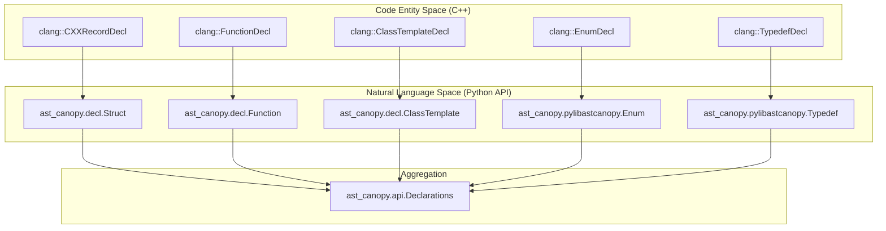
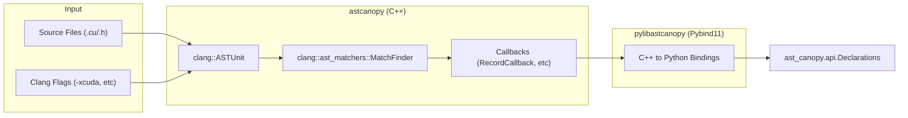

<!-- source: DeepWiki mcp.deepwiki.com · repo NVIDIA/numbast · page 2 ast_canopy: C++ AST Parsing Layer · fetched 2026-10-26 -->

# ast_canopy: C++ AST Parsing Layer

Relevant source files

The following files were used as context for generating this wiki page:

- [ast_canopy/ast_canopy/api.py](ast_canopy/ast_canopy/api.py)
- [ast_canopy/ast_canopy/pylibastcanopy.cpp](ast_canopy/ast_canopy/pylibastcanopy.cpp)
- [ast_canopy/ast_canopy/pylibastcanopy.pyi](ast_canopy/ast_canopy/pylibastcanopy.pyi)
- [ast_canopy/cpp/include/ast_canopy/ast_canopy.hpp](ast_canopy/cpp/include/ast_canopy/ast_canopy.hpp)
- [ast_canopy/cpp/src/ast_canopy.cpp](ast_canopy/cpp/src/ast_canopy.cpp)
- [ast_canopy/tests/test_parse_from_source.py](ast_canopy/tests/test_parse_from_source.py)
- [docs/source/faq.rst](docs/source/faq.rst)

`ast_canopy` is the parsing front-end of the Numbast ecosystem. It leverages Clang's C++ driver and AST matching infrastructure to extract structural information from CUDA C++ source files and headers, converting them into a hierarchy of Python-accessible objects. This layer abstracts the complexities of the Clang AST (Abstract Syntax Tree) and provides a clean data model for the downstream `numbast` package to generate Numba-compatible bindings.

### Core Role in Numbast
`ast_canopy` acts as a bridge between the C++ source code and Python. It handles environment discovery (finding CUDA and system headers), drives the Clang parser with appropriate flags (e.g., `-xcuda`, `--cuda-path`), and traverses the resulting AST to identify structs, functions, templates, and enums.

The following diagram illustrates the transition from C++ source code entities to the Python objects provided by `ast_canopy`.

**C++ to Python Entity Mapping**

Sources: [ast_canopy/ast_canopy/api.py:56-64](), [ast_canopy/cpp/include/ast_canopy/ast_canopy.hpp:197-221](), [ast_canopy/ast_canopy/pylibastcanopy.cpp:15-100]()

---

### Python API Overview
The primary entry point for users is `parse_declarations_from_source`, which coordinates the environment setup and parsing logic. The results are returned in a `Declarations` dataclass containing lists of extracted entities.

- **Environment Discovery**: The API includes helpers like `get_cuda_include_dir_for_clang` and `get_default_compiler_search_paths` to ensure Clang can resolve standard and CUDA-specific headers.
- **Filtering**: The `files_to_retain` parameter allows users to filter the results, ensuring that only declarations from specific files are returned, even if the parser processed a large header graph.

For details on the Python interface, see [Python API: parse_declarations_from_source](#2.1).

Sources: [ast_canopy/ast_canopy/api.py:56-64](), [ast_canopy/ast_canopy/api.py:210-213]()

---

### C++ Core and AST Traversal
The heavy lifting is performed by a C++ shared library (`astcanopy`) and its `pybind11` bindings (`pylibastcanopy`).

- **AST Matching**: The system uses `clang::ast_matchers` to identify specific C++ constructs. Callbacks like `RecordCallback` and `FunctionCallback` populate C++ structs (e.g., `ast_canopy::Record`, `ast_canopy::Function`) with metadata.
- **Data Model**: The C++ layer captures detailed information including `execution_space` (host vs. device), `method_kind` (constructors vs. operators), and mangled names for linking.
- **Serialization**: Most core structs implement `py::pickle` support, allowing the extracted AST data to be cached or transferred between processes.

For details on the C++ implementation, see [C++ Core: AST Traversal and Data Model](#2.2).

**AST Parsing Pipeline**

Sources: [ast_canopy/cpp/src/ast_canopy.cpp:154-180](), [ast_canopy/cpp/src/ast_canopy.cpp:81-150](), [ast_canopy/ast_canopy/pylibastcanopy.cpp:15-49]()

---

### Build System and Requirements
`ast_canopy` has significant build-time dependencies on LLVM and Clang. It uses `scikit-build-core` and CMake to manage the compilation of the C++ extensions.

- **Clang Versioning**: The codebase strictly supports Clang versions 18 through 21.
- **Shim Headers**: To handle differences between CUDA versions (e.g., CUDA 12 vs 13), `ast_canopy` includes a `shim_include` directory that provides compatibility wrappers during the parsing phase.
- **Packaging**: The build process ensures that the resulting Python wheel contains the necessary shared libraries and C++ resources required for parsing.

For details on the build process and environment requirements, see [Build System: CMake and scikit-build-core](#2.3).

Sources: [ast_canopy/cpp/src/ast_canopy.cpp:26-27](), [ast_canopy/ast_canopy/api.py:42-53](), [docs/source/faq.rst:70-82]()

---

### Child Pages
- [Python API: parse_declarations_from_source](#2.1)
- [C++ Core: AST Traversal and Data Model](#2.2)
- [Build System: CMake and scikit-build-core](#2.3)

---

