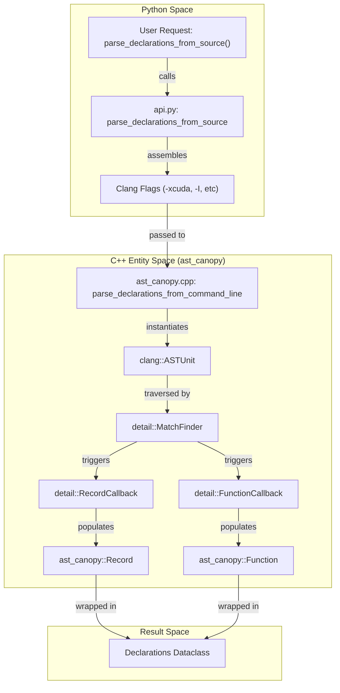
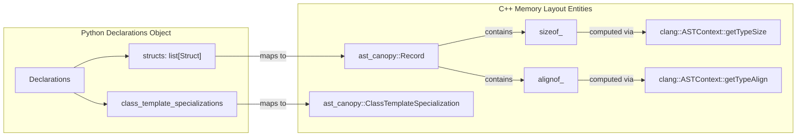

<!-- source: DeepWiki mcp.deepwiki.com · repo NVIDIA/numbast · page 2.1 Python API: parse_declarations_from_source · fetched 2026-10-26 -->

# Python API: parse_declarations_from_source

Relevant source files

The following files were used as context for generating this wiki page:

- [ast_canopy/ast_canopy/__init__.py](ast_canopy/ast_canopy/__init__.py)
- [ast_canopy/ast_canopy/api.py](ast_canopy/ast_canopy/api.py)
- [ast_canopy/ast_canopy/constants.py](ast_canopy/ast_canopy/constants.py)
- [ast_canopy/ast_canopy/fdcap_min.py](ast_canopy/ast_canopy/fdcap_min.py)
- [ast_canopy/cpp/src/ast_canopy.cpp](ast_canopy/cpp/src/ast_canopy.cpp)
- [ast_canopy/cpp/src/record.cpp](ast_canopy/cpp/src/record.cpp)
- [ast_canopy/tests/data/sample_record_incomplete.cu](ast_canopy/tests/data/sample_record_incomplete.cu)
- [ast_canopy/tests/test_parse_from_source.py](ast_canopy/tests/test_parse_from_source.py)
- [ast_canopy/tests/test_record_incomplete.py](ast_canopy/tests/test_record_incomplete.py)
- [docs/source/faq.rst](docs/source/faq.rst)

The `ast_canopy` Python API provides the primary interface for extracting C++ declarations from CUDA source files. It leverages a Clang-based backend to parse headers and source code into structured Python dataclasses, facilitating the generation of Numba bindings.

## Core API: parse_declarations_from_source

The central function of the `ast_canopy` package is `parse_declarations_from_source`. It orchestrates the environment resolution, Clang command-line construction, and the invocation of the C++ AST traversal engine.

### Data Flow and Implementation
When called, the function performs the following steps:
1. **Environment Resolution**: It gathers necessary include paths for the CUDA Toolkit, Clang resource headers, and system C++ headers (libstdc++) [ast_canopy/ast_canopy/api.py:234-245]().
2. **Command-Line Assembly**: It constructs a list of Clang compiler flags, including `-xcuda`, `--cuda-device-only`, and target architecture (e.g., `sm_80`) [ast_canopy/ast_canopy/api.py:252-277]().
3. **AST Parsing**: It calls the underlying pybind11-wrapped C++ function `parse_declarations_from_command_line` [ast_canopy/ast_canopy/api.py:301-305]().
4. **Filtering**: It uses the `files_to_retain` mechanism to ensure only declarations from specified files are returned, preventing the pollution of the results with standard library or system headers [ast_canopy/cpp/src/ast_canopy.cpp:155-157]().

### The Declarations Dataclass
The result of a parse operation is encapsulated in a `Declarations` dataclass, which serves as a container for various C++ entities.

| Field | Type | Description |
| :--- | :--- | :--- |
| `structs` | `list[Struct]` | Non-templated C++ structs, classes, and unions. |
| `functions` | `list[Function]` | Free-standing (non-member) C++ functions. |
| `function_templates` | `list[FunctionTemplate]` | Free-standing function templates. |
| `class_templates` | `list[ClassTemplate]` | C++ class/struct templates. |
| `class_template_specializations` | `list[ClassTemplateSpecialization]` | Explicit or implicit template instantiations. |
| `typedefs` | `list[Typedef]` | C++ type aliases and typedefs. |
| `enums` | `list[Enum]` | C++ enumerations (scoped and unscoped). |

**Sources:** [ast_canopy/ast_canopy/api.py:56-65](), [ast_canopy/ast_canopy/api.py:210-310]()

## Environment Resolution Helpers

Parsing CUDA C++ requires discovering specific system resources. `ast_canopy` includes several helpers to automate this.

### CUDA Include Discovery
`get_cuda_include_dir_for_clang` uses `cuda.pathfinder` to locate CUDA Toolkit headers. It handles different layouts for CUDA 12 and 13, including support for pip-installed toolkit wheels and system-wide installations [ast_canopy/ast_canopy/api.py:210-231]().

### Clang Resource Directory
`get_clang_resource_dir` locates the builtin Clang headers (e.g., `<stddef.h>`, `__clang_cuda_runtime_wrapper.h`). It prioritizes the directory associated with the `ast_canopy` installation or falls back to searching the system path for a `clang` binary [ast_canopy/ast_canopy/api.py:173-208]().

### libstdc++ Fallback
`libstdcxx_include_dirs_fallback` provides a mechanism to find system C++ headers on Linux (typically in `/usr/include/c++/<version>`) if the Clang driver fails to report them automatically [ast_canopy/ast_canopy/api.py:130-170]().

**Sources:** [ast_canopy/ast_canopy/api.py:130-231](), [docs/source/faq.rst:70-125]()

## System Architecture Diagrams

The following diagrams illustrate the relationship between the Python API and the underlying C++ entities.

### Natural Language to Code Entity Mapping: Parsing Flow
This diagram maps the high-level request to parse a file to the specific internal classes and functions involved.

**Sources:** [ast_canopy/ast_canopy/api.py:210-310](), [ast_canopy/cpp/src/ast_canopy.cpp:154-200]()

### Entity Relationship: Declarations and Layout
This diagram shows how the `Declarations` object relates to the underlying C++ structural information extracted by the parser.

**Sources:** [ast_canopy/ast_canopy/api.py:56-65](), [ast_canopy/cpp/src/record.cpp:19-97]()

## Filtering with files_to_retain

The `files_to_retain` parameter is critical for performance and clarity. C++ headers often include a vast tree of dependencies. By passing a list of filenames to `files_to_retain`, the parser ignores any declaration whose source location does not match one of the provided paths [ast_canopy/cpp/src/ast_canopy.cpp:72-79]().

### Special Case: Incomplete Types
If a struct or class template specialization is encountered that is incomplete (e.g., only forward-declared), `ast_canopy` cannot compute its size or alignment. In these cases, the parser assigns sentinel values:
*   `INVALID_SIZE_OF`: Indicates the size could not be determined.
*   `INVALID_ALIGN_OF`: Indicates the alignment could not be determined.

This prevents the parser from crashing when encountering complex template hierarchies [ast_canopy/cpp/src/record.cpp:85-97]().

**Sources:** [ast_canopy/cpp/src/record.cpp:85-97](), [ast_canopy/ast_canopy/constants.py:1-10](), [ast_canopy/tests/test_record_incomplete.py:81-101]()

## Constant Evaluation: value_from_constexpr_vardecl

In addition to parsing structural declarations, `ast_canopy` can extract the values of `constexpr` variables. The `value_from_constexpr_vardecl` function takes a `ConstExprVar` object and returns its evaluated constant value (e.g., an integer or boolean) from the AST [ast_canopy/ast_canopy/api.py:19]().

**Sources:** [ast_canopy/ast_canopy/api.py:19](), [ast_canopy/ast_canopy/__init__.py:10-19]()

---

