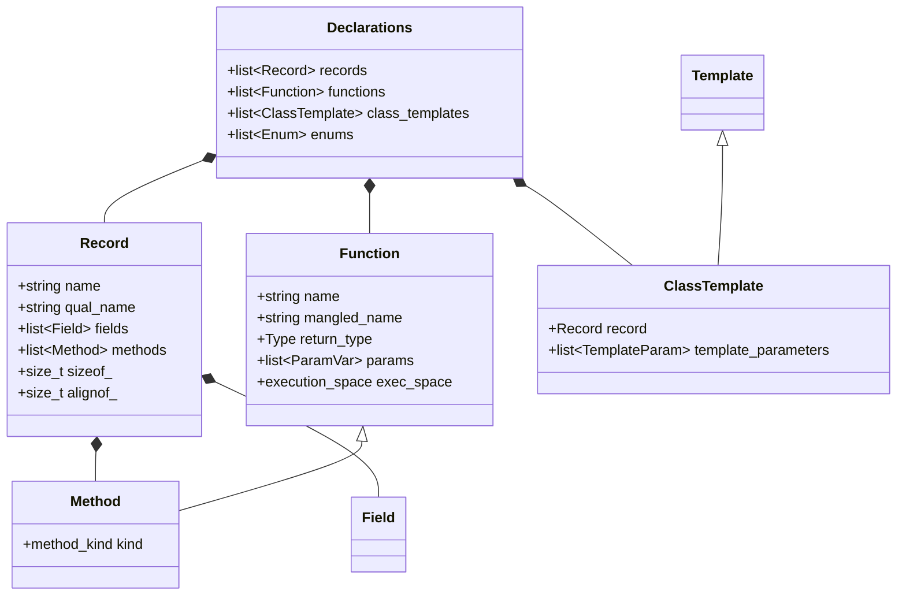
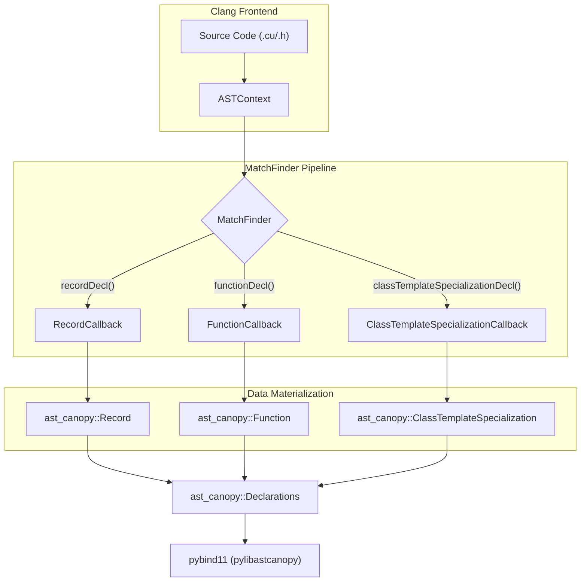

<!-- source: DeepWiki mcp.deepwiki.com · repo NVIDIA/numbast · page 2.2 C++ Core: AST Traversal and Data Model · fetched 2026-10-26 -->

# C++ Core: AST Traversal and Data Model

Relevant source files

The following files were used as context for generating this wiki page:

- [ast_canopy/ast_canopy/__init__.py](ast_canopy/ast_canopy/__init__.py)
- [ast_canopy/ast_canopy/constants.py](ast_canopy/ast_canopy/constants.py)
- [ast_canopy/ast_canopy/decl.py](ast_canopy/ast_canopy/decl.py)
- [ast_canopy/ast_canopy/pylibastcanopy.cpp](ast_canopy/ast_canopy/pylibastcanopy.cpp)
- [ast_canopy/ast_canopy/pylibastcanopy.pyi](ast_canopy/ast_canopy/pylibastcanopy.pyi)
- [ast_canopy/cpp/include/ast_canopy/ast_canopy.hpp](ast_canopy/cpp/include/ast_canopy/ast_canopy.hpp)
- [ast_canopy/cpp/src/class_template.cpp](ast_canopy/cpp/src/class_template.cpp)
- [ast_canopy/cpp/src/class_template_specialization.cpp](ast_canopy/cpp/src/class_template_specialization.cpp)
- [ast_canopy/cpp/src/constexpr_vardecl.cpp](ast_canopy/cpp/src/constexpr_vardecl.cpp)
- [ast_canopy/cpp/src/detail/matchers.hpp](ast_canopy/cpp/src/detail/matchers.hpp)
- [ast_canopy/cpp/src/detail/matchers/class_template_specialization_matcher.cpp](ast_canopy/cpp/src/detail/matchers/class_template_specialization_matcher.cpp)
- [ast_canopy/cpp/src/detail/matchers/function_matcher.cpp](ast_canopy/cpp/src/detail/matchers/function_matcher.cpp)
- [ast_canopy/cpp/src/detail/matchers/record_matcher.cpp](ast_canopy/cpp/src/detail/matchers/record_matcher.cpp)
- [ast_canopy/cpp/src/enum.cpp](ast_canopy/cpp/src/enum.cpp)
- [ast_canopy/cpp/src/function.cpp](ast_canopy/cpp/src/function.cpp)
- [ast_canopy/cpp/src/function_template.cpp](ast_canopy/cpp/src/function_template.cpp)
- [ast_canopy/cpp/src/record.cpp](ast_canopy/cpp/src/record.cpp)
- [ast_canopy/cpp/src/template.cpp](ast_canopy/cpp/src/template.cpp)
- [ast_canopy/cpp/src/template_param.cpp](ast_canopy/cpp/src/template_param.cpp)
- [ast_canopy/cpp/src/type.cpp](ast_canopy/cpp/src/type.cpp)
- [ast_canopy/cpp/src/typedef.cpp](ast_canopy/cpp/src/typedef.cpp)
- [ast_canopy/tests/conftest.py](ast_canopy/tests/conftest.py)
- [ast_canopy/tests/data/sample_crtp_dependent.cu](ast_canopy/tests/data/sample_crtp_dependent.cu)
- [ast_canopy/tests/data/sample_itanium_mangled_names.cu](ast_canopy/tests/data/sample_itanium_mangled_names.cu)
- [ast_canopy/tests/data/sample_macro.cu](ast_canopy/tests/data/sample_macro.cu)
- [ast_canopy/tests/data/sample_null_qualtype.cu](ast_canopy/tests/data/sample_null_qualtype.cu)
- [ast_canopy/tests/data/sample_record_incomplete.cu](ast_canopy/tests/data/sample_record_incomplete.cu)
- [ast_canopy/tests/data/sample_template_template_param.cu](ast_canopy/tests/data/sample_template_template_param.cu)
- [ast_canopy/tests/data/sample_typedef_template_inst.cu](ast_canopy/tests/data/sample_typedef_template_inst.cu)
- [ast_canopy/tests/data/sample_types.cu](ast_canopy/tests/data/sample_types.cu)
- [ast_canopy/tests/data/sample_unsupported_template_args.cu](ast_canopy/tests/data/sample_unsupported_template_args.cu)
- [ast_canopy/tests/test_crtp_dependent_mangle.py](ast_canopy/tests/test_crtp_dependent_mangle.py)
- [ast_canopy/tests/test_mangled_name.py](ast_canopy/tests/test_mangled_name.py)
- [ast_canopy/tests/test_null_qualtype_guard.py](ast_canopy/tests/test_null_qualtype_guard.py)
- [ast_canopy/tests/test_parse_macro.py](ast_canopy/tests/test_parse_macro.py)
- [ast_canopy/tests/test_parse_type.py](ast_canopy/tests/test_parse_type.py)
- [ast_canopy/tests/test_record_incomplete.py](ast_canopy/tests/test_record_incomplete.py)
- [ast_canopy/tests/test_template_template_param.py](ast_canopy/tests/test_template_template_param.py)
- [ast_canopy/tests/test_typedef_template_instantiation.py](ast_canopy/tests/test_typedef_template_instantiation.py)
- [ast_canopy/tests/test_unsupported_template_args.py](ast_canopy/tests/test_unsupported_template_args.py)
- [numbast/src/numbast/tools/tests/macros.cuh](numbast/src/numbast/tools/tests/macros.cuh)
- [numbast/src/numbast/tools/tests/test_macros.py](numbast/src/numbast/tools/tests/test_macros.py)

This page documents the C++ internals of `ast_canopy`, the layer responsible for parsing CUDA C++ source code using Clang and exposing a structured data model to Python. It details the core C++ structs, the AST traversal mechanism using Clang Matchers, and the pybind11 bindings that bridge the C++ and Python layers.

## Data Model and Core Structs

The `ast_canopy` data model is defined as a hierarchy of C++ structs that mirror C++ language constructs. These structs are designed to be serializable and easy to consume from Python.

### Core Struct Hierarchy

| Struct | Description |
| :--- | :--- |
| `Type` | Represents a C++ type, storing its name, unqualified name, and reference properties [ast_canopy/cpp/include/ast_canopy/ast_canopy.hpp:50-65](). |
| `Record` | Represents a `struct` or `class`. Contains fields, methods, nested records, and layout information (`sizeof`, `alignof`) [ast_canopy/cpp/include/ast_canopy/ast_canopy.hpp:197-215](). |
| `Function` | Represents a C++ function, including return type, parameters, execution space, and mangled name [ast_canopy/cpp/include/ast_canopy/ast_canopy.hpp:138-159](). |
| `Method` | Inherits from `Function`; represents a class member function with an associated `method_kind` [ast_canopy/cpp/include/ast_canopy/ast_canopy.hpp:177-190](). |
| `Template` | Base struct for templates, holding `TemplateParam` lists [ast_canopy/cpp/include/ast_canopy/ast_canopy.hpp:112-122](). |
| `ClassTemplate` | Represents a class template declaration [ast_canopy/cpp/include/ast_canopy/ast_canopy.hpp:228-243](). |
| `Enum` | Represents a C++ enumeration and its constant values [ast_canopy/cpp/include/ast_canopy/ast_canopy.hpp:67-82](). |
| `Declarations` | The top-level container returned by the parser, holding collections of all parsed entities [ast_canopy/ast_canopy/pylibastcanopy.pyi:27-35](). |

### Enums for Metadata

The system uses several enums to categorize C++ entities:
*   **`execution_space`**: Identifies where a function can run (`host`, `device`, `host_device`, `global_`) [ast_canopy/cpp/include/ast_canopy/ast_canopy.hpp:33]().
*   **`method_kind`**: Categorizes constructors (default, copy, move, converting) and destructors [ast_canopy/cpp/include/ast_canopy/ast_canopy.hpp:35-44]().
*   **`access_kind`**: Standard C++ access specifiers (`public_`, `protected_`, `private_`) [ast_canopy/cpp/include/ast_canopy/ast_canopy.hpp:48]().

### C++ Data Model Overview

**Sources:** [ast_canopy/cpp/include/ast_canopy/ast_canopy.hpp:30-243](), [ast_canopy/ast_canopy/pylibastcanopy.pyi:9-125]()

## AST Traversal and MatchFinder

The parsing process uses Clang's `ASTMatchFinder` to locate specific declarations in the AST. Callbacks are registered for different types of C++ nodes.

### Matcher Callbacks

The `ast_canopy::detail` namespace contains several callback classes that inherit from `MatchFinder::MatchCallback` [ast_canopy/cpp/src/detail/matchers.hpp:41-121]().

1.  **`RecordCallback`**: Extracts struct/class definitions. It iterates through the `DeclContext` to find fields, methods, and nested declarations [ast_canopy/cpp/src/record.cpp:19-77]().
2.  **`FunctionCallback`**: Handles standalone functions and computes their Itanium mangled names [ast_canopy/cpp/src/function.cpp:131-176]().
3.  **`ClassTemplateSpecializationCallback`**: Specifically handles template instantiations. It captures the actual template arguments and registers the specialization's ID in a shared map to allow `Typedef` resolution [ast_canopy/cpp/src/detail/matchers/class_template_specialization_matcher.cpp:97-132]().

### Execution Space Detection
The `get_execution_space` helper identifies CUDA attributes on function declarations:
*   `__global__` -> `execution_space::global_`
*   `__host__ __device__` -> `execution_space::host_device`
*   Standard functions default to `execution_space::undefined` or `host` [ast_canopy/cpp/src/function.cpp:19-32]().

### Mangling and Dependent Signatures
For functions with template-dependent signatures (where types are not yet resolved), the Clang mangler can crash. `ast_canopy` detects this using `has_dependent_signature` and falls back to a stable, byte-encoded fallback name instead of a standard Itanium mangled symbol [ast_canopy/cpp/src/function.cpp:41-129]().

### Traversal Logic Flow

**Sources:** [ast_canopy/cpp/src/detail/matchers.hpp:25-121](), [ast_canopy/cpp/src/function.cpp:131-176](), [ast_canopy/cpp/src/detail/matchers/class_template_specialization_matcher.cpp:101-132]()

## Pybind11 Bindings (`pylibastcanopy`)

The `pylibastcanopy` module exposes the C++ structs to Python. It is defined in `ast_canopy/ast_canopy/pylibastcanopy.cpp`.

### Serialization (Pickle Support)
Most core classes implement `py::pickle` to allow `Declarations` objects to be saved and loaded across Python sessions. This is critical for caching parsed headers [ast_canopy/ast_canopy/pylibastcanopy.cpp:59-70]().

### Key Bindings

*   **Enums**: `execution_space`, `method_kind`, `template_param_kind`, and `access_kind` are mapped to Python enums [ast_canopy/ast_canopy/pylibastcanopy.cpp:23-48]().
*   **Type**: Exposes `name`, `unqualified_non_ref_type_name`, and reference check methods [ast_canopy/ast_canopy/pylibastcanopy.cpp:50-57]().
*   **Record**: Exposes fields, methods, and layout constants. If a record is incomplete or dependent, `sizeof_` and `alignof_` return `INVALID_SIZE_OF` / `INVALID_ALIGN_OF` [ast_canopy/ast_canopy/pylibastcanopy.cpp:18-19](), [ast_canopy/cpp/src/record.cpp:85-97]().

### Binding Association
| C++ Entity | Python Binding | Role |
| :--- | :--- | :--- |
| `ast_canopy::Type` | `pylibastcanopy.Type` | Type metadata provider [ast_canopy/ast_canopy/pylibastcanopy.cpp:50]() |
| `ast_canopy::Record` | `pylibastcanopy.Record` | Struct/Class definition [ast_canopy/ast_canopy/pylibastcanopy.cpp:211]() |
| `ast_canopy::Function` | `pylibastcanopy.Function` | Function/Operator metadata [ast_canopy/ast_canopy/pylibastcanopy.cpp:158]() |
| `ast_canopy::Declarations` | `pylibastcanopy.Declarations` | Aggregate container [ast_canopy/ast_canopy/pylibastcanopy.cpp:280]() |

**Sources:** [ast_canopy/ast_canopy/pylibastcanopy.cpp:15-300](), [ast_canopy/cpp/include/ast_canopy/ast_canopy.hpp:25-28]()

## Type Resolution and Normalization

`ast_canopy` performs normalization on type names to ensure consistency between the C++ parser and Numba's type system.

### Qualifier Removal
The function `remove_qualifier_recursive_to_name` recursively strips `const`, `volatile`, and references from types. For example, `const int*` is normalized to `int*` [ast_canopy/cpp/src/type.cpp:53-74]().

### Portability for `stdint` Types
Types like `uint64_t` are handled specially. Instead of resolving them to their underlying platform-specific canonical type (e.g., `unsigned long long`), `ast_canopy` preserves the `stdint` name if detected via `contains_stdint_type` to ensure portability of generated bindings [ast_canopy/cpp/src/type.cpp:21-35](), [ast_canopy/cpp/src/type.cpp:99-101]().

**Sources:** [ast_canopy/cpp/src/type.cpp:21-110]()

---

