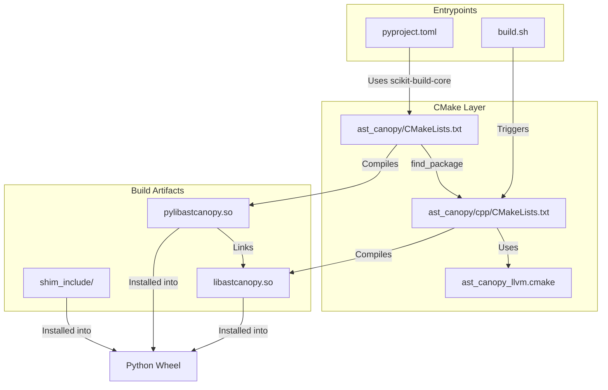
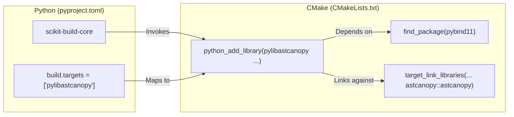

<!-- source: DeepWiki mcp.deepwiki.com · repo NVIDIA/numbast · page 2.3 Build System: CMake and scikit-build-core · fetched 2026-10-26 -->

# Build System: CMake and scikit-build-core

Relevant source files

The following files were used as context for generating this wiki page:

- [ast_canopy/CMakeLists.txt](ast_canopy/CMakeLists.txt)
- [ast_canopy/build.sh](ast_canopy/build.sh)
- [ast_canopy/cpp/CMakeLists.txt](ast_canopy/cpp/CMakeLists.txt)
- [ast_canopy/cpp/cmake/ast_canopy_llvm.cmake](ast_canopy/cpp/cmake/ast_canopy_llvm.cmake)
- [ast_canopy/pyproject.toml](ast_canopy/pyproject.toml)
- [ast_canopy/tests/host/cuda_headers/include/cuda.h](ast_canopy/tests/host/cuda_headers/include/cuda.h)
- [ast_canopy/tests/host/data/sample_host_function.cpp](ast_canopy/tests/host/data/sample_host_function.cpp)
- [ast_canopy/tests/host/test_cuda_h.py](ast_canopy/tests/host/test_cuda_h.py)
- [ast_canopy/tests/host/test_function.py](ast_canopy/tests/host/test_function.py)
- [ci/build_wheels.sh](ci/build_wheels.sh)
- [pyproject.toml](pyproject.toml)

This page describes the build infrastructure for the `ast_canopy` package, which serves as the C++ front-end for Numbast. The system utilizes a multi-stage approach involving Bash entrypoints, CMake for C++ compilation and library discovery, and `scikit-build-core` for Python wheel integration.

### Build Architecture Overview

The build system is designed to handle two distinct components: the core C++ library (`astcanopy`) and the Python bindings (`pylibastcanopy`). It must also manage complex dependencies on LLVM and Clang libraries, ensuring consistent Run-Time Type Information (RTTI) support across the stack.

The following diagram illustrates the flow from the build entrypoint to the final packaged wheel:

**Figure 1: ast_canopy Build and Packaging Flow**

**Sources:** [ast_canopy/build.sh:1-18](), [ast_canopy/CMakeLists.txt:12-34](), [ast_canopy/cpp/CMakeLists.txt:19-55](), [ast_canopy/pyproject.toml:4-10]()

---

### The build.sh Entrypoint

The `build.sh` script provides a unified interface for developers to configure and compile the C++ core. It handles environment normalization, build type selection (Debug/Release), and LLVM linkage preferences.

| Option | Description | Implementation |
| :--- | :--- | :--- |
| `--develop` | Sets `Editable_Mode` for development. | [ast_canopy/build.sh:71-74]() |
| `--debug` | Sets `CMAKE_BUILD_TYPE` to `Debug`. | [ast_canopy/build.sh:75-78]() |
| `--llvm-linkage` | Chooses `STATIC` or `SHARED` linkage for Clang/LLVM. | [ast_canopy/build.sh:79-87]() |
| `--incremental` | Reuses existing build cache in `cpp/build`. | [ast_canopy/build.sh:88-91]() |

The script also performs critical path normalization, converting between colon-separated environment paths and semicolon-separated CMake paths via `normalize_cmake_prefix_path` [ast_canopy/build.sh:21-28]().

**Sources:** [ast_canopy/build.sh:41-106](), [ast_canopy/build.sh:185-195]()

---

### CMake Structure and LLVM Linkage

The C++ core is defined in `ast_canopy/cpp/CMakeLists.txt`. It builds a shared library `astcanopy` containing the AST traversal logic [ast_canopy/cpp/CMakeLists.txt:19-43]().

#### LLVM/Clang Integration
The project requires several Clang components (e.g., `clangTooling`, `clangASTMatchers`). Linkage is managed by the helper function `ast_canopy_target_link_clang` [ast_canopy/cpp/cmake/ast_canopy_llvm.cmake:11-51]().

**Linkage Verification Logic:**
1.  It iterates through required targets like `clangAST` and `clangSema` [ast_canopy/cpp/cmake/ast_canopy_llvm.cmake:13-27]().
2.  It checks the `TYPE` property of the discovered targets against the requested `LLVM_LINKAGE` [ast_canopy/cpp/cmake/ast_canopy_llvm.cmake:37-38]().
3.  If `LLVM_LINKAGE` is `STATIC` but shared libraries are found, it raises a `FATAL_ERROR` to prevent binary incompatibility [ast_canopy/cpp/cmake/ast_canopy_llvm.cmake:41-44]().

#### RTTI Requirements
Because Clang's AST Matchers rely heavily on C++ Run-Time Type Information, both the core library and the Python bindings must be compiled with `-frtti` [ast_canopy/cpp/CMakeLists.txt:78](), [ast_canopy/CMakeLists.txt:28](). This is enforced via `CMAKE_CXX_FLAGS` in the build script [ast_canopy/build.sh:190]().

**Sources:** [ast_canopy/cpp/CMakeLists.txt:55-82](), [ast_canopy/cpp/cmake/ast_canopy_llvm.cmake:1-51](), [ast_canopy/build.sh:193-194]()

---

### Python Integration with scikit-build-core

The `ast_canopy/pyproject.toml` file defines `scikit-build-core` as the build backend [ast_canopy/pyproject.toml:4-6](). This integration allows the Python package to manage the CMake lifecycle during `pip install` or `pip wheel`.

**Figure 2: Code Entity Association (Python to C++ Build)**

#### Packaging Header Shims
The `shim_include` directory contains C++ headers required at runtime by Numbast for template instantiation. These must be explicitly included in the wheel.
*   **CMake Install:** `install(DIRECTORY ... DESTINATION ast_canopy)` ensures the files are placed in the install tree [ast_canopy/CMakeLists.txt:40-43]().
*   **SDist Inclusion:** `sdist.include` in `pyproject.toml` ensures these headers are present in source distributions [ast_canopy/pyproject.toml:23]().

**Sources:** [ast_canopy/pyproject.toml:18-23](), [ast_canopy/CMakeLists.txt:23-43]()

---

### CI Wheel Build Pipeline

The `ci/build_wheels.sh` script automates the production of redistributable wheels. It forces static LLVM linkage to ensure the resulting binaries are self-contained and do not depend on the host's LLVM installation.

1.  **Static Build:** Executes `./build.sh --llvm-linkage=STATIC --no-install` [ci/build_wheels.sh:26]().
2.  **Multi-version Python:** Iterates through supported Python versions (3.10 through 3.14) to generate specific wheels [ci/build_wheels.sh:32-34]().
3.  **Auditwheel Repair:** Uses `auditwheel repair` to bundle the internal `libastcanopy.so` into the wheel, ensuring the library can be found via `LD_LIBRARY_PATH` during the repair process [ci/build_wheels.sh:37-40]().

**Sources:** [ci/build_wheels.sh:7-40]()

---

