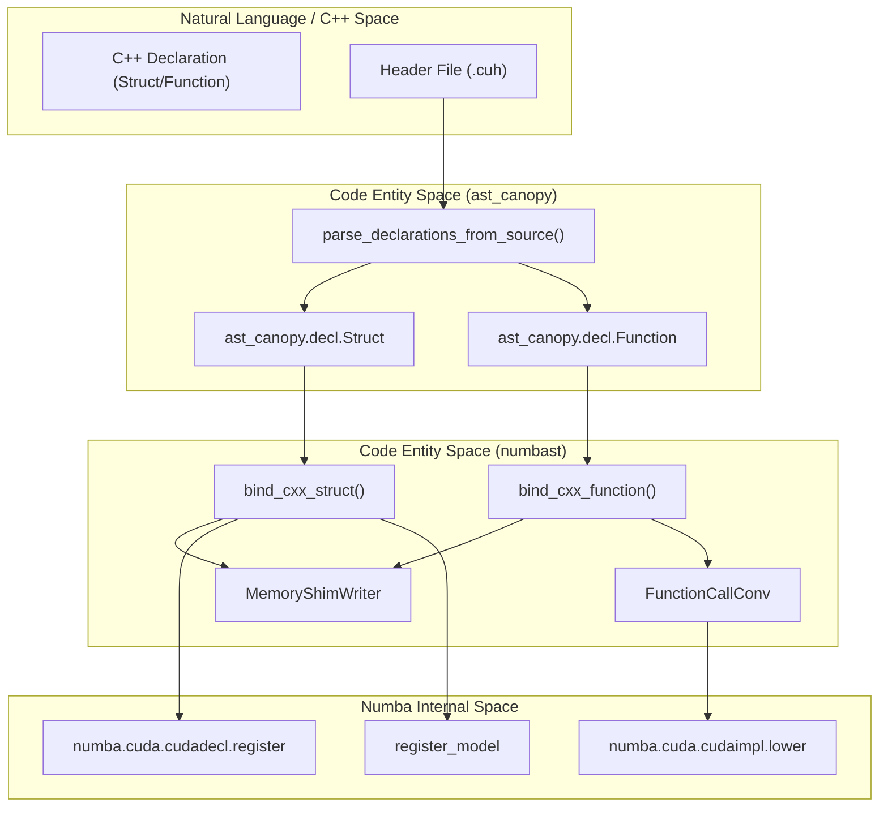
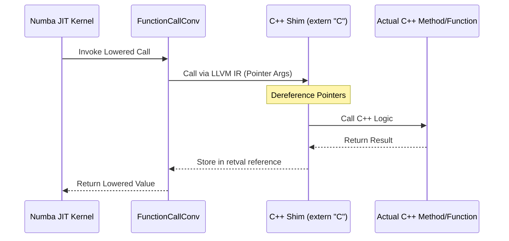

<!-- source: DeepWiki mcp.deepwiki.com · repo NVIDIA/numbast · page 3.1 Dynamic Binding: bind_cxx_struct and bind_cxx_function · fetched 2026-10-26 -->

# Dynamic Binding: bind_cxx_struct and bind_cxx_function

Relevant source files

The following files were used as context for generating this wiki page:

- [docs/source/api_reference.rst](docs/source/api_reference.rst)
- [docs/source/dynamic.rst](docs/source/dynamic.rst)
- [docs/source/supported_declarations.rst](docs/source/supported_declarations.rst)
- [numbast/src/numbast/function.py](numbast/src/numbast/function.py)
- [numbast/src/numbast/static/tests/data/src/struct.cu](numbast/src/numbast/static/tests/data/src/struct.cu)
- [numbast/src/numbast/static/tests/data/struct.cuh](numbast/src/numbast/static/tests/data/struct.cuh)
- [numbast/src/numbast/struct.py](numbast/src/numbast/struct.py)
- [numbast/tests/data/sample_name_override.cuh](numbast/tests/data/sample_name_override.cuh)
- [numbast/tests/data/sample_struct.cuh](numbast/tests/data/sample_struct.cuh)
- [numbast/tests/demo/demo.cuh](numbast/tests/demo/demo.cuh)
- [numbast/tests/demo/demo.py](numbast/tests/demo/demo.py)
- [numbast/tests/demo/test_demo.py](numbast/tests/demo/test_demo.py)
- [numbast/tests/test_bind_cxx_struct_name_override.py](numbast/tests/test_bind_cxx_struct_name_override.py)
- [numbast/tests/test_struct.py](numbast/tests/test_struct.py)

Dynamic binding generation allows Numbast to produce Numba-compatible bindings at runtime. This system parses C++ headers via `ast_canopy`, generates intermediate C++ shim code, and registers types, data models, and lowering functions directly into Numba's global registries. This mode is ideal for rapid prototyping and interactive development where a separate compilation step for bindings is undesirable [docs/source/dynamic.rst:1-12]().

## System Overview

The dynamic binding process bridges the gap between `ast_canopy` declarations and Numba's internal compiler machinery. It uses a `ShimWriter` to accumulate the necessary C-linkage wrappers required to call C++ methods and functions from LLVM IR [numbast/src/numbast/struct.py:27-34]().

### Data Flow: C++ to Numba Registry

The following diagram illustrates how a C++ declaration is transformed into a live Numba object during dynamic binding.

**Binding Transformation Pipeline**

**Sources:** [numbast/src/numbast/struct.py:63-128](), [numbast/src/numbast/function.py:125-155](), [docs/source/dynamic.rst:48-78]()

---

## Struct Binding Lifecycle

Binding a C++ struct via `bind_cxx_struct` involves a multi-stage lifecycle that configures how Numba perceives and interacts with the C++ type [numbast/src/numbast/struct.py:63-69]().

### 1. Type Creation and Data Model
Numbast creates a Python class representing the C++ struct and associates it with a Numba `Type`. The `register_model` function links this type to a `DataModel` (usually `StructModel` or `PrimitiveModel`), defining the memory layout in LLVM [numbast/src/numbast/struct.py:11-20]().

*   **Field Mapping:** `StructModel` layouts support POD fields, including fixed-size arrays, multidimensional arrays, and nested POD structs [docs/source/supported_declarations.rst:15-17]().
*   **Alignment:** Numbast honors C++ alignment attributes (e.g., `__attribute__((aligned(N)))`) during model registration [docs/source/dynamic.rst:29-30]().

### 2. Constructors (Ctors)
`bind_cxx_struct_ctor` generates a shim that uses C++ placement `new` to initialize the object [numbast/src/numbast/struct.py:36-42]().
*   **Lowering:** A `@lower` decorator is used to map the Python constructor call to a `FunctionCallConv` that invokes the shim [numbast/src/numbast/struct.py:120-128]().
*   **Converting Constructors:** If a constructor is marked as a converting constructor in the AST, Numbast also registers a `lower_cast` for implicit type conversion [numbast/src/numbast/struct.py:130-145]().

### 3. Methods and Attributes
*   **Regular Methods:** Instance methods are bound by passing a `self` pointer to a generated shim [numbast/src/numbast/struct.py:44-50]().
*   **Attributes:** Public fields are exposed for read access via `make_attribute_wrapper` [numbast/src/numbast/struct.py:14-15](), [docs/source/supported_declarations.rst:11-12]().

### 4. Name Overrides and Sanitization
When binding template specializations, the parsed name (e.g., `Vec`) may be insufficient. The `name=` parameter allows providing a fully qualified C++ name (e.g., `demo::Vec<float, 3>`) [numbast/tests/test_bind_cxx_struct_name_override.py:4-11]().
Since these names contain characters invalid in C symbols (like `<` or `:`), `_sanitize_c_identifier` replaces them with underscores for shim function names [numbast/src/numbast/struct.py:53-61]().

**Sources:** [numbast/src/numbast/struct.py:36-61](), [numbast/src/numbast/struct.py:150-190](), [docs/source/supported_declarations.rst:6-17]()

---

## Function Binding and Dispatch

Functions are bound using `bind_cxx_function`, which handles both free functions and operator overloads [numbast/src/numbast/function.py:45-50]().

### Function Dispatch Registry
Numbast maintains internal registries to manage overloads and Python-side function objects:
*   `overload_registry`: Maps function names to lists of Numba `Signature` objects [numbast/src/numbast/function.py:41]().
*   `func_obj_registry`: Maps function names to the Python-callable objects used in JIT kernels [numbast/src/numbast/function.py:42]().

### Operator Overload Mapping
C++ operators are automatically mapped to their Python equivalents (e.g., `operator+` becomes `operator.add`) [numbast/src/numbast/function.py:78-80]().

| C++ Operator | Python Operator | Numba Registry |
| :--- | :--- | :--- |
| `operator+` | `operator.add` | `@lower(py_op, ...)` |
| `operator-` | `operator.sub` | `@lower(py_op, ...)` |
| `operator*` | `operator.mul` | `@lower(py_op, ...)` |

**Sources:** [numbast/src/numbast/function.py:41-43](), [numbast/src/numbast/function.py:78-121]()

---

## Implementation Detail: Shim Generation

Every bound entity requires a C-linkage shim to bridge the Numba (LLVM) environment and the C++ ABI.

**Shim Execution Flow**

**Sources:** [numbast/src/numbast/function.py:25-31](), [numbast/src/numbast/struct.py:101-118](), [numbast/src/numbast/callconv.py:23]()

### Argument Intent Handling
`bind_cxx_non_operator_function` utilizes the `IntentPlan` system to determine how reference parameters are treated. By default, references are treated as input values, but they can be configured via `arg_intent` to be exposed as `CPointer` types or promoted to Python return values [numbast/src/numbast/function.py:168-200]().

**Sources:** [numbast/src/numbast/function.py:125-200](), [numbast/src/numbast/intent.py:26-27]()

---

