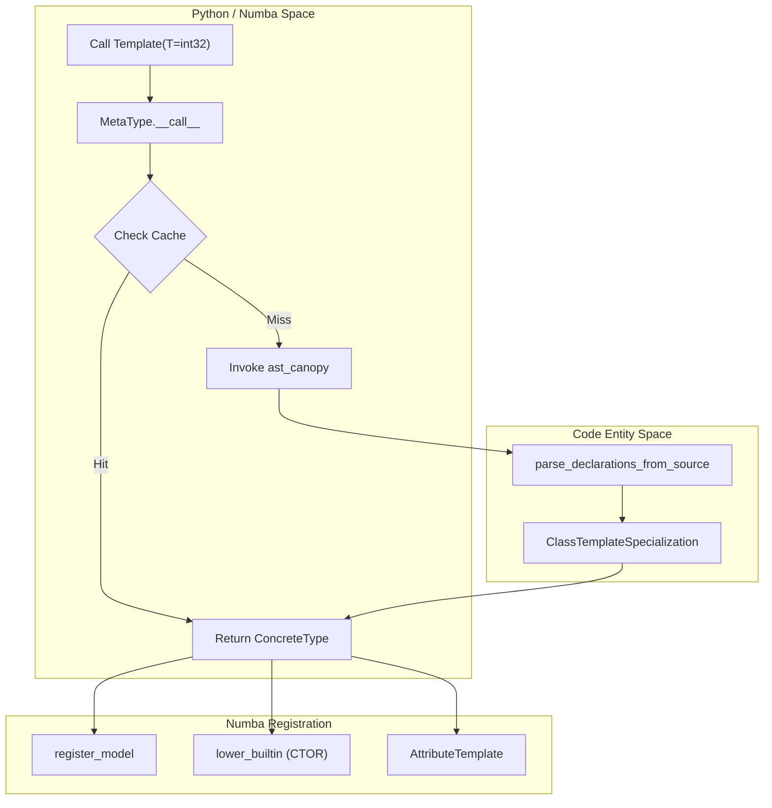
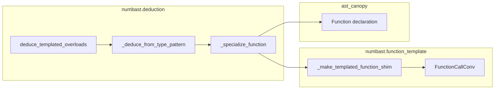

<!-- source: DeepWiki mcp.deepwiki.com · repo NVIDIA/numbast · page 3.2 Template Binding: Class and Function Templates · fetched 2026-10-26 -->

# Template Binding: Class and Function Templates

Relevant source files

The following files were used as context for generating this wiki page:

- [ast_canopy/ast_canopy/instantiations.py](ast_canopy/ast_canopy/instantiations.py)
- [ast_canopy/tests/test_class_template_specialization.py](ast_canopy/tests/test_class_template_specialization.py)
- [docs/source/argument_intents.rst](docs/source/argument_intents.rst)
- [docs/source/template.rst](docs/source/template.rst)
- [numbast/src/numbast/class_template.py](numbast/src/numbast/class_template.py)
- [numbast/src/numbast/deduction.py](numbast/src/numbast/deduction.py)
- [numbast/src/numbast/function_template.py](numbast/src/numbast/function_template.py)
- [numbast/src/numbast/overload_selection.py](numbast/src/numbast/overload_selection.py)
- [numbast/tests/data/sample_class_template.cuh](numbast/tests/data/sample_class_template.cuh)
- [numbast/tests/data/sample_function_template.cuh](numbast/tests/data/sample_function_template.cuh)
- [numbast/tests/test_class_template.py](numbast/tests/test_class_template.py)
- [numbast/tests/test_deduction.py](numbast/tests/test_deduction.py)
- [numbast/tests/test_function_template.py](numbast/tests/test_function_template.py)

This page explains how Numbast handles C++ class and function templates. Unlike non-templated entities, templates are bound using a two-tier system: **MetaTypes** (representing the unspecialized template) and **ConcreteTypes** (representing specific instantiations). Specializations are generated on-the-fly by invoking `ast_canopy` parsing during the Numba typing phase.

## MetaType vs. ConcreteType

Numbast distinguishes between the template definition and its concrete instantiations to integrate with Numba's type system.

| Concept | Implementation | Role |
|:---|:---|:---|
| **MetaType** | `MetaType` [numbast/src/numbast/class_template.py:86-90]() | A Numba type representing the unspecialized C++ class template. It acts as a factory. |
| **MetaFunctionType** | `MetaFunctionType` [numbast/src/numbast/class_template.py:92-96]() | A Numba type representing an unspecialized C++ function template. |
| **ConcreteType** | Numba `TypeRef` [numbast/src/numbast/class_template.py:73]() | A specific instantiation (e.g., `Foo<int, 32>`). These are cached and registered as standard Numba types. |

### System Data Flow: Template Specialization
The following diagram illustrates how a Python call to a template results in a concrete C++ specialization.

**Diagram: Template Specialization Flow**

Sources: [numbast/src/numbast/class_template.py:40-46](), [numbast/src/numbast/class_template.py:73-74](), [numbast/src/numbast/class_template.py:86-96]()

## Class Template Binding

Class templates are bound via `bind_cxx_class_templates`. When a class template is invoked in a `@cuda.jit` kernel, Numbast performs the following steps:

1.  **Template Argument Resolution**: It combines explicit keyword arguments (e.g., `Foo(T=np.int32)`) with arguments deduced from constructor parameters [docs/source/template.rst:63-74]().
2.  **Specialization**: If the specific combination of template arguments hasn't been seen, Numbast triggers `ast_canopy` to parse a temporary C++ snippet containing the specialization (e.g., `template class Foo<int, 128>;`) [ast_canopy/ast_canopy/instantiations.py:98-121]().
3.  **Caching**: The resulting `ClassTemplateSpecialization` is stored in `ConcreteTypeDeclCache`, and the Numba type is stored in `ConcreteTypeCache` [numbast/src/numbast/class_template.py:73-74]().
4.  **Member Binding**: Methods and fields of the concrete specialization are bound using the standard `bind_cxx_struct` logic, but specialized for the resolved types [numbast/src/numbast/class_template.py:166-184]().

### ConcreteTypeCache
To avoid redundant parsing and LLVM IR generation, Numbast maintains global caches for specialized types.
*   `ConcreteTypeCache`: Maps specialization parameters to Numba `TypeRef` [numbast/src/numbast/class_template.py:73]().
*   `ConcreteTypeDeclCache`: Maps specialization parameters to `ast_canopy` declaration objects [numbast/src/numbast/class_template.py:74]().
*   `clear_concrete_type_caches()`: Utility to reset these caches between test runs or sessions [numbast/src/numbast/class_template.py:80-83]().

Sources: [numbast/src/numbast/class_template.py:73-83](), [numbast/src/numbast/class_template.py:166-215](), [docs/source/template.rst:7-36]()

## Function Template Binding and Deduction

Function templates are bound using `bind_cxx_function_template`. They rely heavily on **Template Argument Deduction (TAD)** to select the correct overload and specialize types based on the Numba types of the call arguments.

### Overload Selection Logic
The function `_select_templated_overload` performs the initial filtering [numbast/src/numbast/overload_selection.py:13-34]():
1.  **Arity Matching**: It calculates the "visible arity" of each C++ overload, accounting for `ArgIntent` (e.g., `out_return` parameters are hidden from the Python signature) [numbast/src/numbast/overload_selection.py:39-53]().
2.  **Deduction**: It attempts to deduce template parameters for each candidate using `deduce_templated_overloads` [numbast/src/numbast/deduction.py:105-110]().
3.  **Ambiguity Check**: If multiple overloads match the arity and deduction succeeds for more than one, a `TypeError` is raised [numbast/src/numbast/overload_selection.py:68-72]().

### Template Argument Deduction (TAD) Implementation
The deduction engine in `numbast.deduction` mimics C++ TAD:
*   **Pattern Matching**: `_deduce_from_type_pattern` uses regex to match concrete Numba types against C++ template patterns (e.g., matching `float*` against `T*` deduces `T=float`) [numbast/src/numbast/deduction.py:91-122]().
*   **Consistency**: If a placeholder (like `T`) appears multiple times in a signature, all occurrences must deduce to the same type [numbast/src/numbast/deduction.py:155-157]().
*   **Substitution**: Once deduced, placeholders are replaced in the C++ function signature to create a specialized `Function` declaration [numbast/src/numbast/deduction.py:161-205]().

**Diagram: Deduction and Shim Generation**

Sources: [numbast/src/numbast/deduction.py:91-158](), [numbast/src/numbast/overload_selection.py:13-74](), [numbast/src/numbast/function_template.py:190-210]()

## Templated Methods

Methods within a class template can themselves be templated. Numbast handles this "nested" templating by:
1.  Resolving the class template specialization first.
2.  Treating the templated method as a function template bound to the specialized class instance.
3.  Resolving per-method `arg_intent` overrides during the method call [numbast/src/numbast/class_template.py:216-221]().

### Shim Generation for Templated Entities
Because the exact signature of a template specialization isn't known until runtime, shims for templated functions and methods are generated dynamically as strings and passed to the `ShimWriter`.

*   `_make_templated_function_shim`: Generates the `extern "C"` bridge function [numbast/src/numbast/function_template.py:71-102]().
*   `_make_templated_function_shim_arg_strings`: Handles complex C++ types like array references (`T (&arg)[N]`) during shim generation [numbast/src/numbast/function_template.py:107-187]().

Sources: [numbast/src/numbast/class_template.py:216-240](), [numbast/src/numbast/function_template.py:71-187]()

---

